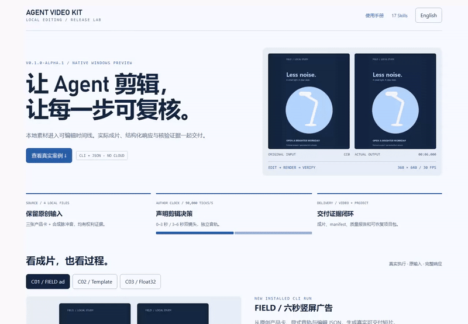
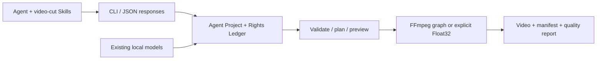
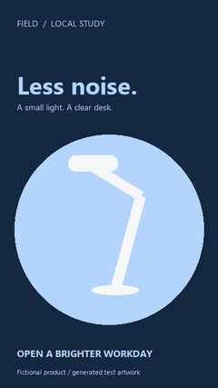

# Agent Video Kit

**A local video editing CLI for Agents.** Editable JSON timelines, explicit capability contracts and real render evidence for advertising edits, template variants, keyframes and video automation.

[简体中文](README.md) · [Download](https://github.com/Tonscriptions/agent-video-kit/releases/tag/v0.1.0-alpha.1) · [Documentation](docs/README.md) · [Manual](docs/releases/v0.1.0-alpha.1/USAGE.md) · [Skills](docs/releases/v0.1.0-alpha.1/SKILLS.md) · [Complete cases](docs/releases/v0.1.0-alpha.1/CASES.md)

**Release: `v0.1.0-alpha.1` — a native Windows CLI preview.** This milestone closes offline installation, structured editing, previews, rendering, checks and delivery. Full CapCut feature coverage, its asset ecosystem and perceptual equivalence remain future goals. [Release decision and open requirements](docs/releases/v0.1.0-alpha.1/RELEASE.md).



This is the local case documentation page replaying actual CLI logs. The product is a CLI; the page documents cases and responses. [Recording](docs/assets/release-v0.1.0-alpha.1-r2/workflow.mp4) · [Desktop screenshot](docs/assets/release-v0.1.0-alpha.1-r2/desktop.png) · [Mobile screenshot](docs/assets/release-v0.1.0-alpha.1-r2/mobile.png).

## Architecture and operation



The shipped implementation is a Python CLI, Agent Project schema and FFmpeg, with an explicitly selected native Float32 processing path. Concat informed earlier research; this release is this repository's Python implementation. Reused OpenFilm subtitle segmentation, frame-clock and HTML motion/template modules retain their provenance and licenses. No OpenFilm online service is required.

An Agent uses Skills to turn a brief into an edit plan, reads `capabilities` and `schema show`, then invokes the CLI. Projects retain assets, authored sequences, a Rights Ledger, snapshots and operations. Outputs include manifests and quality reports. The default renderer uses the existing FFmpeg graph. `settings.pixel_pipeline.engine = "float32-native-v1"`, with complete source/signal/budget declarations, explicitly selects its advertised subset; unsupported effects must be refused. The two paths have different coverage.

## Included capabilities

| # | Capability | Entry point | Release boundary |
|---|---|---|---|
| F01 | Projects, transactions, snapshots, recovery, relinking | `project` / `media relink` | Local projects with operation evidence |
| F02 | Ingest, probes, scenes/silence, thumbnails/waveforms | `media ingest/understand/prepare` | Local files; semantic tasks need explicit adapters |
| F03 | Multitrack, trim/split, range and linked edits, nesting | `timeline compose/edit` | Integer author ticks, clocks, locks and transactions |
| F04 | Keyframes, scale/pan/rotation, camera presets, effects | `effects list` + edit JSON | Advertised properties; not CapCut's full preset catalog |
| F05 | Source-handle transitions, speed curves, reverse, freeze | Timeline contracts | Implemented default-render combinations; newer Float32 transition candidates excluded |
| F06 | Masks, composition, color, HSL, LUT/1D shapers | Effects / `lut` / `surface` | Explicit Float32 source/working/delivery signals; no complete HDR/ICC claim |
| F07 | Subtitles, segmentation, word highlighting, HTML motion | `subtitle` / `motion` / timeline | Some commands need existing Node/Chromium |
| F08 | Audio extraction/mixing/buses/ducking, multicam sync | `audio` / audio tracks / `media multicam` | Author audio explicitly; perceptual audio review is separate |
| F09 | Template variables/batches, fragments, asset indexing | `template` / `fragment` / `library` | Existing local assets; no subscription library |
| F10 | Optional ASR/OCR/tracking/matting/repair adapters | Model registration and related commands | Weights and large inference runtimes are not bundled |
| F11 | Frame/range previews, queues, cancellation, scopes | `preview` / `queue` / `quality` | Budgets are not peak-RSS or real-time guarantees |
| F12 | Project packages, JSON, OTIO, MLT/plain draft exchange | `convert import/export` | Format-specific Exact/Approximate/Unsupported/Failed reports |

Use bundled `capabilities`, `schema show` and `COMMAND --help` for the exact supported contract. Plain draft adapters operate on existing authorized local JSON, do not run CapCut, and do not promise lossless compatibility with every proprietary effect. [Detailed manual](docs/releases/v0.1.0-alpha.1/USAGE.md).

## Installation

The verified profile is **native Windows x64 with CPython 3.13**. Existing `ffmpeg` and `ffprobe` must be on `PATH`. The asset contains the application and seven pinned dependency wheels, including Pillow and NumPy. Installation is offline, uses no virtual environment and does not modify global site-packages. Python, FFmpeg, Node, Chromium, CUDA and model weights are separate prerequisites.

```powershell
# Existing native CPython 3.13 x64 and ffmpeg/ffprobe on PATH are required.
# Extract the Windows release asset into E:\tools\agent-video-kit-v0.1.0-alpha.1.
Set-Location E:\tools\agent-video-kit-v0.1.0-alpha.1
$avkPython = 'C:\Python313\python.exe'
# Copy the exact manifest digest from the release's version.json / SHA256SUMS.txt.
$avkManifest = (Get-Content .\version.json -Raw | ConvertFrom-Json).manifest_sha256
& $avkPython -I -B -X utf8 .\bundle\install.py --target E:\tools\avk-alpha1 --manifest-sha256 $avkManifest
& $avkPython -I -S -B -X utf8 E:\tools\avk-alpha1\run.py doctor
& $avkPython -I -S -B -X utf8 E:\tools\avk-alpha1\run.py capabilities
```

Verify the ZIP and `version.json` against `SHA256SUMS.txt` on the release page first. A manifest digest detects changed contents; it is **not an author signature**. Other ABIs and platforms are unverified even where package metadata allows a lower Python version.

With development dependencies already installed, `./ai-ad-editor.ps1 doctor` runs from a source checkout. See the manual for offline builds, dependency troubleshooting, recovery and rollback.

## Minimal workflow

```powershell
$avkRun = 'E:\tools\avk-alpha1\run.py'
$avkProject = 'E:\video-work\first-ad'
& $avkPython -I -S -B -X utf8 $avkRun project init $avkProject --name 'First ad'
& $avkPython -I -S -B -X utf8 $avkRun media ingest --project $avkProject --input E:\media\product.mp4
# Use the returned data.asset.id in a locally authored changes.json.
& $avkPython -I -S -B -X utf8 $avkRun timeline compose --project $avkProject --input E:\video-work\changes.json
& $avkPython -I -S -B -X utf8 $avkRun validate --project $avkProject
& $avkPython -I -S -B -X utf8 $avkRun preview frame --project $avkProject --frame 0
& $avkPython -I -S -B -X utf8 $avkRun render --project $avkProject --output E:\video-work\first-ad\renders\ad.mp4
& $avkPython -I -S -B -X utf8 $avkRun quality check --project $avkProject --input E:\video-work\first-ad\renders\ad.mp4
```

Ingested rights default to unverified. Provide local license/provenance evidence before a commercial delivery, then run `rights check` and `render --publish`. **`--publish` is a local rights gate; it does not upload media.** The source and edit JSON in this example are supplied by you. [Reproducible cases](docs/releases/v0.1.0-alpha.1/CASES.md) include generated inputs, actual IDs, all commands and complete responses.

Agents must inspect the process exit code plus JSON `ok`, `status`, `errors`, `warnings` and `artifacts`. A dry plan is not a render. Use `--idempotency-key` only for commands implementing it; command-specific semantics remain authoritative.

## Real cases

| Case | Input → output | Complete artifacts |
|---|---|---|
| C01 / FIELD vertical ad | Original fictional-product cards + synthetic pulse → 6 s, 360×640 MP4 | [Input](docs/assets/release-v0.1.0-alpha.1-r2/input.mp4) · [Output](docs/assets/release-v0.1.0-alpha.1-r2/field.mp4) · [GIF](docs/assets/release-v0.1.0-alpha.1-r2/field.gif) · [Edit JSON](docs/validation/evidence/release-v0.1.0-alpha.1-r2/changes.json) · [Response](docs/validation/evidence/release-v0.1.0-alpha.1-r2/render.stdout.json) |
| C02 / Template variant | Parameterized template + replacement card → 3 s variant | [Template](docs/validation/evidence/release-v0.1.0-alpha.1-r2/template.json) · [Variables](docs/validation/evidence/release-v0.1.0-alpha.1-r2/variables.json) · [Output](docs/assets/release-v0.1.0-alpha.1-r2/variant.mp4) · [GIF](docs/assets/release-v0.1.0-alpha.1-r2/variant.gif) |
| C03 / Float32 color chain | Dated V112 synthetic source → 1D LUT/shaper and 3D LUT | [Input](docs/assets/float-shaper-20261023-installed-r1/original.mp4) · [Output](docs/assets/float-shaper-20261023-installed-r1/edited.mp4) · [Comparison](docs/assets/float-shaper-20261023-installed-r1/formal-comparison.gif) · [Receipt](docs/validation/evidence/float-shaper-20261023-lab/installed-r1/verification.json) |
| C04 / Delivery and refusal | Package export/import/validation and a rejected remote reference | [Export](docs/validation/evidence/release-v0.1.0-alpha.1-r2/export-package.stdout.json) · [Restored validation](docs/validation/evidence/release-v0.1.0-alpha.1-r2/restored-validate.stdout.json) · [Refusal](docs/validation/evidence/release-v0.1.0-alpha.1-r2/remote-refused.stdout.json) |



These new assets are locally generated graphics and synthetic audio, with zero new model inferences. C03 is dated historical evidence. GIFs carry no sound; automated decoding, static review, continuous playback and human listening are reported separately. [Provenance, hashes, inputs and reproduction](docs/releases/v0.1.0-alpha.1/CASES.md).

## 17 Agent Skills

| # | Skill | Purpose |
|---|---|---|
| 1 | `$video-cut-agent-editor` | Route editing work, initialize projects and deliver outputs |
| 2 | `$video-cut-timeline` | Author timelines, keyframes, camera moves, transitions and nesting |
| 3 | `$video-cut-quality` | Review pixels, masks, scopes and render evidence |
| 4 | `$video-cut-project-ops` | Manage snapshots, recovery, relinking and render queues |
| 5 | `$video-cut-local-policy` | Audit local-only execution and remote references |
| 6 | `$video-cut-rights-ledger` | Record and check media, font, model and template rights |
| 7 | `$video-cut-local-models` | Register and run existing offline model adapters |
| 8 | `$video-cut-video-understand` | Analyze scenes, silence, frame evidence and transcripts |
| 9 | `$video-cut-template-library` | Apply templates, index assets and reuse edited clip groups |
| 10 | `$video-cut-long-to-short` | Turn talks or lessons into reviewed short clips |
| 11 | `$video-cut-screen-demo` | Edit screen demos with action anchors and zooms |
| 12 | `$video-cut-reference-remake` | Rebuild reference pacing and layout using replacement assets |
| 13 | `$video-cut-ffmpeg` | Perform general local FFmpeg media operations |
| 14 | `$video-cut-video-edit` | Trim, concatenate, resize and compress local media |
| 15 | `$video-cut-ad-creative` | Plan ad copy, hooks and creative variants |
| 16 | `$video-cut-video-content-strategist` | Plan content direction, scripts and channel strategy |
| 17 | `$video-cut-campaign-analytics` | Analyze supplied campaign data |

```powershell
.\register-video-cut-skills.ps1
```

Registration creates Windows junctions from the current checkout to the user's Codex Skills directory and preserves conflicting unrelated entries. Skills provide task guidance; the bundle does not install an Agent host, subscription assets or commercial models. [Inputs, outputs, dependencies and routing](docs/releases/v0.1.0-alpha.1/SKILLS.md).

## Verification

| ID | Check | Observed result | Evidence and limits |
|---|---|---|---|
| R01 | Baseline full regression | **2,930 passed; 0 skipped**, 6991.508 s | [2026-10-23 receipt](docs/validation/evidence/float-shaper-20261023-lab/full-r1.json); this release rechecks identical 331 frozen inputs, rather than claiming a new full run |
| R02 | Previous V112 fresh installation | **118 methods; 197 product resources** | [Receipt](docs/validation/evidence/float-shaper-20261023-lab/installed-r1/verification.json); overlaps the full suite, not additive |
| R03 | Newly rebuilt and installed release | Eight pinned wheels, isolated `-I -S` launch | [Release gate](docs/validation/evidence/release-v0.1.0-alpha.1-r2/release-verification.json); Windows/CPython 3.13 x64 |
| R04 | New ad and template cases | Real inputs, encoded outputs, GIFs, responses and package round trip | [New case receipt](docs/validation/evidence/release-v0.1.0-alpha.1-r2/verification.json); synthetic media, zero new inference |
| R05 | Local policy refusal | Nonzero exit and structured error for remote provenance | [Actual response](docs/validation/evidence/release-v0.1.0-alpha.1-r2/remote-refused.stdout.json) |
| R06 | Documentation UI and recording | Desktop/mobile captures, interaction checks, log replay | [Browser receipt](docs/validation/evidence/release-v0.1.0-alpha.1-r2/browser-verification.json); documentation UI, not an editor GUI or live terminal recording |
| R07 | Skills and links | All 17 entry formats and release-document local links checked | [Gate](docs/validation/evidence/release-v0.1.0-alpha.1-r2/release-verification.json); format validation is not behavioral quality proof |
| R08 | Preserved failed first case run | Incorrect relative output path in the case driver | [Failure](docs/validation/evidence/release-v0.1.0-alpha.1-r1/failure.json); corrected to an absolute in-project path before rerunning |

## Limitations and next milestones

This alpha supports reproducible local workflows in the stated environment. Full CapCut effect/transition/library coverage, broad natural-media picture and audio quality, HDR/ICC, long-form peak memory and interactive performance, other platforms/ABIs and universal lossless draft compatibility remain unaccepted.

Next priorities are renderer capability consistency, natural-media playback and perceptual review, performance/cancellation/recovery, then broader templates and model coverage. R113/R114 Float32 transition/runtime-closure candidates and later adjustment experiments are excluded. [Release scope, gates, risks and roadmap](docs/releases/v0.1.0-alpha.1/RELEASE.md).

## Documentation, contributions and licensing

- [Manual](docs/releases/v0.1.0-alpha.1/USAGE.md), [Skills](docs/releases/v0.1.0-alpha.1/SKILLS.md), [cases](docs/releases/v0.1.0-alpha.1/CASES.md), [release notes](docs/releases/v0.1.0-alpha.1/RELEASE.md), and [all documentation](docs/README.md). Release-specific guides are bilingual; older research/specifications are primarily Chinese.
- [Product baseline](docs/产品需求与开发路线基线_2026-10-12.md), [system architecture](docs/architecture/系统边界与模块契约_v0.1_2026-10-13.md), and [machine-readable schema](docs/specs/agent-project.schema.json).
- [Complete historical numbered verification log](docs/releases/v0.1.0-alpha.1/history/README.zh.pre-release.md) and [historical index](docs/releases/v0.1.0-alpha.1/history/docs-index.pre-release.md). Dated counts are retained rather than added together.
- Original code/documentation is [MIT licensed](LICENSE). Vendored projects, Skills, models, fonts and media retain their separate terms. [Third-party notices](docs/releases/v0.1.0-alpha.1/THIRD_PARTY.md). The Rights Ledger records evidence and gates work; it does not automatically establish legal clearance.
- Issues should include version, a minimal shareable project, actual command/error, manifests and tool versions. Changes maintain `main`, both READMEs and evidence. See the manual for the native frozen-regression entrypoint.
