# Agent Video Kit

面向 Agent 的本地视频广告编辑内核。项目使用原生 Windows、Python 和本地 FFmpeg，通过 CLI、结构化 Agent Project JSON、Skills 和可审计的素材权利台账完成广告剪辑流水线；当前工作区位于 `E:\dev\sandbox\AI广告剪辑`。

项目明确不依赖剪映/Jianying 私有运行时、登录态、闭源线上服务、Docker、WSL 或其他虚拟化环境。网络默认关闭，模型、媒体和字体必须从显式本地路径提供。

## 功能核验与真实实测

本表随功能和验证结果同步更新。**功能执行、实际内容、自动质量与听感分别验收，失败记录保留。** 本轮 V33：OpenFilm O02 整片段规划子集已适配为本地 Python，提供关联/解关联、同步锁、主轨骑乘跟随、共同闭隙与平移；不引入上游 GUI/Node/网络。完整 **695/695，1329.624 秒**，0 跳过；113 Python+1 Schema+1 打包配置+1 MIT 原文共 116 文件冻结，31 新增/132 关联均为完整子集。九组/187 CLI（177 成功、10 预期拒绝），360 新帧与编辑前/手工参考分计，216 万个新立体声采样帧的独立混音最大差 0。固定上游 80/80 数据对照另计；固定 V32 同测 31 方法均失败、含子测试 53 条记录。视频手工参考使用同一渲染器；59 视频/69 音频复核、GIF/原片和九条开发记录公开，未连续播放/听审。源边缘裁切、插入/覆盖、完整磁吸重排、长片/自然质量与完整剪映等价仍未完成。 历史行按当轮结果保留。

| 编号 | 功能 | 已执行的核验与实测结果 | 当前边界 | 证据 |
|---|---|---|---|---|
| V01 | 多轨剪辑、关键帧、运镜、转场、蒙版、音频 | 多轨演示批次通过正式 CLI 导入 4 个自制资产，应用 push-in、HSL、0.5 秒交叉淡化、动态羽化圆形蒙版、透明标题图层和音频淡入淡出；输出 5.5 秒、640×360、30 fps、165 帧 MP4，渲染 warning 为 0 | 合成样例证明功能可运行，未代表自然广告画质；标题为图片叠加 | [原片与 GIF/MP4](#实测演示素材)、[14 次 CLI 记录](docs/assets/readme-20261016/verification.json) |
| V02 | 渲染质量检查 | 上述 MP4 音画时长差 0 ms、未检出黑帧、真峰值 −24.3 dBFS；GIF 55 帧、10 fps、5.5 秒，时长一致 | 音画时长差不等于口型同步；没有听审或目标广告响度验收 | [质量与媒体探测](docs/assets/readme-20261016/verification.json) |
| V03 | 项目与素材便携交换 | 多轨演示批次正式导出项目包、导入新目录，严格权利/项目校验通过；包内保留素材、时间线及 Rights Ledger | 外部 Python、FFmpeg、模型不随包分发；未据此验证跨设备运行 | [可下载项目包](docs/assets/readme-20261016/cli-showcase.aevpkg.zip)、[复现说明](docs/validation/README功能核验与实测演示_2026-10-16.md) |
| V04 | 本地策略与权利门禁 | 多轨演示批次自制素材经严格权利校验和 `render --publish`；策略扫描 12 文件、0 发现。既有模型实测中未核验权利按预期阻断发布 | 权利字段通过不替代外部许可核验；自然人物原片尚不公开 | [多轨演示批次证据](docs/assets/readme-20261016/verification.json)、[素材来源](docs/assets/readme-20261016/fixture-provenance.json) |
| V05 | Whisper 中文转写 | 本地 CPU/CUDA 已实跑；38.04 秒输入得到 15 段字幕，末段到 38.02 秒；选定中文样例 CER 2% | 单一语料结果，繁简差异单列；广泛字幕质量待验收 | [实测](docs/validation/Whisper中文离线转写实测_2026-10-15.md) |
| V06 | SoulX 中文配音 | 本地 CUDA 真实生成 3.44 秒中文语音，完成音轨应用、渲染和质量/策略检查 | 多声线、情绪、长期听感及声源许可待验收 | [实测](docs/validation/SoulX中文离线配音实测_2026-10-15.md) |
| V07 | YOLO 跟踪、标签绑定、重构图 | 受控双目标 29/32 次观测；标签绑定与横/竖成片已实渲，组合几何回归定位误差 ≤3 px | 自然遮挡、交叉身份恢复与完整嵌套坐标空间待验收 | [模型实测](docs/validation/YOLO本地多目标跟踪与重构图实测_2026-10-15.md)、[组合实测](docs/validation/跟踪坐标绑定与组合渲染实测_2026-10-15.md) |
| V08 | HDemucs 人声/伴奏分离 | CPU/CUDA 对同一 12.68 秒语音与合成伴奏实跑；SI-SDR 改善约 12.66 dB，分离结果完成入轨和成片 | 自然音乐、听审和模型商业许可待验收 | [实测](docs/validation/HDemucs本地人声伴奏分离实测_2026-10-16.md) |
| V09 | RVM 人物抠像 | 3 秒/36 帧样例输出软 alpha MOV、两背景 MP4 和透明 WebM，音频链路完成 | 首帧边缘缺失，手持头盔被排除；广泛画质未通过 | [实测](docs/validation/RVM本地人物抠像与透明成片实测_2026-10-16.md) |
| V10 | SAM2 点/框、多对象与提示修正 | 原生 CPU/CUDA、选择/修正/重置、自然双人 32 帧、概率蒙版及两背景成片已实跑；前轮在同一场景新增一次 CUDA 修正，5 个明确检查点从 3 个通过到 4 个通过 | **修正后仍失败**：目标手腕继续漏选；保留人物前臂从误选变为排除，不代表完整选区改善 | [前序实测](docs/validation/SAM2本地对象分割与提示修正实测_2026-10-16.md)、[此前逐点实测](docs/validation/本地蒙版范围与正负检查点实测_2026-10-16.md) |
| V11 | LaMa / VACE 修复与色差融合 | 显式 harmonic 受控选区 PSNR 分别 47.45 / 42.90 dB；自然 32 帧链路完成，蒙版外 RGB 与全部 alpha 保留，PCM 原声独立核对一致 | **自然人物移除画质未通过**：残影、纹理涂抹或色块仍存在；VACE 为实验能力 | [实测](docs/validation/本地区域色差融合实测_2026-10-16.md)、[机器证据](docs/validation/evidence/repair-blend-smoke-20261016.json) |
| V12 | 背景参考传播研究 | 单表面 PSNR 30.878→31.124 dB；双表面合计 **33.448→33.410 dB，略退化**。22 项独立研究检查通过；公开原输入和逐帧对照 | **未接入产品**；人工遮挡真值不代表真实人物移除，自然画质未通过 | [研究 GIF/MP4](#实测演示素材)、[实测](docs/validation/本地多运动参考选择与双表面真值实测_2026-10-16.md) |
| V13 | 产品自动回归 | 完整 **695/695，1329.624 秒**，0 跳过；116 文件冻结（113 Python、Schema、pyproject、MIT）；31 新增/132 关联为子集；固定 V32 同测 31 方法均失败，含子测试 53 条记录 | 新命令缺失的旧版失败不等于画质差异；原上游 123、当前 80 数据对照、开发/媒体分计；自然质量与完整剪映未验 | [完整日志](docs/validation/evidence/linked-edit-final-v2-full-20261017.log)、[机器证据](docs/validation/evidence/linked-edit-20261017.json) |
| V14 | 编码蒙版范围与正负检查点 | 新增 `quality mask`：逐帧面积/包围框/IoU、明确 selected/clear 检查。自制 4 秒/32 帧样例准确报出第 12 帧缺腿；补全几何后 4 点通过，失败报告及退出码 2 保留；原始 alpha 全帧摘要匹配 | 补全样例为脚本恢复几何，非 AI 修复；检查点不证明完整身份/边缘/自然质量。自然样例修正后仍有 1 点失败 | [原蒙版与 GIF/MP4](#实测演示素材)、[实际 CLI 与媒体证据](docs/assets/mask-review-20261016/evidence.json)、[实测](docs/validation/本地蒙版范围与正负检查点实测_2026-10-16.md) |
| V15 | 编码蒙版驱动轨迹、标签与重构图 | 16 次正式 CLI，4 秒/64 帧/16 fps；逐帧 bbox 与自制真值一致。标签位置最大误差：横屏 1.64 px、缩放旋转后 2.14 px、竖屏 2.15 px；包和源/蒙版权利依赖保留 | 自制选区不是模型分割能力。自然 SAM2 仍 4/5 检查点通过；该轮标签 4.10 px 失败，后续 V17 重验通过标签门槛，分割持续未验收 | [原视频与 GIF/MP4](#实测演示素材)、[全帧测量](docs/assets/mask-track-20261016/evidence.json)、[自然失败实测](docs/validation/本地蒙版驱动锚定与重构图实测_2026-10-16.md) |
| V16 | 透明标签合成与失败报告 | 抽帧发现 PNG 的 fit 补边变黑；新增像素回归先失败，修复后 PNG/alpha MOV 通过，公开 64 帧两侧 128 区域核对。检查点失败仍保存诊断、回滚项目 | 位置准确不证明合成正确；修复前原片与失败日志保留；该轮自然标签失败，后续 V17 补充缩放修复与重验 | [修复前原成片](docs/assets/mask-track-20261016/before-alpha-fix-bound.mp4)、[前后证据](docs/validation/本地蒙版驱动锚定与重构图实测_2026-10-16.md) |
| V17 | 透明素材缩放边缘与自然标签复验 | 正式 CLI 对照同 alpha/可见 RGB、仅隐藏黑/绿不同的标签：旧成片最大差 64，新成片全 32 帧 RGB 差为 0；自然标签最大误差 **4.0954→2.0650 px**，超 3 px 帧 **5→0**，0 新推理 | V17 当轮覆盖 PNG/MOV/pal8、适配和标量；V18 补入仿射/动态 crop/文字源。线性光、性能与自然蒙版仍未验收 | [原视频与 GIF/MP4](#实测演示素材)、[全帧/源码证据](docs/assets/alpha-resize-20261016/evidence.json)、[自然复验与原失败](docs/validation/透明素材缩放边缘与标签精度实测_2026-10-16.md) |
| V18 | 仿射、动态裁切与文字透明合成 | 16 次正式 CLI，32 帧组合运镜/文字：白底最大 RGB 误差 **255→3**、隐藏色差 **72→0**；复用 RVM 人物照片平移短片 36 帧，fit 补边误差最大降到 **1.33**；SAM2 标签仍≤3 px | 人物素材无自然人体运动或真值 matte；原人体/手持物缺失和 SAM2 手腕失败保留；一般畸变、线性光/HDR、4K 性能与完整质量未验收 | [原视频与 GIF/MP4](#实测演示素材)、[实际全帧证据](docs/assets/alpha-geometry-20261016/evidence.json)、[人物复用与限制](docs/validation/仿射动态裁切与文字透明合成实测_2026-10-16.md) |
| V19 | 嵌套变速、倒放与原关键帧时钟 | 23 次正式 CLI、5 次额外交付检查；五组前后成片共 172 个新输出帧，主样例源帧误差 **13→0**，缩放宽度误差 **42.8821→0.9831 px**；五组新脉冲包络均无不匹配 | 多段样例仍最大差 1 个源帧；CFR、hold/linear 受控验收。V19 当轮速度 easing 后续见 V20；音频相位、VFR、定格/字幕 cue、群组空间和自然质量待验收 | [原视频与 GIF/MP4](#实测演示素材)、[逐帧证据](docs/assets/nested-time-20261016/evidence.json)、[实测与失败记录](docs/validation/嵌套变速倒放与关键帧时钟实测_2026-10-16.md) |
| V20 | 速度 easing/Bezier 与有界源时钟 | 31 次生成 CLI、7 次额外交付检查；七组新输出 336 帧，旧最大 2–7 帧误差降为 0；原动画宽度 **8.1369→0.9911 px**。独立参数域积分复核编译界，额外三帧 PTS 保留长时低速修复证据 | 本批为受控 CFR；250 μs 是单曲线未归一化积分上界。端点速度 floor、资源门限、VFR、音频相位/听感、定格/字幕和完整群组待验收 | [原视频与 GIF/MP4](#实测演示素材)、[逐帧记录](docs/assets/speed-easing-20261016/evidence.json)、[独立实测与边界](docs/validation/速度Easing与Bezier原时钟实测_2026-10-16.md) |
| V21 | 嵌套字幕与文字动画时钟 | 105 次 CLI，448 主帧+288 校准帧；高亮/打字机/文件 cue 不匹配降至 0，亮度误差≤0.0133；旋转 6 姿态通过；本地字体、源帧/脉冲独立核对 | **V21 当轮高亮字形偏移、排版未通过，后续 V22 独立重验**；动态尺寸内嵌透明度近似，定格/VFR/文件动画/整体质量未验收 | [原片/GIF/MP4](#实测演示素材)、[全帧证据](docs/assets/subtitle-clock-20261016/evidence.json)、[失败与复现](docs/validation/嵌套字幕与文字动画原时钟实测_2026-10-16.md) |
| V22 | 逐字高亮原生排版与颜色选择 | 九组 632 主帧+632 普通对照帧；旧最大 R/G 差 51–255→2；逐词激活/串色、源帧和脉冲均 0 不匹配；90 次生成 CLI+9 次额外策略审计 | 受控样例通过；CJK 仅四字，动态内嵌高亮显式降级；任意透明度/复杂排版/完整质量未验收；两段开发失败保留 | [原片/GIF/MP4](#实测演示素材)、[全部九组与失败](docs/validation/逐字高亮原生排版与真实成片实测_2026-10-16.md)、[机器证据](docs/validation/evidence/word-layout-20261016.json) |
| V23 | 文字颜色、样式透明度与实际合成 | 九组 632 新主帧+1480 空白/覆盖率对照；RGB 最大误差 9.93–54.91→2.22–3.61；123 次 CLI 含 39 渲染/9 质量/9 策略；字色/框/描边/阴影、淡入、图层 opacity、逐词替换 | 受控 8-bit 子项通过；动态内嵌颜色显式近似；V23 当轮逐词+动画未验，后续 V24 补测；ASS、HDR/广泛质量未验收；保留旧版失败和首轮回归失败 | [原片/GIF/MP4](#实测演示素材)、[九组误差与复现](docs/validation/文字颜色透明度与实际合成实测_2026-10-16.md)、[机器证据](docs/validation/evidence/text-paint-20261016.json) |
| V24 | 文字动画×高亮与原生前缀打字机 | 2026-10-17：12 组/846 主帧+1818 控制；160 CLI 含 50 渲染；组合 R/G≤2、逐字/词状态 0 不匹配；11 组交付通过 | **V24 当轮 1 组尾帧背景消失，交付失败；后续 V25 同源复验已修复**；分数帧率仅 90 帧样例；动态内嵌/复杂塑形/整体质量未验 | [原片/GIF/MP4](#实测演示素材)、[全部编号样例和失败](docs/validation/文字动画高亮组合与原生打字机实测_2026-10-17.md)、[机器证据](docs/validation/evidence/text-animation-20261017.json) |
| V25 | 嵌套裁切、倒放与首尾帧覆盖 | 2026-10-17：10 组/496 新主帧+116 控制；85 CLI 含 22 渲染；视频可见性 0 不匹配、源帧≤1；V24 尾帧恢复；8 组交付通过 | **V25 当轮 2 组极短音频全静音，交付失败**；V26 显式 R3 有声但音高仍失败；非整帧时长/VFR/整体质量未验 | [原片/GIF/MP4](#实测演示素材)、[10 组编号和失败](docs/validation/嵌套视频帧区间与结束时钟实测_2026-10-17.md)、[机器证据](docs/validation/evidence/nested-frame-coverage-20261017.json) |
| V26 | 本地整段离线音频变速与高精度 PCM | 2026-10-17：8 组/72 CLI 含 24 渲染；210 新主帧+210 精度控制；MKV 24/32-bit/float PCM、倒放、Bezier、采样/声道、缓存复现/篡改/取消；4 组受控通过 | **4 组极短音高失败**；8 组质量 CLI 通过不等于听感通过；未配置仍走 atempo，瞬态/相位/完整质量未验 | [原片/音频/GIF/成片](#实测演示素材)、[八组编号与失败](docs/validation/离线音频伸缩与真实采样实测_2026-10-17.md)、[机器证据](docs/validation/evidence/offline-audio-stretch-20261017.json) |
| V27 | R3 声道策略与立体声取舍 | 2026-10-17：20 组/180 CLI 含 60 渲染；516 新主帧+516 精度控制；默认 10 组与固定 V26 音频一致；显式 together/apart、mono/静音声道、反相、缓存；11 组受控通过 | **8 组极短音高失败、1 组 apart 反相混合失败**；20 组质量 CLI 通过不等于内容/听感通过；全功能剪映对标未完成 | [原视频/双声道/GIF/成片](#实测演示素材)、[20 组编号与失败](docs/validation/R3声道策略与立体声权衡实测_2026-10-17.md)、[机器证据](docs/validation/evidence/audio-channels-20261017.json) |
| V28 | 嵌套序列隔离合成、父枢轴与透明混合 | 2026-10-17：14 组/112 CLI（28 渲染、14 质量、14 策略）；360 新主帧与 360 独立参考全像素核对，最大 RGB 差 3；固定 V27 12 组失败/2 控制；另有 57 帧开发回归对照 | 已测空间子项通过；组级音频/独立子画布/定格/VFR/HDR/长片性能仍未验收；既有音高/相位失败保留，未连续播放或听审 | [原片/GIF/实际成片](#实测演示素材)、[14 组编号与失败记录](docs/validation/嵌套序列隔离合成与逐帧像素实测_2026-10-17.md)、[机器证据](docs/validation/evidence/sequence-groups-20261017.json) |
| V29 | 分层音频总线、后置效果与采样包络 | 2026-10-17：12 组/102 CLI（24 渲染/12 质量/12 策略）；1,152,000 新立体声采样帧全检查，最大差 0≤2e-6；288 新主视频帧与旧版像素一致；旧版 11 组失败/1 控制 | 浮点求和改变旧多轨音量，无自动限幅；V29 当轮 DC 诊断 82 个零采样帧失败，后续 V30 同源受控重验通过；极短音高/相位及听感未验收；命名路由/空间音频未完成 | [原视频/WAV/GIF/成片](#实测演示素材)、[12 组编号与失败](docs/validation/分层音频总线与真实采样实测_2026-10-17.md)、[机器证据](docs/validation/evidence/audio-buses-20261017.json) |
| V30 | 分段音频上下文、实际尾部与资源拒绝 | 2026-10-17：11 组/88 CLI（22 渲染/11 质量/11 策略）；396 新视频帧与旧版相同；1,584,000 新立体声采样帧按声明条件检查；六组 DC 全有效区间通过、T01 内部零帧 82→0；S01 另 6 CLI 按预期拒绝超预算 | 分段近似/极短输入补静音边界保留；通用音高/相位/瞬态、自然声音、听感与完整剪映未验；开发尾部缺样及错误参考公开 | [原视频/WAV/GIF/新旧成片](#实测演示素材)、[11 组编号及失败记录](docs/validation/分段音频上下文与完整尾部实测_2026-10-17.md)、[机器证据](docs/validation/evidence/tempo-context-20261017.json) |
| V31 | 独立序列画布与原生父投影 | 2026-10-17：九组/65 CLI，216 新主帧；C01–C08 全像素最大 RGB 差 ≤2（门槛 5），C09 与固定 V30 字节一致；fit/fill/锚点/裁切/父子蒙版/多级画布；选中子级导出、quality/queue 和尺寸互操作通过 | 168 独立参考帧、24 字形投影帧、24 兼容控制分计；高频抗锯齿、独立 FPS/色域/SAR、长片资源与完整剪映未验；未连续播放/听审，开发失败保留 | [原输入与 GIF/MP4](#实测演示素材)、[九组实测](docs/validation/独立序列画布与原生坐标投影实测_2026-10-17.md)、[机器证据](docs/validation/evidence/sequence-canvas-20261017.json) |
| V32 | 序列面积采样与投影工作配额 | 2026-10-17：九组/74 CLI（72 成功、2 预期拒绝），144 area 帧；最大 RGB 差 4≤4，三像素周期纹理均值误差 85→0；默认九组与固定 V31 像素一致；分数裁切/动画/软 Alpha/父蒙版、queue/quality/resume 和前置配额 | 只验源轴矩形核；144 旧帧/144 默认/144 参考分计；配额不是进程 RSS；叶采样/深层 area/HDR/长片/自然质量/完整剪映未验；开发夹具及标题失败保留，未连续播放/听审 | [原输入与四列 GIF/MP4](#实测演示素材)、[九组实测](docs/validation/序列面积采样与工作配额实测_2026-10-17.md)、[机器证据](docs/validation/evidence/sequence-sampling-20261017.json) |
| V33 | 关联剪辑、同步锁与主轨联动 | 2026-10-17：九组/187 CLI，360 新帧/216 万立体声采样帧，手工时间线画面一致、独立 PCM 最大差 0；字幕重复移位/clip 基准/倒放、锁定/短移/冲突轨、旧摘要/幂等/回滚；固定上游 80/80 数据另计 | 只做整片段；不含源边缘裁切、insert/overwrite/完整磁吸；markers 绝对；效果/闪避音频换轨拒绝；视频参考同一渲染器，未连续播放/听审；失败保留 | [原片/GIF](#实测演示素材)、[实测与边界](docs/validation/关联剪辑与主轨联动真实音画实测_2026-10-17.md)、[机器证据](docs/validation/evidence/linked-edit-20261017.json) |

## 开源复用核查

2026-10-17 固定检查 OpenFilm `b138595d`，当次 API 快照 704 stars；代码 MIT。O02 的**整片段关联/同步锁/联动规划**已进入 V33；O01 字幕分句待接入，HTML 动效与 `look` 自检仍为可选后端。前两项适配约 **7–13 人日**、相同范围从头约 15–24 人日，均为初步工程估算，不是全项目节省比例。

| 编号 | 核验内容 | 真实结果 | 状态与边界 | 证据 |
|---|---|---|---|---|
| R01 | OpenFilm 源码、许可证、无 GUI 拆分及数据输出 | 历史原模块 58/58；Hook 分离副本 65/65；619 原文件 SHA 一致。后续 O02 整片段子集已进入 V33，80 组固定上游数据对照另计 | 研究 123 项不与产品回归相加；O01 字幕分句、HTML 后端及其余模块仍未集成；原 React 依赖失败保留 | [12 项模块/成本](docs/OpenFilm源码拆解与复用成本评估_2026-10-17.md)、[原研究证据](docs/validation/evidence/openfilm-reuse-20261017.json)、[V33](docs/validation/关联剪辑与主轨联动真实音画实测_2026-10-17.md) |

实际数据：[字幕原输入](docs/validation/evidence/openfilm-reuse-20261017/S01-subtitle-input.json) → [三段输出](docs/validation/evidence/openfilm-reuse-20261017/S01-subtitle-output.json)；[跨轨删除原模型](docs/validation/evidence/openfilm-reuse-20261017/S02-ripple-input.json) → [操作计划/实际结果/手工预期](docs/validation/evidence/openfilm-reuse-20261017/S02-ripple-output.json)。字幕无词标的时间为估算。原 CLI/Skill 连接 Studio、npx latest 与服务商；选用模块需改为固定本地入口、强制离线并保留原版权。GUI 目录内的纯规划算法可提取；上游不是完整剪映或本地 AI 特效替代内核。

## 实测演示素材

**正式产品 CLI V33：关联剪辑、同步锁与主轨联动。** 三列依次为编辑前作者输入 / CLI 实际输出 / 手工时间线参考。四行展示同步删除、字幕跟随、保留音量的冲突换轨和连续移位 SRT；参考视频使用同一渲染器，音频另做独立 PCM 求和。

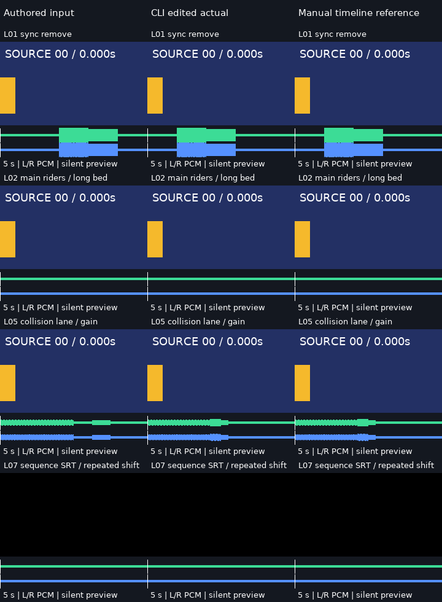

[自制原片](docs/assets/linked-edit-20261017/source.mp4) · [编辑前](docs/assets/linked-edit-20261017/L01-input.mp4) · [同步删除成片](docs/assets/linked-edit-20261017/L01-after.mp4) · [冲突换轨成片](docs/assets/linked-edit-20261017/L05-after.mp4) · [字幕成片](docs/assets/linked-edit-20261017/L07-after.mp4) · [三列 MP4](docs/assets/linked-edit-20261017/comparison.mp4) · [九组与失败](docs/validation/关联剪辑与主轨联动真实音画实测_2026-10-17.md)。

公开 175 文件及来源/SHA，原片/每组为 240×136、8 fps、40 帧/5 秒；三列预览 720×980、40 帧/5 秒，无声，GIF **20 编码帧/5000 ms**。360 新输出帧、360 输入、360 手工参考和 40 固定 V32 控制帧分计；216 万新立体声采样帧最大误差 0。59 视频/69 音频已重新解码，首/中/末图静态目检，**未连续播放或听审**。原声与无损 MKV 有声，AAC MP4 仅供播放。[字体/CC0 来源](docs/assets/linked-edit-20261017/fixture-provenance.json)、[包与原始 CLI 记录](docs/validation/关联剪辑与主轨联动真实音画实测_2026-10-17.md#3-原片gif工程及复现)、[完整证据](docs/validation/evidence/linked-edit-20261017.json)。主轨磁吸重排、源边缘裁切及完整剪映等价未验收。

**历史正式产品 CLI V32：高频缩小与透明面积采样。** 从左至右为固定 V31 / 当前默认双线性 / 显式 area / 独立单元重叠参考。三像素黑/黑/白纹理的三倍缩小均值误差由 85 降为 0；九组最大 RGB 差 4（门槛 4）。

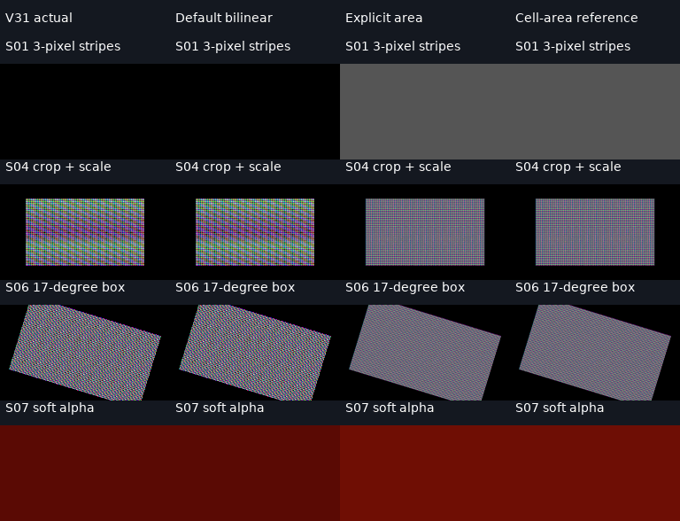

[真实输入 PNG](docs/assets/sequence-sampling-20261017/S01-source.png) · [源预览 MP4](docs/assets/sequence-sampling-20261017/S01-source.mp4) · [旧版](docs/assets/sequence-sampling-20261017/S01-before.mp4) · [area 成片](docs/assets/sequence-sampling-20261017/S01-area.mp4) · [四列 MP4](docs/assets/sequence-sampling-20261017/comparison-readable.mp4) · [九组原输入/全部成片/失败](docs/validation/序列面积采样与工作配额实测_2026-10-17.md)。实际输入为自制 CC0 PNG，源预览 MP4 是黑底展示；软 Alpha 原输入见 S07 PNG。各组视频 16 帧/8 fps/2 秒；预览 768×588、无声，GIF **8 编码帧/2000 ms**。144 area 帧、144 旧帧、144 默认控制与 144 参考分计；45 视频重新解码、27 路预期静音核对，103 文件 SHA/来源见[机器证据](docs/validation/evidence/sequence-sampling-20261017.json)。静态查看首末帧，**未连续播放或听审**；一般旋转只验源轴矩形核，配额不是进程 RSS 上界。原跨列标题预览与开发夹具失败保留。

**正式产品 CLI V31：独立竖屏子画布与父级投影。** 左至右为固定 V30 / 新版实际解码 / 独立空间参考；四行展示 fit、fill 后旋转、锚点动画与父蒙版。九组分别通过声明门槛，C01–C08 最大 RGB 差 2，继承控制逐字节一致。

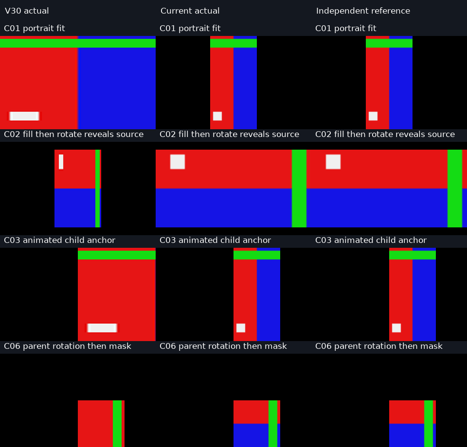

[自制原输入](docs/assets/sequence-canvas-20261017/source-portrait.mp4) · [旧版实际](docs/assets/sequence-canvas-20261017/C01-before.mp4) · [新版实际](docs/assets/sequence-canvas-20261017/C01-after.mp4) · [独立参考](docs/assets/sequence-canvas-20261017/C01-reference.mp4) · [三列对照 MP4](docs/assets/sequence-canvas-20261017/comparison.mp4) · [九组编号、失败与复现](docs/validation/独立序列画布与原生坐标投影实测_2026-10-17.md)。

预览 960×920；MP4 12 fps、24 帧/2 秒，无音轨；GIF **12 编码帧/2000 ms**，降低帧率和调色板仅供展示。原输入 CC0，24 帧/12 fps/2 秒，字体许可及全部 SHA-256 见[来源](docs/assets/sequence-canvas-20261017/fixture-provenance.json)和[63 文件清单](docs/validation/evidence/sequence-canvas-20261017.json)。216 新主帧中 168 帧有独立空间参考，24 帧只验局部字形投影，24 帧只验继承兼容；24 单独子级帧另计，0 新模型推理。已机器逐帧/静音复核、静态目检首末帧，**未连续播放或听审**；[错误参考与开发失败](docs/validation/独立序列画布与原生坐标投影实测_2026-10-17.md#5-失败记录与参考修正)保留，不证明任意高频细节/自然画质或完整剪映等价。

**历史正式产品 CLI V30：分段变速的实际音频与完整尾部。** 三列为原始输入 / 固定 V29 / V30 真实解码，上下分开显示 L/R。T01 内部零采样帧 82→0，六组 DC 完整有效区间均通过；自然声音与听感仍未验收。

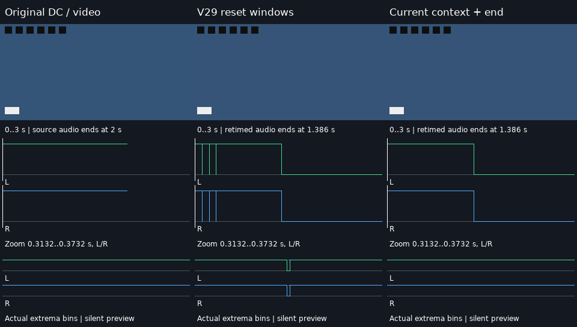

[原视频](docs/assets/audio-tempo-context-20261017/source.mp4) · [DC 原声](docs/assets/audio-tempo-context-20261017/dc.wav) · [旧失败 MP4](docs/assets/audio-tempo-context-20261017/T01-before.mp4) · [当前 MP4](docs/assets/audio-tempo-context-20261017/T01-after.mp4) · [无损 MKV](docs/assets/audio-tempo-context-20261017/T01-after.mkv) · [解码 WAV](docs/assets/audio-tempo-context-20261017/T01-after.wav) · [三列预览 MP4](docs/assets/audio-tempo-context-20261017/comparison.mp4) · [完整尾部对照](docs/assets/audio-tempo-context-20261017/slow-tail-comparison.png) · [11 组编号、来源与复现](docs/validation/分段音频上下文与完整尾部实测_2026-10-17.md)。

预览 960×544；MP4 12 fps、36 帧/3 秒，GIF **18 编码帧/3000 ms**，均无声；原 WAV/正式成片有声。自制 CC0，0 新模型推理，[来源与 SHA-256](docs/assets/audio-tempo-context-20261017/fixture-provenance.json)。396 个新视频帧及 1,584,000 个新立体声采样帧完成声明范围的自动检查；目检首末/慢速尾部静态图，**未连续播放或听审**。这不等于全部采样与独立高质量变速参考相等；AAC MP4 仅供播放。另公开[开发版尾部缺样](docs/assets/audio-tempo-context-20261017/development-context-only-T05.mkv)、[错误参考截图](docs/assets/audio-tempo-context-20261017/development-preview-invalid-reference.png)与[失败说明](docs/assets/audio-tempo-context-20261017/development-verification.json)。

**历史 V29 正式产品 CLI：分层混音与逐采样核验。** 左至右为固定 V28 / 新版实际解码 / 独立参考 PCM；上下独立显示 L/R 通道。12 组无损采样检查通过，旧版 11 组失败、1 正控制；自然声音与听感仍未验收。

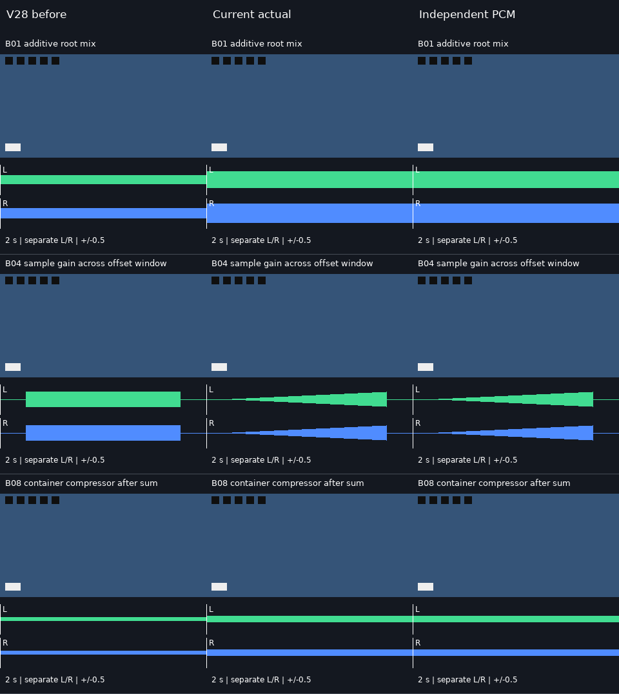

[原视频](docs/assets/audio-buses-20261017/source.mp4) · [A 原声](docs/assets/audio-buses-20261017/tone_a.wav) · [B 原声](docs/assets/audio-buses-20261017/tone_b.wav) · [旧包络失败 MP4](docs/assets/audio-buses-20261017/B04-before.mp4) · [新包络 MP4](docs/assets/audio-buses-20261017/B04-after.mp4) · [无损新 MKV](docs/assets/audio-buses-20261017/B04-after.mkv) · [参考 WAV](docs/assets/audio-buses-20261017/B04-reference.wav) · [三列预览 MP4](docs/assets/audio-buses-20261017/comparison.mp4) · [12 组编号、原始日志与复现](docs/validation/分层音频总线与真实采样实测_2026-10-17.md)。

预览 960×1074；MP4 12 fps、24 帧/2 秒，GIF **12 编码帧/2000 ms**，均无声；正式成片/WAV 有声。源素材为自制双声道正弦波和移动帧码，[CC0 来源/许可](docs/assets/audio-buses-20261017/fixture-provenance.json)。全部 1,152,000 新采样帧及 288 新视频帧已自动检查，并目检预览首末图，**未连续播放或听审**。MKV float PCM 用于精度验收，AAC MP4 仅供播放。另公开[非线性 atempo DC 失败](docs/assets/audio-buses-20261017/dc-diagnostic-retimed-plain.mkv)及[采样诊断](docs/assets/audio-buses-20261017/dc-diagnostic-verification.json)；该 V29 历史输出保留；V30 对同字节输入的受控重验已消除检查区 82 个零采样帧，通用音高/相位与听感仍开放。旧多轨工程音量可能因关闭自动归一化而变化，未自动加限制器。

补充 [S01 容器内部画面静音对照](docs/assets/audio-buses-20261017/S01-verification.json)：只有子容器提供画面时，静音/有声版 24 帧逐像素一致，静音 PCM 为零、有声 PCM 与原 WAV 一致；10 次额外 CLI 与主批次分计。[有声 MP4](docs/assets/audio-buses-20261017/S01-audible.mp4) · [静音 MP4](docs/assets/audio-buses-20261017/S01-muted.mp4)。

**历史 V28 正式产品 CLI：子序列先合成，再处理父级。** 左至右为固定 V27 / 新版实际视频 / 独立参考，展示重叠 opacity、父枢轴、父 mask 和整组旋转。14 组全部像素最大 RGB 差 3；原视频和旧失败成片同时公开。

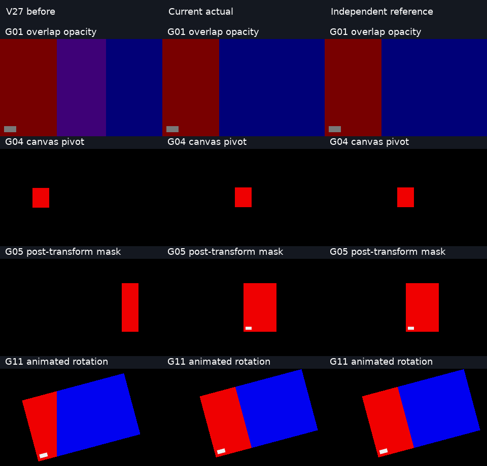

[原红色视频](docs/assets/sequence-compositing-20261017/source-red.mp4) · [原蓝色视频](docs/assets/sequence-compositing-20261017/source-blue.mp4) · [旧重叠失败](docs/assets/sequence-compositing-20261017/G01-before.mp4) · [新重叠成片](docs/assets/sequence-compositing-20261017/G01-after.mp4) · [完整旋转成片](docs/assets/sequence-compositing-20261017/G11-after.mp4) · [三列 MP4](docs/assets/sequence-compositing-20261017/comparison.mp4) · [14 组原片/新旧/参考与复现](docs/validation/嵌套序列隔离合成与逐帧像素实测_2026-10-17.md)。

MP4 960×920、12 fps、24 帧/2 秒；GIF 同尺寸、**12 编码帧/2000 ms**，平均 6 fps，均无声。输入是自制移动图形，非自然广告。已做全帧检查和首末静态图目检，**未连续播放或听审**。[来源/许可](docs/assets/sequence-compositing-20261017/fixture-provenance.json)、102 文件 SHA-256 与原日志保留。另公开[开发动态栅格失败](docs/assets/sequence-compositing-20261017/development-raster-before.mp4)和[同源修复](docs/assets/sequence-compositing-20261017/development-raster-after.mp4)，57 帧补充回归单独计数；其“修复前”是开发中实现，不是固定 V27。

**历史 V27 正式产品 CLI：R3 声道策略，音高失败保留。** 左至右为原片 / 固定 V26 together / V27 apart；下方绿色/蓝色是实际左右声道 PCM，原音频横轴 4 ms、成片横轴 250 ms，幅度同尺度。两种模式均未通过极短音高门槛。

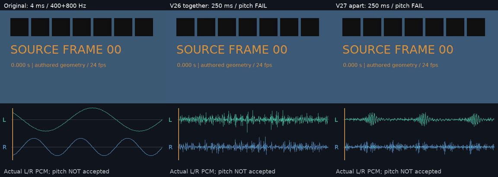

[原视频](docs/assets/audio-channel-modes-20261017/source.mp4) · [原双音](docs/assets/audio-channel-modes-20261017/stereo-tones.wav) · [原反相](docs/assets/audio-channel-modes-20261017/antiphase.wav) · [together 实际成片](docs/assets/audio-channel-modes-20261017/after-tiny-forward-together.mp4) · [apart 实际成片](docs/assets/audio-channel-modes-20261017/after-tiny-forward-apart.mp4) · [apart 无损 WAV](docs/assets/audio-channel-modes-20261017/after-tiny-forward-apart.wav) · [普通慢放通过样例](docs/assets/audio-channel-modes-20261017/after-scalar-slow-apart.mp4) · [反相失败成片](docs/assets/audio-channel-modes-20261017/after-antiphase-apart.mp4) · [对照 MP4](docs/assets/audio-channel-modes-20261017/waveform-comparison.mp4) · [20 组结果与复现](docs/validation/R3声道策略与立体声权衡实测_2026-10-17.md)。

预览 MP4 1536×548、24 fps、24 帧/1 秒；GIF 1152×411、**24 编码帧/1000 ms**，预览无声，正式成片/WAV 有声。波形按列抽样，音高由完整 PCM 另算。全帧/PCM 自动检查、首末静态图目检已做，未连续播放或听审；[来源/许可](docs/assets/audio-channel-modes-20261017/fixture-provenance.json)及 153 份公开文件 SHA-256 保留。极短双音主峰 together 约 797.24/797.24 Hz，apart 375/819.95 Hz；8 组极短音高失败、1 组 apart 反相混合失败仍属未通过内容。

**历史 V26 正式产品 CLI：本地 R3 整段离线音频变速。** 左至右为原片、固定 V25、显式本地 R3 的实际视频；下方为真实解码的左声道波形，原音频横轴 4 ms、成片横轴 250 ms，幅度同尺度。音高和双声道另行检查。


[原视频](docs/assets/offline-audio-stretch-20261017/source.mp4) · [原双声道音频](docs/assets/offline-audio-stretch-20261017/stereo-tones.wav) · [前轮原脉冲](docs/assets/offline-audio-stretch-20261017/pulses.wav) · [旧版静音成片](docs/assets/offline-audio-stretch-20261017/before-tiny-forward.mp4) · [R3 实际成片，音高失败](docs/assets/offline-audio-stretch-20261017/after-tiny-forward.mp4) · [无损 WAV](docs/assets/offline-audio-stretch-20261017/after-tiny-forward.wav) · [普通慢放通过样例](docs/assets/offline-audio-stretch-20261017/after-scalar-slow.mp4) · [波形 MP4](docs/assets/offline-audio-stretch-20261017/waveform-comparison.mp4) · [八组结果与复现](docs/validation/离线音频伸缩与真实采样实测_2026-10-17.md)。

预览 MP4 为 1536×470、24 fps、24 帧/1 秒；GIF 为 1152×353、24 编码帧/1000 ms。预览无声，正式 MP4/WAV 带实际音频。全部双声道采样/视频已自动核对，首末帧和波形已静态目检，未连续播放或听审；[来源与许可](docs/assets/offline-audio-stretch-20261017/fixture-provenance.json)、命令和全部输出 SHA-256 保留，0 新模型推理。

**未通过：4 组极短音高。** 原脉冲正/倒放主峰约 386.72 Hz（原 400 Hz），双声道样例两路约 797.24 Hz（原 400/800 Hz），超过 ±5 Hz 门槛。采样数和非静音通过不能关闭这些交付失败；未配置 R3 继续默认 atempo，瞬态/相位/听感待验收。

**历史 V25 正式产品 CLI：嵌套倒放首尾帧修复。** 左列按独立作者时钟从原视频选择真实源帧（作者留白为黑）；中、右列分别为固定旧版和本轮 CLI 实际成片。第 50/51 帧此前仅剩文字，本轮恢复原视频背景。

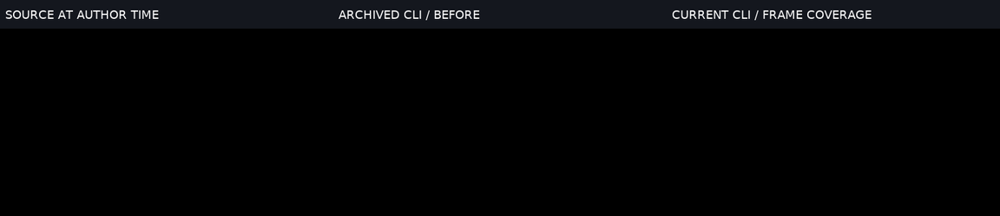

[原视频](docs/assets/nested-frame-coverage-20261017/source.mp4) · [原音频](docs/assets/nested-frame-coverage-20261017/pulses.wav) · [分数帧率输入](docs/assets/nested-frame-coverage-20261017/source-fractional.mp4) · [旧版失败](docs/assets/nested-frame-coverage-20261017/before-retained-typing-tail.mp4) · [修复后成片](docs/assets/nested-frame-coverage-20261017/after-retained-typing-tail.mp4) · [三列 MP4](docs/assets/nested-frame-coverage-20261017/nested-frame-comparison.mp4) · [10 组编号表和复现](docs/validation/嵌套视频帧区间与结束时钟实测_2026-10-17.md)。

三列预览 MP4 为 1536×332、24 fps、52 帧/2.166667 秒；GIF 为 1152×249、**45 个编码帧、2170 ms**，52 个显示时隙的相邻相同画面已合并。预览无声，正式成片保留实际音轨。自动全帧/PCM 检查及 0/26/51 接触表、尾帧静态目检已做，未连续播放或听审；[来源/字体许可](docs/assets/nested-frame-coverage-20261017/fixture-provenance.json)、命令、probe 和全部 85 份公开文件 SHA-256 保留，0 新模型推理。

**未通过：[4 毫秒正放音频](docs/assets/nested-frame-coverage-20261017/after-tiny-forward.mp4)与[倒放音频](docs/assets/nested-frame-coverage-20261017/after-tiny-reverse.mp4)** 拉伸到 250 毫秒后解码全静音，质量 CLI 返回 `OUTPUT_TRUE_PEAK_UNAVAILABLE`。两组视频帧正确，整体交付失败；原生 `atempo` 探针为 0 输出样本，该轮补静音或更换滤镜的诊断不算修复。V26 已接入显式 R3，同源脉冲恢复声音仍未通过音高门槛。

**历史 V24 正式产品 CLI：文字动画、高亮与原生打字机，3 秒。** 左至右为原视频 / 固定旧版实际输出 / 新版实际输出。文字基于完整段落居中，逐字显示时保持锚点和行基线；普通/激活文字同步更新。

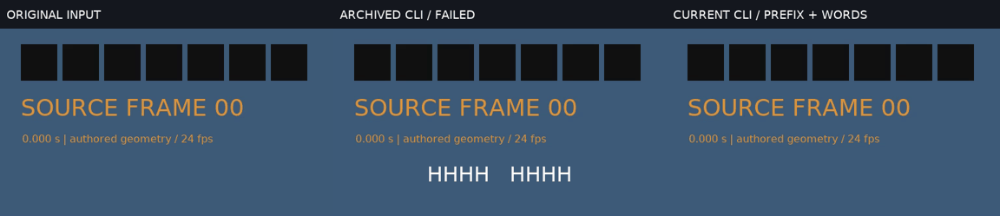

[原视频](docs/assets/text-animation-20261017/source.mp4) · [原音频](docs/assets/text-animation-20261017/pulses.wav) · [旧版失败](docs/assets/text-animation-20261017/before-typing-center.mp4) · [新版实际成片](docs/assets/text-animation-20261017/after-typing-center.mp4) · [整段普通对照](docs/assets/text-animation-20261017/full-typing-center.mp4) · [三列 MP4](docs/assets/text-animation-20261017/text-animation-comparison.mp4) · [12 组编号表和复现](docs/validation/文字动画高亮组合与原生打字机实测_2026-10-17.md)。

预览 MP4 1536×332、24 fps、72 帧/3 秒；GIF 1152×249、72 帧、40/50 ms 合计 3000 ms，无声。50 份正式渲染变体有实际脉冲音轨。自动全帧/PCM 检查、0/36/71 帧接触表静态目检已做，未连续播放或听审；[来源/字体许可](docs/assets/text-animation-20261017/fixture-provenance.json)与逐文件 SHA-256 保留。0 新模型推理。

**V24 历史失败（V25 已另行复验修复，原证据保留）：[裁切倒放实际成片](docs/assets/text-animation-20261017/after-typing-nested-trim.mp4)** 末尾第 50/51 帧背景视频消失，文字显示仍正确；该组交付未通过。另保留 [29.97 fps 首次发布拒绝](docs/validation/evidence/text-animation-initial-media-20261017.log)，最终样例明确设为 90 帧/3.003 秒，不宣称任意时长均可发布。

**历史 V23 正式产品 CLI：文字颜色与透明度，3 秒。** 左至右为原视频 / 固定旧版实际输出 / 新版实际输出 / 数值公式参考。修复半透明文字过暗、alpha 重复相乘；第四列是独立计算的参考图，不是 CLI 成片。

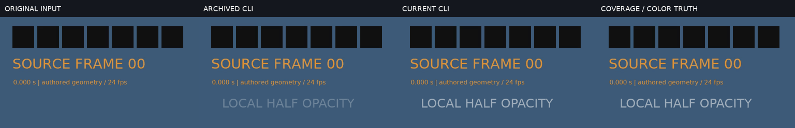

[原视频](docs/assets/text-paint-20261016/source.mp4) · [原音频](docs/assets/text-paint-20261016/pulses.wav) · [旧版失败](docs/assets/text-paint-20261016/before-styled.mp4) · [新版实际成片](docs/assets/text-paint-20261016/after-styled.mp4) · [不透明字面覆盖率对照](docs/assets/text-paint-20261016/fontcolor-styled.mp4) · [空白底片](docs/assets/text-paint-20261016/blank-styled.mp4) · [四列 MP4](docs/assets/text-paint-20261016/text-paint-comparison.mp4) · [九组编号误差表、全部对照和复现](docs/validation/文字颜色透明度与实际合成实测_2026-10-16.md)。

预览 MP4 为 2048×332、24 fps、72 帧/3 秒；GIF 为 1536×249、72 帧，40/50 ms 帧时长合计 3000 ms，两者无声。39 份正式渲染变体带真实脉冲音轨；逐帧/PCM 自动核对及接触表 0/36/71 帧静态目检已做，未做连续播放或听审。素材/字体许可与 SHA-256 见[来源记录](docs/assets/text-paint-20261016/fixture-provenance.json)。

**历史 V22 正式产品 CLI：逐字高亮原生排版，3 秒。** 左至右为原视频 / 固定旧版 / 新版实际输出；相同整段字形只切换颜色，修复错位残字、重复词居中和多行串色。

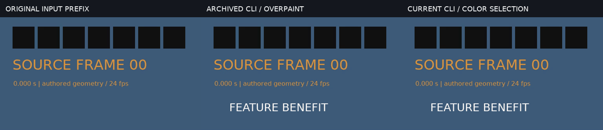

[原视频](docs/assets/word-layout-20261016/source.mp4) · [原音频](docs/assets/word-layout-20261016/pulses.wav) · [旧输出](docs/assets/word-layout-20261016/before-inline.mp4) · [新输出](docs/assets/word-layout-20261016/after-inline.mp4) · [普通字幕对照](docs/assets/word-layout-20261016/reference-inline.mp4) · [对照 MP4](docs/assets/word-layout-20261016/word-layout-comparison.mp4) · [九组全部视频与复现](docs/validation/逐字高亮原生排版与真实成片实测_2026-10-16.md)。

原片和对照均 72 帧/24 fps/3 秒，GIF 72 帧、40/50 ms、合计 3 秒，无声；27 份正式变体带实际脉冲音轨。独立逐词复核覆盖 632 个新主帧和 632 个普通字幕对照帧。公开自制 CC0 输入、两种字体独立许可、原始日志及 SHA-256；CJK 只验四字。已抽帧目检 0/36/71 和部分第 40 帧，未连续播放/听审。

[开发失败多行](docs/assets/word-layout-failures-20261016/failed-multiline.mp4) · [开发失败换行](docs/assets/word-layout-failures-20261016/failed-wrap.mp4) · [失败与当前抽帧](docs/assets/word-layout-failures-20261016/failed-vs-current.png)。两次失败各有 15/40 帧词状态不匹配；R/G 轮廓仍可通过，因此保留逐词核对和失败媒体，最终九组已重验通过。

**历史 V21 正式产品 CLI：嵌套字幕原时钟，约 2.46 秒。** 左至右：原片前缀 / 固定旧版本 / V21 CLI，黄色为激活词。该轮时间对应通过、字形仍偏移；原失败画面保留，后续排版修复见 V22。

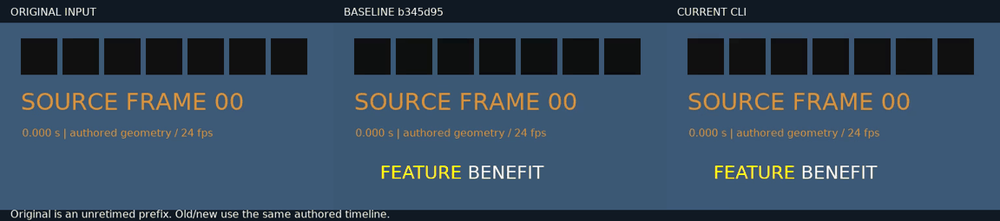

[原视频](docs/assets/subtitle-clock-20261016/source.mp4) · [原音频](docs/assets/subtitle-clock-20261016/pulses.wav) · [原 SRT](docs/assets/subtitle-clock-20261016/clip-cues.srt) · [旧输出](docs/assets/subtitle-clock-20261016/before-words-inline.mp4) · [新输出](docs/assets/subtitle-clock-20261016/after-words-inline.mp4) · [对照 MP4](docs/assets/subtitle-clock-20261016/subtitle-clock-comparison.mp4) · [八组全部成片/复现与失败](docs/validation/嵌套字幕与文字动画原时钟实测_2026-10-16.md)。

原片 72 帧/24 fps/3 秒；对照 59 帧/2.458333 秒，GIF 59 帧/40–50 ms/2.460 秒，无声。左列仅原片前 59 帧。105 次正式 CLI 含 20 次渲染、12 次质量；448 主帧与 288 校准帧分别核对。静态目检 0/29/58 帧，无连续播放/听审；自制 CC0 媒体与 DejaVu 字体许可证分开记录，未分发字体。


**正式产品 CLI：速度 easing/Bezier 与原动画时钟。** 左至右为原片前缀 / 旧版线性化 / 新版实际曲线；各帧保留可读源帧号。

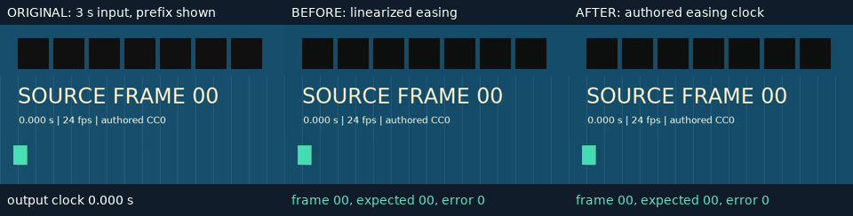

[完整原视频](docs/assets/speed-easing-20261016/source.mp4) · [原始 WAV](docs/assets/speed-easing-20261016/pulses.wav) · [旧成片](docs/assets/speed-easing-20261016/before-forward.mp4) · [新成片](docs/assets/speed-easing-20261016/after-forward.mp4) · [Bezier 动画新成片](docs/assets/speed-easing-20261016/after-animated.mp4) · [对比 MP4](docs/assets/speed-easing-20261016/speed-easing-comparison.mp4) · [全部七组、复现与边界](docs/validation/速度Easing与Bezier原时钟实测_2026-10-16.md)。

完整源视频 72 帧、3 秒、24 fps；演示源面板只取前 59 帧。对比 MP4 为 59 帧、2.458333 秒；GIF 同 59 帧、40/50 ms 量化后为 **2.460 秒**，无声，不能说时长完全一致。十四份实际前后成片含脉冲音轨。已静态目检 0/29/58 帧，未连续播放或听审。额外三帧 PTS 诊断确认了长时低速数值修复，原失败记录保留。素材/字体许可、独立积分、源码/媒体摘要分别保留；不把受控零源帧误差推广为整体剪映等效。

**正式产品 CLI：嵌套变速与倒放的源时钟修复。** 左至右为原视频前缀 / 旧版 / 新版；源帧号可直接核对。旧版从本地固定 Git 提交真实运行。

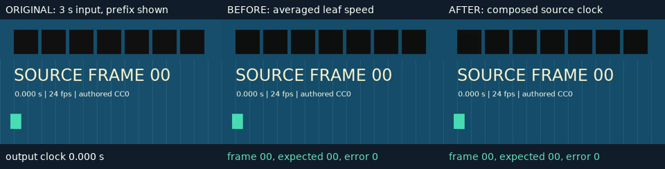

[完整原视频](docs/assets/nested-time-20261016/source.mp4) · [原始脉冲 WAV](docs/assets/nested-time-20261016/pulses.wav) · [旧成片](docs/assets/nested-time-20261016/before-forward.mp4) · [新成片](docs/assets/nested-time-20261016/after-forward.mp4) · [关键帧缩放新成片](docs/assets/nested-time-20261016/after-animated.mp4) · [对比 MP4](docs/assets/nested-time-20261016/nested-time-comparison.mp4) · [全部五组前后成片、复现和边界](docs/validation/嵌套变速倒放与关键帧时钟实测_2026-10-16.md)。

完整源视频 72 帧、24 fps、3 秒；对比面板只用前 33 帧。对比 MP4 为 33 帧、1.375 秒，GIF 同 33 帧、40/50 ms 量化后为 **1.380 秒**，无声；十份实际前后成片含脉冲音轨。自制素材与字体许可分别保留，0 新模型实测推理。已静态目检 0/16/32 帧，未连续播放或听审。全组最大源帧误差≤1，不能将主样例零误差推广到全部视频。

**正式产品 CLI：动态裁切、旋转与独立文字的透明合成修复，4 秒。** 上排为原背景 / 旧实现 / 新实现；下排为原 RGBA / 旧白底 / 新白底核验。白图层和白字叠白底应保持白色，另有深底可见性对照，未以删除图层通过核验。

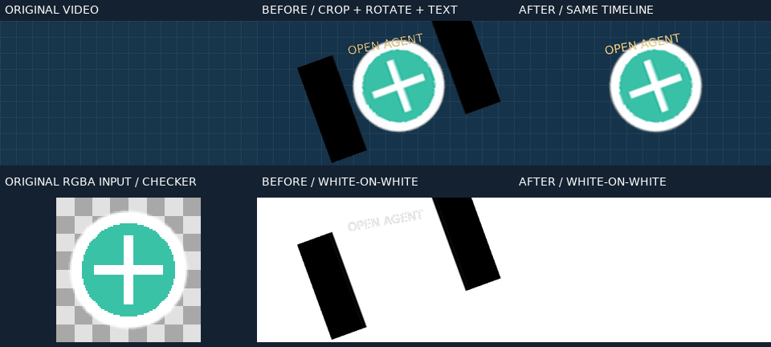

[原视频](docs/assets/alpha-geometry-20261016/source.mp4) · [原 RGBA](docs/assets/alpha-geometry-20261016/marker-black.png) · [旧组合成片](docs/assets/alpha-geometry-20261016/before-combined.mp4) · [新组合成片](docs/assets/alpha-geometry-20261016/after-combined.mp4) · [旧白底核验](docs/assets/alpha-geometry-20261016/before-white.mp4) · [新白底核验](docs/assets/alpha-geometry-20261016/after-white.mp4) · [完整对照 MP4](docs/assets/alpha-geometry-20261016/alpha-geometry-comparison.mp4) · [全部输入/输出、复现与失败边界](docs/validation/仿射动态裁切与文字透明合成实测_2026-10-16.md)。

原视频和六份实际成片均为 32 帧、8 fps、4 秒；GIF 为 32 帧、120/130 ms 交替、4 秒，无声。旧版固定本地 Git 提交真实执行。背景/RGBA 自制 CC0，字体采用有独立许可证的本地 DejaVuSans，未分发字体二进制。已静态目检 0/16/31 帧，未据此声明连续播放/听审或整体剪映质量通过。


**正式产品 CLI：透明标签缩放修复，4 秒。** 左至右为原视频、旧实现、新实现；下方放大窗来自实际解码像素。两份原标签仅全透明 RGB 不同，旧版从本地固定 Git 提交执行，没有用新代码模拟旧效果。

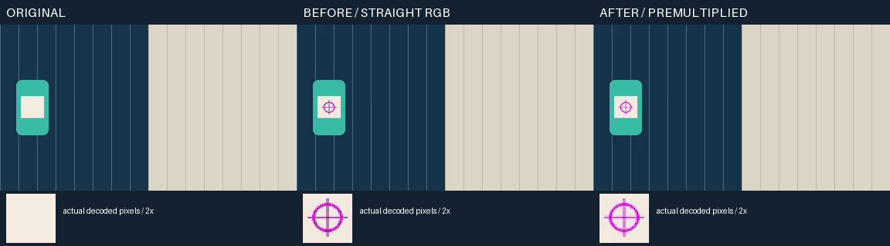

[原视频](docs/assets/alpha-resize-20261016/source.mp4) · [原黑标签](docs/assets/alpha-resize-20261016/marker-black.png) · [原绿标签](docs/assets/alpha-resize-20261016/marker-green.png) · [旧黑标签成片](docs/assets/alpha-resize-20261016/before-black.mp4) · [新黑标签成片](docs/assets/alpha-resize-20261016/after-black.mp4) · [旧绿标签成片](docs/assets/alpha-resize-20261016/before-green.mp4) · [新绿标签成片](docs/assets/alpha-resize-20261016/after-green.mp4) · [完整对照 MP4](docs/assets/alpha-resize-20261016/alpha-resampling-comparison.mp4) · [复现和失败边界](docs/validation/透明素材缩放边缘与标签精度实测_2026-10-16.md)。

原视频和实际 MP4 均为 32 帧、8 fps、4 秒；GIF 为 32 帧、120/130 ms 交替、总 4 秒，无声。自制 CC0 素材、10 次真实 CLI、SHA-256 和媒体探测见[本批机器记录](docs/assets/alpha-resize-20261016/evidence.json)。自然人物原片权利未核验，只公开测量记录；标签门槛通过不代表蒙版语义或整体剪映质量通过。


以下为实际输出的本地媒体，均随仓库提交。GIF 无声并降低色数便于预览，部分演示降低帧率；MP4 保留展示帧率，多轨合成组包含实际渲染音频。所有公开输入为本地合成素材；未确认发布权利的自然人物视频仅保留实测记录。

**正式产品 CLI：蒙版驱动锚定、变换后重算与竖屏，4 秒。** 从左到右：原视频 / 跟随标签 / 源缩放旋转后重新绑定 / 自动竖屏。选区为自制几何，未调用分割模型。

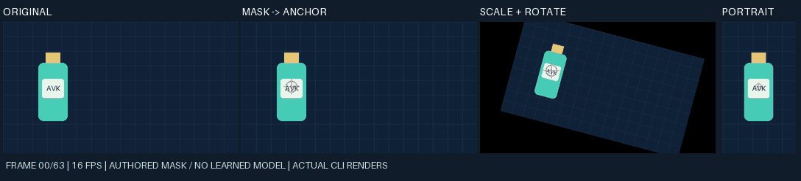

[原视频](docs/assets/mask-track-20261016/source.mp4) · [原 alpha 蒙版](docs/assets/mask-track-20261016/selected-mask.mov) · [横屏输出](docs/assets/mask-track-20261016/bound.mp4) · [变换后输出](docs/assets/mask-track-20261016/bound-transformed.mp4) · [竖屏输出](docs/assets/mask-track-20261016/portrait.mp4) · [对照 MP4](docs/assets/mask-track-20261016/mask-tracking-comparison.mp4) · [16 次调用/逐帧测量与摘要](docs/assets/mask-track-20261016/evidence.json)

原输入和 MP4 均为 16 fps、64 帧；GIF 间隔取样 32 帧、平均 8 fps、4 秒、无声。已修复透明标签黑色补边，修复前[实际成片](docs/assets/mask-track-20261016/before-alpha-fix-bound.mp4)和[抽帧](docs/assets/mask-track-20261016/before-alpha-fix-contact-frame-32.png)同样保留。自然 SAM2 选区手腕仍漏选，补边修复时标签最大 4.10 px 超过 3 px；后续 V17 预乘 alpha 缩放已将同一样例降至 2.07 px，原失败保留，详情见[实测和复现](docs/validation/本地蒙版驱动锚定与重构图实测_2026-10-16.md)。

**正式蒙版核验：漏选失败与补全几何通过，4 秒。** 从左到右：完整输入 / 漏选蒙版 / 恢复几何的样例。核验报告来自实际产品 CLI；恢复几何由脚本完成，未调用修复模型。

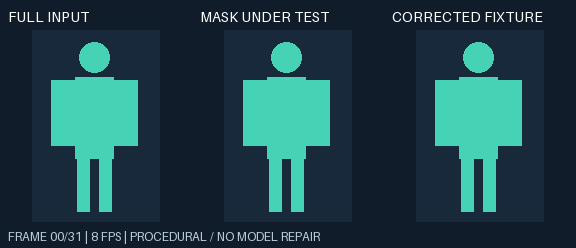

[完整原蒙版 MOV](docs/assets/mask-review-20261016/mask-full.mov) · [漏选原蒙版 MOV](docs/assets/mask-review-20261016/mask-under-test.mov) · [对照 MP4](docs/assets/mask-review-20261016/mask-review-comparison.mp4) · [检查点 JSON](docs/assets/mask-review-20261016/expectations.json) · [失败报告](docs/assets/mask-review-20261016/under-test-report.json) · [通过报告](docs/assets/mask-review-20261016/full-report.json)

MP4 与原蒙版均为 8 fps、32 帧；GIF 保留全部 32 帧，帧时长交替 120/130 ms，总计 4 秒。自然场景另有真实 SAM2 修正记录：目标是男孩（对象 2），女孩（对象 1）应保留；修正后女孩前臂误选消除，男孩手腕仍漏选。该自然样例继续失败，源与衍生画面因发布权利未核验而不公开，见[逐点实测和未通过项](docs/validation/本地蒙版范围与正负检查点实测_2026-10-16.md)。

**正式产品 CLI：多轨与运镜合成，5.5 秒。** 图形和音频由脚本生成，编辑、合成、编码由产品 CLI 执行。

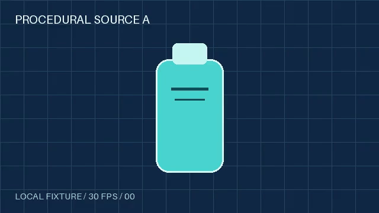

[原视频 A](docs/assets/readme-20261016/source-a.mp4) · [原视频 B](docs/assets/readme-20261016/source-b.mp4) · [原音频](docs/assets/readme-20261016/source-audio.wav) · [实际成片 MP4（含音频）](docs/assets/readme-20261016/cli-showcase.mp4) · [可导入项目包](docs/assets/readme-20261016/cli-showcase.aevpkg.zip)

**研究对照：独立平移表面，12 帧。** 从左到右：遮挡输入 / 回退填充 / 前序光流 / 当前参考选择 / 未遮挡真值。

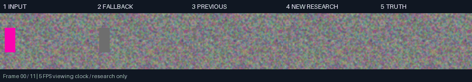

[原输入 MP4](docs/assets/readme-20261016/translation-input.mp4) · [完整对照 MP4](docs/assets/readme-20261016/translation-comparison.mp4)

**研究对照：独立运动与形变的双表面，12 帧。** 保留当前方法相对前序略退化的样例，列顺序同上。

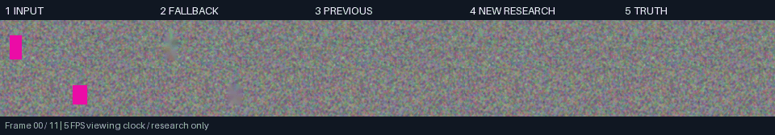

[原输入 MP4](docs/assets/readme-20261016/two-surfaces-input.mp4) · [完整对照 MP4](docs/assets/readme-20261016/two-surfaces-comparison.mp4)

研究数组没有原始播放时钟，公开动画统一按 5 fps 展示，每组 2.4 秒；PSNR 在原始无损数组上计算，GIF/MP4 不用于指标计算。已完成全部媒体解码和抽帧目检，尚未做连续播放/听审。复现命令、素材哈希、检查边界与维护规则见[演示核验记录](docs/validation/README功能核验与实测演示_2026-10-16.md)。

## 当前状态

- 当前 26 模块进度见[构建进度总表](docs/构建进度总表_2026-10-16.md)：V33 完整 **695/695**、0 跳过；关联整片段/同步锁/联动已接入。完整磁吸、源边缘裁切、进程 RSS/长片、子 FPS/色域/SAR、自然 AI/声音/听感、开放内容库与完整剪映等价继续待验。
- 新增 `--mask-asset-id` 接通 `media track / track-bind / reframe`，支持显式检查点门禁、源时钟映射及源/蒙版/模型权利依赖。受控全帧几何通过，自然漏抠继续失败；标签像素门槛在 V17 复验通过，见[契约](docs/specs/本地分割蒙版轨迹与锚定契约_v0.1_2026-10-16.md)和[实测](docs/validation/本地蒙版驱动锚定与重构图实测_2026-10-16.md)。
- 蒙版核验使用原生 FFmpeg 和 Python 标准库，支持 alpha/luma、明确正负检查点、切点及解码存储预算，失败仍保存报告。公开样例通过实际 CLI 验证；真实 SAM2 提示修正后仍有手腕漏选，检查点从 3/5 到 4/5，不自动接入发布门禁或证明完整分割。见[契约](docs/specs/本地蒙版逐帧核验与检查点契约_v0.1_2026-10-16.md)与[实测](docs/validation/本地蒙版范围与正负检查点实测_2026-10-16.md)。
- VACE 五组同源采样/输入尺度对照 **5/5 已完成，画质均未通过**：暗矩形补丁仍存在，4 倍输入或 50 步未改善该样例。CLI 已接入显式 `--flow-shift` 和 `--model-input-scale {1,2,4}`，默认仍为 3/1；输入数组预算按倍率平方计入，输出画布不变。详见[校准证据](docs/validation/evidence/vace-calibration-20261016.json)和[正式参数验证](docs/validation/evidence/vace-profiles-20261016.json)。
- VACE 实验性联合编辑：提示词/seed、窗口/重叠/切点和原生 CUDA 已接入；Windows 进度快照/原子替换冲突已修复。真实 **32 帧/3 窗口/30 步 SAM2→VACE→原声/入轨→MP4** 正式链路成功，蒙版外 RGB 改变 0、全部 alpha 一致；Torch 峰值已分配约 6.75 GiB。**自然画质未通过**：彩色块、形体残影、纹理不连续，部分抽样帧明显差于匹配源/蒙版的 LaMa 对照。前序 direct 的 8 帧/2 窗口/30 步受控正式链路也通过，但有暗矩形补丁；许可、长期时序和广泛效果继续验收。见[契约](docs/specs/本地VACE联合视频编辑契约_v0.1_2026-10-16.md)、[实测与缺口](docs/validation/VACE本地多帧编辑与生成填充实测_2026-10-16.md)和[机器证据](docs/validation/evidence/vace-smoke-20261016.json)。
- 区域色差融合已接入 LaMa/VACE：显式 `--repair-blend harmonic`，默认 direct；浮点预测/窗口混合后修正、实际选区预算前置检查、收敛报告及失败回滚。受控 masked PSNR：LaMa 47.45 dB、VACE 42.90 dB；均完成音频/入轨/MOV/MP4，独立 PCM 核对一致。LaMa 全空 8 帧不加载权重；自然 32 帧交付成功，残影/纹理仍未通过。见[契约](docs/specs/本地修复区域色差融合契约_v0.1_2026-10-16.md)、[实测](docs/validation/本地区域色差融合实测_2026-10-16.md)和[机器证据](docs/validation/evidence/repair-blend-smoke-20261016.json)。
- 多运动参考选择研究：新增背景特征配准、相机/DIS 候选与可见上下文评分，同一帧不重复计票；新增 12 项，合并研究 **22/22** 通过。匹配输入下，墙面 PSNR 从前序 30.11→32.46 dB、床单 24.80→25.36 dB；独立双表面合计 33.448→33.410 dB 略退化，自然残影/涂抹仍未通过，未接入产品或替换默认。该批次 89 份生产相关源码未改，该研究批次没有重跑完整产品回归。见[实测与复现](docs/validation/本地多运动参考选择与双表面真值实测_2026-10-16.md)和[机器证据](docs/validation/evidence/temporal-reference-selection-20261016.json)。
- 前序光流背景传播研究：新增可复现诊断 CLI 与 10/10 独立研究检查；真实画面人工遮挡真值中，墙面 PSNR 25.61→30.11 dB、床单 23.45→24.80 dB。自然人物移除仍有残留/接缝，未接入产品；无新增模型运行。该批次 89 份生产/测试/烟测源码与 363 项回归版本一致，该研究批次未重跑完整产品回归。见[实测与复现](docs/validation/本地光流背景传播与遮挡真值实测_2026-10-16.md)和[机器证据](docs/validation/evidence/temporal-background-flow-20261016.json)。
- LaMa 区域修复：`media inpaint` 接入显式本地 TorchScript/CPU/CUDA、alpha/luma 蒙版、时钟/几何校验、ROI、蒙版外 RGB/全部 alpha 保留、音频/入轨、取消恢复及源/蒙版/模型权利依赖。LaMa 轮新增 25 项，当轮完整回归 303/303；受控真值与两种 SAM2→修复→成片样例通过功能链路，自然运动仍有腿部残影和纹理涂抹，该引擎为逐帧修复，广泛广告质量未验收；联合窗口/提示词填充由 VACE 实验增量提供。见[契约](docs/specs/本地LaMa区域修复与对象移除契约_v0.1_2026-10-16.md)、[实测](docs/validation/LaMa本地区域修复与物体移除实测_2026-10-16.md)和[机器证据](docs/validation/evidence/lama-smoke-20261016.json)。此前[仅在建状态核对](docs/validation/evidence/build-progress-checked-lama-20261016.json)保留为历史快照。
- SAM2 对象分割：本地 CPU/CUDA、点/框、多对象选择、修正/重置及概率掩码已接入 `media matting`。真实受控人物/头盔与自然双人运动完成透明素材、两背景成片、音频/权利门禁；新增 21 项，完整回归 278/278。重置选区变化、边缘漏抠和概率残影仍需复核，见[契约](docs/specs/本地SAM2对象分割与提示修正契约_v0.1_2026-10-16.md)及[实测](docs/validation/SAM2本地对象分割与提示修正实测_2026-10-16.md)。
- 人物视频抠像：`media matting` 使用显式登记的本地 RVM FP32 ONNX/CPU，输出软 alpha 的 QTRLE/ARGB MOV，保留音频并支持视频及显式 audio 轨道应用。真实 3 秒/36 帧样例完成两背景 MP4 和透明 WebM；首帧边缘缺失、手持头盔被排除，广泛质量与商业许可尚未验收。见[契约](docs/specs/本地RVM人物视频抠像与透明素材契约_v0.1_2026-10-16.md)和[实测](docs/validation/RVM本地人物抠像与透明成片实测_2026-10-16.md)。
- P0 CLI 闭环已实现：项目初始化、媒体摄取与探测、时间线变更、关键帧与运镜、字幕、音频、遮罩、转场、渲染、项目内持久化渲染队列、质量检查、权利门禁、快照/迁移/跨文件事务恢复、确定性素材索引/搜索/重复组、增量刷新、FFmpeg 感知候选和受限互操作（OTIO canonical Stack/Gap 与 MLT 帧时间映射）；队列默认顺序执行，也支持显式 `queue run --workers N --continue-on-error` 的有界本地 FFmpeg 并发，项目写入由原生 Windows 文件锁串行化，元数据事务由 `operations/project-transaction.json` 保护，队列取消在渲染持锁时仍可递交并异步确认。
- 本地项目包：`convert export --target-format package` 会把 Agent Project、Rights Ledger、项目内支持文件和引用素材写成可移植 `.aevpkg.zip`，重写资产 URI 并生成逐文件 SHA-256 manifest；`convert import` 会在落盘前拒绝路径穿越、符号链接、未登记成员和哈希篡改。项目包不含 renders/cache/operations/history，不调用网络或剪映运行时，契约见 [`docs/specs/本地项目包与交换清单契约_v0.1_2026-10-15.md`](docs/specs/本地项目包与交换清单契约_v0.1_2026-10-15.md)。
- 本地明文草稿支持 `convert import` 自动识别，并提供 `convert export --target-format jianying-draft-json`：支持基础媒体/轨道/源目标时钟、变换/裁切/线性关键帧、文字/本地字体和显式视频原声；`--strict` 在近似、不支持或失败项出现时拒绝写入，私有资源仅脱敏保留。已通过本地音画往返渲染，尚未验证商业版本兼容性、复杂效果与视觉等效，见[适配器契约](docs/specs/本地明文草稿双向适配器契约_v0.1_2026-10-15.md)。同时修复音频尾部补齐和 Windows 中文目录下本地字体渲染。
- 中文离线配音：已接入显式登记的 SoulX HF/BF16 + CUDA，支持原样参考逐字稿、模型/声源完整性核验、生成 WAV 资产与可选音频入轨；真实 3.44 秒中文样例已完成渲染、质量/本地策略校验，未核验权利仍阻断发布。见[配音契约](docs/specs/本地SoulX中文配音与声线登记契约_v0.1_2026-10-15.md)和[实测记录](docs/validation/SoulX中文离线配音实测_2026-10-15.md)。
- 中文离线转写：新增 `asr adapter register/list/inspect`，显式登记本地 Python、完整 Whisper safetensors、设备与证据；CPU/CUDA 实测通过，38.04 秒输入返回 15 段字幕、末段到 38.02 秒。`subtitle evaluate` 提供明确归一化的 CER 报告，原始中文样例为 2%，繁简差异另行如实记录；不代表广泛质量通过。配套修复字体导入、空字幕、相对输出、绝对输出幂等和失败回滚，见[实测记录](docs/validation/Whisper中文离线转写实测_2026-10-15.md)与[契约](docs/specs/本地Whisper模型登记与转写验收契约_v0.1_2026-10-15.md)。
- 原生模型跟踪：新增显式本地 `yolov10-onnx-cpu-tracking-v1`，CPU ONNX 检测与常速度/IoU 全局关联；4 秒受控双目标样例记录 29/32 次观测，已完成文字绑定、竖屏重构图及实际渲染。模型权利进入片段依赖，registry 随快照/事务/项目包保留；长滤镜图使用本地 SHA-256 文件规避 Windows 命令长度。自然遮挡、同类交叉和嵌套父层等完整坐标空间仍待验收，见[实测](docs/validation/YOLO本地多目标跟踪与重构图实测_2026-10-15.md)与[契约](docs/specs/本地YOLO检测与多目标跟踪契约_v0.1_2026-10-15.md)。
- 持久跟踪画布绑定：`media track-bind --source-track-id <track> --source-clip-id <clip>` 保存源哈希及源时钟观测，按源裁切/fit/fill/stretch、旋转/锚点/缩放、镜像和剪辑时钟，在每次输出画布上重算。新增 17 项专项回归，受控像素定位 ≤3 px；真实 YOLO + 动态重构图 + 标签已完成横竖两版本地渲染。支持解除绑定、项目包保留关系和外部导出烘焙报告；嵌套/VFR/遮挡与高分辨率性能仍需专项验收，见[坐标契约](docs/specs/本地跟踪绑定坐标空间与渲染重算契约_v0.1_2026-10-15.md)与[实测](docs/validation/跟踪坐标绑定与组合渲染实测_2026-10-15.md)。
- 本地人声/伴奏分离：`torchaudio-hdemucs-local-v1` 使用显式本地权重、原生 Python 和证据，支持 CPU/CUDA、分段重叠拼接、精确采样、浮点 WAV、音轨应用及源/模型双权利依赖。受控 12.68 秒语音+合成伴奏实测改善约 12.66 dB，策略检查通过，未核验许可仍阻断发布；自然音乐、听感和广泛广告质量待验收。见[契约](docs/specs/本地HDemucs人声伴奏分离契约_v0.1_2026-10-16.md)及[实测](docs/validation/HDemucs本地人声伴奏分离实测_2026-10-16.md)。
- 历史回归：RVM 257/257、LaMa 303/303、VACE 首轮 338/338、显式参数 344/344、区域融合 363/363（其中融合子集 73 项）。前轮蒙版核验完整 **379/379**，详见[回归记录](docs/validation/回归验证记录_2026-10-13.md)和[该轮机器证据](docs/validation/evidence/mask-review-20261016.json)。
- 当前实现仍会明确报告近似和未支持能力，不能把 P0 底座描述成已经完全等同于剪映。对象跟踪的真实模型质量、遮挡/交叉身份恢复、分割/姿态、复杂路径逐点动画、GPU 效果、多语言/情绪配音的广泛质量验收、完整外部工程映射和黄金素材集仍按路线图推进。
- 生产 Skill 统一使用 `video-cut-` 前缀，并只保留本地 FFmpeg、本地模型和离线编排入口；可用 `$video-cut-技能名` 调用，清单见 [`video-cut-install-manifest.json`](video-cut-install-manifest.json)。

## 快速开始

在 PowerShell 中从仓库根目录执行：

```powershell
.\ai-ad-editor.ps1 doctor
.\ai-ad-editor.ps1 version
```

直接调用 Python CLI 时：

```powershell
$env:PYTHONPATH = "$(Get-Location)\product\src"
python -X utf8 -m ai_ad_editor project init .\workspace\demo
python -X utf8 -m ai_ad_editor media ingest --project .\workspace\demo --input C:\media\source.mp4
python -X utf8 -m ai_ad_editor convert export --project .\workspace\demo --output .\exports\demo.aevpkg.zip --target-format package
python -X utf8 -m ai_ad_editor convert import --input .\exports\demo.aevpkg.zip --output .\workspace\demo-imported
python -X utf8 -m ai_ad_editor convert import --input E:\media\draft_info.json --output .\workspace\draft-imported
python -X utf8 -m ai_ad_editor convert export --project .\workspace\draft-imported --output .\exports\draft_info.json --target-format jianying-draft-json
python -X utf8 -m ai_ad_editor media track --project .\workspace\demo --asset-id source --mask-asset-id selected_mask --step-frames 1 --dry-run
python -X utf8 -m ai_ad_editor media track-bind --project .\workspace\demo --asset-id source --mask-asset-id selected_mask --source-track-id track_video_1 --source-clip-id product --target-track-id labels --target-clip-id label --apply --dry-run
python -X utf8 -m ai_ad_editor media reframe --project .\workspace\demo --asset-id <asset_id> --roi 0.20,0.20,0.20,0.35 --clip-id talking_head --track-id track_video_1 --dry-run
python -X utf8 -m ai_ad_editor media track-bind --project .\workspace\demo --asset-id <asset_id> --roi 0.20,0.20,0.20,0.35 --target-clip-id product_label --target-track-id track_text_1 --scale-mode roi --dry-run
python -X utf8 -m ai_ad_editor media adapter register --project .\workspace\demo --adapter-id tracker_local --engine command-json-tracking-v1 --model-path E:\models\tracker.bin --executable E:\models\tracker_runner.py --license-spdx Apache-2.0 --verification-status verified --evidence local://tracker-evidence --dry-run
python -X utf8 -m ai_ad_editor media adapter list --project .\workspace\demo
python -X utf8 -m ai_ad_editor media adapter register --project .\workspace\demo --adapter-id rvm_local --engine rvm-onnx-cpu-matting-v1 --model-path E:\models\rvm_mobilenetv3_fp32.onnx --executable E:\python\python.exe --evidence E:\models\rvm-evidence.json --threads 4 --dry-run
python -X utf8 -m ai_ad_editor media matting --project .\workspace\demo --asset-id <asset_id> --adapter-id rvm_local --derived-asset-id person_alpha --track-id track_video_1 --audio-track-id track_audio_1 --apply --dry-run
python -X utf8 -m ai_ad_editor media track --project .\workspace\demo --asset-id <asset_id> --adapter-id tracker_local --roi 0.20,0.20,0.20,0.35 --dry-run
python -X utf8 -m ai_ad_editor media track --project .\workspace\demo --asset-id <asset_id> --adapter-id tracker_multi --roi 0.20,0.20,0.20,0.35 --object-id person_2 --dry-run
python -X utf8 -m ai_ad_editor media track --project .\workspace\demo --asset-id <asset_id> --adapter-id tracker_multi --roi 0.20,0.20,0.20,0.35 --all-objects --dry-run
python -X utf8 -m ai_ad_editor media smart-cut --project .\workspace\demo --track-id track_video_1 --clip-id speech_clip --linked-track-id track_audio_1 --linked-clip-id speech_audio --dry-run
python -X utf8 -m ai_ad_editor media smart-cut --project .\workspace\demo --track-id track_video_1 --clip-id speech_clip --transcript .\workspace\demo\validation\captions.srt --remove-phrase "嗯" --dry-run
python -X utf8 -m ai_ad_editor media multicam --project .\workspace\demo --source-asset-id camera_wide --source-asset-id camera_close --reference-asset-id camera_wide --switch-seconds 4 --track-id track_video_1 --dry-run
python -X utf8 -m ai_ad_editor audio extract --project .\workspace\demo --asset-id camera_source --derived-asset-id camera_audio --track-id track_audio_1 --apply
python -X utf8 -m ai_ad_editor audio separate --project .\workspace\demo --asset-id camera_source --center-asset-id camera_center --side-asset-id camera_side --track-id track_audio_1 --stem center --apply
python -X utf8 -m ai_ad_editor audio adapter register --project .\workspace\demo --adapter-id hdemucs_local --engine torchaudio-hdemucs-local-v1 --model-path E:\models\hdemucs.pt --executable E:\python\python.exe --evidence E:\models\evidence.json --device cpu --dry-run
python -X utf8 -m ai_ad_editor audio adapter list --project .\workspace\demo
python -X utf8 -m ai_ad_editor audio adapter inspect --project .\workspace\demo --adapter-id hdemucs_local
python -X utf8 -m ai_ad_editor audio separate --project .\workspace\demo --asset-id source_audio --adapter-id hdemucs_local --vocals-asset-id vocals_01 --accompaniment-asset-id accompaniment_01 --stem vocals --track-id track_audio_1 --apply --dry-run
python -X utf8 -m ai_ad_editor media beat-cut --project .\workspace\demo --input .\media\music.wav --source-asset-id <asset_id> --track-id track_video_1 --dry-run
python -X utf8 -m ai_ad_editor media highlights --project .\workspace\demo --asset-id <asset_id> --beats --top-k 5
python -X utf8 -m ai_ad_editor media highlights --project .\workspace\demo --asset-id <asset_id> --track-id track_video_1 --top-k 5 --apply --replace-track
python -X utf8 -m ai_ad_editor subtitle transcribe --project .\workspace\demo --asset-id <asset_id> --model-path E:\models\ggml-small.bin --transcribe-engine ffmpeg-whisper --dry-run
python -X utf8 -m ai_ad_editor media stabilize --project .\workspace\demo --asset-id <asset_id> --derived-asset-id stabilized-source --smoothing 15 --dry-run
python -X utf8 -m ai_ad_editor validate --project .\workspace\demo
python -X utf8 -m ai_ad_editor project recover --project .\workspace\demo
python -X utf8 -m ai_ad_editor render --project .\workspace\demo --output .\workspace\demo\renders\ad.mp4
python -X utf8 -m ai_ad_editor tts synthesize --project .\workspace\demo --text 'Hello local advertising voice' --output .\workspace\demo\assets\voice.wav
python -X utf8 -m ai_ad_editor ad plan --project .\workspace\demo --input .\workspace\brief.json --output .\workspace\demo\validation\ad-plan.json
python -X utf8 -m ai_ad_editor ad apply --project .\workspace\demo --input .\workspace\demo\validation\ad-plan.json
python -X utf8 -m ai_ad_editor effects list --query color
python -X utf8 -m ai_ad_editor effects inspect --name curves
python -X utf8 -m ai_ad_editor motion list --query position
python -X utf8 -m ai_ad_editor motion inspect --name push-in
python -X utf8 -m ai_ad_editor motion apply --project .\workspace\demo --clip-id <clip_id> --preset ken_burns --amount 0.2 --dry-run
python -X utf8 -m ai_ad_editor queue enqueue --project .\workspace\demo --input .\workspace\queue.json
python -X utf8 -m ai_ad_editor queue run --project .\workspace\demo --workers 2 --continue-on-error --progress jsonl
python -X utf8 -m ai_ad_editor queue list --project .\workspace\demo --status failed
python -X utf8 -m ai_ad_editor policy audit --project .\workspace\demo
python -X utf8 -m ai_ad_editor rights list --project .\workspace\demo
python -X utf8 -m ai_ad_editor rights export --project .\workspace\demo --target commercial_ad --output .\workspace\demo\exports\release.json
python -X utf8 -m ai_ad_editor rights impact --project .\workspace\demo --asset-id <asset_id>
python -X utf8 -m ai_ad_editor rights decide --project .\workspace\demo --asset-id <asset_id> --action replace --replacement-asset-id <replacement_asset_id> --status approved --reason "replace historical usage"
python -X utf8 -m ai_ad_editor rights apply --project .\workspace\demo --decision-id <decision_id>
python -X utf8 -m ai_ad_editor quality golden --project .\workspace\demo --input .\workspace\demo\renders\ad.mp4 --mode capture --require-audio --expensive
python -X utf8 -m ai_ad_editor quality golden --project .\workspace\demo --input .\workspace\demo\renders\ad.mp4 --mode verify --require-audio --expensive
```

渲染前要为可发布素材补齐 Rights Ledger；没有许可证、来源和允许用途的素材会被发布门禁阻断。当前 Rights Ledger 0.2.0 支持不可变修订、模板/父资产依赖闭包、哈希校验、批量修订、撤下/争议/过期状态、渠道校验、历史影响报告、非破坏性的历史成片 replace/delete 决策、决策审批/撤销链、替代资产依赖门禁、已批准处置发布阻断、本地 `rights apply` 当前项目变更、审计历史和确定性发布清单。素材库 `0.3.0` 的增量刷新、感知候选和复核边界见 [`docs/specs/本地素材库增量刷新与感知候选契约_v0.1_2026-10-14.md`](docs/specs/本地素材库增量刷新与感知候选契约_v0.1_2026-10-14.md)。模板变量支持类型、枚举、数值/字符串范围、默认值和字符串内嵌替换，模板操作支持追加、更新/替换/删除片段、轨道和标记，并把解析后的变量写入 `template_snapshot`；具体边界见 [`docs/specs/广告模板变量契约_v0.1_2026-10-14.md`](docs/specs/广告模板变量契约_v0.1_2026-10-14.md)。队列状态文件位于项目 `operations/render-queue.json`；默认顺序执行，也可用 `queue run --workers N --continue-on-error` 启用有界本地并发，worker 只运行 FFmpeg/质量检查，项目输出、操作记录和队列 JSON 由主线程串行提交；项目写命令使用 `operations/project-write.lock`，冲突返回 `PROJECT_WRITE_LOCKED`，元数据事务日志位于 `operations/project-transaction.json`，可通过 `project recover` 恢复中断写入；`queue cancel` 在锁被占用时写入原子取消标记并返回已递交/待确认状态。失败或取消作业需要显式 `queue run --job-id ID` 重试，相同输出路径会在并发批次启动前返回 `QUEUE_OUTPUT_CONFLICT`。完整命令契约见 [`docs/specs/AgentCLI契约_v0.1_2026-10-13.md`](docs/specs/AgentCLI契约_v0.1_2026-10-13.md)，事务状态机见 [`docs/specs/跨文件项目事务恢复契约_v0.1_2026-10-15.md`](docs/specs/跨文件项目事务恢复契约_v0.1_2026-10-15.md)，队列状态机见 [`docs/specs/本地渲染队列与任务状态契约_v0.1_2026-10-14.md`](docs/specs/本地渲染队列与任务状态契约_v0.1_2026-10-14.md)，并发与取消语义见 [`docs/specs/本地项目写锁与取消通道契约_v0.1_2026-10-14.md`](docs/specs/本地项目写锁与取消通道契约_v0.1_2026-10-14.md)，实现入口见 [`docs/产品实现入口与P0使用说明_v0.1_2026-10-13.md`](docs/产品实现入口与P0使用说明_v0.1_2026-10-13.md)。

## 目录

| 路径 | 用途 |
|---|---|
| [`product/`](product/) | Agent CLI、项目领域模型、FFmpeg 渲染器和测试 |
| [`skills/`](skills/) | 可编辑的本地 `video-cut-*` Skills |
| [`sources/`](sources/) | 上游仓库快照、ZIP、提交和许可证证据 |
| [`research/`](research/) | 开源社区调研、Skill 审计和上游证据脚本 |
| [`docs/`](docs/) | 产品需求、架构、规范、路线图和验收记录 |
| [`ai-ad-editor.ps1`](ai-ad-editor.ps1) | 原生 Windows CLI 包装入口 |
| [`register-video-cut-skills.ps1`](register-video-cut-skills.ps1) | 建立本地 Skill 发现目录联接 |
| [`enable-auto-push.ps1`](enable-auto-push.ps1) | 安装 Git 提交后自动推送钩子 |

项目文档统一放在 `docs/`；新增需求、架构、研究结论和验收记录应先更新对应文档，再修改代码或 Skill。

## 主要能力

`timeline edit --project <项目> --input <请求JSON> --dry-run` 提供整片段 link/unlink/remove/close_gap/close_gaps/shift；正式省略 dry-run，可用 --expected-project-sha256 校验计划摘要。compose 的 linked_edit 可加入批次事务。先检查 short_tick、锁定成员、新轨处理与字幕偏移，见[契约](docs/specs/关联片段与主轨联动规划契约_v0.1_2026-10-17.md)。

序列独立像素画布、子坐标 crop/anchor 与父画布 position/mask 已接入，支持多级隔离投影和选中子级 render/quality/queue；`timeline compose` 通过 `add_sequence.canvas` / `update_sequence.patch` 修改或清除。输出临时覆盖不改作者项目。见[契约](docs/specs/独立序列画布与父级投影契约_v0.1_2026-10-17.md)和[实际成片](docs/validation/独立序列画布与原生坐标投影实测_2026-10-17.md)；显式 area/配额见[采样契约](docs/specs/序列面积采样与工作栅格预算契约_v0.1_2026-10-17.md)，一般重建核/叶采样、子 FPS/色域/SAR 和长片资源仍待验。

嵌套序列采用[隔离合成契约](docs/specs/嵌套序列隔离合成契约_v0.1_2026-10-17.md)：子画布先合成，父级空间操作和透明混合统一执行，时间映射沿用原作者时钟。manifest 可审计每个组节点；V29 加入[分层音频总线](docs/specs/分层音频总线与采样包络契约_v0.1_2026-10-17.md)，已测组增益/后置效果通过，任意命名路由和完整群组验收仍开放。V30 的[分段音频上下文与实际末端](docs/specs/分段音频变速上下文契约_v0.1_2026-10-17.md)限定在作者选区内，资源拒绝及通用质量未验标志可审计。

自动字幕流水线提供登记模型路径：先执行 `asr adapter register --project <项目> --adapter-id <ID> --python-executable <现有原生Python.exe> --model-path <本地Whisper目录> --evidence <本地证据文件> --device cpu --threads 4 --dry-run`，复核后正式登记并使用 `asr adapter inspect`；再将 `--adapter-id` 传给 `subtitle transcribe` 或 `media understand --transcribe`。登记模型经独立原生进程执行，字幕应用保留源素材与模型的权利依赖；`subtitle evaluate --input <SRT> --reference <UTF8逐字稿> --max-cer <阈值>` 可执行字符错误率门禁，默认不转换繁简。

原有自动字幕入口继续提供 `subtitle transcribe`：可选择显式本地 Transformers 模型目录或 FFmpeg `whisper.cpp` 模型文件，生成项目内 SRT；使用 `--apply` 时会在源素材已有 Rights Ledger 记录的前提下登记派生字幕资产、创建独立字幕轨道片段、快照、校验和操作记录。模型不会自动下载，FFmpeg Whisper 只有在本机构建暴露 `whisper` 滤镜时才运行，具体边界见 [`docs/specs/本地AI适配器与字幕流水线规范_v0.1_2026-10-13.md`](docs/specs/本地AI适配器与字幕流水线规范_v0.1_2026-10-13.md)。

当前渲染器覆盖多轨时间线、裁切/滑移/涟漪编辑、静态和 cubic Bezier 关键帧、12 项本地关键帧运镜预设（`motion list/inspect/apply`，含别名和参数边界）、本地模板或已登记视觉 runner 对象跟踪（v1 单目标与 v2 多目标 `object_id` 选择）、目标画幅的 `media reframe` 动态裁切、将选定跟踪结果绑定到独立文字/贴纸/效果片段的 `media track-bind`、`media smart-cut` 静音与字幕短语裁切计划、`media beat-cut` 本地能量节拍卡点混剪计划、`media multicam` 本地多机位音频偏移估计与固定/显式机位切换计划、`audio extract` 本地第一条音频流无损 WAV 派生资产与 audio 轨道应用、`audio separate` 本地 mid/side center/side stem 派生与选定 stem 轨道应用、`media stabilize` 基于本地 `vidstabdetect`/`vidstabtransform` 的两遍防抖派生资产、倒放与反向速度曲线段反射、任意位置视频定格、默认同点音频静音插入、常用 FFmpeg xfade 转场（含连续片段的显式 `auto_handle`）、独立文字轨道与视频轨道按 `track.order` 统一层级排序、图层锚点定位、文字片段的缩放/旋转/透明度关键帧、遮罩、混合、fade/dissolve 透明层转场和 slide/wipe 空间转场、纯文字画布与本地透明层旋转、字幕动画与高级 drawtext 样式、字体 advance width 换行和源文本逐字时间匹配、固定点数路径/多边形遮罩、line/cubic 曲线控制点关键帧、动态 feather、blend、动态 crop、序列级全局和局部区间调节层、项目内 LUT3D（`.cube/.3dl/.csp/.dat`）及可审计的 `lut register/list/inspect` 资产库、`.cube` 静态 `intensity` identity 混合缓存、效果参数逐帧关键帧、通过 `effects list/inspect` 可发现的 45 项本地 FFmpeg 效果目录（含 HSL、RGB 曲线、三向色轮、曝光、色阶、曲线、降噪、时域混合、镜头校正、框线、去闪烁和本地 `minterpolate` 光流补帧）、音频轨道的 mute/solo/volume/pan/role 控制、片段音量/声像自动化、降噪/压缩/均衡/响度/旁白闪避、多画布输出、10-bit 像素格式、WebM `yuva420p` 透明画布、显式本地 HDR tone map、FFmpeg 内置 flite ASCII/英文离线 TTS、色彩元数据、确定性本地素材 token/字幕侧车搜索、SHA-256 精确重复组、stat 签名增量刷新、可选 FFmpeg `ahash-v1` 感知候选、项目内 JSON 渲染队列、无 GUI 的 waveform/vectorscope/histogram 色彩审查图、固定质量 golden 清单和 JSONL 进度/取消/安全恢复。

`media stabilize` 会把稳定化视频登记为项目派生资产并继承父素材权利；它不自动修改时间线，执行前应先 dry-run，执行后检查防抖报告和质量门禁。参数、快照、两遍 FFmpeg 流程和质量边界见 [`docs/specs/本地视频防抖与稳定化派生素材契约_v0.1_2026-10-15.md`](docs/specs/本地视频防抖与稳定化派生素材契约_v0.1_2026-10-15.md)。

`media beat-cut` 会用本地 FFmpeg 音频能量峰值生成卡点混剪计划，并可将已登记的本地视频素材按节拍写入视频轨道；默认只生成报告，`--apply` 才创建 `before-beat-cut` 快照并应用。它不声称音乐语义理解，节拍不足、源素材复用或慢放都会进入报告和 JSON warning。参数、源范围、重叠门禁和验收边界见 [`docs/specs/本地节拍卡点与混剪时间线契约_v0.1_2026-10-15.md`](docs/specs/本地节拍卡点与混剪时间线契约_v0.1_2026-10-15.md)。

`media highlights` 会用本地镜头、静音和可选节拍证据生成 hash 绑定的高光候选报告；默认只写报告，`--apply --asset-id --track-id` 才会创建 `before-highlights` 快照并把候选按源时间顺序写入视频轨道。目标轨道重叠必须显式使用 `--replace-track`，应用结果保留 `HIGHLIGHTS_HEURISTIC` 与 `HIGHLIGHTS_REVIEW_REQUIRED` warning；该能力不宣称语义高光选择或剪映智能导演。字段和错误边界见 [`docs/specs/本地高光候选与自动粗剪时间线契约_v0.1_2026-10-15.md`](docs/specs/本地高光候选与自动粗剪时间线契约_v0.1_2026-10-15.md)。

广告工作流还提供本地 `ad plan` / `ad apply`：先从 brief 生成阶段和标记，再在快照、项目校验和重复标记门禁下写入序列，便于 Agent 继续用模板和素材库完成换料；契约见 [`docs/specs/广告计划与时间线应用契约_v0.1_2026-10-15.md`](docs/specs/广告计划与时间线应用契约_v0.1_2026-10-15.md)。

关键帧运镜目录和独立应用入口见 [`docs/specs/关键帧运镜预设契约_v0.1_2026-10-15.md`](docs/specs/关键帧运镜预设契约_v0.1_2026-10-15.md)：Agent 可先用 `motion list/inspect` 获取本地预设，再用 `motion apply` 以快照、校验和操作记录的方式写入片段关键帧。

智能剪口播入口见 [`docs/specs/本地智能剪口播与静音裁切契约_v0.1_2026-10-15.md`](docs/specs/本地智能剪口播与静音裁切契约_v0.1_2026-10-15.md)：Agent 可先执行 `media smart-cut --dry-run` 生成可审计计划，再用 `--apply` 在 `before-smart-cut` 快照后同步切片直接媒体视频片段和显式指定的音频片段；除本地 `silencedetect` 外，可通过项目内 SRT/VTT/ASS/SSA/TTML 与重复的 `--remove-phrase` 指定明确短语，按整条字幕 cue 生成可审计删除区间。该规则是词法匹配，不猜测逐词时间，也不宣称语义理解；嵌套序列、speed curve 与 freeze 片段仍会结构化拒绝。

多机位入口见 [`docs/specs/本地多机位同步与切换契约_v0.1_2026-10-15.md`](docs/specs/本地多机位同步与切换契约_v0.1_2026-10-15.md)：`media multicam` 先用本地 FFmpeg/NumPy 音频特征估计相对偏移，再用 `--switch-seconds` 或显式本地 JSON 生成切换计划；`--apply` 创建 `before-multicam` 快照并写入直接媒体片段。它不把低置信度音频互相关描述成视觉自动导演，必须复核 `score`、偏移和报告 warning。

音频提取入口见 [`docs/specs/本地音频提取与派生资产契约_v0.1_2026-10-15.md`](docs/specs/本地音频提取与派生资产契约_v0.1_2026-10-15.md)：`audio extract` 使用本地 FFmpeg 将视频/音频的第一条音频流写为项目内 16-bit PCM WAV，正式执行创建 `before-audio-extract` 快照、继承父 Rights Ledger，并可用 `--apply --track-id` 写入音频轨道；该入口提供可复用原声资产，不把结果描述成人声/伴奏 AI 分离。

音频 stem 入口见 [`docs/specs/本地音频mid-side与源分离适配器边界契约_v0.1_2026-10-15.md`](docs/specs/本地音频mid-side与源分离适配器边界契约_v0.1_2026-10-15.md)：`audio separate` 使用本地 FFmpeg `aformat`/`pan` 生成 center mono 与 side stereo 派生资产，正式执行创建 `before-audio-separate` 快照、继承父 Rights Ledger，并可选择一个 stem 写入 audio 轨道；该能力是声道相位近似，保留 `AUDIO_SEPARATION_APPROXIMATE`，不宣称模型级人声/伴奏分离。


音频和视觉适配器 registry 只登记已存在的本地模型/执行器路径、稳定哈希、许可证和 Rights Ledger 证据；视觉 `media adapter` 使用 `models/visual-adapters.json`，`command-json-tracking-v1` 通过 `agent-video-object-tracking-v1` 生成严格归一化单目标框/置信度，`command-json-tracking-multi-v1` 通过 v2 生成唯一 `object_id` 的多目标轨迹，接入 `track`、`track-bind` 和 `reframe`。v2 的 `--object-id` 才能应用，`--all-objects` 只用于报告；两类 runner 都拒绝 shell wrapper、不会访问网络或静默 fallback，模型质量仍需项目 golden 复核。详见[本地模型适配器注册与音频分离门禁契约](docs/specs/本地模型适配器注册与音频分离门禁契约_v0.1_2026-10-15.md)、[本地视觉模型适配器与对象跟踪协议契约](docs/specs/本地视觉模型适配器与对象跟踪协议契约_v0.1_2026-10-15.md)和[本地多目标视觉跟踪与对象选择协议契约](docs/specs/本地多目标视觉跟踪与对象选择协议契约_v0.1_2026-10-15.md)。

自动重构图入口见 [`docs/specs/本地自动重构图与对象跟踪应用契约_v0.1_2026-10-15.md`](docs/specs/本地自动重构图与对象跟踪应用契约_v0.1_2026-10-15.md)：Agent 可把本地模板或已登记视觉 runner 跟踪转换为目标画幅的 `crop.x/y/width/height` 关键帧，应用前检查置信度、主体越界警告和 `before-reframe` 快照；嵌套、变速和倒放片段会结构化拒绝。

跟踪绑定入口见 [`docs/specs/本地跟踪绑定与对象锚定契约_v0.1_2026-10-15.md`](docs/specs/本地跟踪绑定与对象锚定契约_v0.1_2026-10-15.md)：Agent 可把本地模板或已登记视觉 runner 的归一化位置和可选 ROI 尺寸映射到独立文字、贴纸或效果片段，先 dry-run，再用 `--apply` 创建 `before-track-bind` 快照、报告、provenance、操作记录和项目校验。目标必须是视觉片段；音频片段和嵌套序列会结构化拒绝，源跟踪时钟到目标片段时长的映射、模板漂移和外部模型质量会保留 warning。

字幕入口支持 SRT、VTT、ASS/SSA 与本地 TTML/DFXP 时码，`subtitle validate/normalize` 会拒绝外部实体、负时码和缺少结束时间的 cue，并统一输出项目内 SRT。

所有不确定能力通过 `capabilities` 清单和渲染 warning 披露。运行：

```powershell
python -X utf8 -m ai_ad_editor capabilities
python -X utf8 -m ai_ad_editor library index --root .\library --output .\work\library.json
python -X utf8 -m ai_ad_editor library search --catalog .\work\library.json --query "product launch" --kind video --has-audio
python -X utf8 -m ai_ad_editor library duplicates --catalog .\work\library.json
python -X utf8 -m ai_ad_editor library index --root .\library --output .\work\library.json --previous .\work\library.json --incremental --visual-hash
python -X utf8 -m ai_ad_editor library similar --catalog .\work\library.json --max-distance 12
python -X utf8 -m ai_ad_editor lut register --project .\work\demo --input .\looks\warm.cube --lut-id lut_warm --license-spdx CC0-1.0 --verification-status verified
python -X utf8 -m ai_ad_editor lut list --project .\work\demo
python -X utf8 -m ai_ad_editor lut inspect --project .\work\demo --lut-id lut_warm
# 在效果参数中使用：{"type":"lut3d","parameters":{"lut_id":"lut_warm","intensity":0.5}}
python -X utf8 -m ai_ad_editor quality scopes --project .\work\demo --input .\work\demo\renders\ad.mp4 --at-seconds 1.25
python -X utf8 -m ai_ad_editor quality golden --project .\work\demo --input .\work\demo\renders\ad.mp4 --mode verify --require-audio
```

## 验证

```powershell
$env:PYTHONPATH = "$(Get-Location)\product\src"
$env:AI_AD_EDITOR_RUNTIME_DIR = "$(Get-Location)\product\.runtime"
python -X utf8 -m compileall -q product\src product\tests
python -X utf8 -m unittest discover -s product\tests -v
python -X utf8 research\audit_video_cut_skills.py
```

运行时临时文件、模型目录、Python 字节码和库缓存固定在 `product/.runtime/`，不写回 C 盘旧路径。当前 `doctor` 应报告 `network=disabled`、`docker_or_wsl_started=false`、`jianying_runtime_enabled=false`；`policy audit` 应报告项目产物无远程引用。

## Git 发布约定

主分支为 `main`，远端为 `origin`：

```text
git@github.com:Tonscriptions/agent-video-kit.git
```

首轮初始化推送使用：

```powershell
git push -u origin main --force
```

后续提交后执行 `git push origin main`。运行 `.\enable-auto-push.ps1` 会安装原生 Git `post-commit` 钩子，让后续在 `main` 分支上的成功提交自动推送；钩子不会在其他分支或未配置 `origin` 时强行推送。也可以直接执行 [`git-auto-push.ps1`](git-auto-push.ps1)。

自动推送仍受 GitHub SSH 凭据、网络和远端保护规则约束；推送失败会保留本地提交并返回错误，不会删除或重写工作区文件。

## 约束与路线

根目录 [`AGENTS.md`](AGENTS.md) 是本地工作区约束。产品需求、能力差异、Concat/FFmpeg 评估、开源素材版权和剪映项目互操作边界均已归档在 [`docs/README.md`](docs/README.md)。当前工作区迁移记录见 [`docs/工作区迁移记录_2026-10-13.md`](docs/工作区迁移记录_2026-10-13.md)。

离线音频伸缩的本地配置、依赖/许可摘要、整段时间图、PCM 缓存和资源边界见[契约](docs/specs/离线音频伸缩与PCM输出契约_v0.1_2026-10-17.md)。MKV 支持 16/24/32-bit 与 float32 PCM；R3 需显式本地配置，产品运行不下载工具。

R3 声道策略可显式设置 `settings.audio_stretch.channel_mode` 为 `together`（默认）或 `apart`；相位和单声道兼容代价见[契约](docs/specs/R3声道策略契约_v0.1_2026-10-17.md)，极短音高问题仍未关闭。

序列容器投影可临时选择 `render --sequence-sampling area --sequence-memory-mib 1024`；quality check/golden 使用相同覆盖，队列字段为 `sequence_sampling` / `sequence_memory_mib`。作者配置 `settings.sequence_sampling` 也可声明 method/max_working_bytes。默认 bilinear 保留，1 GiB 配额适用于可达容器；超预算结构化拒绝，不自动降质。见[契约](docs/specs/序列面积采样与工作栅格预算契约_v0.1_2026-10-17.md)和[真实成片](docs/validation/序列面积采样与工作配额实测_2026-10-17.md)。
