# Agent Video Kit

<!-- V78-CURRENT -->
2026-10-20 **V78（时间线帧/区间预览与内容缓存限定验收）**：新增 `preview frame/range/cache-list/cache-prune`，完整作者图合成后按输出帧截取；RGBA PNG、FFV1 BGRA＋float32 PCM NUT、H.264/AAC MP4；有理数显示帧率、末帧音频端点与全部 PTS 核验。持久缓存以实际源/派生/运行时 SHA 验证，不能沿用上游路径＋大小＋mtime 命中；新目录导出、取消、损坏拒绝、配额及工程引用保护。完整原生回归 **1768/1768、2772.065 秒、0 跳过、235 冻结输入＋8 外部夹具前后相同**；22 新方法为全量子集，专项 **22/22、48.755 秒、0 跳过**。开发 **32 次 CLI／24 项检查**，四组共37帧；移动 HSL、缩小、实际透明作者输出及 NTSC 不完整末帧，全部 RGBA／每个 PCM 样本与独立完整图参考逐字节一致，包重放一致。离线 **154 资源／7 wheels／35 次隔离 CLI＋1 来源探针／11 项检查**，源码／平台 wheel／安装资源逐字节相同，安装解码结果与开发一致；17 Skills／318 本地引用与发现联接已核对。另作跨转场及本地R3伸缩两组上下文探针：开发/同一隔离安装各22次CLI／15检查，24帧与完整PCM及包重放一致，独立于主四组计数。LUT三种字段再以开发/隔离入口各12次CLI验证同大小/mtime替换失效与新像素；不与上述次数混合。保留早期探测字段、像素转换和演示夹具失败。软件预览从作者起点累计解码，命中仍需内容校验；未验收实时播放、连续审片／听审、自然质量、HDR或完整剪映等价。

[CLI与缓存契约](docs/specs/时间线帧区间预览与内容缓存契约_v0.1_2026-10-20.md) · [实测、失败与时延边界](docs/validation/时间线帧区间预览与离线发行实测_2026-10-20.md) · [完整回归](docs/validation/evidence/timeline-preview-20261020-v78/full-r2.json)

| 编号 | 功能性核验／实测 | 实际结果与边界 | 证据 |
|---|---|---|---|
| V78-01 | 帧与区间语义 | 22/22；48.755s；全图RGBA／完整PCM、透明、NTSC末端、调整区间与嵌套倒放 | [记录](docs/validation/evidence/timeline-preview-20261020-v78/targeted-r7.json) |
| V78-02 | 缓存与故障 | 同大小/mtime素材及三种LUT别名内容失效；命中不编图/探测/编码；损坏拒绝；取消、复制失败、引用保护与Windows junction | [记录](docs/validation/evidence/timeline-preview-20261020-v78/targeted-r7.json) |
| V78-03 | 实际开发CLI | 32 CLI／24 检查；四组37帧，RGBA和每个PCM样本与完整图一致，包重放一致 | [记录](docs/validation/evidence/timeline-preview-20261020-v78/native-r6/verification.json) |
| V78-04 | 离线平台发行 | 154资源／7wheels；35 隔离CLI＋1来源探针／11 检查；开发/安装解码相同 | [记录](docs/validation/evidence/timeline-preview-20261020-v78/installed-r3/verification.json) |
| V78-05 | 完整原生回归 | 1768/1768；2772.065s；235输入＋8夹具；0跳过 | [记录](docs/validation/evidence/timeline-preview-20261020-v78/full-r2.json) |
| V78-06 | 早期产品核验失败 | r1：2失败/7错误；r2：3像素失败；修正探测字段、字符串噪声旁路与BGRA/scale转换，阈值未放宽 | [记录](docs/validation/evidence/timeline-preview-20261020-v78/targeted-r1.json) |
| V78-07 | 实际演示夹具失败 | 源尾端/原生插件路径/NTSC关键帧/极短GIF四类失败均保留；未改产品通过阈值 | [记录](docs/validation/evidence/timeline-preview-20261020-v78/native-r4/verification.json) |
| V78-08 | 安装演示失败 | 首次安装资源已正确，单帧NTSC转8fps GIF输出0帧；修正演示为PNG和MP4，原失败保留 | [记录](docs/validation/evidence/timeline-preview-20261020-v78/installed-r1/verification.json) |
| V78-09 | 静态审查边界 | 只静看最终开发/安装PNG；完整播放、声音、自然质量、HDR与实时延迟未验收 | [记录](docs/validation/evidence/timeline-preview-20261020-v78/static-review-r2.json) |
| V78-10 | 跨转场/真实音频衍生任务 | 开发与隔离安装各22 CLI／15检查；两组各12帧，跨剪切点与R3 0.5倍速，完整参考RGBA/PCM及包重放一致 | [记录](docs/validation/evidence/timeline-preview-20261020-v78/contexts-native-r3/verification.json) |
| V78-11 | LUT兼容别名失效修复 | 额外测试先复现lut入口旧命中再修复；path/file/lut三字段实际新像素与完整参考相同；旧全量停止并保留 | [记录](docs/validation/evidence/timeline-preview-20261020-v78/targeted-r6.json) |
| V78-12 | LUT别名实际CLI | 开发/隔离入口各12次CLI；三字段内容替换后拒绝旧命中，像素变化且新内容可重复命中 | [记录](docs/validation/evidence/timeline-preview-20261020-v78/lut-native-r1/verification.json) |

自制 CC0 合成移动图、RGBA 图和立体声声音；[原视频](docs/assets/timeline-preview-20261020-v78-r6/moving-original.mp4) · [原无损视频](docs/assets/timeline-preview-20261020-v78-r6/moving-original.nut) · [原透明PNG](docs/assets/timeline-preview-20261020-v78-r6/alpha-original.png) · [原WAV](docs/assets/timeline-preview-20261020-v78-r6/audio-original.wav)。

[动画时间线区间 MP4](docs/assets/timeline-preview-20261020-v78-r6/motion-preview.mp4) · [无损RGBA/PCM](docs/assets/timeline-preview-20261020-v78-r6/motion-reference.nut)

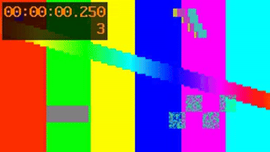

[合成后缩小 MP4](docs/assets/timeline-preview-20261020-v78-r6/scaled-preview.mp4) · [无损RGBA/PCM](docs/assets/timeline-preview-20261020-v78-r6/scaled-reference.nut)

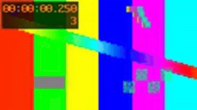

[透明作者图的观看副本 MP4](docs/assets/timeline-preview-20261020-v78-r6/alpha-preview.mp4) · [无损RGBA/PCM](docs/assets/timeline-preview-20261020-v78-r6/alpha-reference.nut)

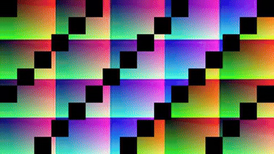

[NTSC末帧 PNG](docs/assets/timeline-preview-20261020-v78-r6/ntsc-frame.png) · [NTSC单帧 MP4](docs/assets/timeline-preview-20261020-v78-r6/ntsc-preview.mp4) · [可编辑工程包](docs/assets/timeline-preview-20261020-v78-r6/editable-project.zip)。单帧不足8fps GIF一步，未人为延长动画。

上下文探针：[跨转场 MP4](docs/assets/timeline-preview-20261020-v78-contexts-r3/transition-preview.mp4) · [R3伸缩区间 MP4](docs/assets/timeline-preview-20261020-v78-contexts-r3/rubberband-preview.mp4) · [隔离安装探针](docs/validation/evidence/timeline-preview-20261020-v78/contexts-installed-r2/verification.json)。
<!-- /V78-CURRENT -->

<!-- R12-CURRENT -->
2026-10-20 **R12（OpenFilm 0.2.3 源码复核，产品仍为 V77）**：固定 `284f8bd3d6850ceaa773043e2ecb90e13640f547`；社区快照 **1524 stars/153 forks，22:12:10 Asia/Taipei**。757→781 文件中 **616 不变、27 新增、138 修改、3 删除**。本轮为源码研究，完整 [复用清单、成本和接入边界](docs/OpenFilm_0.2.3增量复用与开发成本评估_2026-10-20.md) 已更新；没有新增产品 CLI/成片验收或再次累计 V77 的 1746 项历史回归。

| 编号 | 实际核验 /新发现 | 结果与证据 |
|---|---|---|
| R12-01 | 全树、MIT 与 14 个候选入口 | MIT 不变；8 不变/4 修改/2 新增。[全树与命令收据](docs/validation/evidence/openfilm-023-20261020-r12/run-r1/verification.json) |
| R12-02 | 五份上游原始纯函数测试 | **46/46，0 跳过**：工程文档 30、帧率 1、组件参数 3、模板控制 9、撤销栈 3；原生 Node 类型擦除，不代表完整上游安装或渲染验收 |
| R12-03 | 缓存正确性和组件输入 | **4 组观察/8 断言**：素材 SHA 改变而大小+mtime 相同时 key 不变；组件接入仍须本地资产、变量名与匹配序号预算。[真实观察和原片段](docs/validation/evidence/openfilm-023-20261020-r12/probe-r1/verification.json) |
| R12-04 | 可复用内容与工程量 | 组件字段：原型 1–2 /生产化 3–5 人日；内容缓存：2–4 /7–12；NLE 基础导出：3–6 /8–15。均为限定范围估计，未宣称已实现或实际节省 |
| R12-05 | Skill/providers 与产品完整性 | 10 套/31 个 Skill 文件不变，**0 新安装**；29 provider 文件中 6 修改，与离线模型分开计数。两次研究的 **233 个产品输入 SHA 均未变** |

新增价值是可命名/重置的组件参数与保调音频预览；FCPXML、预览缓存和诊断核心不变。沿用本项目工程与本地执行链；不接入上游 GUI、安装器和云 provider。[未实现的接入设计](docs/specs/OpenFilm组件参数与预览缓存接入边界_v0.1_2026-10-20.md)。本轮没有新视频/GIF；已有原输入及实际输出见 [V70](docs/validation/OpenFilm同批次结果复用实测_2026-10-20.md)、[V71](docs/validation/透明视频多帧联系表与Alpha核验实测_2026-10-20.md)、[V72](docs/validation/HTML子帧快门与透明混合实测_2026-10-20.md)。
<!-- /R12-CURRENT -->

<!-- V77-CURRENT -->
2026-10-20 **V77（八色 HSL 原生提速与离线发行限定验收）**：catalog **0.8.1／46 项**；本地 C11 frei0r 像素内核＋有界作者表达式 DAG，保留原八色 HSL、25 表达式通道和作者模型；既有 **10 类／34 命令通道**不增计。默认校验摘要后选原生模块，可显式 native／expression；完整性错误拒绝。完整原生回归 **1746/1746、2940.352 秒、0 跳过、233 冻结输入＋8 外部夹具前后相同**；本轮新增 19 内核＋2 安装方法，原 HSL 29 和安装 22 专项均为全量子集。最终专项 **19/19（4.806s）、29/29（42.425s）、22/22（2.993s）**，均无跳过。原生 **24 CLI／50 检查**，四组各 24 帧，独立 colorsys＋source-over RGB 最大差均 **1/255**；Alpha、每组完整 **96,000 帧立体声 PCM**、全部 PTS 和包重建分别核验。离线 **153 资源／7 wheels／27 隔离 CLI＋1 来源探针／13 检查**，源／平台 wheel／安装逐字节一致，安装成片与开发解码和内核元数据一致；17 Skills／310 本地引用与发现联接均核对。**1080p 最终滤镜探针 52.97–67.43fps（60 帧×3，null 输出，最多 3 后台线程＋调用线程）；完整 CLI 静态八色 11.35–13.18fps、强度动画 11.54–12.20fps，未达 30fps。**完整 CLI 包含校验、解码、合成、H.264/AAC 编码和清单，且并发回归；不能把滤镜吞吐当实时预览。保留构建／夹具失败、安装器标签缺口、漏打包 HTML 脚本及两次停止全量。未连续审片／听审；自然质量、HDR、交互预览和完整剪映等价未验收。

[原生契约](docs/specs/八色HSL原生像素内核与表达式DAG契约_v0.1_2026-10-20.md) · [实测与失败](docs/validation/八色HSL原生提速与离线发行实测_2026-10-20.md) · [最终回归](docs/validation/evidence/native-hsl-20261020-v77/full-r3.json)

| 编号 | 功能性核验／实测 | 实际结果 | 证据 |
|---|---|---|---|
| V77-01 | 原生内核与程序 | 19/19；RGBA／geq 对照、六插值、非线性时钟、奇数步幅、并发、惰性分支、非法程序与完整性 | [记录](docs/validation/evidence/native-hsl-20261020-v77/native-targeted-r4.json) |
| V77-02 | 既有作者模型 | 29/29；保留八色定义、窗口／反转、区间、预算、工程包／片段和中性旁路 | [记录](docs/validation/evidence/native-hsl-20261020-v77/hsl-targeted-r4.json) |
| V77-03 | 真实 CLI 四组色彩 | 24 CLI／50 检查；每组24帧，独立 RGB 最大差1、Alpha／完整PCM／PTS分别核验 | [记录](docs/validation/evidence/native-hsl-20261020-v77/native-r3/verification.json) |
| V77-04 | 平台 wheel 与离线 | 153资源／7wheels，py3-none-win_amd64；27隔离CLI＋1来源探针／13检查，安装成片相同 | [记录](docs/validation/evidence/native-hsl-20261020-v77/installed-r3/verification.json) |
| V77-05 | 安装平台限制 | 22/22；接受无 CPython C ABI 的 Windows x64，仍拒绝 ARM／Linux／win32／错误 Python ABI | [记录](docs/validation/evidence/native-hsl-20261020-v77/offline-targeted-r3.json) |
| V77-06 | 1080p 滤镜吞吐 | 52.97–67.43fps；各60帧×3；filter_threads=1，C内核另有最多3后台线程＋调用线程 | [记录](docs/validation/evidence/native-hsl-20261020-v77/fastpath-r5.json) |
| V77-07 | 完整 CLI 速度 | 静态八色 11.35–13.18fps；强度动画 11.54–12.20fps；均未达30fps | [记录](docs/validation/evidence/native-hsl-20261020-v77/cli-r2/verification.json) |
| V77-08 | 完整回归 | 1746/1746；2940.352秒；0跳过；233输入＋8夹具 | [记录](docs/validation/evidence/native-hsl-20261020-v77/full-r3.json) |
| V77-09 | 历史拒绝与修复 | 安装器拒绝新平台标签；修复后仍检查平台边界；失败收据保留 | [记录](docs/validation/evidence/native-hsl-20261020-v77/installed-r1/verification.json) |
| V77-10 | 打包遗漏与修正 | 实际安装152项，补回既有openfilm_text_bounds.mjs；核验器兼容wheel标准purelib布局 | [记录](docs/validation/evidence/native-hsl-20261020-v77/installed-r2/verification.json) |
| V77-11 | 中止的全量 | full-r1、full-r2均停止自有unittest树并保留失败终态，不纳入通过计数 | [记录](docs/validation/evidence/native-hsl-20261020-v77/full-r2-stop.json) |
| V77-12 | 静态目检边界 | 只静看最终开发／安装两张PNG；未连续播放、听审或验收自然质量 | [记录](docs/validation/evidence/native-hsl-20261020-v77/static-review-r1.json) |
| V77-13 | 完整 CLI 有界诊断 | 另1次带cProfile的实际渲染；FFmpeg指纹及子进程等待可见，不把受扰动计时当fps基准 | [记录](docs/validation/evidence/native-hsl-20261020-v77/profile-r1/verification.json) |

四组输入为自制 CC0 静态色带／透明区、棋盘和合成双声道声音，非自然实拍。[前景 PNG](docs/assets/native-hsl-20261020-v77-native-r3/foreground-original.png) · [棋盘 PNG](docs/assets/native-hsl-20261020-v77-native-r3/background-original.png) · [原始 WAV](docs/assets/native-hsl-20261020-v77-native-r3/audio-original.wav) · [原输入视频预览](docs/assets/native-hsl-20261020-v77-native-r3/source-preview.mp4)。

[红橙色相 MP4](docs/assets/native-hsl-20261020-v77-native-r3/red-orange.mp4) · [精确 FFV1／PCM](docs/assets/native-hsl-20261020-v77-native-r3/red-orange-lossless.mkv)

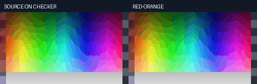

[蓝色饱和度 MP4](docs/assets/native-hsl-20261020-v77-native-r3/blue-saturation.mp4) · [精确 FFV1／PCM](docs/assets/native-hsl-20261020-v77-native-r3/blue-saturation-lossless.mkv)

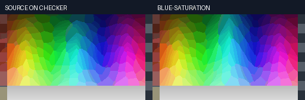

[洋红明度 MP4](docs/assets/native-hsl-20261020-v77-native-r3/magenta-lightness.mp4) · [精确 FFV1／PCM](docs/assets/native-hsl-20261020-v77-native-r3/magenta-lightness-lossless.mkv)

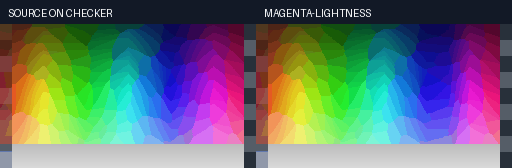

[八色强度 MP4](docs/assets/native-hsl-20261020-v77-native-r3/grade-intensity.mp4) · [精确 FFV1／PCM](docs/assets/native-hsl-20261020-v77-native-r3/grade-intensity-lossless.mkv)

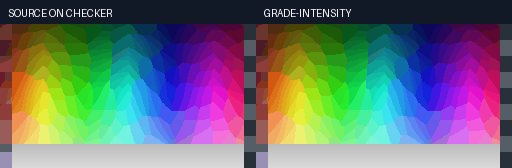

完整 1080p CLI 的移动测试图与实际成片（均为合成测试素材）：[原视频](docs/assets/native-hsl-20261020-v77-cli-r2/source-testsrc2.mp4) · [无 HSL 对照](docs/assets/native-hsl-20261020-v77-cli-r2/control.mp4) · [静态八色](docs/assets/native-hsl-20261020-v77-cli-r2/eight-band.mp4) · [强度动画](docs/assets/native-hsl-20261020-v77-cli-r2/animated-intensity.mp4)。
<!-- /V77-CURRENT -->

<!-- V76-CURRENT -->
2026-10-20 **V76（八色分区 HSL 限定功能验收）**：catalog **0.8.0／46 项**；新增八色各 H/S/L＋最终 RGB 强度 **25 个表达式通道**，原生命令仍为 **10 类／34 通道**。按原始色相相邻权重同时分区，灰阶与输入 Alpha 保留；作者时钟、六插值、拆分／反转、区间、工程包／片段重建均核验。修复片段／区间效果超大整数校验，静态中性／零强度旁路不消耗执行配额。完整原生回归 **1725/1725、2092.459 秒、0 跳过、225 冻结输入＋8 外部夹具前后相同**；29 新方法为全量子集。专项 **29/29、17.722 秒、0 跳过**。开发 **24 CLI／50 检查**，四组各 24 帧，独立 colorsys＋source-over 参照的 RGB 最大差均 **1/255**，输出 Alpha、每组完整 **96,000 帧立体声 PCM** 和每帧 PTS 分别检查。离线 **147 资源／7 wheels／27 隔离 CLI＋1 模块来源探针／12 安装检查**，开发／安装全部解码摘要、参数／内核元数据和 PTS 一致；17 Skills／302 本地引用，发行联接与正文均核对。**1080p 单滤镜线程、各 3 帧探针：单色区／八色约 21.040／26.856 秒/帧，未达 30fps；性能仍是明确缺口。**保留首轮 1 failure／2 errors 和参照修正；仅静看最终两张 PNG，未连续审片／听审。本轮为 8 位编码 RGB 算法验收；自然质量、实时预览、线性光／HDR及完整剪映等价未验收。

[契约](docs/specs/八色分区HSL与关键帧契约_v0.1_2026-10-20.md) · [实测与失败](docs/validation/八色分区HSL与离线发行实测_2026-10-20.md) · [当前回归](docs/validation/evidence/selective-hsl-20261020-v76/full-r1.json)

| 编号 | 功能性核验／实测 | 实际结果 | 证据 |
|---|---|---|---|
| V76-01 | 旧版本缺口 | ea232b9 未发现八色效果、没有生成滤镜；六帧解码与输入相同，223 旧输入不变 | [记录](docs/validation/evidence/selective-hsl-20261020-v76/baseline-r1.json) |
| V76-02 | 25 通道与作者时钟 | 29/29；正负值、六插值、灰阶、Alpha、线程、实例、共享预算、旁路、包／片段、拆分／反转／区间 | [记录](docs/validation/evidence/selective-hsl-20261020-v76/targeted-r4.json) |
| V76-03 | 红橙色相 | 24 帧动画；独立全 RGB 最大差 1；Alpha／完整 PCM／PTS 分别检查 | [记录](docs/validation/evidence/selective-hsl-20261020-v76/native-r2/verification.json) |
| V76-04 | 蓝色饱和度 | 24 帧；蓝色去饱和＋静态青色明度；RGB 最大差 1，灰阶中性 | [记录](docs/validation/evidence/selective-hsl-20261020-v76/native-r2/verification.json) |
| V76-05 | 洋红明度 | 24 帧；明度动画＋静态紫色色相；RGB 最大差 1 | [记录](docs/validation/evidence/selective-hsl-20261020-v76/native-r2/verification.json) |
| V76-06 | 八色强度动画 | 24 帧；最终编码 RGB 强度混合；RGB 最大差 1，工程包解码逐字节重建 | [记录](docs/validation/evidence/selective-hsl-20261020-v76/native-r2/verification.json) |
| V76-07 | 原生离线安装 | 147 资源逐字节一致、7 wheels；27 隔离 CLI＋1 来源探针／12 检查，四组解码相同 | [记录](docs/validation/evidence/selective-hsl-20261020-v76/installed-r1/verification.json) |
| V76-08 | 完整回归 | 1725/1725；2092.459 秒；0 跳过；225 输入＋8 夹具 | [记录](docs/validation/evidence/selective-hsl-20261020-v76/full-r1.json) |
| V76-09 | 静态审查范围 | 查看开发／安装 PNG；未连续播放、听审或验收自然素材 | [记录](docs/validation/evidence/selective-hsl-20261020-v76/static-review-r1.json) |
| V76-10 | 首轮失败与参照修正 | 24 方法含 1 failure／2 errors；真实整数溢出修复，发现读取路径和 ease_in_out 参照修正 | [记录](docs/validation/evidence/selective-hsl-20261020-v76/targeted-r1.log) |
| V76-11 | 中间检查边界 | 26 方法阶段的区间测试覆盖不足已纠正；最终 29 方法直接要求实际区间结构化错误 | [记录](docs/validation/evidence/selective-hsl-20261020-v76/targeted-r2.json) |
| V76-12 | 1080p 性能缺口 | 单线程单色区／八色 21.040／26.856 秒/帧；3 帧、各一次、含启动且并发回归，不能实时预览 | [记录](docs/validation/evidence/selective-hsl-20261020-v76/performance-r1.json) |

原输入是自制 CC0 静态色带／透明区域和双声道正弦，**不是自然实拍视频**。[前景 PNG](docs/assets/selective-hsl-20261020-v76-native-r2/foreground-original.png) · [棋盘 PNG](docs/assets/selective-hsl-20261020-v76-native-r2/background-original.png) · [双声道 WAV](docs/assets/selective-hsl-20261020-v76-native-r2/audio-original.wav) · [静态输入视频预览](docs/assets/selective-hsl-20261020-v76-native-r2/source-preview.mp4)。

[红橙色相 MP4](docs/assets/selective-hsl-20261020-v76-native-r2/red-orange.mp4) · [FFV1／PCM 精确参照](docs/assets/selective-hsl-20261020-v76-native-r2/red-orange-lossless.mkv)


[蓝色饱和度 MP4](docs/assets/selective-hsl-20261020-v76-native-r2/blue-saturation.mp4) · [FFV1／PCM 精确参照](docs/assets/selective-hsl-20261020-v76-native-r2/blue-saturation-lossless.mkv)


[洋红明度 MP4](docs/assets/selective-hsl-20261020-v76-native-r2/magenta-lightness.mp4) · [FFV1／PCM 精确参照](docs/assets/selective-hsl-20261020-v76-native-r2/magenta-lightness-lossless.mkv)


[八色强度 MP4](docs/assets/selective-hsl-20261020-v76-native-r2/grade-intensity.mp4) · [FFV1／PCM 精确参照](docs/assets/selective-hsl-20261020-v76-native-r2/grade-intensity-lossless.mkv)


<!-- /V76-CURRENT -->

<!-- V75-CURRENT -->
2026-10-20 **V75（空间／抠像效果关键帧限定验收）**：catalog **0.7.0**，45 项效果不增计；新增高斯模糊、颜色对比、镜头畸变、RGB 抠像 **4 类／14 数值通道**，累计 **10 类／34 原生命令通道**。支持作者时钟、六插值、窗口／拆分、完整输出反转、工程包／片段跨项目重建和递归预算。修复超大整数校验异常、静态及动态抠像覆盖原有 Alpha、颜色对比目录默认值；模糊零半径为精确中性。完整原生回归 **1696/1696、2120.997 秒、0 跳过、223 冻结输入＋8 外部夹具前后相同**；29 新方法为全量子集。专项 **29/29、16.696 秒、0 跳过**。开发 **24 CLI／36 检查**，四组各 24 帧，独立静态原生选项＋source-over 参照的全 RGB 最大差均 **0**，输出 Alpha 与每组完整 **96,000 帧立体声 PCM** 精确。离线 **146 资源／7 wheels／27 隔离 CLI＋1 模块来源探针／12 安装检查**，开发／安装全部解码摘要、作者参数、抠像覆盖元数据及每帧 PTS 一致；17 Skills／294 本地引用，发行联接与正文均核对。保留全部失败和已停止的 full-r1；只静看最终开发／安装两张联系图，未连续审片或听审。gblur 会处理 Alpha，colorkey 的 RGB 距离覆盖乘以该阶段输入 Alpha，镜头采用原生采样；自然绿幕／去溢色、线性光／HDR、长片性能和完整剪映等价未验收。

[契约](docs/specs/空间滤镜与抠像参数关键帧契约_v0.1_2026-10-20.md) · [实测与失败](docs/validation/空间滤镜与抠像关键帧实测_2026-10-20.md) · [当前回归](docs/validation/evidence/spatial-automation-20261020-v75/full-r2.json)

| 编号 | 功能性核验／实测 | 实际结果 | 证据 |
|---|---|---|---|
| V75-01 | 旧版本基线 | 5fcff32f 的四类动态曲线均未生成控制，10 个相同输入帧的输出仍恒定；222 旧输入不变 | [记录](docs/validation/evidence/spatial-automation-20261020-v75/baseline-r1.json) |
| V75-02 | 作者与原生命令 | 29/29；14 通道、六插值、分数帧率、实例、边界、缓存、预算、窗口、反转、包／片段、静态／动态 Alpha 和独立预算 | [记录](docs/validation/evidence/spatial-automation-20261020-v75/targeted-r5.json) |
| V75-03 | 模糊聚焦 | 24 帧；两轴半径动画；独立 RGB 最大差 0；Alpha／完整 PCM 一致 | [记录](docs/validation/evidence/spatial-automation-20261020-v75/native-r3/verification.json) |
| V75-04 | 镜头畸变 | 24 帧；k1 动画；独立 RGB 最大差 0；Alpha／PCM 一致 | [记录](docs/validation/evidence/spatial-automation-20261020-v75/native-r3/verification.json) |
| V75-05 | RGB 绿幕 | 24 帧；similarity 动画；独立 RGB 最大差 0；透明输入保持不可见，覆盖乘积与 PCM 一致 | [记录](docs/validation/evidence/spatial-automation-20261020-v75/native-r3/verification.json) |
| V75-06 | 颜色对比 | 24 帧；系数与静态权重实际生效；独立 RGB 最大差 0 | [记录](docs/validation/evidence/spatial-automation-20261020-v75/native-r3/verification.json) |
| V75-07 | 原生离线安装 | 146 资源逐字节相同，7 wheels；27 隔离 CLI＋1 来源探针／12 检查；四组成片一致 | [记录](docs/validation/evidence/spatial-automation-20261020-v75/installed-r2/verification.json) |
| V75-08 | 完整回归 | 1696/1696；2120.997 秒；0 跳过；223 输入＋8 夹具 | [记录](docs/validation/evidence/spatial-automation-20261020-v75/full-r2.json) |
| V75-09 | 检查与审片范围 | 自动检查全部 PTS／PCM，静看开发／安装 PNG；未连续播放、听审或验收自然素材 | [记录](docs/validation/evidence/spatial-automation-20261020-v75/static-review-r2.json) |
| V75-10 | 错误与参照修正 | 24 方法首轮含 5 条失败／4 条子测试错误；真实整数溢出已修复，零权重／解析 Bezier 参照修正 | [记录](docs/validation/evidence/spatial-automation-20261020-v75/targeted-r1.log) |
| V75-11 | 抠像原覆盖保护 | 修复前 27 方法中 2 项 Alpha 回归失败；修复后静态／动态／多实例均核验，不把原生覆盖写入当作正确语义 | [记录](docs/validation/evidence/spatial-automation-20261020-v75/targeted-r3-alpha-before-fix.json) |
| V75-12 | 保留未完成全量 | full-r1 为修改前主动停止，终态失败且无方法计数；不纳入通过统计 | [记录](docs/validation/evidence/spatial-automation-20261020-v75/full-r1-stop.json) |

[原始前景 PNG](docs/assets/spatial-automation-20261020-v75-native-r3/foreground-original.png) · [原始棋盘 PNG](docs/assets/spatial-automation-20261020-v75-native-r3/background-original.png) · [原始双声道 WAV](docs/assets/spatial-automation-20261020-v75-native-r3/audio-original.wav) · [静态输入视频预览](docs/assets/spatial-automation-20261020-v75-native-r3/source-preview.mp4)。

[模糊聚焦 MP4](docs/assets/spatial-automation-20261020-v75-native-r3/blur-focus.mp4) · [FFV1／PCM 精确参照](docs/assets/spatial-automation-20261020-v75-native-r3/blur-focus-lossless.mkv)

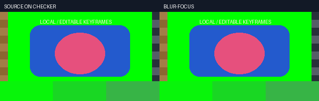

[镜头畸变 MP4](docs/assets/spatial-automation-20261020-v75-native-r3/lens-ramp.mp4) · [FFV1／PCM 精确参照](docs/assets/spatial-automation-20261020-v75-native-r3/lens-ramp-lossless.mkv)

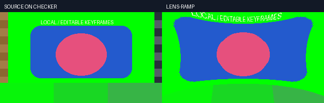

[RGB 抠像 MP4](docs/assets/spatial-automation-20261020-v75-native-r3/key-ramp.mp4) · [FFV1／PCM 精确参照](docs/assets/spatial-automation-20261020-v75-native-r3/key-ramp-lossless.mkv)

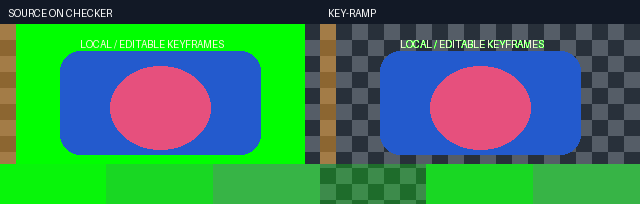

[颜色对比 MP4](docs/assets/spatial-automation-20261020-v75-native-r3/contrast-ramp.mp4) · [FFV1／PCM 精确参照](docs/assets/spatial-automation-20261020-v75-native-r3/contrast-ramp-lossless.mkv)

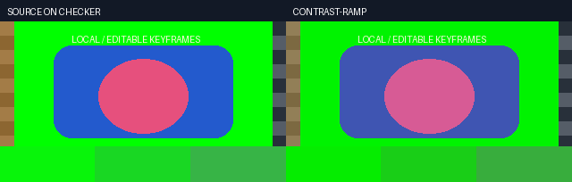
<!-- /V75-CURRENT -->

<!-- V74-CURRENT -->
2026-10-20 **V74（外部混合动画变速限定验收）**：完整输出相对变速现在保留可编辑 `blend.opacity_animation`，支持恒速、既有有界速度曲线、倒放、定格、重复操作和输出窗口；混合仍在原背景上执行，alpha 只乘一次。修复默认 u8 静音进入 tempo 后的 −256 PCM 偏移。完整原生回归 **1667/1667、2517.215 秒、0 跳过、222 冻结输入＋8 外部夹具前后相同**；23 个新增方法是其子集。专项 **23/23、9.975 秒、0 跳过**；原生 **24 CLI/30 检查**，三组各 30 帧独立 RGB 对照最大误差 **0/1/1 个 8 位码值**，输出 alpha 和每组完整 144,000 帧立体声 PCM 精确。离线 **146 资源/7 wheels/27 隔离 CLI＋1 模块来源探针/11 安装检查**；开发/安装解码摘要、作者模型和每帧 PTS 一致。17 Skills / 286 本地引用，发现联接与正文已核对。保留测试输入、旧栅格参考、音频成片失败及中止的 full-r1；静看两张对照 PNG，未连续审片或听审。连续参数与隔离祖先已栅格化帧序有明确边界；HDR、线性光、自然素材、长片性能、全部剪映混合效果与完整等价均未验收。

[契约](docs/specs/外部混合动画与完整输出变速契约_v0.1_2026-10-20.md) · [实测与失败](docs/validation/外部混合动画变速与静音修复实测_2026-10-20.md) · [当前完整回归](docs/validation/evidence/retime-blend-20261020-v74/full-r2.json)

| 编号 | 本轮功能核验/真实执行（2026-10-20） | 结果与边界 | 证据 |
|---|---|---|---|
| V74-01 | 旧程序基线 | 2e3fa5ff 的有效混合曲线相对变速确实被拒；220 已发行输入前后不变 | [记录](docs/validation/evidence/retime-blend-20261020-v74/baseline-r1.json) |
| V74-02 | 作者模型与原生参数 | 23/23；六类插值、分数帧率、重复映射、窗口、关联、预算、缓存、事务、迁移 | [记录](docs/validation/evidence/retime-blend-20261020-v74/targeted-r7.json) |
| V74-03 | 正常叠加 + 2x | 30 帧；全像素独立 RGB 最大差 0；alpha/完整背景 PCM 一致 | [记录](docs/validation/evidence/retime-blend-20261020-v74/native-r3/verification.json) |
| V74-04 | 滤色 + 2x 倒放 + 定格 | 30 帧；全像素 RGB 最大差 1；定格前后作者参数、alpha/PCM 一致 | [记录](docs/validation/evidence/retime-blend-20261020-v74/native-r3/verification.json) |
| V74-05 | 正片叠底 + 1→3 曲线速度 | 30 帧；独立积分逆函数和混合算术最大差 1；alpha/PCM 一致 | [记录](docs/validation/evidence/retime-blend-20261020-v74/native-r3/verification.json) |
| V74-06 | 静音偏移修复 | 本机 FFmpeg 默认 u8 静音 96,000 样本非零，显式浮点后全部为零；保留修复前成片 | [记录](docs/validation/evidence/retime-blend-20261020-v74/silent-audio-baseline-r2.json) |
| V74-07 | 离线安装真实 CLI | 146 资源逐字节相同，7 wheels；27 隔离 CLI＋1 来源探针；三组解码/PTS 与开发相同 | [记录](docs/validation/evidence/retime-blend-20261020-v74/installed-r2/verification.json) |
| V74-08 | 完整回归 | 1667/1667；2517.215 秒；0 跳过；222 输入＋8 夹具 | [记录](docs/validation/evidence/retime-blend-20261020-v74/full-r2.json) |
| V74-09 | 声音与视觉审查边界 | 全量 PCM 与编码 PTS 自动检查；仅静看两张 PNG，未连续播放/听审/自然质量验收 | [记录](docs/validation/evidence/retime-blend-20261020-v74/static-review-r1.json) |
| V74-10 | 工程互换与 Skill | 原生包/片段保留可编辑模型；OTIO/MLT 标为 Unsupported；17 Skills / 286 本地引用，发现联接与正文已核对。 | [记录](docs/validation/evidence/retime-blend-20261020-v74/targeted-r7.json) |

[原始前景 MP4](docs/assets/retime-blend-20261020-v74-native-r3/source-preview.mp4) · [原 RGBA 视频](docs/assets/retime-blend-20261020-v74-native-r3/foreground-original.nut) · [原 PCM](docs/assets/retime-blend-20261020-v74-native-r3/audio-original.wav) · [倒放定格成片](docs/assets/retime-blend-20261020-v74-native-r3/screen-reverse-hold.mp4) · [安装后成片](docs/assets/retime-blend-20261020-v74-installed-r2/screen-reverse-hold.mp4) · [CC0 来源](docs/assets/retime-blend-20261020-v74-LICENSE.txt)

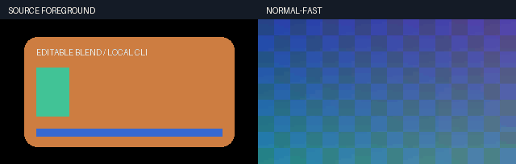

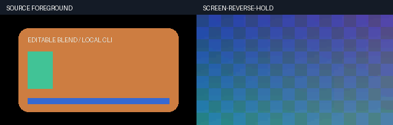

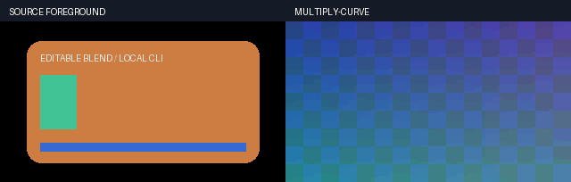
<!-- /V74-CURRENT -->

<!-- V73-CURRENT -->
2026-10-20 **V73（LUT 强度关键帧限定验收）**：catalog **0.6.0** 新增 `lut3d.intensity`，共 6 类/20 个数值通道；四别名、六种插值、作者时钟及共享预算。修复中性 CUBE 静态半强度红蓝索引、常速祖先效果时钟、区间调节层输入分流及项目包 LUT 依赖。完整原生回归 **1644/1644、4143.088 秒、0 跳过、220 冻结输入＋8 外部夹具前后相同**；30 个新方法为其子集。专项 **30/30、16.595 秒、0 跳过**；原生 **8 CLI/9 检查**，24 帧逐帧独立 RGB 对照最大误差 1/255、alpha 全字节一致。**145 资源/7 wheels/11 隔离 CLI＋1 模块来源/12 安装检查**，开发/安装完整解码摘要与每帧 PTS 相同。**17 Skills/278 本地引用**。另各 **7 CLI/2 组解析时钟核验**，线性速度曲线 22 帧、外套 2x 倒放 11 帧，与独立积分逆函数的 RGB 误差≤1；不并入方法数。保留所有旧专项与演示失败；静看对照 PNG，未连续审片或听审。8-bit 编码 RGB 混合；HDR、线性光、全部厂商 LUT 方言、自然调色质量和完整剪映等价未验收。 [契约、实际输入输出与失败记录](docs/validation/LUT强度关键帧与中性调色修复实测_2026-10-20.md)。

| 编号 | 功能性核验 | 实测结果与边界 |
|---|---|---|
| V73-01 | 中性 CUBE 与缓存修复 | 旧 0.5 强度将 (32,96,192,128) 改为 (112,96,112,128)；修复 red-fastest，五档静态中性控制通过；v2 缓存不命中旧错误表 |
| V73-02 | 可编辑动态强度 | 0..1、四别名、六种插值；静态默认 0 不再吞掉关键帧，未知通道/越界/损坏缓存拒绝 |
| V73-03 | 原生像素与透明 | 独立 RGB 算术、逐字节 alpha；原生 24 帧实际视频，单阶段误差≤1 个色值；多级量化单独计界 |
| V73-04 | 时钟与层级 | 非零起点、NTSC、裁切/分割、嵌套自身效果、透明文字和区间调节层；另在开发/安装实际验证线性速度曲线＋外套 2x 倒放，独立积分时钟对照 |
| V73-05 | 本地 LUT 格式 | 实际执行 CUBE 2³、3DL 17³、CSP 2³、DAT 33³；小尺寸 DAT 首轮失败保留，不推断全部方言兼容 |
| V73-06 | 包/片段/重放 | 路径或 lut_id 解析为包内哈希路径，保留原 LUT 字节和可编辑关键帧；导入/片段跨项目像素一致；缺失或登记变更在建包前拒绝 |
| V73-07 | 资源与配额 | 独立 blend target、LUT SHA、命令缓存 SHA、根图共享四项预算；队列绑定实际 LUT 字节 |
| V73-08 | 离线安装 | 7 个已有 wheel，145 资源逐字节匹配；-I -S 新进程重做 CLI/原生参考和解码/PTS 比对 |
| V73-09 | 原视频与 GIF | 精确 NUT 输入含 25 帧端点保护，实际输出/预览各 24 帧；MP4/GIF 为有损预览，RGB 核验使用无损输出 |
| V73-10 | 全量与限制 | 本轮完整回归收据单独记录；专项为子集。LUT 新增专项未调用浏览器；既有完整回归包含 HTML 浏览器测试。无模型/GPU 前向、GUI、网络媒体、Docker/WSL/虚拟环境；不宣称剪映等价 |

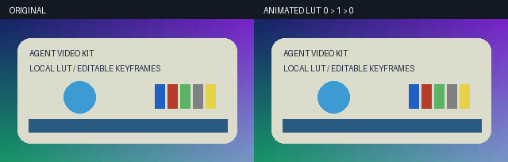

[原视频 MP4](docs/assets/lut-intensity-20261020-v73-native-r5/source-preview.mp4) · [实际 CLI 输出](docs/assets/lut-intensity-20261020-v73-native-r5/edited-cli.mp4) · [无损输出](docs/assets/lut-intensity-20261020-v73-native-r5/edited-lossless.mkv) · [精确源 NUT](docs/assets/lut-intensity-20261020-v73-native-r5/source-original.nut) · [可编辑请求](docs/assets/lut-intensity-20261020-v73-native-r5/timeline-request.json)
<!-- /V73-CURRENT -->

<!-- R11-CURRENT -->
2026-10-20 **R11（OpenFilm 0.2.2 源码与创作工作流复核）**：固定 `695f4a887a97258d45ffe5715eadf537b6d2579b`；社区快照为 **1343 stars/137 forks，2026-10-20 10:26:27 Asia/Taipei**。两版 757 文件中 **718 不变、6 新增、33 修改、6 删除**，MIT 原文不变。实际运行 **1 个上游纯帧率测试＋8 个函数观察**；不运行上游完整渲染。**10 套创作工作流/31 文件**及 29 个 provider 文件与旧版全部字节相同，本次未新增安装 Skill。保留 ZIP 根目录误判的首轮失败及最终收据。研究不增加产品测试通过数或成片验收数。 [完整评估、入口、原始证据与复现](docs/OpenFilm_0.2.2差异复核与复用取舍_2026-10-20.md)。

| 编号 | 本次核验 | 结论与复用边界 |
|---|---|---|
| R11-01 | 最新固定源码、许可与全树 SHA | CLI/desktop 0.2.2；新 ZIP 11,539,861 字节；不混写 R09 的较早 Star 快照 |
| R11-02 | 新帧率规则 | 1 个原测试通过；8 个观察中，1.99 被推断成 2000/1001。当前 CLI 已有显式 num/den，不移植隐式猜测 |
| R11-03 | 十套 Skill 正文 | 10 份正文＋10 封面＋10 元数据＋1 SOURCE；三套已有本地工作流，其余按需求补入现有 Skill，不当作新算法 |
| R11-04 | 可复用模块 | 批次复用、透明联系表、HTML 子帧采样对应 V70/V71/V72；已有工作不重复计算收益。联系表定位素材，运镜/关键帧仍由时间线内核处理 |
| R11-05 | 后续可选项 | FCPXML/xmeml 映射 3–6 人日、重写内容 key 后的区间缓存 2–4 人日，均为限定原型估计；目标 NLE 实际打开和长期质量另计 |
| R11-06 | 未补齐的核心 | 没有因此获得本地抠像、美颜、美体、重光照或完整权利素材库；不宣称剪映完整等价 |

已有功能的独立实测与实际 GIF：[V70 批次复用](docs/validation/OpenFilm同批次结果复用实测_2026-10-20.md)、[V71 透明联系表](docs/validation/透明视频多帧联系表与Alpha核验实测_2026-10-20.md)、[V72 HTML 快门](docs/validation/HTML子帧快门与透明混合实测_2026-10-20.md)。本次 R11 不生成新的画质样例。
<!-- /R11-CURRENT -->

<!-- D01-CURRENT -->
2026-10-20 **D01（原生回归等待取样）**：保存两次非阻塞主线程栈、一次 E 盘 WMI 观察和工具来源摘要。取样时分别位于工程原子写入持久化与 JSON 文件打开路径；单次取样不能解释整轮耗时或证明存储故障。**所核对的 219 个快门候选输入未变，新增功能测试与画质验收均为 0**；正式通过数以各版本全量收据为准。 [方法、原始数据与局限](docs/validation/原生回归文件等待取样记录_2026-10-20.md)。

| 编号 | 实际留证 | 适用范围 |
|---|---|---|
| D01-01 | 2 份 `py-spy --nonblocking` 栈，退出码均为 0 | 无局部变量取样；只说明各自瞬时等待位置 |
| D01-02 | 1 次原生 E 盘 WMI 记录 | 与文件等待相符，不是吞吐基准或故障归因 |
| D01-03 | 工具 wheel 与官方资产 SHA 相符；诊断前后源码摘要相同 | 未全局安装；七个离线 wheel 不变；未中断正在执行的两组 full-r2 |
<!-- /D01-CURRENT -->

<!-- V72-CURRENT -->
2026-10-20 **V72（HTML 子帧快门限定验收）**：采用 OpenFilm 子帧重绘思路，新增可选 `motion html-render --shutter-samples/--shutter-fraction`、源切点与配方重放。中心中点采样＋预乘编码域 sRGB 8-bit；默认/零快门保留原帧路径。隔离分支完整 **1614/1614、9086.433 秒、0 跳过、219 源码输入＋8 外部夹具前后相同**；发布路径字节逐项匹配，21 个快门和 4 个原生 Job 新方法为其子集。专项 **21/21、116.579 秒、0 跳过**；公开原生 **19 CLI/36 检查**，整片 RGBA 对照独立 Python 参考；strict 检查每个实际子帧，打包和片段跨项目重建像素相同。**145 资源/7 wheels/22 隔离 CLI＋1 模块来源/34 安装检查**，开发/安装全部公开输入输出字节一致。**4 次旧安装 CLI**另验默认 PNG、整片 RGBA 与 PTS；不与新安装操作合并。**17 Skills/270 本地引用**。**当前 26 公开文件/14 视频探测**，另保留历史 29 文件/14 复探（总计 55/28）。保留旧 Schema 摘要、Canvas 严格布局测试设置和演示验证命令失败；只静看图片，未连续审片或听审。本轮无模型/GPU 前向、GUI、网络媒体、Docker/WSL/虚拟环境；自然运动、HDR、4K 长片性能和完整剪映等价未验收。 [契约、原输入、实际输出及失败](docs/validation/HTML子帧快门与透明混合实测_2026-10-20.md)。

| 编号 | 功能性核验 | 本轮实际结果与边界 |
|---|---|---|
| V72-01 | 子帧重绘与确定性 | 4 个真实时刻/输出帧，三次新鲜上下文逐子帧相同；中心中点相位 |
| V72-02 | 透明与整片像素 | 锐利/无切点/显式切点各 16 帧，独立 Python 逐像素参考；默认、零快门、半透明和隐藏 RGB 控制 |
| V72-03 | 时间与场景边界 | 8fps/2s/16 帧精确 PTS；cut_tick=89100 防止声明切点跨场；不自动推断未声明切点 |
| V72-04 | strict 与取消 | 所有实际子帧的 DOM 门禁；Canvas 语义文字继续拒绝；首合成帧后实际取消及进程回收 |
| V72-05 | 结构化复用 | 原生 19 CLI/36 检查；项目打包/导入和片段跨项目重建整片 RGBA 相同 |
| V72-06 | 独立离线安装 | 145 资源/7 wheels/22 隔离 CLI＋1 模块来源/34 检查；全部公开产物字节相同 |
| V72-07 | 历史默认兼容 | 4 次旧安装 CLI；旧/新默认 PNG、RGBA、PTS 相同，容器摘要实际记录；不是所有模板兼容声明 |
| V72-08 | 完整回归 | 隔离分支完整 1614/1614、9086.433 秒、0 跳过、219 源码输入＋8 外部夹具前后相同；发布路径字节逐项匹配，21 个快门和 4 个原生 Job 新方法为其子集。 |
| V72-09 | 公开证据与限制 | 当前 26 文件/14 探测，历史 29 文件/14 复探；输入 HTML、实际 NUT/MP4/GIF、失败原记录；未连续审片或接受自然/HDR/剪映完整效果 |

原始输入：[可编辑 HTML](docs/assets/html-shutter-20261020-v72-native-r3/source/index.html)、[锐利预览 MP4](docs/assets/html-shutter-20261020-v72-native-r3/sharp.mp4)；实际输出：[透明 NUT](docs/assets/html-shutter-20261020-v72-native-r3/cut-alpha.nut)、[三列 MP4](docs/assets/html-shutter-20261020-v72-native-r3/comparison.mp4)。三列依次为锐利、未声明内部切点的快门、有显式切点的快门；均为实际输出，GIF 为量化预览。

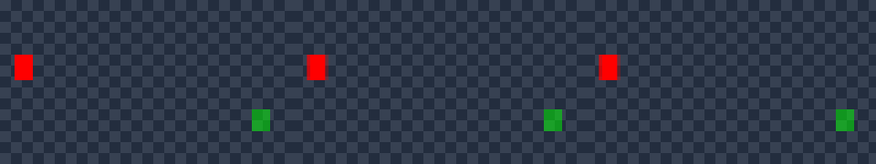
<!-- /V72-CURRENT -->

<!-- V71-CURRENT -->
2026-10-20 **V71（透明联系表限定验收）**：参考 OpenFilm `lookMedia`，新增原生 `media contact-sheet`；透明视频按实际 PTS 输出棋盘格、浅底、深底、Alpha 四视图。显式锚点选择请求时刻或之后的首个可解码帧，0.17 秒样例实际为 0.25 秒，不伪造精确播放定位。隔离分支完整 **1593/1593、9056.192 秒、0 跳过、217 源码输入＋8 外部夹具前后相同**，发布工作区相同相对路径字节逐项匹配；25 个联系表和 4 个原生 Job 新方法为其子集。联系表专项 **25/25、107.100 秒、0 跳过**。开发原生 **7 CLI/35 检查**；四锚点均与完整 24 帧解码对应帧逐字节一致，16 面板通过独立 Alpha 像素对照。**144 资源/7 wheels/10 隔离 CLI＋1 模块来源/38 安装检查**，安装联系表 PNG、来源帧、Alpha、PTS 和字体摘要与开发版一致。原生 Job **4/4**与受控提前退出对照通过；修复挂起创建→加入 Job→恢复主线程，8 份外部夹具显式绑定。**17 Skills/264 本地引用**。**当前 33 公开文件、6 次实际视频探测**（另留 33 历史文件）；静看开发/安装两张图，未连续播放或听审。本版无 GUI、浏览器、模型前向或网络媒体请求；8-bit 抽样预览不验收自然人像、HDR、长片性能或完整剪映等价。 [契约、原视频、实际图片及失败](docs/validation/透明视频多帧联系表与Alpha核验实测_2026-10-20.md)。

| 编号 | 功能性核验 | 本轮结果与边界 |
|---|---|---|
| V71-01 | 透明解码 | VP9/libvpx；4 帧与独立完整解码逐字节一致，各 Alpha 0..255 |
| V71-02 | 实际时间锚点 | 请求 0/0.17/0.75/1.5 秒→实际 0/0.25/0.75/1.5 秒；整数 PTS＋有理数时基 |
| V71-03 | 四种视图 | 4 锚点/16 面板独立逐像素 Alpha 对照；自动 count 是去重后的数量上限 |
| V71-04 | 时钟与失败 | VFR、非零起点、1200 秒偏移、SAR、缩放、图片、源变化、真实进程取消；超时与写盘故障注明测试替身 |
| V71-05 | 原生 CLI | 7 CLI/35 检查；9 次脚本直接进程调用已含 CLI，不是子进程树总计；创作字节不改写 |
| V71-06 | 独立安装 | 144 资源、7 wheels、10 隔离 CLI＋1 模块来源、38 检查；联系表原字节及解码证据相同 |
| V71-07 | 完整回归 | 隔离分支完整 1593/1593、9056.192 秒、0 跳过、217 源码输入＋8 外部夹具前后相同，发布工作区相同相对路径字节逐项匹配；25 个联系表和 4 个原生 Job 新方法为其子集。 |
| V71-08 | 演示与质量 | 原始 MP4、透明 WebM、实际 2560×444 PNG；当前 33 文件/6 探测，历史另存；静看 2 图，未连续播放或听审 |
| V71-09 | 原生进程生命周期 | 4/4；挂起创建、加入 Job 后恢复、20 快速子进程、真实后代回收；注入调度窗口另标 |
| V71-10 | 历史失败 | 首轮完整 1589 项：51 失败/20 错误，70 夹具缺失/1 Job 加入失败；原报告和测试控制失败保留 |

原始输入：[MP4 预览](docs/assets/contact-sheet-20261020-v71-native-r2/source-preview.mp4)、[透明原始 MKV](docs/assets/contact-sheet-20261020-v71-native-r2/source.mkv)、[实际透明 WebM](docs/assets/contact-sheet-20261020-v71-native-r2/source-alpha.webm)；[安装版实际输出](docs/assets/contact-sheet-20261020-v71-installed-r2/contact/contact.png)。

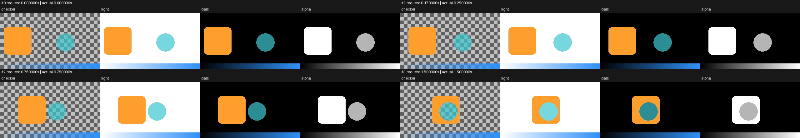
<!-- /V71-CURRENT -->

<!-- V70-CURRENT -->
2026-10-20 **V70（同批次结果复用限定验收）**：参考 OpenFilm 的批次规则，新增显式 `queue run --reuse-identical`，仅本次调用、同项目、单 worker。实际源字节、有效设置、权利和运行实现绑定摘要；复制另建 operation/manifest，编码证据保留来源身份。完整 **1564/1564、4147.745 秒、0 跳过、214 输入冻结**；28 新契约方法为其子集。针对性 **28/28、62.954 秒、0 跳过**。开发版 **10 次 CLI、22 项检查**；6 个作业中 5 成功/1 参数拒绝，真实 **3 次编码、2 次复制**；普通 MP4、透明 WebM 的副本逐字节、全部 24 帧、PTS、PCM 相同。**143 资源/7 wheels/13 次隔离 CLI＋1 次模块来源检查/38 项安装检查**；安装版独立重复样例，全部帧/PTS/PCM 与开发版相同。真实 ffconcat 伪装登记另 5 CLI＋1 FFprobe，在编码前拒绝；**17 Skills/260 本地引用**。本次为程序生成的 320×180/12 fps/2 秒技术素材；静看两张首帧联系图，未连续播放或听审。**未验收自然素材效果、吞吐提升、跨调用缓存或完整剪映等价**。 [契约、原片/GIF、收据与保留的失败](docs/validation/OpenFilm同批次结果复用实测_2026-10-20.md)。

| 编号 | 功能性核验 | 当前结果与边界 |
|---|---|---|
| V70-01 | 内容签名 | 深层 JSON、归一化默认值、实际媒体/字体/LUT/蒙版/权利/运行摘要；同大小恢复 mtime 仍失效 |
| V70-02 | 原生队列 | 10 CLI、22 检查；5 成功/1 参数拒绝；3 编码/2 复制，不把参数拒绝计作编码 |
| V70-03 | 成片一致 | MP4 与透明 WebM 各一对；文件、全部 24 帧 RGBA、PTS、PCM 相同；256×144 另编码 |
| V70-04 | 透明与来源 | WebM Alpha 最小 0/最大 255；新 manifest 命令为空、标注未执行编码，保留来源证据 |
| V70-05 | 依赖/失败/默认行为 | 默认关闭、跨调用不复用、派生缓存变化、源/manifest 损坏、复制取消与写盘失败等；执行器故障注入属于测试替身 |
| V70-06 | 实际容器重探测 | 真实 ffconcat 伪装 png_pipe；5 CLI＋1 FFprobe，QUEUE_REUSE_UNSUPPORTED，0 编码/0 复制 |
| V70-07 | 原生安装 | 143 资源原字节、7 wheels、13 隔离 CLI＋1 模块来源、38 检查；安装版解码结果与开发版一致 |
| V70-08 | 完整回归 | 完整 1564/1564、4147.745 秒、0 跳过、214 输入冻结；28 新契约方法为其子集。 |
| V70-09 | 演示与质量 | 2 张首帧联系图已静看；GIF 实际 12 帧/2 秒；未连续播放/听审、未验收自然素材/性能/剪映等价 |
| V70-10 | 发行格式检查 | 首次暂存检查因测试文件 EOF 空行中止；保留已执行源码字节，设置该文件格式规则并重新核对暂存；[原边界收据](docs/validation/evidence/openfilm-batch-reuse-20261020-v70/publication-format-boundary-r1.json) |

原始输入：[透明 FFV1/PCM](docs/assets/openfilm-batch-reuse-20261020-v70-native-r3/source.mkv)、[MP4 预览](docs/assets/openfilm-batch-reuse-20261020-v70-native-r3/source-preview.mp4)；实际输出：[首次 MP4](docs/assets/openfilm-batch-reuse-20261020-v70-native-r3/first.mp4)、[复制 MP4](docs/assets/openfilm-batch-reuse-20261020-v70-native-r3/renamed.mp4)、[透明 WebM](docs/assets/openfilm-batch-reuse-20261020-v70-native-r3/alpha-copy.webm)。下图为复制 MP4 的缩小 GIF，实际 12 帧/2 秒、无声，不代替 24 帧视频和机器核验。

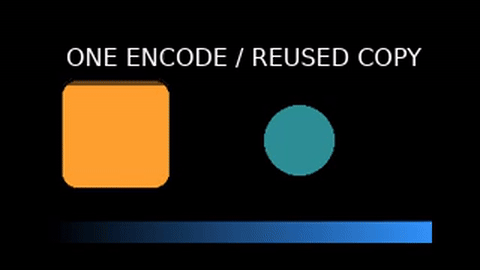
<!-- /V70-CURRENT -->

<!-- V69-CURRENT -->
2026-10-20 **V69（CPU 人脸契约限定验收）**：本地 OpenSeeFace 66 点逐帧锚点，显式磨皮/曝光/瘦脸/眼部放大；默认零强度，缺失/切点清空几何关联，保存完整地标配方并显式重放。完整 **1536/1536、3748.515 秒、0 跳过、212 输入冻结**；16 新契约方法为子集。开发 **16 次基础 CLI/39 条原检查/24 帧，24 次真实检测＋20 次地标**；四项独立控制另 20 检查、0 新模型前向。**142 包内资源/7 wheels/19 次基础隔离 CLI＋1 模块来源检查**；开发/安装另各 1 次 worker 启动后取消核验。安装版另 24 检测/20 地标，全部 RGBA/PCM 与开发相同。**17 Skills/256 引用**。原 Alpha、范围外 RGB、中性输出、逐帧 PTS/PCM、取消/超时回滚通过；PNG 中文路径和 FFV1 色彩标签失败保留。素材为 NASA 静照生成的平移/空脸段，静看 3 帧和控制联系图，未连续播放/听审；**自然动态美颜、透明人脸边缘、美妆/身体及完整剪映等价未验收**。暂存 CRLF 检查曾中止；已保留日志并修正规则，源码与实测文件原字节保留。 [原片/GIF/失败与发行](docs/validation/离线人脸锚点与局部修饰实测_2026-10-20.md)。

| 编号 | 核验 | 结果与范围 |
|---|---|---|
| FACE-V01 | 模型/坐标 | 固定 OpenSeeFace，作者预处理与解码对照；66 点不是身份或皮肤精分 |
| FACE-V02 | 真实视频 | 24 帧、4 帧无脸、切点/缺失重置；24 检测/20 地标，不以回调计推理 |
| FACE-V03 | 四项修饰/重放 | 中性 RGBA、原 Alpha、范围外样本、PTS/PCM；保存地标配方重放 0 模型前向 |
| FACE-V04 | 回滚与退出 | 坏选择 2、取消 8、真实超时 6；额外各 1 次证明 worker 启动后取消；作者字节恢复、无半成品、自有进程回收 |
| FACE-V05 | 逐控制 | 4 项独立实际输出、20 检查；不接受自然纹理/遮挡质量 |
| FACE-V06 | 原生发行 | 142 资源、19 基础隔离 CLI＋1 次 worker 取消、1 模块来源检查，全部 RGBA/PCM 与开发相同 |
| FACE-V07 | 完整回归 | 完整 1536/1536、3748.515 秒、0 跳过、212 输入冻结；16 新契约方法为子集。 |
| FACE-V08 | 开放质量 | 静照平移与静帧不能验收自然动态、美妆/身体或完整剪映质量 |

原片：[MP4](docs/assets/local-face-beauty-20261020-v69-native-r5/source.mp4)；实际输出：[MP4](docs/assets/local-face-beauty-20261020-v69-native-r5/retouched.mp4)。GIF 左原片、右组合控制；实际 23 帧/2.88 秒/无声，是静照平移技术样例，不代替完整 24 帧视频检查。


<!-- /V69-CURRENT -->

<!-- V68-CURRENT -->
2026-10-20 **V68（CLI/协议/发行限定核验）**：显式 `media inpaint|outpaint --temporal-context previous`，把同场景、同一全局帧已经正式输出的生成选区交给后窗，保留已输出前缀；默认/`none` 保持旧路径。完整 **1520/1520、3573.275 秒、0 跳过、204 输入冻结**；65 项 VACE 定向是子集，新增 24 方法。**135 包内资源/7 wheels/28 隔离 CLI**，另 1 次安装模块契约调用；开发/安装各 8 帧真实 LaMa 控制，全部 RGBA/PCM 相同；**17 Skills/250 引用**。真实 VACE previous 在文本权重准入阶段拒绝：物理可用 5146 MiB，要求 7936 MiB；CLI 退出码 6，**0 有效 VACE 前向/无成片**，原错误和诊断保留。 当前 none/previous 的真实成片对照及自然质量仍未验收。 **完整剪映等价未验收**。 [编号核验、原片/GIF、失败及发行](docs/validation/VACE前窗生成上下文实测_2026-10-20.md)。

| 编号 | 核验内容 | 实际结果与边界 |
|---|---|---|
| VTC-V01 | 前窗条件、输出时序和身份 | 两窗、21 窗/极高重叠、移动选区、Alpha、harmonic/feather/量化后的真实前缀；协议回调不当作 VACE 推理 |
| VTC-V02 | 负对照、切点和预算 | 擦除颜色不泄漏、倍率 1/2/4、场景清空、空窗口/无新增选区旁路；额外 W×H×4×overlap 在读帧/模型前准入 |
| VTC-V03 | 默认兼容 | 7 类受控配置，与封存 V67 完整输出、调用输入/采样及写出时序逐字节对照 |
| VTC-V04 | 报告与资产事务 | 控制器/模型侧实际 RGB/mask 摘要一致；坏报告拒绝并回滚；配方/生成参数随工程包和片段组保留 |
| VTC-V05 | 完整回归与发行 | 1520 项包含 65 项定向；135 资源、28 隔离 CLI、1 次安装模块契约调用；不能累加中间轮次 |
| VTC-V06 | 真实模型与质量 | 真实 VACE 命令单独留证；LaMa 控制不代替 previous、30 dB、自然结构或完整剪映效果 |

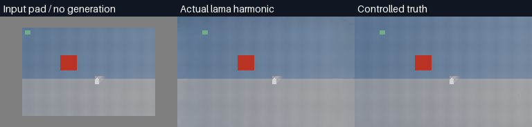

[原片](docs/assets/vace-temporal-context-20261020-v68-lama-r1/source.mp4) /[真实 LaMa 输出](docs/assets/vace-temporal-context-20261020-v68-lama-r1/expanded.mp4)。
<!-- /V68-CURRENT -->


<!-- V67-CURRENT -->
2026-10-20 **V67（产品限定验收）**：共享 RVM/SAM2/LaMa/VACE 管道新增三角色退出观测、有界脱敏日志、回收前留证和 `diagnostics list/show/export`；保留原错误、operation ID 和事务回滚。完整 **1496/1496、4676.172 秒、0 跳过、202 输入冻结**，34 新专项为子集。开发 **33 CLI**：真实无效 ONNX 解析失败 1 次（0 有效模型前向），LaMa harmonic 真实 **8 次前向/8 帧**；原生离线 **134 包内文件/35 隔离 CLI**，另一次真实解析失败与 8 帧 LaMa 输出，全部解码 RGBA/PCM 与开发版相同；**17 Skills/244 引用**。受控生成区 35.578 dB，≥30 dB 单项通过，沿用原质量门槛；静看 4 帧，未连续播放/听审。**本轮没有新 VACE 模型推理或新 Torch 崩溃，原访问冲突根因/长期稳定性、自然质量及完整剪映等价仍未验收**。 [编号核验/失败/发行](docs/validation/本地模型管道诊断与回收前留证实测_2026-10-20.md)。

| 编号 | 当轮核验 | 结果 /证据 |
|---|---|---|
| DIA-V01 | 当前冻结完整回归 | 1496/1496、0 跳过；34 新专项为子集，不累加中间轮次 |
| DIA-V02 | 实际读取预算 | 4 GiB 稀疏日志只 read 64 KiB；超 128 KiB 响应不读载荷；UTF-8/无换行/空文件另验 |
| DIA-V03 | 原生失败和回滚 | 开发/安装各 1 次真实无效 ONNX 解析失败；原 CLI 退出码 6/operation ID、退出值、空缓存、作者元数据不变 |
| DIA-V04 | 进程/路径/历史 | 受控三角色/同时失败、启动失败、取消/超时、联接/硬链接/身份替换、32 次/14 天/活动 64 MiB 保护 |
| DIA-V05 | 正常真实视频 | 开发 23 CLI/8 帧 LaMa；安装 25 隔离 CLI/8 帧；RGBA、PCM、PTS、原区域保护与既有门槛另核 |
| DIA-V06 | 发行和 Skill | 134 资源、7 wheels；诊断另 10 隔离 CLI，共 35；17 Skills/244 本地引用 |


[原视频 MP4](docs/assets/pipeline-diagnostics-20261020-v67-lama-r3/source.mp4) /[实际输出 MP4](docs/assets/pipeline-diagnostics-20261020-v67-lama-r3/expanded.mp4)。诊断包没有可视模型效果，GIF 用于检查同版正常视频输出。
<!-- /V67-CURRENT -->

<!-- R09-RESEARCH -->
2026-10-20 **R09（OpenFilm 拆分复核）**：03:53:10 Asia/Taipei API **1269 stars /128 forks**；main 仍为 `71922644` /0.2.1，重新核对 **757 份源码**。新增 **16 个原声明提取夹具**：6 个并发启发式、7 个导出签名、3 个缓存检查；确认低内存仍返回 1 worker、自定义文件名阻止相同内容共用、同大小/恢复 mtime 的内容修改不改变旧缓存 key。优先复用批次规划；按需补透明联系表、HTML 子帧采样和中立格式导出。字幕/模板/帧时钟/三套 Skill/硬件策略/诊断已有限定采用，不重复计算收益。**本次仅源码研究，无新成片/模型/浏览器/产品全量；既有 V68 在开发修改原样保留，未由本轮验收。** [编号复用、剩余人日、依赖与原证据](docs/OpenFilm最新复用评估与成本取舍_2026-10-20.md#r09当前复核与拆取顺序)。
<!-- /R09-RESEARCH -->

<!-- R08-RESEARCH -->
OpenFilm 最新复核固定 `71922644` /0.2.1，1252 stars /128 forks 为 2026-10-20 01:56:20 Asia/Taipei 快照；757 文件；10 套创作 Skill 所在 31 文件、29 个 provider 目录文件未变。建议拆诊断和批量导出规划，按需补透明联系表；现有缩略图已先缩放，无需重复建设。预览缓存须重写 key，FCPXML 按需求实施，在线 provider 不接入。 [编号复用、成本、原测试与失败](docs/OpenFilm最新复用评估与成本取舍_2026-10-20.md)。
<!-- /R08-RESEARCH -->

<!-- V66-CURRENT -->
2026-10-20 **V66（产品，10-19 开始的跨日验收）**：新增 `media outpaint`，本地 LaMa/VACE 向更大画布生成背景；显式放置、同源蒙版、归一化原区域 RGBA/PTS/PCM 保护、可编辑配方、工程包与片段组跨项目重绑定。完整 **1462/1462、4928.763 秒、0 跳过、200 输入冻结**；24 扩图专项、41 VACE 专项均为子集，后者含 8 个新增读取方法。开发 **67 CLI/3 次模型交付/24 帧**；原生离线 **133 包内文件/25 隔离 CLI**，LaMa harmonic 的全部 RGBA/PCM 与开发版相同；**17 Skills/238 引用**。生成区预先声明 ≥30 dB，实测 lama/direct 34.485 dB（通过）；lama/harmonic 35.578 dB（通过）；vace/harmonic 19.228 dB（未通过）。原画面保护通过不替代生成质量；**自然扩图、安装版 VACE 推理与完整剪映等价仍未验收**。 VACE 两次原生文本加载访问冲突保留；组件内 `pread` 后本例实际交付通过，**底层根因与长期稳定性仍未确认**。 [原片/GIF/编号核验/失败/发行](docs/validation/本地视频扩图与原画面保护实测_2026-10-19.md)。


[原视频](docs/assets/video-outpainting-20261019-v66-lama-harmonic-r2/source.mp4) /[实际 LaMa 输出](docs/assets/video-outpainting-20261019-v66-lama-harmonic-r2/expanded.mp4)；图中真值为独立受控背景。

VACE 实际生成区 **19.228 dB，未通过 30 dB 门槛**；保留桌面边界和底部暗带缺陷：

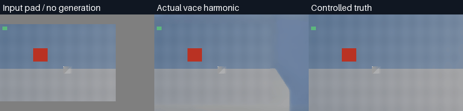

[VACE 原视频](docs/assets/video-outpainting-20261019-v66-vace-harmonic-r4/source.mp4) /[实际 VACE 输出](docs/assets/video-outpainting-20261019-v66-vace-harmonic-r4/expanded.mp4)。

OpenFilm 同步补查：字幕/HTML/模板规则、三套本地创作 Skill 和限定硬件编解码已有采用记录；下一优先候选为诊断辅助逻辑。上游日志 tail 先读完整文件，保留本项目已有的有界读取并补进程归因；本次诊断补查为静态研究，尚未接入，也不增加产品测试数。[当前采用/待办/成本边界](docs/OpenFilm当前复用决策_2026-10-18.md) /[两模块 SHA 与原生故障缺口](docs/OpenFilm诊断模块复用与原生模型故障后续项_2026-10-20.md)。
<!-- /V66-CURRENT -->

<!-- V65-CURRENT -->
2026-10-19 **V65（历史产品验收）**：接入 OpenFilm 固定 `f6a65ae5` 的硬件参数/H.273 策略，保留 Python/FFmpeg 主链；独立 `off/prefer/require` 编码/解码、四帧实测、强制硬件帧与 CPU 对照、NV12/P010 输入、帧级/码流色彩标签、有限回退、队列/续跑及持久诊断。完整 **1430/1430、2566.147 秒、0 跳过、198 输入冻结**；20 新专项为子集。开发 **20 CLI/49 断言/8 成片/384 帧/768,000 立体声采样帧**；离线 **132 包内文件/22 隔离 CLI**，8 成片解码视频/PCM 均与开发版相同；**17 Skills/235 引用**。本机 RTX 3060 的 H.264 NVENC＋D3D11VA/CUDA、HEVC 10-bit NVENC＋CUDA 通过；AMF 不可用和 H.264 10-bit 设备拒绝均保留。GIF 为实际成片 8-fps 采样、16 帧/2.01 秒/无声；已查看 6 个静帧，未听审/连续播放。这是位流格式/传输与受控合成样例核验，**不验收内部全精度 10-bit 合成、所有设备、自然画质、提速或完整剪映等价**。 [原片/GIF/失败/发行](docs/validation/硬件编解码与显式回退实测_2026-10-19.md)；[契约](docs/specs/硬件编解码探测与显式回退契约_v0.1_2026-10-19.md)。

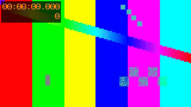

[原视频 MP4](docs/assets/hardware-acceleration-20261019-v65-r6/preview-r3/original.mp4) /[实际输出 MP4](docs/assets/hardware-acceleration-20261019-v65-r6/preview-r3/edited.mp4)；MP4 视频流复制、音频另转 AAC，PCM 相等证据使用原 MKV。
<!-- /V65-CURRENT -->

<!-- R07-RESEARCH -->
2026-10-19 **R07（OpenFilm 0.2.1 源码研究）**：固定 `f6a65ae5`，API **1142 stars /117 forks** 为 19:18:55 Asia/Taipei 时点；731→749 文件，37 新增/179 修改/19 changeset 删除。选定原测试 **75 通过/1 可选 DTD 跳过**，另 13 纯数据夹具通过；**同大小、还原 mtime 的内容修改未改变预览缓存键，直接复用门槛不通过**。优先候选为硬件编解码探测/显式回退、受控诊断；预览缓存需重写内容指纹，FCPXML 为可选交换。10 份创作 Skill 所在 31 文件、provider 目录 29 文件均与 R06 相同；既有 3 套本地工作流保留，不新增本地 AI 特效内核。196 产品输入与 V64 完整回归相同；本轮为研究，无新产品接入/成片/完整回归。 [18 项复用/成本/证据](docs/OpenFilm_0.2.1复用清单与成本复核_2026-10-19.md)。
<!-- /R07-RESEARCH -->

<!-- V64-DEMO -->
**V64 音频上下文实测**：原 WAV、实际成片与失败均公开。下图为实际 PCM 的 **3 页/6 秒无声统计图**，非 GUI 录屏；只验证受控音高与采样。

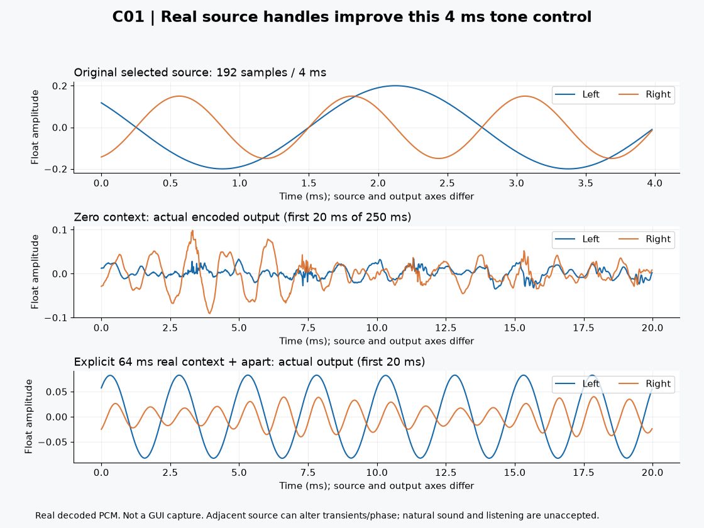

[原 WAV](docs/assets/audio-source-context-20261019-v64-r2/stereo-tones.wav) · [实际有声 AAC 预览](docs/assets/audio-source-context-20261019-v64-r2/preview/C01-context-aac-preview.mp4) · [无损 float32 MKV](docs/assets/audio-source-context-20261019-v64-r2/C01-context.mkv) · [完整结果](docs/validation/离线音频真实源上下文与短窗音高实测_2026-10-19.md)
<!-- /V64-DEMO -->

<!-- V64-CURRENT -->
2026-10-19 **V64（历史产品验收）**：显式 R3 `source_context_ms` 0..1000、默认 0；真实源前后句柄、有理边缘时间图、原作者采样裁切后反向。完整 **1410/1410、2079.167 秒、0 跳过、196 输入冻结**；9 新专项为子集。开发版 **144 CLI/408 最终帧/816,000 立体声采样帧**；8 次独立原生 R3 裁切 PCM 最大差 0，零上下文与固定 V62 基线解码相同。**131 包内文件/146 隔离 CLI/408 安装帧**；工程往返另 5 隔离 CLI/36 帧/72,000 采样帧；**17 Skills/232 引用**。选定 4 ms 双音 apart 从 375/819.946 改善为 400.085/799.988 Hz，**together 右声道 789.368 Hz 仍失败，apart 反相残差 0.00246022013 仍失败**。28 研究探针/旧代码基线分别计数。GIF 是实际采样统计图、3 页/6 秒、无声；静帧已看，未听审/连续播放。自然质量及完整剪映等价未验收。 [原输入/GIF/失败/发行](docs/validation/离线音频真实源上下文与短窗音高实测_2026-10-19.md)；[契约](docs/specs/离线音频真实源上下文与精确选区契约_v0.1_2026-10-19.md)。
<!-- /V64-CURRENT -->

<!-- V63-REJECTION -->
2026-10-19 **V63（真实资源拒绝）**：不变 V62 产品/原 VACE 模型流程在 `text-weights` 前因物理可用 3,718 MiB、要求 7,936 MiB 拒绝；0 新模型前向/修复视频。失败、空项目状态与事后自有进程快照保留；未终止其它任务，显存观测不预约资源。 [真实日志与限制](docs/validation/VACE共享显存真实重试与准入拒绝_2026-10-19.md)。
<!-- /V63-REJECTION -->

<!-- V62-DEMO -->
**V62 离线 OCR 文字运镜**：[原片、四组输出、中文输入、完整错误与安装](docs/validation/离线OCR与文字锚点真实成片实测_2026-10-19.md)；实际模型识别框生成可编辑相机，精确查询由作者指定，非自动点击理解。


<!-- /V62-DEMO -->

<!-- V62-CURRENT -->
历史产品 2026-10-19 **V62（产品）**：新增本地 PP-OCRv4 CPU `ocr adapter/scan/anchors`，源帧/PTS、原文字/多边形、唯一精确查询生成可编辑位置/缩放和回全景。完整 **1401/1401、2428.911 秒、0 跳过、195 文件冻结**；27 OCR 专项为全量子集。开发版 **42 CLI /192 最终帧 /1,152,000 立体声采样帧**；32 聚焦帧边缘最大差 1.484375 px，160 全景帧 RGB 最大差 2，PCM 0。英文四个选定目标/中文四个目标通过，原生前向分别 6 det+60 rec /1 det+4 rec；**英文首帧全十行仅 5/10 完全一致，7/255 字符编辑**，保留空格错误，非盲测。**131 包内文件 /44 隔离 CLI /192 安装帧**，同源预测/解码音画一致；**17 Skills /228 引用**。冒号文本误判、静音夹具/字体缺字、标点阈值参考与旧回归中断保留。静帧已看，未连续播放/听审；文字框不代表点击区域，全隐私、自然 OCR/语义、VACE 修订版完整交付与完整剪映等价仍未验收。 [原片/GIF/识别错误/安装与范围](docs/validation/离线OCR与文字锚点真实成片实测_2026-10-19.md)。
<!-- /V62-CURRENT -->

<!-- R06-RESEARCH -->
2026-10-19 **R06（OpenFilm 源码研究）**：固定 `91b4e90c`，API **1098 stars /116 forks** 为 16:37 Asia/Taipei 时点；相对 R05 **727→731 文件，4 新增/20 修改/707 不变**。新增可脱离 GUI 的轨道种类/编号/分层函数，修复 FCPXML 音画连接、原轨道标签和 stem 角色；**64 原测试通过/1 可选 DTD 跳过，8 个独立轨道夹具通过**，非完整上游套件。CLI/渲染 `src/` 28 文件原字节不变。导出/轨道模块仍为候选，未接入生产转换、未运行目标 NLE；不新增本地 AI 模型，不改变完整剪映等价未达成的状态。 [源码变化/编号复用与工期](docs/OpenFilm导出修复与纯轨道模块复用复核_2026-10-19.md)。
<!-- /R06-RESEARCH -->

<!-- V61-CURRENT -->
历史工作流 2026-10-19 **V61（Agent 工作流适配）**：将固定 OpenFilm 的参考片重建、长转短、录屏演示创作要求适配为 **3 个本地 `video-cut-` Skill，累计 17 个**；沿用现有编辑内核。当前 **62 次真实 CLI、158 个最终编码帧/PTS、948,000 个立体声采样帧**；长转短另有 94 个中间基础帧，不叠加为最终产量。参考运镜中心最大差 0.878 像素；字幕前源帧最大差 2，三类 PCM 最大差 0；录屏控件边缘最大差 2.600 像素，5 次回全景 RGB 最大差 2，94 帧字幕安全边缘通过。**188 产品输入与 V60 相同，沿用已完成的 1374/1374，未重跑完整回归**。首轮音频/时长失败、第二版出框/裁切及后续底边拒绝保留。公开原片、无音预览/GIF；生成语音仅内部使用、商业权利拒绝。未连续播放/听审；自动语义/点击识别、自然质量及完整剪映等价未验收。 [原片/GIF/实测/失败/Skill](docs/validation/OpenFilm三套本地创作Skill与实片核验_2026-10-19.md)。
<!-- /V61-CURRENT -->

<!-- V60-CURRENT -->
历史产品 2026-10-19 **V60（产品增量，GPU 完整交付待验）**：VACE 用完整 GPU UUID 对齐物理/Torch free，在文本加载、视频上卡和每个非空窗口准入；补充文本卸载钩子清理及当前 worker 空闲缓存的前后记录。**1374/1374、2480.857 秒、0 跳过、188 文件冻结**；16 新资源专项和 33 VACE 专项属于全量子集。本机原生离线安装 **125 包内文件/2 隔离 CLI/安装版 CUDA 准入** 通过，当前源码原生 **128 MiB** 有效分配/自身空闲缓存释放通过。首轮模型在窗口 1 前因 Torch free 522.441 MiB 拒绝；修订版小额探测在分配前因物理 free 440.000 MiB 拒绝，该次未执行分配，资源回升后的复测通过。**本轮无新修复成片**；保留原片/选区/真值及失败。不预约显存、不保证无 OOM，当前真模型整链、自然质量和完整剪映等价待验。 [原片/拒绝/范围/安装证据](docs/validation/VACE物理显卡准入与真实交付实测_2026-10-19.md)。 另有 [OpenFilm 三套创作流程适配设计](docs/OpenFilm创作流程本地适配设计_2026-10-19.md)：22 命令声明映射，未新增 Skill 或整片。
<!-- /V60-CURRENT -->

<!-- V59-RESEARCH -->
历史研究 2026-10-19 **V59（研究）**：固定 ROSE 作者 Transformer、Wan T5/VAE 在现有 Windows 原生 CUDA Python 真实运行两条既有样例，各 32 帧@8 fps、50 步；补末帧至 33 后裁回，不改原时钟。受控整体 **28.116434 dB /运动残差 3.442043**，沿用 ≥30 dB、MAE≤5 且不差于 FGT 的门槛，结果 **未通过**。原始全画面和限于选区的合成分别保存；区外 RGB/原 Alpha/每帧 PTS 与自然 768,000 字节 PCM 核对。ROSE 仍为独立研究 runner，未注册生产引擎；#56 自然背景/纹理/阴影反射、全局显存准入与完整剪映等价未验收。186 产品输入未改，未重跑产品全量；该轮最近完整产品回归为 V58 1357/1357。 [原片/GIF/失败与范围](docs/validation/ROSE本地对象移除与原始全画面输出实测_2026-10-19.md)、[先行契约](docs/specs/ROSE离线对象移除与副作用核验契约_v0.1_2026-10-19.md)。
<!-- /V59-RESEARCH -->

<!-- R05-RESEARCH -->
2026-10-19 **R05（OpenFilm 源码研究）**：最新固定 `7a64d1fe`，API **947 stars /99 forks** 为 02:21:46 Asia/Taipei 时点；713→727 文件，14 新增/41 修改，148 个既有 CLI/渲染/服务端文件原字节不变。选定原测试 **63 通过、1 跳过**，窗口仅 mock，无 GUI/服务商/新模型。现有拆取方案继续适用；新增主要为桌面会话/设置，不新增本地 AI 剪辑内核。[编号复用决策、剩余人日和原始证据](docs/OpenFilm复用复核与开发成本更新_2026-10-19.md)。研究结果与 V58 产品回归分别计数。
<!-- /R05-RESEARCH -->

<!-- V58-CURRENT -->
历史产品 2026-10-19 **V58（产品）**：色温、基础色彩平衡、三向色轮、曝光、色阶共 **19 数值通道**逐帧执行，保留作者时钟和可编辑字段；独立实例、递归配额、运行时能力及缓存摘要门禁。**1357/1357、2022.398 秒、0 跳过、186 文件冻结**；28 新增专项为全量子集。**64 CLI /14 组 /262 帧 /1,158,528 立体声采样帧**；13 组独立参数参考 RGB 最大差 1，文字另验实际颜色变化、Alpha 0 与同编码音频一致；全部 PCM 0。**124 包内文件 /65 隔离 CLI /282 安装帧 /1,254,528 采样帧；14 Skills /206 引用**。另验复合容器自身效果：6 隔离 CLI/20 帧/96,000 采样帧，RGB/Alpha/PCM 0，重复实例时钟重置。原曝光参考失配与文字夹具修正保留，未放宽误差门槛。原生静态参考共用 FFmpeg 算法及相同交付边界；Kelvin/基础平衡仍为阴影映射，物理白平衡、HDR、自然质量、连续播放/听审、另一台机器及完整剪映等价未验收。[契约](docs/specs/逐帧调色参数自动化契约_v0.1_2026-10-19.md)、[原输入/MP4/GIF/失败/安装](docs/validation/逐帧调色参数自动化实测_2026-10-19.md)。
<!-- /V58-CURRENT -->

<!-- V57-CURRENT -->
历史 **V57（产品，2026-10-19）**：完整作者输出的相对变速、曲线、反向、定格与主轨自动随动，保留可编辑作者子序列；局部关联音画共用宿主时钟，连续 BGM 可选保持速度波纹或显式变速。**1329/1329、2092.274 秒、0 跳过、184 文件冻结**；40 新增专项、66 旧磁吸集成为完整子集，不叠加。**62 CLI /344 主帧 /1,651,200 立体声采样帧**，RGB 最大差 1、PCM 0；**123 包内文件 /51 隔离 CLI /454 安装帧 /2,179,200 采样帧**；**14 Skills /202 引用**。原曲线 PCM 失败已修复；文件头部与总线尾部选样参考分开，开发失败全数保留。未连续播放/听审、自然质量、动态外部 blend、全手势、长片/HDR、另一台机器及完整剪映等价未验收。[契约](docs/specs/完整作者输出变速与磁吸联动契约_v0.1_2026-10-18.md)、[原输入/MP4/GIF/失败/发行](docs/validation/完整作者输出变速与磁吸联动实测_2026-10-19.md)。
<!-- /V57-CURRENT -->

2026-10-18 **V56（产品）**：持久主轨磁吸、剪口吸附及 append/remove/shift/trim 联动，跨不同位移剪口的连续音频/字幕/嵌套输出自动分段。完整 **1289/1289，1986.638 秒**、0 跳过、**181 文件**冻结；66 磁吸专项含 26 新增与 40 旧重排，为完整子集。**44 CLI /236 主帧 /1,132,800 立体声采样帧**，RGB 最大差 1、PCM 0；**121 包内文件 /39 隔离 CLI /316 安装帧 /1,516,800 采样帧**，开发版与安装版解码一致；**14 Skills /198 引用**通过。局部片段组真实失败与旧回归中断保留；复杂音频/字形参考使用同版完整作者图，独立原源参考另计。未连续播放/听审；速度/曲线/定格长度自动随动、全手势、自然质量、长片/HDR、另一台机器及完整剪映等价未验收。[契约](docs/specs/主轨磁吸模式与跨剪口同步拆分契约_v0.1_2026-10-18.md)、[原输入/MP4/GIF/失败/发行](docs/validation/主轨磁吸模式与跨剪口同步拆分实测_2026-10-18.md)。

历史产品 2026-10-18 **V55（产品）**：新增本地命名音频 bus、多级发送/返回、前后推子、侧链及采样自动化，完整子总线先于父级变速/反向/定格。完整 **1263/1263，1847.991 秒**、0 跳过、**178 文件**冻结；37 专项为全量子集。六组 **60 CLI /156 主帧 /62.4 万立体声采样帧**通过，最大差 **1.77e-8**；**119 包内文件 /30 隔离 CLI /204 安装帧**通过。原中断及各轮失败保留；未接受自然听感、空间声或完整剪映等价。[原 WAV、实际 MP4/GIF、工程包、安装包与证据](docs/validation/命名音频总线发送返回与侧链实测_2026-10-18.md)。

2026-10-18 **R04 /V54**：复核 OpenFilm 新 main `5c2000b8`，713 文件整树比较，整理 17 项可拆模块与降本顺序。同步模板 CSS URL 快速拒绝修复，**73/73 HTML 定向回归**通过；上游选定 **38 通过/1 跳过**另计。FCPXML/GPU/官方 Skill 仍是候选；本轮没有重跑完整产品套件或发布新视频/离线包。[源码、工期、前后对照与失败记录](docs/OpenFilm最新源码复核与降本清单_2026-10-18.md)。

2026-10-18 **V53（产品）**：新增明确的主轨整片段 `reorder`，自动紧邻排列，被挤动镜头的关联配音/字幕随动，复杂作者与有效转场保留；断开的转场默认拒绝。完整 **1223/1223，1762.901 秒**、0 跳过、**175 文件**冻结；40 新增专项为全量子集。**69 CLI /380 主帧**；独立原 PCM **115.2 万采样帧差 0**，复杂块参考另计；**118 包内文件 /19 隔离 CLI /190 安装帧**，**14 Skills /190 引用**通过。四轮开发夹具失败保留；9 时刻静帧，未连续播放/听审。持久磁吸模式/全手势、自然 AI/声音、长片/HDR、另一台机器及完整剪映等价仍未验收。 [原输入/GIF/成片/失败/发行包](docs/validation/主轨磁吸重排与关联附着实测_2026-10-18.md)。

历史产品 2026-10-18 **V52（产品）**：受控 VP9 无损交付及重新入轨的 Alpha 最大差 **0**；4.01 秒工程按作者时钟核对端点，保留原始 90 ms 差及 **80 ms** 门槛，真实偏移仍拒绝。完整 **1183/1183，2258.638 秒**、0 跳过、**173 文件**冻结；22 新增专项是全量子集。**36 当前 CLI /251 主帧**，另有 4 次 V51 对照；**117 包内文件 /13 隔离 CLI /98 安装帧**，**14 Skills /186 引用**通过。有损 VP9 /VP8 的 Alpha 差 **12 /4**，仍不接受精确交付；YUV 4:2:0 不代表 RGB 无损。8 时刻静帧、未连续播放/听审；自然 AI/声音、另一台机器、长片/HDR与完整剪映等价仍未验收。 [原输入/GIF/原视频/安装包与失败](docs/validation/透明视频交付与音画端点实测_2026-10-18.md)。

历史产品 2026-10-18 **V51（产品）**：复合片段先完成完整子画面/字幕/动画/转场与子音频总线，再统一定格；父动画继续。完整 **1161/1161，2083.168 秒**，0 跳过，**172 文件**冻结；26 新增专项为全量子集，相同测试在固定 V50 上 22 失败/4 控制通过。九组 **30 CLI /327 主帧 /1,567,101 立体声采样帧**；曲线音频只验长度/有限性。**117 包内文件 /9 隔离 CLI /80 新安装帧**与开发版 RGB/PCM 一致；**14 Skills /182 引用**通过。**正式 VP9 精确 alpha 失败：326,400 像素最大差 1（128→129）**；另 3 CLI/41 帧门禁诊断中，10 fps /4.01 秒 MP4 被现有 80 ms AV 门禁拒绝。无损图精确不能替代交付通过。四时刻静帧、未连续播放/听审，0 新模型前向；自然声音/AI、长片/HDR与完整剪映等价仍未验收。 [原片/GIF/安装包与失败](docs/validation/复合片段定格与完整音画时钟实测_2026-10-18.md)。

面向 Agent 的本地视频广告编辑内核。项目使用原生 Windows、Python 和本地 FFmpeg，并提供显式登记的本地 Node/Chromium 动效后端，通过 CLI、结构化 Agent Project JSON、Skills 和可审计的素材权利台账完成广告剪辑流水线；当前工作区位于 `E:\dev\sandbox\AI广告剪辑`。

项目明确不依赖剪映/Jianying 私有运行时、登录态、闭源线上服务、Docker、WSL 或其他虚拟化环境。网络默认关闭，模型、媒体和字体必须从显式本地路径提供。

## 功能核验与真实实测

历史研究 2026-10-18 **V50（研究）**：完成字词边界三方案对照，**3 个实际模型 worker /6 次新前向**；Qwen 两组最大误差 **220 /161 ms**，仍未过既定 **66.6667 ms** 门槛，中文一字零时长/六处相邻重叠；Whisper-DTW 与新留出 CTC 也失败。两组最终研究图 **458 帧**核对 PTS、**243,835 个原 PCM 样本**精确保留，两个中间静帧可读性检查，未连续播放/听审。**170 产品/测试/发行文件与 V49 相同，本轮没有重跑历史 1135/1135**；Qwen 尚未成为正式 engine，完整剪映等价仍未达成。 [原输入/GIF/逐词失败/来源](docs/validation/开源字词边界模型对照实测_2026-10-18.md)。

历史产品 2026-10-18 **V49（产品）**：新增本地 Wav2Vec2 CTC `subtitle align`、原文码点/样本时钟、长音频重叠窗和 SRT 窗口，**英文定位门槛未通过：最大 258.1875 ms，高于预声明 66.6667 ms**。完整 **1135/1135，1592.399 秒**，0 跳过，**170 文件**冻结；28 新增方法为完整子集。英文开发 15 CLI/3 worker/5 前向，中文 12 CLI/2 worker/3 前向（含一次预期繁体 OOV 拒绝）；逐帧高亮 236 帧、48 kHz 单声道 377,550 样本核对通过。最终原生安装 **116 包内文件 /11 隔离 CLI /七轮依赖包**，另一次真实 worker/一次前向，RGB/PCM 与开发版一致；缺 Pillow 的旧安装、双音轨和错误 16 kHz 预期均保留。**14 Skills /172 引用**通过。三时刻静帧、未连续播放/听审；自然对齐/歌词、完整声音、长片/HDR、另一台干净机器及完整剪映等价仍未验收。 [契约](docs/specs/离线CTC字词强制对齐契约_v0.1_2026-10-18.md)、[原片/GIF/安装包与失败](docs/validation/离线CTC字词强制对齐实测_2026-10-18.md)。

历史产品 2026-10-18 **V48（产品）**：拆取 OpenFilm 示例两个原描线函数，新增 `motion stroke-source`，显式字符时间/折线转为可编辑离线源并沿用透明编码和工程包；完整 **1107/1107，1677.105 秒**，0 跳过，**165 文件**冻结，23 新增专项为全量子集。开发版 **17 CLI /108 HTML 帧**，另 216 次乱序重绘、36 时间线主帧；独立几何 36 帧覆盖 100%，颜色切换 alpha 与工程包重建 RGBA 一致。**112 包内文件 /12 独立 CLI**；实际原生离线安装另 **6 CLI /36 帧**，五个固定依赖，均与开发版 RGBA 一致。**14 Skills /164 引用**通过；浏览器页面/子进程全回收。三时刻静帧，未连续播放/听审，0 新模型推理。只处理明确输入的笔画，不提供自动汉字笔顺、字体生成或语音对齐；自然 AI/声音、复杂 HTML、长片/HDR、干净机器、FGT 自然画质、内容库和完整剪映等价仍未验收。 [契约](docs/specs/离线逐笔描线动效契约_v0.1_2026-10-18.md)、[原输入/原视频/GIF/发行包与失败](docs/validation/离线逐笔描线动效实测_2026-10-18.md)。

历史产品 2026-10-18 **V47（产品）**：固定 Schema 随 wheel 分发，声明本地校验依赖及显式日期检查，缺资源/执行器或摘要不符拒绝成功降级；新增 `schema show/export` 和原生 Windows CPython 3.13 x64 离线安装入口。完整 **1084/1084，1524.818 秒**，0 跳过，**160 文件（含测试/发行代码）**冻结；33 新增专项为全量子集。实际安装 **108 包内文件 / 22 隔离 CLI**，关联音画源滑移与工程包往返共 90 新帧、432,000 立体声采样帧；独立源帧身份一致、RGB 最大差 1、PCM 差 0，重建 RGB/PCM 一致。**14 Skills /162 引用**通过，日期夹具层级失败和周期音频弱观察保留。三时刻静帧，未连续播放/听审，0 新模型推理；本机独立安装及 Schema 随包已验，其他机器/平台、自然 AI/声音、复杂 HTML、长片/HDR、内容库及完整剪映功能/效果仍未验收。 [契约](docs/specs/离线发行与随包Schema契约_v0.1_2026-10-18.md)、[发行包/原片/GIF/实测](docs/validation/离线发行与随包Schema实测_2026-10-18.md)。

本表随功能和验证结果同步更新。**功能执行、实际内容、自动质量与听感分别验收，失败记录保留。**


历史产品 2026-10-18 **V46（产品）**：采用 OpenFilm MIT `cutText` 原函数作同帧诊断对照，新增 `motion html-quality` 和 `html-render --layout-check strict`；逐帧检查部分/完全出框、容器独立轴裁切、实际平台字体及本地 Unicode→glyph 映射。严格门禁随配方继承并重新执行，失败报告/PNG 保留，工程/台账/新编码资产不变。完整 **1051/1051，1697.011 秒**，0 跳过；**152 文件（含测试）**冻结，26 新增专项为全量子集。原创样例 **26 CLI / 60 编码帧**，120 次额外渲染重绘；9 次质量检查共 108 帧及 108 次独立反序重绘，FontTools 独立核对 120 个字符，33 页面全关闭/Job 回收，继承及工程包重建 RGBA 一致。**104 包内文件 / 14 独立进程 CLI** 的离线 wheel、**14 Skills / 156 引用**通过。V45 缺 O 字体负例及两轮开发实测失败保留；公开出框/裁切/修复使用新原创完整字体，不发布系统 fallback 像素。三时刻静帧，未连续播放；无音频、0 新模型推理。复杂字形/变换、WOFF2、自然质量、长片/HDR、Schema 随包/干净机器、FGT 自然画质与来源链及完整剪映等价仍未验收。 [契约](docs/specs/HTML文字布局与字体覆盖核验契约_v0.1_2026-10-18.md)、[原片/GIF/实测](docs/validation/HTML文字布局与字体覆盖实测_2026-10-18.md)。

历史产品 2026-10-18 **V45（产品）**：复用 OpenFilm MIT 模板字段与原字节覆盖/恢复函数，新增 `motion html-controls` 和 `html-render --overrides`；CSS 单位、原文/换行、已登记图片、逐帧恢复、配方继承/单项 null 撤销及跨工程重建可用。完整 **1025/1025，1436.703 秒**，0 跳过；**146 文件（含测试）**冻结，20 新增专项为全量子集。原创样例 **26 CLI / 72 编码帧**，144 次额外乱序重绘、2 次单帧检查；17,280 品牌像素及 84,924 不透明图片像素与独立参考一致，继承/撤销/工程包/片段组重建 RGBA 一致，浏览器 Job 全部回收。**100 包内文件 / 11 独立进程 CLI** 的离线 wheel、**14 Skills / 150 引用**通过。三时刻静帧目检，未连续播放；原创样例无音频、0 新模型推理。缺字/越界、自然广告美学、长片/HDR、Schema 随包/干净机器及完整剪映等价仍未验收；FGT 继续为 V44 研究候选，自然画质和来源链未关闭。 [契约](docs/specs/离线HTML模板控件与覆盖恢复契约_v0.1_2026-10-18.md)、[原片/GIF/完整实测](docs/validation/离线HTML模板控件与覆盖恢复实测_2026-10-18.md)。

历史研究 2026-10-18 **V44（研究）**：FGT 原生离线多帧修复在一个原创双表面样本通过预声明门槛：选区 PSNR **26.143899→33.137925 dB**，已知运动残差 MAE **5.213643→0.908588**；同一自然 32 帧仍有残留/纹理补丁，**自然质量与完整剪映等价未验收**。两个 worker 合计 RAFT 124 / LAFC 124 / FGT 14 次前向，受控 LaMa 32 次；ROSE 仅断网导入、0 次推理。全部编码帧/PTS/alpha/选区外 RGB 核对通过，自然 768,000 字节 PCM 一致；四时刻静态目检，未连续播放/听审。生产 **141 文件**与 V43 相同，本轮未重跑最近 **1005/1005**、0 跳过的完整产品回归，不增加产品 CLI/测试计数。FGT 尚未注册产品适配器，来源链/商业权利仍开放。 [原片/GIF/实测](docs/validation/开源FGT时序修复候选实测_2026-10-18.md)、[机器证据](docs/validation/evidence/fgt-temporal-20261018/verification.json)。

历史产品 2026-10-18 **V43（产品）**：新增标准库/FFmpeg `media mask-edit`，支持笔刷、框、椭圆、多边形、有序布尔覆盖、关键帧和切镜重置，编辑计划随工程包保留并可重建。完整 **1005/1005，1432.864 秒**，0 跳过，134 Python+4 MJS+Schema+pyproject+MIT 共 141 文件冻结；30 新增专项为完整子集。原创 16 帧/12 CLI、1,228,800 RGBA 字节与独立真值完全一致，24 检查点通过；同一自然场景末帧显式修正 261 个 alpha 像素，五个旧检查点由 4/5 到 5/5，前 31 帧 alpha 不变。真实 LaMa 一次 worker/32 次帧调用消费新蒙版，扩张外 RGB 改变 0、源 alpha 与 768,000 字节 PCM 精确保留；**自然背景仍涂抹，完整对象/画质未验收**。96 文件离线 wheel/11 新进程 CLI、14 Skills/140 引用通过；锁码测试误期望、策略元数据真实失败与主动停止的旧回归保留。仅两张静帧目检，未连续播放/听审；完整剪映等价、长片资源与干净机器发行未验收。 [实测/原片/GIF](docs/validation/本地蒙版笔刷与关键帧修正实测_2026-10-18.md)、[机器证据](docs/validation/evidence/mask-edits-20261018/verification.json)。

历史研究 2026-10-18 **V42（研究）**：空间/时序一致供体选择完成 7 组、124 候选帧及独立复核，**41/41 研究检查，质量门槛未通过（12 区域中 4 失败）**；三组新增输入无严格 MSE 改善。原输入/失败/GIF 和研究 CLI 已保留，未进入产品；137 产品文件与 V41 一致，本轮未重跑其 975 项完整回归，研究与产品计数分开。 [实测/原片](docs/validation/空间与时序一致参考选择实测_2026-10-18.md)、[机器证据](docs/validation/evidence/coherent-reference-20261018/verification.json)。

历史产品 V41（以下为当轮记录）：提取 OpenFilm 原帧时钟，新增完全本地 `motion html-register/html-source/html-inspect/html-render`；保留 HTML/CSS/SVG/Canvas 源码、固定资源/工具链、强类型参数、新版本重建和普通时间线透明叠加。完整 **975/975，1302.879 秒**，0 跳过；137 文件冻结，37 新增专项为完整子集。五组成功内容/三项页面拒绝共 30 CLI 入口调用，96 HTML 编码输入帧、192 全帧乱序重绘、24 原生时间线主帧分计；独立 RGB 合成最大差 3、均值 0.476496，工程包/片段组重建 RGBA 一致，所有实际浏览器 Job 回收。94 文件离线 wheel/11 独立进程 CLI、14 Skills/133 本地引用通过；六张静帧目检，未连续播放/听审。初始 MKV 帧时钟错位、源长和回收/工具链诊断失败原证据保留；正式采用逐帧精确 PTS 的 FFV1/BGRA NUT。完整 OpenFilm HTML 时间线/媒体/WebGL、自动模板控件/缺字越界诊断、HDR/自然广告美学、长片资源、Schema 随包/干净机器及完整剪映等价仍未验收。

历史 V34：固定复用 OpenFilm O01 原算法，新增本地 `subtitle segment`：中文/英文/数字单位分段、明确提供的双语、绑定输入摘要的局部回写，生成 JSON/SRT 并可入轨。完整 **733/733，1604.604 秒**，0 跳过；115 Python+2 MJS+Schema+打包配置+MIT 原文共 120 文件前后字节冻结；38 新增专项为完整子集。四组/108 CLI（100 成功、8 预期拒绝），192 新帧与手工文字/时钟参考一致；参考使用同一渲染器，编辑前后 PCM 一致。另一次真实 Whisper CPU 推理将 5 条原句分成 9 条字幕，CER 2%，同一既有语料、无逐字对齐，音视频因权利未核验留本地。上游 13 测试/48 数据另计；离线 wheel 的 84 文件和 7 次隔离 CLI、14 Skills/104 引用通过。仅三帧静态目检，未连续播放/听审；分段估时、启发式译文对齐、样式迁移、广泛语言/自然质量、干净机器发行与完整剪映等价仍未验收。 历史行按当轮结果保留。

| 编号 | 功能 | 已执行的核验与实测结果 | 当前边界 | 证据 |
|---|---|---|---|---|
| V01 | 多轨剪辑、关键帧、运镜、转场、蒙版、音频 | 多轨演示批次通过正式 CLI 导入 4 个自制资产，应用 push-in、HSL、0.5 秒交叉淡化、动态羽化圆形蒙版、透明标题图层和音频淡入淡出；输出 5.5 秒、640×360、30 fps、165 帧 MP4，渲染 warning 为 0 | 合成样例证明功能可运行，未代表自然广告画质；标题为图片叠加 | [原片与 GIF/MP4](#实测演示素材)、[14 次 CLI 记录](docs/assets/readme-20261016/verification.json) |
| V02 | 渲染质量检查 | 上述 MP4 音画时长差 0 ms、未检出黑帧、真峰值 −24.3 dBFS；GIF 55 帧、10 fps、5.5 秒，时长一致 | 音画时长差不等于口型同步；没有听审或目标广告响度验收 | [质量与媒体探测](docs/assets/readme-20261016/verification.json) |
| V03 | 项目与素材便携交换 | 多轨演示批次正式导出项目包、导入新目录，严格权利/项目校验通过；包内保留素材、时间线及 Rights Ledger | 外部 Python、FFmpeg、模型不随包分发；未据此验证跨设备运行 | [可下载项目包](docs/assets/readme-20261016/cli-showcase.aevpkg.zip)、[复现说明](docs/validation/README功能核验与实测演示_2026-10-16.md) |
| V04 | 本地策略与权利门禁 | 多轨演示批次自制素材经严格权利校验和 `render --publish`；策略扫描 12 文件、0 发现。既有模型实测中未核验权利按预期阻断发布 | 权利字段通过不替代外部许可核验；自然人物原片尚不公开 | [多轨演示批次证据](docs/assets/readme-20261016/verification.json)、[素材来源](docs/assets/readme-20261016/fixture-provenance.json) |
| V05 | Whisper 中文转写 | 本地 CPU/CUDA 已实跑；38.04 秒输入得到 15 段字幕，末段到 38.02 秒；选定中文样例 CER 2% | 单一语料结果，繁简差异单列；广泛字幕质量待验收 | [实测](docs/validation/Whisper中文离线转写实测_2026-10-15.md) |
| V06 | SoulX 中文配音 | 本地 CUDA 真实生成 3.44 秒中文语音，完成音轨应用、渲染和质量/策略检查 | 多声线、情绪、长期听感及声源许可待验收 | [实测](docs/validation/SoulX中文离线配音实测_2026-10-15.md) |
| V07 | YOLO 跟踪、标签绑定、重构图 | 受控双目标 29/32 次观测；标签绑定与横/竖成片已实渲，组合几何回归定位误差 ≤3 px | 自然遮挡、交叉身份恢复与完整嵌套坐标空间待验收 | [模型实测](docs/validation/YOLO本地多目标跟踪与重构图实测_2026-10-15.md)、[组合实测](docs/validation/跟踪坐标绑定与组合渲染实测_2026-10-15.md) |
| V08 | HDemucs 人声/伴奏分离 | CPU/CUDA 对同一 12.68 秒语音与合成伴奏实跑；SI-SDR 改善约 12.66 dB，分离结果完成入轨和成片 | 自然音乐、听审和模型商业许可待验收 | [实测](docs/validation/HDemucs本地人声伴奏分离实测_2026-10-16.md) |
| V09 | RVM 人物抠像 | 3 秒/36 帧样例输出软 alpha MOV、两背景 MP4 和透明 WebM，音频链路完成 | 首帧边缘缺失，手持头盔被排除；广泛画质未通过 | [实测](docs/validation/RVM本地人物抠像与透明成片实测_2026-10-16.md) |
| V10 | SAM2 点/框、多对象与提示修正 | 原生 CPU/CUDA、选择/修正/重置、自然双人 32 帧、概率蒙版及两背景成片已实跑；前轮在同一场景新增一次 CUDA 修正，5 个明确检查点从 3 个通过到 4 个通过 | **该轮仍失败**：目标手腕继续漏选；保留人物前臂从误选变为排除，不代表完整选区改善；V43 显式笔刷后 5/5 旧点通过，不是 SAM2 模型改善 | [前序实测](docs/validation/SAM2本地对象分割与提示修正实测_2026-10-16.md)、[此前逐点实测](docs/validation/本地蒙版范围与正负检查点实测_2026-10-16.md) |
| V11 | LaMa / VACE 修复与色差融合 | 显式 harmonic 受控选区 PSNR 分别 47.45 / 42.90 dB；自然 32 帧链路完成，蒙版外 RGB 与全部 alpha 保留，PCM 原声独立核对一致 | **自然人物移除画质未通过**：残影、纹理涂抹或色块仍存在；VACE 为实验能力 | [实测](docs/validation/本地区域色差融合实测_2026-10-16.md)、[机器证据](docs/validation/evidence/repair-blend-smoke-20261016.json) |
| V12 | 背景参考传播研究 | 单表面 PSNR 30.878→31.124 dB；双表面合计 **33.448→33.410 dB，略退化**。22 项独立研究检查通过；公开原输入和逐帧对照 | **未接入产品**；人工遮挡真值不代表真实人物移除，自然画质未通过 | [研究 GIF/MP4](#实测演示素材)、[实测](docs/validation/本地多运动参考选择与双表面真值实测_2026-10-16.md) |
| V13 | 产品自动回归 | 最近 V58 1357/1357、2022.398 秒、0 跳过、186 文件冻结；28 新增为全量子集 | 历史、研究、安装和专项不相加；完整剪映仍未验收 | [完整日志](docs/validation/evidence/effect-automation-20261019-v58/full-final.log)、[终态](docs/validation/evidence/effect-automation-20261019-v58/full-final.json) |
| V14 | 编码蒙版范围与正负检查点 | 新增 `quality mask`：逐帧面积/包围框/IoU、明确 selected/clear 检查。自制 4 秒/32 帧样例准确报出第 12 帧缺腿；补全几何后 4 点通过，失败报告及退出码 2 保留；原始 alpha 全帧摘要匹配 | 补全样例为脚本恢复几何，非 AI 修复；检查点不证明完整身份/边缘/自然质量。该轮自然仍有 1 点失败；V43 显式笔刷补点后 5/5，完整质量未验 | [原蒙版与 GIF/MP4](#实测演示素材)、[实际 CLI 与媒体证据](docs/assets/mask-review-20261016/evidence.json)、[实测](docs/validation/本地蒙版范围与正负检查点实测_2026-10-16.md) |
| V15 | 编码蒙版驱动轨迹、标签与重构图 | 16 次正式 CLI，4 秒/64 帧/16 fps；逐帧 bbox 与自制真值一致。标签位置最大误差：横屏 1.64 px、缩放旋转后 2.14 px、竖屏 2.15 px；包和源/蒙版权利依赖保留 | 自制选区不是模型分割能力。自然 SAM2 仍 4/5 检查点通过；该轮标签 4.10 px 失败，后续 V17 重验通过标签门槛，分割持续未验收 | [原视频与 GIF/MP4](#实测演示素材)、[全帧测量](docs/assets/mask-track-20261016/evidence.json)、[自然失败实测](docs/validation/本地蒙版驱动锚定与重构图实测_2026-10-16.md) |
| V16 | 透明标签合成与失败报告 | 抽帧发现 PNG 的 fit 补边变黑；新增像素回归先失败，修复后 PNG/alpha MOV 通过，公开 64 帧两侧 128 区域核对。检查点失败仍保存诊断、回滚项目 | 位置准确不证明合成正确；修复前原片与失败日志保留；该轮自然标签失败，后续 V17 补充缩放修复与重验 | [修复前原成片](docs/assets/mask-track-20261016/before-alpha-fix-bound.mp4)、[前后证据](docs/validation/本地蒙版驱动锚定与重构图实测_2026-10-16.md) |
| V17 | 透明素材缩放边缘与自然标签复验 | 正式 CLI 对照同 alpha/可见 RGB、仅隐藏黑/绿不同的标签：旧成片最大差 64，新成片全 32 帧 RGB 差为 0；自然标签最大误差 **4.0954→2.0650 px**，超 3 px 帧 **5→0**，0 新推理 | V17 当轮覆盖 PNG/MOV/pal8、适配和标量；V18 补入仿射/动态 crop/文字源。线性光、性能与自然蒙版仍未验收 | [原视频与 GIF/MP4](#实测演示素材)、[全帧/源码证据](docs/assets/alpha-resize-20261016/evidence.json)、[自然复验与原失败](docs/validation/透明素材缩放边缘与标签精度实测_2026-10-16.md) |
| V18 | 仿射、动态裁切与文字透明合成 | 16 次正式 CLI，32 帧组合运镜/文字：白底最大 RGB 误差 **255→3**、隐藏色差 **72→0**；复用 RVM 人物照片平移短片 36 帧，fit 补边误差最大降到 **1.33**；SAM2 标签仍≤3 px | 人物素材无自然人体运动或真值 matte；原人体/手持物缺失和 SAM2 手腕失败保留；一般畸变、线性光/HDR、4K 性能与完整质量未验收 | [原视频与 GIF/MP4](#实测演示素材)、[实际全帧证据](docs/assets/alpha-geometry-20261016/evidence.json)、[人物复用与限制](docs/validation/仿射动态裁切与文字透明合成实测_2026-10-16.md) |
| V19 | 嵌套变速、倒放与原关键帧时钟 | 23 次正式 CLI、5 次额外交付检查；五组前后成片共 172 个新输出帧，主样例源帧误差 **13→0**，缩放宽度误差 **42.8821→0.9831 px**；五组新脉冲包络均无不匹配 | 多段样例仍最大差 1 个源帧；CFR、hold/linear 受控验收。V19 当轮速度 easing 后续见 V20；音频相位、VFR、定格/字幕 cue、群组空间和自然质量待验收 | [原视频与 GIF/MP4](#实测演示素材)、[逐帧证据](docs/assets/nested-time-20261016/evidence.json)、[实测与失败记录](docs/validation/嵌套变速倒放与关键帧时钟实测_2026-10-16.md) |
| V20 | 速度 easing/Bezier 与有界源时钟 | 31 次生成 CLI、7 次额外交付检查；七组新输出 336 帧，旧最大 2–7 帧误差降为 0；原动画宽度 **8.1369→0.9911 px**。独立参数域积分复核编译界，额外三帧 PTS 保留长时低速修复证据 | 本批为受控 CFR；250 μs 是单曲线未归一化积分上界。端点速度 floor、资源门限、VFR、音频相位/听感、定格/字幕和完整群组待验收 | [原视频与 GIF/MP4](#实测演示素材)、[逐帧记录](docs/assets/speed-easing-20261016/evidence.json)、[独立实测与边界](docs/validation/速度Easing与Bezier原时钟实测_2026-10-16.md) |
| V21 | 嵌套字幕与文字动画时钟 | 105 次 CLI，448 主帧+288 校准帧；高亮/打字机/文件 cue 不匹配降至 0，亮度误差≤0.0133；旋转 6 姿态通过；本地字体、源帧/脉冲独立核对 | **V21 当轮高亮字形偏移、排版未通过，后续 V22 独立重验**；动态尺寸内嵌透明度近似，定格/VFR/文件动画/整体质量未验收 | [原片/GIF/MP4](#实测演示素材)、[全帧证据](docs/assets/subtitle-clock-20261016/evidence.json)、[失败与复现](docs/validation/嵌套字幕与文字动画原时钟实测_2026-10-16.md) |
| V22 | 逐字高亮原生排版与颜色选择 | 九组 632 主帧+632 普通对照帧；旧最大 R/G 差 51–255→2；逐词激活/串色、源帧和脉冲均 0 不匹配；90 次生成 CLI+9 次额外策略审计 | 受控样例通过；CJK 仅四字，动态内嵌高亮显式降级；任意透明度/复杂排版/完整质量未验收；两段开发失败保留 | [原片/GIF/MP4](#实测演示素材)、[全部九组与失败](docs/validation/逐字高亮原生排版与真实成片实测_2026-10-16.md)、[机器证据](docs/validation/evidence/word-layout-20261016.json) |
| V23 | 文字颜色、样式透明度与实际合成 | 九组 632 新主帧+1480 空白/覆盖率对照；RGB 最大误差 9.93–54.91→2.22–3.61；123 次 CLI 含 39 渲染/9 质量/9 策略；字色/框/描边/阴影、淡入、图层 opacity、逐词替换 | 受控 8-bit 子项通过；动态内嵌颜色显式近似；V23 当轮逐词+动画未验，后续 V24 补测；ASS、HDR/广泛质量未验收；保留旧版失败和首轮回归失败 | [原片/GIF/MP4](#实测演示素材)、[九组误差与复现](docs/validation/文字颜色透明度与实际合成实测_2026-10-16.md)、[机器证据](docs/validation/evidence/text-paint-20261016.json) |
| V24 | 文字动画×高亮与原生前缀打字机 | 2026-10-17：12 组/846 主帧+1818 控制；160 CLI 含 50 渲染；组合 R/G≤2、逐字/词状态 0 不匹配；11 组交付通过 | **V24 当轮 1 组尾帧背景消失，交付失败；后续 V25 同源复验已修复**；分数帧率仅 90 帧样例；动态内嵌/复杂塑形/整体质量未验 | [原片/GIF/MP4](#实测演示素材)、[全部编号样例和失败](docs/validation/文字动画高亮组合与原生打字机实测_2026-10-17.md)、[机器证据](docs/validation/evidence/text-animation-20261017.json) |
| V25 | 嵌套裁切、倒放与首尾帧覆盖 | 2026-10-17：10 组/496 新主帧+116 控制；85 CLI 含 22 渲染；视频可见性 0 不匹配、源帧≤1；V24 尾帧恢复；8 组交付通过 | **V25 当轮 2 组极短音频全静音，交付失败**；V26 显式 R3 有声但音高仍失败；非整帧时长/VFR/整体质量未验 | [原片/GIF/MP4](#实测演示素材)、[10 组编号和失败](docs/validation/嵌套视频帧区间与结束时钟实测_2026-10-17.md)、[机器证据](docs/validation/evidence/nested-frame-coverage-20261017.json) |
| V26 | 本地整段离线音频变速与高精度 PCM | 2026-10-17：8 组/72 CLI 含 24 渲染；210 新主帧+210 精度控制；MKV 24/32-bit/float PCM、倒放、Bezier、采样/声道、缓存复现/篡改/取消；4 组受控通过 | **4 组极短音高失败**；8 组质量 CLI 通过不等于听感通过；未配置仍走 atempo，瞬态/相位/完整质量未验 | [原片/音频/GIF/成片](#实测演示素材)、[八组编号与失败](docs/validation/离线音频伸缩与真实采样实测_2026-10-17.md)、[机器证据](docs/validation/evidence/offline-audio-stretch-20261017.json) |
| V27 | R3 声道策略与立体声取舍 | 2026-10-17：20 组/180 CLI 含 60 渲染；516 新主帧+516 精度控制；默认 10 组与固定 V26 音频一致；显式 together/apart、mono/静音声道、反相、缓存；11 组受控通过 | **8 组极短音高失败、1 组 apart 反相混合失败**；20 组质量 CLI 通过不等于内容/听感通过；全功能剪映对标未完成 | [原视频/双声道/GIF/成片](#实测演示素材)、[20 组编号与失败](docs/validation/R3声道策略与立体声权衡实测_2026-10-17.md)、[机器证据](docs/validation/evidence/audio-channels-20261017.json) |
| V28 | 嵌套序列隔离合成、父枢轴与透明混合 | 2026-10-17：14 组/112 CLI（28 渲染、14 质量、14 策略）；360 新主帧与 360 独立参考全像素核对，最大 RGB 差 3；固定 V27 12 组失败/2 控制；另有 57 帧开发回归对照 | 已测空间子项通过；组级音频/独立子画布/定格/VFR/HDR/长片性能仍未验收；既有音高/相位失败保留，未连续播放或听审 | [原片/GIF/实际成片](#实测演示素材)、[14 组编号与失败记录](docs/validation/嵌套序列隔离合成与逐帧像素实测_2026-10-17.md)、[机器证据](docs/validation/evidence/sequence-groups-20261017.json) |
| V29 | 分层音频总线、后置效果与采样包络 | 2026-10-17：12 组/102 CLI（24 渲染/12 质量/12 策略）；1,152,000 新立体声采样帧全检查，最大差 0≤2e-6；288 新主视频帧与旧版像素一致；旧版 11 组失败/1 控制 | 浮点求和改变旧多轨音量，无自动限幅；V29 当轮 DC 诊断 82 个零采样帧失败，后续 V30 同源受控重验通过；极短音高/相位及听感未验收；命名路由/空间音频未完成 | [原视频/WAV/GIF/成片](#实测演示素材)、[12 组编号与失败](docs/validation/分层音频总线与真实采样实测_2026-10-17.md)、[机器证据](docs/validation/evidence/audio-buses-20261017.json) |
| V30 | 分段音频上下文、实际尾部与资源拒绝 | 2026-10-17：11 组/88 CLI（22 渲染/11 质量/11 策略）；396 新视频帧与旧版相同；1,584,000 新立体声采样帧按声明条件检查；六组 DC 全有效区间通过、T01 内部零帧 82→0；S01 另 6 CLI 按预期拒绝超预算 | 分段近似/极短输入补静音边界保留；通用音高/相位/瞬态、自然声音、听感与完整剪映未验；开发尾部缺样及错误参考公开 | [原视频/WAV/GIF/新旧成片](#实测演示素材)、[11 组编号及失败记录](docs/validation/分段音频上下文与完整尾部实测_2026-10-17.md)、[机器证据](docs/validation/evidence/tempo-context-20261017.json) |
| V31 | 独立序列画布与原生父投影 | 2026-10-17：九组/65 CLI，216 新主帧；C01–C08 全像素最大 RGB 差 ≤2（门槛 5），C09 与固定 V30 字节一致；fit/fill/锚点/裁切/父子蒙版/多级画布；选中子级导出、quality/queue 和尺寸互操作通过 | 168 独立参考帧、24 字形投影帧、24 兼容控制分计；高频抗锯齿、独立 FPS/色域/SAR、长片资源与完整剪映未验；未连续播放/听审，开发失败保留 | [原输入与 GIF/MP4](#实测演示素材)、[九组实测](docs/validation/独立序列画布与原生坐标投影实测_2026-10-17.md)、[机器证据](docs/validation/evidence/sequence-canvas-20261017.json) |
| V32 | 序列面积采样与投影工作配额 | 2026-10-17：九组/74 CLI（72 成功、2 预期拒绝），144 area 帧；最大 RGB 差 4≤4，三像素周期纹理均值误差 85→0；默认九组与固定 V31 像素一致；分数裁切/动画/软 Alpha/父蒙版、queue/quality/resume 和前置配额 | 只验源轴矩形核；144 旧帧/144 默认/144 参考分计；配额不是进程 RSS；叶采样/深层 area/HDR/长片/自然质量/完整剪映未验；开发夹具及标题失败保留，未连续播放/听审 | [原输入与四列 GIF/MP4](#实测演示素材)、[九组实测](docs/validation/序列面积采样与工作配额实测_2026-10-17.md)、[机器证据](docs/validation/evidence/sequence-sampling-20261017.json) |
| V33 | 关联剪辑、同步锁与主轨联动 | 2026-10-17：九组/187 CLI，360 新帧/216 万立体声采样帧，手工时间线画面一致、独立 PCM 最大差 0；字幕重复移位/clip 基准/倒放、锁定/短移/冲突轨、旧摘要/幂等/回滚；固定上游 80/80 数据另计 | 只做整片段；不含源边缘裁切、insert/overwrite/完整磁吸；markers 绝对；效果/闪避音频换轨拒绝；视频参考同一渲染器，未连续播放/听审；失败保留 | [原片/GIF](#实测演示素材)、[实测与边界](docs/validation/关联剪辑与主轨联动真实音画实测_2026-10-17.md)、[机器证据](docs/validation/evidence/linked-edit-20261017.json) |
| V34 | 本地字幕分段、双语与局部回写 | 2026-10-17：四组/108 CLI、192 新帧、SRT 文字/时钟核对、源范围/Unicode/大 tick、摘要/锁/幂等/回滚/权利；真实 Whisper 新推理 5→9、CER 2%；13 上游测试/48 数据另计 | 人工标记演示与真实 ASR 分计；无强制对齐/翻译模型；参考同一渲染器；字幕样式迁移/广泛语言未验，未连续播放/听审；四项开发记录保留 | [原片/GIF](#实测演示素材)、[实测与边界](docs/validation/本地字幕分段与双语回写实测_2026-10-17.md)、[机器证据](docs/validation/evidence/subtitle-segments-20261017.json) |
| V35 | 真实源句柄转场、关联音频与可逆编辑 | 2026-10-17～18：12 类型、十五组/113 CLI；900 新帧、432 万立体声采样帧；四组独立 RGB 最大差 1.8、全十五组独立 PCM 差 0；固定 V34 默认不变，移除恢复，源短缺/锁/旧摘要/回滚 | O03 是工作流借鉴后的新实现；窗内方向细节、自然画质未全验；V35 首版嵌套/曲线等拒绝；V36 扩展父级使用，端点限制保留；未连续播放/听审，四项开发记录保留 | [原片/GIF](#实测演示素材)、[契约](docs/specs/真实源句柄转场与可逆编辑契约_v0.1_2026-10-17.md)、[实测](docs/validation/真实源句柄转场与可逆编辑实测_2026-10-17.md)、[机器证据](docs/validation/evidence/source-transitions-20261017.json) |
| V36 | 嵌套转场与父级重映射 | 22 组/236 CLI，920 新帧、441.6 万立体声采样帧；12 组独立 RGB 最大差 1.946，六组独立 PCM 最大差 3.72e-9；父裁切/倒放/恒速/曲线、Alpha/父动画/重复引用及警告/配额核验 | 方向算法内部独立画质、变速音高/相位/听感、自然广告/HDR/VFR/长片 RSS 未验；祖先定格与端点限制保留，原失败公开 | [原片/GIF](#实测演示素材)、[契约](docs/specs/嵌套转场合成与作者时钟契约_v0.1_2026-10-18.md)、[22 组/失败与完整证据](docs/validation/嵌套转场与父级重映射实测_2026-10-18.md) |
| V37 | 可复用片段组库与跨工程插入 | 六组/84 CLI，340 新帧/163.2 万立体声采样帧与固定手工参照全相同；选择闭包、源时钟、同名隔离、重复实例、横转竖、导入后再编辑；五项门禁拒绝 | 相同时基/FPS/色彩/音频；嵌套组方式、部分闪避/全局调节拒绝；自由文本限制不解析，来源撤回不自动传播；非完整剪映验收 | [原片/GIF](#实测演示素材)、[契约](docs/specs/可复用片段组库与跨项目插入契约_v0.1_2026-10-18.md)、[样例/失败与证据](docs/validation/可复用片段组库与跨项目插入实测_2026-10-18.md) |
| V38 | 非破坏裁切、拆分与内部波纹编辑 | 九组/54 CLI，300 新帧/144 万立体声采样帧与固定 V37 原片选区完全相同；倒放/曲线/定格/字幕/嵌套总线/多轨黑边/片段组及锁门禁 | 作者图处理后选区；部分窗口变速/跟踪/智能剪辑/受影响转场明确拒绝；范围外扩/完整磁吸/自然质量/长片未验 | [原片/GIF](#实测演示素材)、[契约](docs/specs/片段输出窗口裁切与波纹编辑契约_v0.1_2026-10-18.md)、[实测/失败](docs/validation/输出窗口裁切与作者时钟实测_2026-10-18.md) |
| V39 | 插入/覆盖/留空删除/波纹提取/滚动剪口/滑动片段 | 八组/73 CLI，340 新帧/163.2 万采样帧匹配固定 V38 完整作者选区；关联音轨、同步/骑乘、字幕、嵌套总线、幂等/回滚及拒绝核验 | 仅保留作者句柄；源外扩/复杂关联 slip/完整磁吸、自然画质/听审/长片、干净机器及完整剪映未验 | [原片/GIF](#实测演示素材)、[契约](docs/specs/范围编辑插入覆盖与滚滑剪口契约_v0.1_2026-10-18.md)、[实测/失败](docs/validation/专业范围编辑与滚滑剪口实测_2026-10-18.md) |
| V40 | 关联源 slip、真实源外扩与源句柄滚滑剪口 | 九组/79 CLI，505 新帧/242.4 万采样帧匹配固定 V39 手工作者工程；100 直接源帧身份无错配；旧入口/锁/源界/警告/幂等/回滚 | 外扩重新处理；嵌套曲线再归一化告警、旧主体时钟保真未验；跟踪重规划/完整磁吸/自然质量/听审/长片/完整剪映未验 | [原片/GIF](#实测演示素材)、[契约](docs/specs/真实源范围外扩与关联Slip契约_v0.1_2026-10-18.md)、[实测/原失败](docs/validation/真实源外扩与关联Slip实测_2026-10-18.md) |
| V41 | 离线 HTML/SVG/Canvas 动效与可编辑源码 | 30 CLI、全帧正序/反序/乱序与真实 PTS；透明叠加独立最大 RGB 差 3；包/片段组可重建，失败/取消 Job 回收 | 五组为原创几何/英文字体；自然广告、中文复杂排版、全 film.html/媒体/WebGL/HDR/长片未验 | [原输入与实际 GIF/MP4](#实测演示素材)、[实测](docs/validation/离线HTML动效源码与透明合成实测_2026-10-18.md)、[证据](docs/validation/evidence/html-motion-20261018.json) |
| V42 | 空间与时序供体选择（研究） | 41 研究检查、7 组/124 候选帧；逐区独立重算，2 成功/1 取消研究 CLI；三组原片/失败/GIF | 质量 4/12 区域失败；新三组无 MSE 改善，未产品化；975 产品回归本轮未重跑 | [研究实测](docs/validation/空间与时序一致参考选择实测_2026-10-18.md)、[原输入/失败动画](docs/assets/coherent-reference-20261018/two_surfaces-comparison.gif)、[独立证据](docs/validation/evidence/coherent-reference-20261018/verification.json) |
| V43 | 编码蒙版笔刷、关键帧及修复衔接 | 2026-10-18：完整 1005/1005；四形状/切镜 16 帧与独立 RGBA 真值一致，24/24 检查点；同一自然五点 4/5→5/5，LaMa 实际消费，选区外 RGB/源 alpha/PCM 保留；96 文件 wheel、11 独立 CLI | 手工几何只修指定区域，前 31 帧 alpha 不变；自然涂抹/密集边缘/时序仍未过，失败记录保留；未连续播放/听审 | [原片/GIF/实测](docs/validation/本地蒙版笔刷与关键帧修正实测_2026-10-18.md)、[机器证据](docs/validation/evidence/mask-edits-20261018/verification.json) |
| V44 | 开源时序修复内核候选（研究） | 真实两组/64 帧 FGT；一个原创双表面样本三行预声明门槛通过，PSNR 26.14→33.14 dB、运动残差 5.21→0.91；自然 PCM/帧/alpha/区外精确保留 | 研究 runner 未产品化，自然残留/补丁未过；ROSE 只导入；141 生产文件不变，本轮不重跑历史 1005/1005 | [原输入/实际 GIF/实测](docs/validation/开源FGT时序修复候选实测_2026-10-18.md)、[独立证据](docs/validation/evidence/fgt-temporal-20261018/verification.json) |
| V45 | OpenFilm HTML 模板控件与覆盖恢复 | 实际 CSS/文字/图片控件；26 CLI、72 HTML 帧，继承/撤销与工程包/片段组 RGBA 一致；完整 1025/1025，146 文件冻结；100 文件 wheel/11 新进程 CLI；14 Skills/150 引用 | 20 新增专项是全量子集；三时刻静帧，无连续播放；缺字/布局/自然广告美学、HDR/长片/干净机器及剪映等价未验收 | [原片/GIF/实测](docs/validation/离线HTML模板控件与覆盖恢复实测_2026-10-18.md)、[独立像素/迁移](docs/validation/evidence/html-template-20261018/verification.json)、[全量](docs/validation/evidence/html-template-tests-20261018/full.json) |
| V46 | HTML 全帧文字布局与本地字体覆盖门禁 | 部分/完全出框、独立轴裁切与实际字体映射；26 CLI/60 编码帧，9 次质量/108 帧、独立 FontTools 120 字符；继承/工程包 RGBA 一致；完整 1051/1051、152 文件冻结；104 文件 wheel/14 新进程；14 Skills/156 引用 | 26 新增专项属全量子集；旧字体缺 O/开发失败保留；系统 fallback 不公开像素，复杂布局/塑形/自然质量/完整剪映等价未验 | [原片/GIF/实测](docs/validation/HTML文字布局与字体覆盖实测_2026-10-18.md)、[机器证据](docs/validation/evidence/html-quality-20261018/verification.json)、[全量](docs/validation/evidence/html-quality-tests-20261018/full.json) |
| V47 | 原生离线发行与随包 Schema | 108 包内文件/五个固定依赖；22 隔离 CLI、90 编码帧、432,000 立体声采样帧；独立源帧/PCM及工程包一致；完整 1084/1084、160 文件冻结；14 Skills/162 引用 | 日期层级负例修正及周期音频弱观察保留；三静帧，无连续播放/听审；其他机器/完整剪映等价未验 | [安装包/原片/GIF/实测](docs/validation/离线发行与随包Schema实测_2026-10-18.md)、[机器证据](docs/validation/evidence/offline-release-final-real-20261018/verification.json)、[全量](docs/validation/evidence/offline-release-tests-20261018/full.json) |
| V48 | OpenFilm 离线逐笔描线内核 | 原 1,417 字节函数；17 CLI/108 HTML 帧，独立几何 100%、工程包 RGBA 一致；112 文件 wheel/12 新进程、原生安装 6 CLI/36 帧；完整 1107/1107、165 文件冻结；14 Skills/164 引用 | 明确笔画和时间；无自动字形/汉字笔顺/强制对齐；三静帧无连续播放，失败保留，完整剪映未验收 | [原片/GIF/发行包/实测](docs/validation/离线逐笔描线动效实测_2026-10-18.md)、[全量](docs/validation/evidence/stroke-tests-20261018/full.json) |
| V49 | 离线 CTC 字词强制对齐 | 中英真实 5 worker/8 前向；236 帧高亮/377,550 个 48 kHz 样本；116 文件/11 隔离 CLI/七轮安装，另一次真实模型；完整 1135/1135、170 文件冻结；14 Skills/172 引用 | **定位门槛失败 258.1875 ms >66.6667 ms**；中文无精标；三静帧无播放/听审；自然质量和剪映等价未验 | [原片/GIF/发行/失败](docs/validation/离线CTC字词强制对齐实测_2026-10-18.md)、[全量](docs/validation/evidence/ctc-tests-20261018/full-2.json) |
| V50 | 开源字词边界模型对照（研究） | 3 模型 worker/6 新前向；CTC 4 CLI；两份最终图 458 帧/243,835 原 PCM；170 产品文件未变 | Qwen 220 /161 ms 仍失败；中文零时长/重叠，未接入正式 engine；两静帧无播放/听审；1135/1135 为历史 | [原 WAV/GIF/实测](docs/validation/开源字词边界模型对照实测_2026-10-18.md)、[逐词评分](docs/validation/evidence/boundary-final-score-20261018.json) |
| V51 | 完整复合片段定格与音画时钟 | 26 新增专项/完整 1161；30 CLI、327 主帧/156.7101 万采样帧；另 3 CLI/41 帧门禁诊断；117 包内文件/9 隔离 CLI/80 帧；14 Skills/182 引用 | 内核图 alpha 精确；正式 VP9 差 1 仍失败；10 fps /4.01 秒 MP4 被 AV 门禁拒绝；曲线音频、自然布局/听审及完整剪映未验 | [原片/GIF/失败/安装包](docs/validation/复合片段定格与完整音画时钟实测_2026-10-18.md)、[完整回归](docs/validation/evidence/nested-freeze-tests-20261018/full-2.json) |
| V52 | 透明交付、重新入轨与作者端点门禁 | 22 专项/完整 1183；36 当前 CLI、251 主帧/119.1904 万解码采样帧；4 次旧版对照另计；117 文件/13 隔离 CLI/98 安装帧；14 Skills/186 引用 | 受控 lossless VP9 Alpha 差 0；真实偏移拒绝，80 ms 不变；有损 VP9 /VP8 Alpha 差 12 /4，RGB 4:2:0 非无损；无连续播放/听审或完整等价 | [原输入/GIF/成片/失败/发行包](docs/validation/透明视频交付与音画端点实测_2026-10-18.md)、[完整回归](docs/validation/evidence/delivery-precision-tests-20261018/full-1.json) |
| V53 | 主轨整片段磁吸重排与关联附着 | 40 专项/完整 1223；69 CLI、380 主帧/182.4 万解码采样帧；独立 PCM 115.2 万差 0，复杂块另计；118 文件/19 隔离 CLI/190 安装帧；14 Skills/190 引用 | 纯切 RGB/Alpha 差 0；作者/转场按重排前完整块比较；四轮夹具失败保留；无持久磁吸/全手势、连续播放/听审或完整等价 | [契约](docs/specs/主轨磁吸重排与关联附着契约_v0.1_2026-10-18.md)、[原输入/GIF/成片/失败/发行包](docs/validation/主轨磁吸重排与关联附着实测_2026-10-18.md)、[完整回归](docs/validation/evidence/magnetic-reorder-tests-20261018/full-1.json) |
| V54 | OpenFilm 新源码复核与模板 URL 快速拒绝 | 713 文件比较；原生上游 38 通过/1 跳过；旧桥两项 5 秒超时，新桥通过；HTML 定向 73/73、188.279 秒、176 文件冻结 | 新增 3 方法为定向子集；首轮夹具失败保留；未重跑完整产品、发布新成片或离线包；FCPXML/GPU/Skill 仍候选 | [17 项降本与原始证据](docs/OpenFilm最新源码复核与降本清单_2026-10-18.md)、[定向终态](docs/validation/evidence/openfilm-recheck-product-20261018-r54/html-targeted-final.json) |
| V55 | 命名音频 bus、发送/返回与侧链 | 37 专项/完整 1263；60 CLI/156 主帧/62.4 万立体声采样帧；误差 ≤1.77e-8；119 文件/30 隔离 CLI/204 安装帧；14 Skills/194 引用 | 数学与同版 FFmpeg DSP 接线参考分列；原生策略问题已修复，旧全量中断与夹具/AAC 失败保留；未连续播放/听审、无空间声/任意音色自动化/插件或完整等价 | [契约](docs/specs/命名音频总线发送返回与侧链契约_v0.1_2026-10-18.md)、[原输入/成片/GIF/工程/发行包/实测](docs/validation/命名音频总线发送返回与侧链实测_2026-10-18.md) |
| V56 | 持久主轨磁吸与跨剪口同步拆分 | 66 集成含 26 新增；1289/1289、1986.638 秒、0 跳过、181 文件冻结；44 CLI/236 主帧/1,132,800 采样帧，RGB 1/PCM 0；121 文件/39 隔离 CLI/316 安装帧；14 Skills/198 引用 | 原帧/PCM 独立参考与复杂作者图参考分计；片段组失败和旧回归中断保留；未连续播放/听审，全手势及完整等价未验 | [契约](docs/specs/主轨磁吸模式与跨剪口同步拆分契约_v0.1_2026-10-18.md)、[原输入/成片/GIF/片段组/发行与失败](docs/validation/主轨磁吸模式与跨剪口同步拆分实测_2026-10-18.md) |
| V57 | 完整作者输出变速与磁吸联动 | 40 新增；1329/1329、2092.274 秒、0 跳过、184 文件冻结；62 CLI/344 帧/1,651,200 采样帧；123 文件/51 隔离 CLI/454 安装帧；14 Skills/202 引用 | 原帧/原 PCM、同版作者图及原生 DSP 尾部参考分计；真实失败保留；未听审或完整等价 | [契约](docs/specs/完整作者输出变速与磁吸联动契约_v0.1_2026-10-18.md)、[原片/GIF/失败/安装](docs/validation/完整作者输出变速与磁吸联动实测_2026-10-19.md) |
| V58 | 逐帧调色参数自动化 | 5 类/19 通道；28 新增；1357/1357、2022.398 秒、0 跳过、186 文件冻结；64 CLI/262 帧；124 文件/65 隔离 CLI/282 安装帧；另复合容器 6 CLI/20 帧；14 Skills/206 引用 | 独立参数与同 FFmpeg 交付边界分清；文字实际变色/Alpha；曝光与文字失败保留；自然调色及完整等价未验 | [契约](docs/specs/逐帧调色参数自动化契约_v0.1_2026-10-19.md)、[14 组及复合容器原片/GIF/失败/安装](docs/validation/逐帧调色参数自动化实测_2026-10-19.md) |
| V59 | ROSE 离线对象移除研究 | 两条既有 32 帧/50 步；受控 28.116434 dB /运动残差 3.442043，门槛未通过；原始/选区输出和自然 PCM 独立核对 | 未接入生产；自然质量/阴影反射/全局显存准入未验；186 产品文件未改，未重跑 V58 全量 | [原输入/实际 MP4/GIF/失败](docs/validation/ROSE本地对象移除与原始全画面输出实测_2026-10-19.md) |
| V60 | VACE 物理显存准入与 worker 清理 | 1374/1374、2480.857 秒、0 跳过、188 冻结；125 包内文件/2 隔离 CLI/安装版 CUDA；原生 128 MiB | 两轮拒绝保留，小额复测通过；当前 GPU 完整交付待验，无新修复成片 | [原片/GIF/失败/安装](docs/validation/VACE物理显卡准入与真实交付实测_2026-10-19.md) |
| V61 | OpenFilm 三套本地创作 Skill | 17 Skills；62 CLI/158 最终帧/948,000 立体声采样帧；94 帧字幕边缘与全景回归 | 188 产品输入同 V60；语音仅内部，自动语义/点击与完整等价未验收 | [原片/GIF/失败/范围](docs/validation/OpenFilm三套本地创作Skill与实片核验_2026-10-19.md) |
| V62 | 离线 OCR 与文字锚点 | 1401/1401；42 CLI/192 帧/1,152,000 采样帧；131 包内文件/44 安装 CLI；17 Skills | 英文首帧 5/10 行完全一致；受控目标通过，点击/隐私/自然质量和完整等价未验收 | [原片/GIF/原错误/发行](docs/validation/离线OCR与文字锚点真实成片实测_2026-10-19.md) |
| V63 | VACE 不变输入真实重试 | 物理 free 3,718 MiB /要求 7,936 MiB；模型加载前拒绝 | 无新模型前向/修复视频；V62 195 输入冻结不变，未重跑全量 | [原日志/状态/范围](docs/validation/VACE共享显存真实重试与准入拒绝_2026-10-19.md) |
| V66 | 本地视频扩图、原画面保护与可编辑配方 | 1462/1462；67 CLI/24 开发帧；133 文件/25 隔离 CLI；17 Skills；原生 pread 实际交付 | VACE 生成区 19.228 dB，未通过 30 dB；两次原生崩溃/长期稳定性与自然质量仍开放 | [原片/GIF/质量/发行](docs/validation/本地视频扩图与原画面保护实测_2026-10-19.md) |
| V65 | 硬件编解码探测、严格模式与显式回退 | 1430/1430；20 CLI/384 帧/768,000 采样帧；132 包内文件/22 隔离 CLI；17 Skills | 单机 H.264/HEVC10 格式通过；全精度合成、异机、自然质量及完整等价待验 | [原片/GIF/失败/发行](docs/validation/硬件编解码与显式回退实测_2026-10-19.md) |
| V64 | R3 真实源上下文与作者采样裁切 | 1410/1410；144 CLI/408 帧/816,000 采样帧；131 包内文件/146 隔离 CLI；17 Skills | apart 选定短窗音高改善；together 右声道/反相 apart 仍失败；自然质量及完整等价未验 | [原 WAV/实际 MKV/GIF/失败/发行](docs/validation/离线音频真实源上下文与短窗音高实测_2026-10-19.md) |

<!-- V61-DEMO -->
**V61 OpenFilm 创作流程适配**：[参考重建/长转短/录屏原片与失败](docs/validation/OpenFilm三套本地创作Skill与实片核验_2026-10-19.md)；下图是原创测试页真实操作的显式锚点演示，未自动识别点击。


<!-- /V61-DEMO -->

<!-- V60-DEMO -->
**V60 原始输入夹具，无本轮新修复成片**：原片、请求选区、隐藏背景真值；修订版 GPU 完整交付待验。[原视频](docs/assets/cuda-admission-source-20261019-v60/source-preview.mp4)、[实际拒绝与范围](docs/validation/VACE物理显卡准入与真实交付实测_2026-10-19.md)。

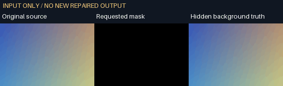
<!-- /V60-DEMO -->

<!-- V59-DEMO -->
**V59 研究原片对照**：六格依次为原输入、历史 LaMa、历史 FGT、实际 ROSE 原始全画面、ROSE 限于选区合成和独立真值；受控门槛未通过，自然与生产未验收。[原视频](docs/assets/rose-native-20261019-v59/source.mp4)、[实际选区输出](docs/assets/rose-native-20261019-v59/rose-selected.mp4)、[完整对照](docs/assets/rose-native-20261019-v59/comparison.mp4)。

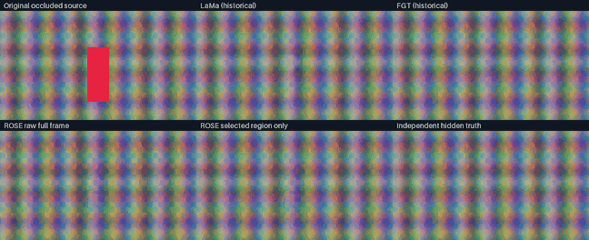
<!-- /V59-DEMO -->

<!-- V58-DEMO -->
**V58 实际逐帧调色**：原创色卡/瓶体图案，2 秒内依次变化；四格为色温、九色轮、曝光、色阶的真实成片。GIF 无声音。[原图](docs/assets/color-automation-r7-20261019-v58/source.png)、[原 MKV](docs/assets/color-automation-r7-20261019-v58/source.mkv)、[原 WAV](docs/assets/color-automation-r7-20261019-v58/source.wav)、[原输入 MP4](docs/assets/color-automation-r7-20261019-v58/source-preview.mp4)、[曝光 MP4](docs/assets/color-automation-r7-20261019-v58/CA04.mp4)、[有色文字 MP4](docs/assets/color-automation-r7-20261019-v58/CA12.mp4)、[复合容器效果 MP4](docs/assets/color-group-r2-20261019-v58/CA15-group.mp4)、[可编辑工程](docs/assets/color-automation-r7-20261019-v58/CA04.aevpkg.zip)、[原生离线包](docs/assets/color-automation-r7-20261019-v58/agent-video-kit-cp313-win_amd64.zip)。[全部 14 组/失败/范围](docs/validation/逐帧调色参数自动化实测_2026-10-19.md)。

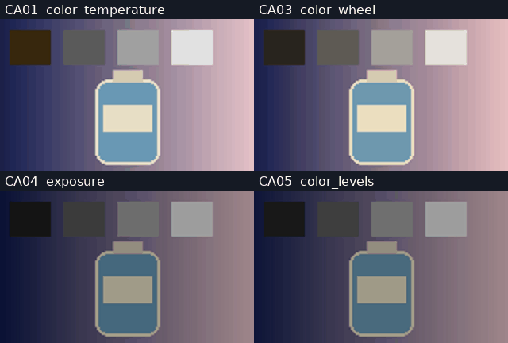
<!-- /V58-DEMO -->

<!-- V57-DEMO -->
**V57 实际完整输出定格**：保持原第 24 帧与关联字幕 TWO 0.3 秒，再继续播放；GIF 来自真实 CLI 输出且无声音。[原 MKV](docs/assets/retime-release-20261019-v57/source.mkv)、[原输入 MP4](docs/assets/retime-release-20261019-v57/source-preview.mp4)、[原 WAV](docs/assets/retime-release-20261019-v57/source.wav)、[实际有声 MP4](docs/assets/retime-release-20261019-v57/RT04.mp4)、[可编辑工程](docs/assets/retime-release-20261019-v57/RT04.aevpkg.zip)、[原生离线包](docs/assets/retime-release-20261019-v57/agent-video-kit-cp313-win_amd64.zip)、[全部 9 组/失败/离线包](docs/validation/完整作者输出变速与磁吸联动实测_2026-10-19.md)。

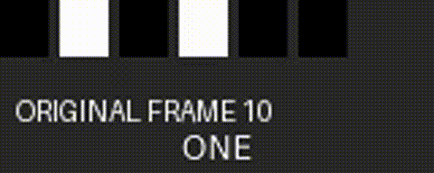
<!-- /V57-DEMO -->

**V56 实际磁吸演示**：C 移到头部后，连续副音轨随 C/A/B/D 自动分段；GIF 来自真实输出且无声音。[原 MKV](docs/assets/magnetic-mode-final-20261018-v56/source.mkv)、[原输入 MP4](docs/assets/magnetic-mode-final-20261018-v56/source-preview.mp4)、[原 WAV](docs/assets/magnetic-mode-final-20261018-v56/source.wav)、[实际 MP4](docs/assets/magnetic-mode-final-20261018-v56/MM01.mp4)、[六组/失败/安装记录](docs/validation/主轨磁吸模式与跨剪口同步拆分实测_2026-10-18.md)。

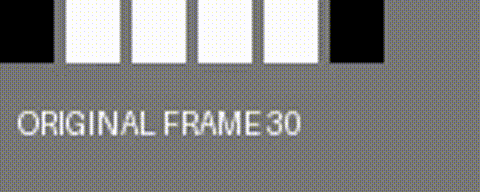

**V55 实际音频路由演示**：图为实际输出的解码波形与验证游标，GIF 无声音；[13 秒 MP4](docs/assets/audio-routing-verified-20261018-v55/audio-routing-showcase-final.mp4)可试听，精度按无损 PCM 核验。原始 [tone](docs/assets/audio-routing-verified-20261018-v55/tone.wav) / [music](docs/assets/audio-routing-verified-20261018-v55/music.wav) / [stereo](docs/assets/audio-routing-verified-20261018-v55/stereo.wav) / [时钟探针](docs/assets/audio-routing-verified-20261018-v55/dc.wav)与六份可编辑工程、哈希及失败见实测记录；不是 GUI 演示或自然混音验收。

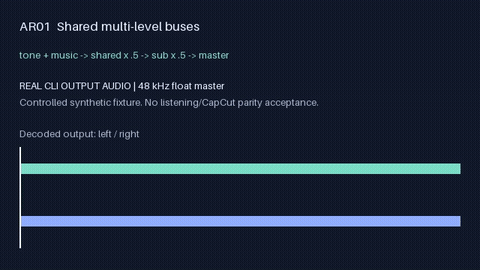

**V50 研究对照**：下图来自真实 CTC /Whisper /Qwen 时间，灰色是作者词块参考；全部未通过原门槛。图为测量可视化，正式内核沿用 V49。 [原 WAV、原稿、两组 MP4/MKV、逐词误差和失败记录](docs/validation/开源字词边界模型对照实测_2026-10-18.md)。

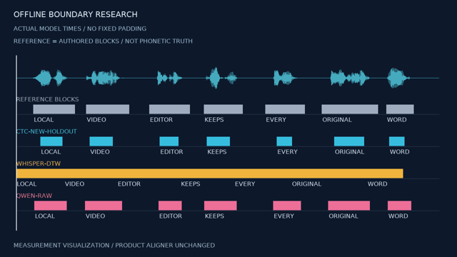

## 开源复用核查

历史 OpenFilm 复核：**853 stars /91 forks**（请求时间见原始证据），main 仍为 `eefd6a8d`；702 原文件及五类已采用 MIT 代码复核通过。推荐复用官方参考片/录屏/长转短流程，XML 按实际互操作需求开展；未安装新上游 Skill 或新增模型内核。[编号复用决策/成本边界](docs/OpenFilm当前复用决策_2026-10-18.md)、[十份官方 Skill 的本地能力映射](docs/OpenFilm官方Skill本地能力映射_2026-10-18.md)、[配套示例的描线/文字/后处理内核](docs/OpenFilm示例与动效内核复用评估_2026-10-18.md)、[本次 API/字节证据](docs/validation/evidence/openfilm-release-review-20261018/verification.json)。该次配套示例审读没有下载媒体或接入内核；后续 V48 已采用 EX02 两个纯函数，见新增核验行。V47 离线发行不计作 OpenFilm 算法。

V46 继续提取固定 `eefd6a8d` 的 MIT `cutText` 原函数（38 行，带来源头 2262 字节）作实际帧对照，本项目补充完全出框、独立轴裁切、body overflow 传播、标准库字体映射及严格门禁。原算法会漏掉本轮后 3 帧完全出框标题，新检查实际检出；字体加载成功不等于覆盖。[采用与效果](docs/validation/HTML文字布局与字体覆盖实测_2026-10-18.md)、[固定 ZIP/原函数摘要](docs/validation/evidence/openfilm-layout-adoption-20261018/verification.json)。本轮未重新获取 GitHub 星数、核验整树或重跑上游测试；既有快照按各自时间保留。剩余重点是复杂字形/Canvas 语义、完整媒体范围与官方创作流程的本地绑定。

V45 已进一步采用 O14：MIT 原字节 `overrides.mjs` 和四个模板字段函数，现有离线 host 可发现 CSS/文字/图片控件、保存覆盖并单项恢复；工程包及片段组实际重建通过。新的 Git 引用检查确认 main 仍为 `eefd6a8d`，星数仅沿用下方 08:38 的 API 快照，不把缓存页面或失败的新 API 请求当成最新计数。[最新采用与剩余范围](docs/OpenFilm_v0.2增量复用与接入建议_2026-10-18.md#v45-html-模板控件受控接入)、[来源引用检查](docs/validation/evidence/openfilm-template-current-20261018/verification.json)。V45 当时剩余的 O15 创作流程、完整页面/媒体范围和布局/字体诊断仍需适配；布局/字体受控子集随后见 V46；没有实测人时，不能据此宣称节省某个工期比例。

2026-10-18 08:38（Asia/Taipei）API 历史快照：OpenFilm **836 stars / 90 forks**，main 仍为固定 `eefd6a8d` / MIT。字幕分段、部分关联规则、Saved 片段组工作流和帧时钟已经采用；V45 已采用离线模板字段与覆盖恢复；V46 已补充受控布局/字体诊断，剩余包括复杂布局语义和官方 Skill 工作流。云 provider 不提供本地 AI 修复内核；本轮另外实测的 FGT 仍为独立研究。[最新接入/剩余成本](docs/OpenFilm_v0.2增量复用与接入建议_2026-10-18.md#v44-研究与-openfilm-边界)、[原 API](docs/validation/evidence/fgt-temporal-20261018/openfilm-current/verification.json)。

2026-10-18 复查 **R03**：OpenFilm main 仍为 `eefd6a8d`，API 快照 **829 stars / 90 forks**，与已审查版本无代码差异。重新核对固定 ZIP、本地 **702 份上游文件**、产品 **130 份冻结文件**及原字幕/MIT 字节；该 R03 研究没有重跑历史测试、编码视频或安装新 Skill；随后 V40 产品增量见本页功能表。[复用落地清单、剩余成本与排除项](docs/OpenFilm_v0.2增量复用与接入建议_2026-10-18.md#当前复用落地决策r03)；[本次 API/摘要/文档链接核对](docs/validation/evidence/openfilm-current-review-20261018/verification.json)。已采用的字幕、关联规则、转场和片段组不重复计收益；剩余优先候选为十份官方 Skill 的本地流程适配，以及 HTML 动效/模板/乱序检查的独立可选后端。

2026-10-18 04:01（Asia/Taipei）复查 GitHub API：**829 stars / 90 forks**，main 仍为已审查 `eefd6a8d`；无新增代码差异。[原 API/时间/SHA](docs/validation/evidence/openfilm-range-followup-20261018/verification.json)。V39 在此前 O02 规则之上原生补齐六种范围编辑；Saved、字幕与关联模块已有受控接入，HTML 动效和模板 CSS 控制仍为单独候选，不重算既有收益。

2026-10-18 03:04（Asia/Taipei）再查 GitHub API：**826 stars / 90 forks**，main 仍为 `eefd6a8d379289102141359a4718dbab12170526`；与 R02 的 809/89 时点分别保留。无新增上游源码差异；[原 API/SHA/修正记录](docs/validation/evidence/openfilm-window-followup-20261018/verification.json)。V38 的复杂作者时钟输出裁切是本项目新实现；下一候选为十份官方 Skill 中的参考片/录屏/长转短流程，原在线接口需替换，HTML 动效另立可选浏览器后端。

2026-10-18 增量核查 **R02**：OpenFilm 0.2.0 固定 `eefd6a8d`，当次 **809 stars / 89 forks**。完整 619→702 文件对比：489 不变、126 改变、87 新增、4 删除；原七份关键文件与 MIT 不变。新增 Saved 片段组库、HTML 模板参数与十份官方 Skill 值得选择性复用；分离间接 React/Playwright 导入后的 **20/20 上游选定测试**及两组文件/数据样例通过，原加载失败保留。R02 当时新模块未接入产品、无浏览器/模型/编码视频；V37 后续接入 O13 见产品实测；20 项包含原树已通过的 12，不能与产品 764 或原研究 123 相加。见[增量复用顺序/工期/边界](docs/OpenFilm_v0.2增量复用与接入建议_2026-10-18.md)。

固定检查 OpenFilm `b138595d`（原快照 704 stars）；10-17 UTC 再查 `eefd6a8d` 时为 790 stars / 89 forks，八个选定文件中七个关键文件原字节一致，README 有更新，详见[复查证据](docs/validation/evidence/openfilm-refresh-20261017/verification.json)。代码 MIT。O02 **整片段关联/同步锁/联动规划**已进入 V33，O01 原字节字幕分句已进入 V34；V35 借鉴 O03 工作流新写真实源句柄转场。HTML 动效、乱序自检和 xmeml 仍是可选增量。O01+O02 的 **7–13 人日适配 / 从头 15–24 人日**是原研究同范围估算；没有实际人时记录，不声称已节省该工期或整个项目比例。

| 编号 | 核验内容 | 真实结果 | 状态与边界 | 证据 |
|---|---|---|---|---|
| R01 | OpenFilm 源码、许可证、无 GUI 拆分及数据输出 | 历史原模块 58/58、Hook 分离副本 65/65、619 原文件 SHA 一致；V33 O02 整片段、V34 O01 原算法已复用，V35 O03 工作流新实现；新八文件复查另计 | 原研究 123 项不与产品回归相加；HTML/乱序自检/其余适配仍未集成；原 React 依赖失败保留 | [12 项模块/成本及接入状态](docs/OpenFilm源码拆解与复用成本评估_2026-10-17.md)、[原研究证据](docs/validation/evidence/openfilm-reuse-20261017.json)、[V35](docs/validation/真实源句柄转场与可逆编辑实测_2026-10-17.md) |
| R02 | OpenFilm 0.2.0 整树更新、片段组库/模板/官方 Skills | 2026-10-18：702 原文件前后摘要一致；独立副本仅改两处依赖边界，20/20 原测试；片段组相对时间/新关联 ID/独立文件副本与模板覆盖两组实际数据通过 | 源码/数据研究；原版间接 Playwright/React 加载失败公开；未安装新 Skill、R02 时未集成 HTML/片段组库、未编码视频或运行完整回归；V37 后续实现 O13 子集，工期为估算 | [编号模块/工期/十份 Skill](docs/OpenFilm_v0.2增量复用与接入建议_2026-10-18.md)、[整树证据](docs/validation/evidence/openfilm-refresh-20261018/verification.json)、[20 项与两组数据](docs/validation/evidence/openfilm-increment-verified-20261018/verification.json) |
| R03 | OpenFilm 当前版本与复用落地决策复核 | 两次公开 API GET；main 与已审查版本相同，702 上游文件及 130 产品冻结文件摘要一致，字幕和 MIT 保留原字节；文档本地链接核对 | 本轮只做源码/证据/文档检查；20 项上游与 897 项产品为历史结果，未重跑、不累加；HTML 后端及新官方 Skill 未接入，无新视频/模型推理 | [具体可拆模块与成本](docs/OpenFilm_v0.2增量复用与接入建议_2026-10-18.md#当前复用落地决策r03)、[本次机器证据](docs/validation/evidence/openfilm-current-review-20261018/verification.json) |
| R04 | OpenFilm 5c2000b8 源码与模板修复 | 历史 713 文件；上游 38 通过/1 跳过；V54 产品定向 73/73 另列 | 不算完整产品回归；XML 为合成数据、无真实目标软件导入 | [17 项复用/成本](docs/OpenFilm最新源码复核与降本清单_2026-10-18.md) |
| R05 | OpenFilm 新 main 及可拆模块复核 | 固定 7a64d1fe；727 原文件；148 核心未变；63 通过/1 DTD 跳过；10 类复用决策 | 原窗口为 mock；无 GUI/模型/新运行时/新 Skill；不计作产品回归 | [成本/范围](docs/OpenFilm复用复核与开发成本更新_2026-10-19.md)、[原证据](docs/validation/evidence/openfilm-reuse-final-20261019-r05/verification.json) |
| R06 | OpenFilm 新导出/轨道源码复核 | 固定 91b4e90c；731 文件；64 原测试通过/1 跳过，8 纯轨道夹具 | 候选模块未接入生产转换；非产品全量/NLE 导入/新 AI 能力验收 | [原始来源/复用判断](docs/OpenFilm导出修复与纯轨道模块复用复核_2026-10-19.md) |
| R07 | OpenFilm 0.2.1 源码与降本复核 | f6a65ae5；749 文件；原测试 75 通过/1 跳过；13 纯数据夹具；196 产品输入不变 | 缓存同大小/mtime 负例失败；候选未接入、无新媒体/GPU/产品回归 | [18 项复用/投入/原证据](docs/OpenFilm_0.2.1复用清单与成本复核_2026-10-19.md) |
| R09 | OpenFilm 当前可拆模块、依赖和剩余成本 | 71922644 未变；757 文件重新校验；16 个原声明夹具复现并发/签名/缓存行为 | 低内存、改名去重及缓存需改写；无新产品/模型/视频验收；既有 V68 修改保留 | [拆取顺序/人日/原证据](docs/OpenFilm最新复用评估与成本取舍_2026-10-20.md#r09当前复核与拆取顺序) |

实际数据：[字幕原输入](docs/validation/evidence/openfilm-reuse-20261017/S01-subtitle-input.json) → [三段输出](docs/validation/evidence/openfilm-reuse-20261017/S01-subtitle-output.json)；[跨轨删除原模型](docs/validation/evidence/openfilm-reuse-20261017/S02-ripple-input.json) → [操作计划/实际结果/手工预期](docs/validation/evidence/openfilm-reuse-20261017/S02-ripple-output.json)。字幕无词标的时间为估算。原 CLI/Skill 连接 Studio、npx latest 与服务商；选用模块需改为固定本地入口、强制离线并保留原版权。GUI 目录内的纯规划算法可提取；上游不是完整剪映或本地 AI 特效替代内核。

## 实测演示素材

V53 实际主轨重排：左为 A/B/C/D，右为 CLI 输出 C/A/B/D，帧号和关联配音逐项核对。五组独立纯切 RGB、独立 Alpha 差 0；115.2 万原 PCM 采样帧差 0。复杂作者/转场使用重排前完整块参考，分别计数。9 时刻静帧，未连续播放/听审。 [原视频](docs/assets/magnetic-reorder-v53-r5-20261018/source-frames.mkv)、[原输入 MP4](docs/assets/magnetic-reorder-v53-r5-20261018/source-preview.mp4)、[原 WAV](docs/assets/magnetic-reorder-v53-r5-20261018/source-audio.wav)、[实际 MP4](docs/assets/magnetic-reorder-v53-r5-20261018/MR01.mp4)、[无损成片](docs/assets/magnetic-reorder-v53-r5-20261018/MR01.mkv)、[全部数据与失败](docs/validation/主轨磁吸重排与关联附着实测_2026-10-18.md)。

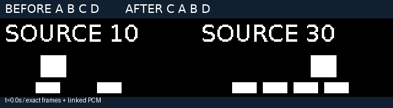

V52 实际交付对照：原覆盖率、固定 V51 成片与当前无损 VP9。Alpha 一个灰阶差由全像素测量确定；GIF 是实际解码结果的棋盘投影。只做 8 时刻静帧检查，未连续播放或听审。 [原透明源](docs/assets/delivery-precision-20261018/source-ramp.mkv)、[原源预览](docs/assets/delivery-precision-20261018/source-checkerboard.mp4)、[原 WAV](docs/assets/delivery-precision-20261018/source-audio.wav)、[当前 WebM](docs/assets/delivery-precision-20261018/DP01-vp9-freeze.webm)、[全部数据/失败](docs/validation/透明视频交付与音画端点实测_2026-10-18.md)。

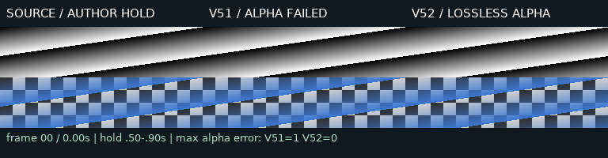

4.01 秒作者区间的实际 MP4：10 fps 下 41 帧显示到 4.1 秒，音轨元数据 4.01 秒；AAC 解码多出 32 采样帧的填充另行报告。结尾留黑和计数/字幕叠置为诊断布局，未作为自然广告排版验收。 [实际 MP4](docs/assets/delivery-precision-20261018/DP09-fractional-mp4.mp4)。


V51 实际 CLI 输出：子运镜和字幕随复合片段暂停，父透明度继续。诊断文字与原片计数叠置，自然广告排版未验；仅四时刻静态目检，未连续播放/听审。 [原 A](docs/assets/nested-freeze-v51-final-20261018/source-a.mp4)、[原 B](docs/assets/nested-freeze-v51-final-20261018/source-b.mp4)、[实际 MP4](docs/assets/nested-freeze-v51-final-20261018/NF06.mp4)、[全部样例/透明编码失败](docs/validation/复合片段定格与完整音画时钟实测_2026-10-18.md)。

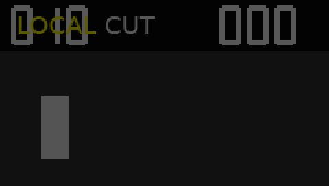

**V49 本地 CTC 对齐（精度未达标）**：左为原创波形输入，右为真实模型时间驱动的字幕；1280×720、30 fps、236 帧。GIF 79 帧/7,900 ms，无音频。逐帧高亮与模型时码一致，但词块边界偏差达 258.1875 ms，未通过 66.6667 ms 门槛。

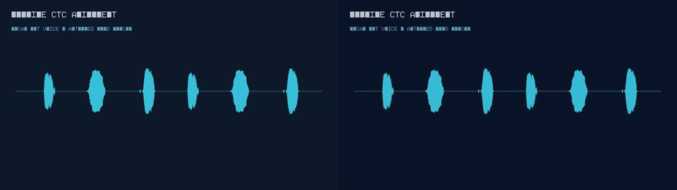

[原视频](docs/assets/ctc-alignment-20261018/input.mp4) · [原声音](docs/assets/ctc-alignment-20261018/input.wav) · [原文](docs/assets/ctc-alignment-20261018/transcript.txt) · [真实成片](docs/assets/ctc-alignment-20261018/result.mp4) · [原始词块/来源](docs/assets/ctc-alignment-20261018/input-provenance.json) · [实际安装包](docs/assets/ctc-alignment-20261018/agent-video-kit-cp313-win_amd64.zip) · [实测/全部失败](docs/validation/离线CTC字词强制对齐实测_2026-10-18.md)

**V48 OpenFilm 描线复用**：左为原创背景，右为实际 CLI 编码的逐笔 A/I；384×216、12 fps、36 帧/3 秒。GIF 实际 16 帧/2,970 ms，无声，停留帧已合并；原输入为显式笔画和时间，无自动字体或语音对齐。


[原视频](docs/assets/stroke-motion-verified-20261018/source.mp4) · [原笔画](docs/assets/stroke-motion-verified-20261018/authored-plan.json) · [实际成片](docs/assets/stroke-motion-verified-20261018/result.mp4) · [可编辑源码](docs/assets/stroke-motion-verified-20261018/editable-source.zip) · [更新安装包](docs/assets/stroke-motion-verified-20261018/agent-video-kit-cp313-win_amd64.zip) · [实测/失败](docs/validation/离线逐笔描线动效实测_2026-10-18.md)

**V47 安装版实际剪辑**：左为源 1–4 秒，右为关联音画滑移后的 2–5 秒；各 30 帧/10 fps/3 秒，非周期立体声逐采样验证；GIF 无音频。原视频、原音频、编码结果和实测发行 ZIP均可复查。

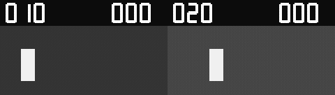

[原视频](docs/assets/offline-release-final-20261018/source-a.mp4) · [原音频探针](docs/assets/offline-release-final-20261018/sound-a.wav) · [实际结果](docs/assets/offline-release-final-20261018/after.mp4) · [已测试离线发行包](docs/assets/offline-release-final-20261018/agent-video-kit-cp313-win_amd64.zip) · [安装/边界/证据](docs/validation/离线发行与随包Schema实测_2026-10-18.md)

**V46 布局诊断与修复**：左为后段标题完全出框，中为 CTA 容器裁切，右为修复。实际三列输出使用新原创完整字体；旧字体的系统 fallback 仅发布诊断元数据。每列 384×216、12 帧/6 fps/2 秒；GIF 768×144、12 帧/2 秒，无音频。

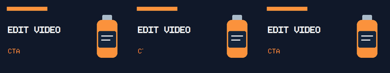

[出框视频](docs/assets/html-quality-20261018/outside.mp4) · [裁切视频](docs/assets/html-quality-20261018/clip.mp4) · [修复视频](docs/assets/html-quality-20261018/fixed.mp4) · [联系表](docs/assets/html-quality-20261018/contact.png) · [诊断/失败/来源](docs/validation/HTML文字布局与字体覆盖实测_2026-10-18.md)

**V45 离线模板控件**：左为原模板，中为换品牌色/图片/文案，右为 null 撤销后重建。三列为实际同帧输出；原片 384×216、12 帧/6 fps/2 秒；GIF 768×144、12 帧/2 秒，无音频。


[原模板视频](docs/assets/html-template-20261018/original.mp4) · [修改后视频](docs/assets/html-template-20261018/changed.mp4) · [恢复视频](docs/assets/html-template-20261018/restored.mp4) · [实际联系表](docs/assets/html-template-20261018/contact.png) · [来源/逐帧证据](docs/validation/离线HTML模板控件与覆盖恢复实测_2026-10-18.md)

### V44 研究：真正多帧修复与独立背景真值

一个原创双表面受控样本的门槛通过，**自然镜头仍未验收、未接入产品**。图中依次为原输入、实际 LaMa、实际 FGT、独立背景真值；GIF 为半尺寸/64 色展示，评分来自实际解码 RGBA。

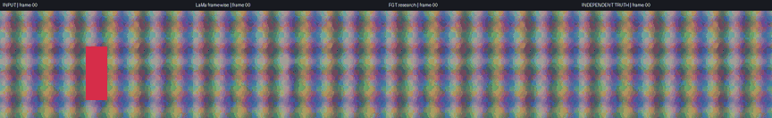

[完整 MP4](docs/assets/fgt-temporal-20261018/comparison.mp4)、[原输入无损视频](docs/assets/fgt-temporal-20261018/source-lossless.mp4)、[实际 FGT 无损视频](docs/assets/fgt-temporal-20261018/final-lossless.mp4)、[真值无损视频](docs/assets/fgt-temporal-20261018/truth-lossless.mp4)、[失败/许可/实测](docs/validation/开源FGT时序修复候选实测_2026-10-18.md)。私有自然像素留本地，只公开标量与摘要。


### V43 产品：可编辑蒙版修正与真实修复输入

16 帧原创样例的缺臂、部分帧缺腿、圆点/角落误选由正式 CLI 修正，含第 8 帧切镜；输出与独立像素真值一致。GIF 为 2 秒、无音频。自然样例 5/5 旧点通过，但真实 LaMa 背景仍涂抹，私有自然视频不公开。

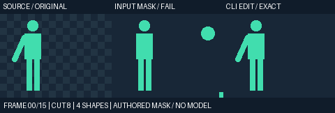

[原片](docs/assets/mask-edits-20261018/source.mp4) · [原蒙版](docs/assets/mask-edits-20261018/mask-input.mov) · [实际蒙版](docs/assets/mask-edits-20261018/mask-edited.mov) · [对照 MP4](docs/assets/mask-edits-20261018/comparison.mp4) · [可编辑工程包](docs/assets/mask-edits-20261018/editable-project.zip) · [复现/全部结果/失败](docs/validation/本地蒙版笔刷与关键帧修正实测_2026-10-18.md)。

### V42 研究：质量未通过，未进入正式修复内核

三组原创输入公开，保留参考、失败 v1、v3 和遮挡前真值。旧双表面的 v3 与参考相等；新增运动场景仍退步，不能以 GIF 或检查通过数宣称画质提升。每组 12 帧、12 fps、1 秒，无音频；无损 NUT 回读/PTS 与独立指标复核通过，未连续播放或听审。

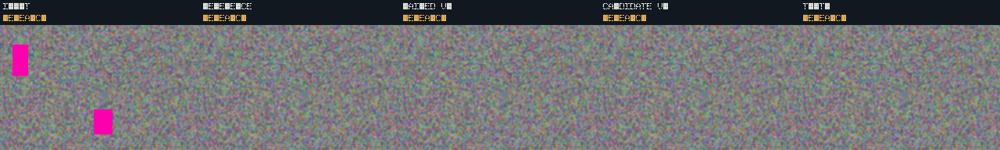

[双表面原输入](docs/assets/coherent-reference-20261018/two_surfaces-input.mp4) · [双运动/切镜原输入](docs/assets/coherent-reference-20261018/two_motion_cut-input.mp4) · [实际双运动 GIF](docs/assets/coherent-reference-20261018/two_motion_cut-comparison.gif) · [非刚性/曝光原输入](docs/assets/coherent-reference-20261018/elastic_exposure-input.mp4) · [实际非刚性 GIF](docs/assets/coherent-reference-20261018/elastic_exposure-comparison.gif) · [复现 CLI/指标与失败](docs/validation/空间与时序一致参考选择实测_2026-10-18.md)


**正式产品 CLI V41：保留动效源码，生成透明标题并叠入时间线。** 左列为原创底图输入，右列为真实产品时间线成片；SVG 商品、文字、CSS 动画与 Canvas 标记均由本地 Chromium 逐帧生成。


[原输入 PNG](docs/assets/html-motion-20261018/source.png) · [原输入 MP4](docs/assets/html-motion-20261018/source.mp4) · [HTML/清单](docs/assets/html-motion-20261018/template/index.html) · [SVG 原素材](docs/assets/html-motion-20261018/template/bottle.svg) · [透明原文件 NUT](docs/assets/html-motion-20261018/S01-alpha.nut) · [实际产品 MP4](docs/assets/html-motion-20261018/S03-timeline.mp4) · [实际产品 MKV](docs/assets/html-motion-20261018/S03-timeline.mkv) · [改参预览](docs/assets/html-motion-20261018/S02-preview.mp4) · [可重建工程包](docs/assets/html-motion-20261018/editable-project.zip) · [五组/失败/复现](docs/validation/离线HTML动效源码与透明合成实测_2026-10-18.md)。

自制 CC0 背景、几何商品和原创像素字体；原片/主输出 640×360、12 fps、24 帧、2 秒。双列 GIF **960×270、12 帧/2000 ms**，无声；主 MKV 另有自动生成的精确静音流。96 成功 HTML 输入帧、192 乱序重绘与 24 原生时间线主帧分计，S03 与独立 alpha/RGB 合成最大差 3、均值 0.476496。78 文件/6,332,822 字节、10 视频/1 静音音频流复解码；两组三时刻静态目检，未连续播放/听审。绿色块为几何核验标记；未验中文长标题、照片广告或自然美学。[来源/30 原始 CLI](docs/assets/html-motion-20261018/verification.json)、[媒体审计](docs/validation/evidence/html-motion-media-final-20261018.json)、[原 MKV 错位成片](docs/assets/html-motion-clock-failure-20261018/S03-timeline.mkv)、[失败与原冻结源码](docs/validation/evidence/html-motion-development-20261018/verification.json)。MIT 只授权复用代码，源码/字体/图片权利继续分别登记。


**正式产品 CLI V40：真实扩展输入范围，并联动音频延长滚动剪口。** 左列固定 V39 手工作者工程，右列本轮实际输出；上行 S02 双侧外扩，下行 S07 关联 roll。

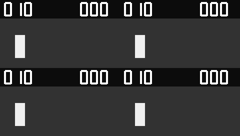

[原视频](docs/assets/source-edits-20261018/source-a.mp4) · [原声](docs/assets/source-edits-20261018/sound-a.wav) · [外扩前原片](docs/assets/source-edits-20261018/S02-original.mp4) · [外扩实际输出](docs/assets/source-edits-20261018/S02-actual.mp4) · [关联 slip](docs/assets/source-edits-20261018/S01-actual.mp4) · [滚动剪口](docs/assets/source-edits-20261018/S07-actual.mp4) · [滑动片段](docs/assets/source-edits-20261018/S08-actual.mp4) · [曲线倒放](docs/assets/source-edits-20261018/S05-actual.mp4) · [无损有声 MKV](docs/assets/source-edits-20261018/S02-actual.mkv) · [九组/复现/原失败](docs/validation/真实源外扩与关联Slip实测_2026-10-18.md)。

既有自制 CC0 输入、0 新模型推理；**301 文件/64,117,582 字节**，56 视频/55 音频流复解码。505 主帧/2,424,000 立体声采样帧完全相同；同产品手工参照不独立验收渲染算法。两组额外核对 100 个直接源帧身份。GIF 480×272、20 帧/4 秒、无声；各组输出预览 MP4 使用 AAC，对照 comparison.mp4 无声，有声无损核对使用 MKV/PCM。四时刻计数/位置条目检一致，边缘计数局部裁切；无连续播放/听审。79 次为两原生 worker 的真实 CLI main 调用，26 次 wheel CLI 另起独立进程；临时 run-state 快照不是完成状态，以 verification 为准。[输入/SHA/全部原 CLI](docs/assets/source-edits-20261018/verification.json)、[媒体复核](docs/validation/evidence/source-media-audit-20261018.json)、[静态记录](docs/validation/evidence/source-static-review-20261018.json)、[原开发记录](docs/validation/evidence/source-development-20261018/verification.json)。

**历史产品 CLI V39：覆盖复杂作者片段，并联动音频滑动中间片段。** 左列固定 V38 完整作者的明确选区/拼接，右列本轮实际输出；上行 R02 覆盖，下行 R06 滑动。

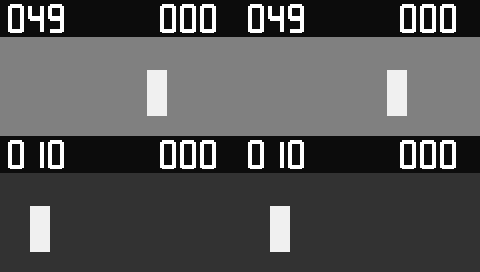

[原输入视频](docs/assets/range-edits-20261018/source-a.mp4) · [原声](docs/assets/range-edits-20261018/sound-a.wav) · [覆盖前原片](docs/assets/range-edits-20261018/R02-original.mp4) · [覆盖后实际输出](docs/assets/range-edits-20261018/R02-actual.mp4) · [滑动前原片](docs/assets/range-edits-20261018/R06-original.mp4) · [滑动后输出](docs/assets/range-edits-20261018/R06-actual.mp4) · [关联滚动剪口](docs/assets/range-edits-20261018/R05-actual.mp4) · [字幕骑乘](docs/assets/range-edits-20261018/R08-actual.mp4) · [无损有声 MKV](docs/assets/range-edits-20261018/R06-actual.mkv) · [八组/复现/原失败](docs/validation/专业范围编辑与滚滑剪口实测_2026-10-18.md)。

自制 CC0 输入，0 新模型推理；**269 文件/36,175,156 字节**，45 视频/45 音频流复解码。340 主帧和 1,632,000 立体声采样帧逐项完全相同；同产品参照不独立验收渲染质量。GIF 480×272、20 帧/4 秒、无声；AAC 为预览，PCM 检查用无损 MKV。抽查 0/12/24/38 帧及 CTA 前后图形；边缘计数有局部裁切，低栅格字幕不可推定自然排版；无连续播放或听审。[输入/SHA/73 原始 CLI](docs/assets/range-edits-20261018/verification.json)、[媒体复核](docs/validation/evidence/range-media-audit-20261018.json)、[静态记录](docs/validation/evidence/range-static-review-20261018.json)、[开发原失败](docs/validation/evidence/range-development-20261018/verification.json)。

**历史产品 CLI V38：在倒放、曲线变速和定格之后，保真裁切与删除中段。** 左列固定 V37 原片的明确选区，右列新 CLI 实际输出；上行删中段，下行定格内裁切。

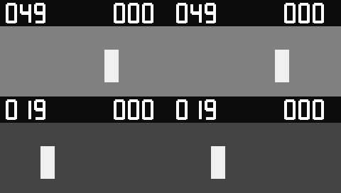

[原视频](docs/assets/clip-windows-20261018/source-a.mp4) · [原声](docs/assets/clip-windows-20261018/sound-a.wav) · [完整曲线倒放原片](docs/assets/clip-windows-20261018/C02-original.mp4) · [删中段实际输出](docs/assets/clip-windows-20261018/C02-actual.mp4) · [定格原片](docs/assets/clip-windows-20261018/C03-original.mp4) · [定格内裁切](docs/assets/clip-windows-20261018/C03-actual.mp4) · [多轨黑边](docs/assets/clip-windows-20261018/C09-actual.mp4) · [无损有声 MKV](docs/assets/clip-windows-20261018/C02-actual.mkv) · [九组/复现/原失败](docs/validation/输出窗口裁切与作者时钟实测_2026-10-18.md)。

输入为自制 CC0 计数器、声音和原创网格字体；不含商业字体或新模型推理。九组 300 新主帧、1,440,000 立体声采样帧与固定旧版原片选区全相同，参照仍使用同一产品渲染器。公开 **202 文件/28,282,096 字节**，35 视频/35 音频流复解码；GIF 480×272、20 编码帧/2000 ms、无声。静态抽查第 0/10/19 对照帧；低分辨率样例中部分边缘计数字符被裁，未验广告字幕排版/自然质量，无连续播放或听审。[来源/SHA/54 原始 CLI](docs/assets/clip-windows-20261018/verification.json)、[媒体审计](docs/validation/evidence/windows-media-audit-20261018.json)、[静态记录](docs/validation/evidence/windows-static-review-20261018.json)、[开发原失败](docs/validation/evidence/windows-development-20261018/verification.json)。

**正式产品 CLI V37：把转场、字幕、LUT 和子序列保存成可编辑组，再跨项目插入。** 左列固定 V36 手工参照，右列实际片段组输出；上行为全组，下行为单选自动补全。

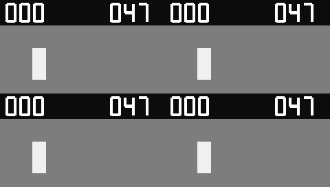

[原视频 A](docs/assets/fragments-20261018/source-a.mp4) · [原视频 B](docs/assets/fragments-20261018/source-b.mp4) · [原声](docs/assets/fragments-20261018/sound-a.wav) · [完整组 MP4](docs/assets/fragments-20261018/C01-actual.mp4) · [单选自动补全 MP4](docs/assets/fragments-20261018/C02-actual.mp4) · [重复实例](docs/assets/fragments-20261018/C04-actual.mp4) · [竖屏目标](docs/assets/fragments-20261018/C05-actual.mp4) · [继续编辑字幕](docs/assets/fragments-20261018/C06-actual.mp4) · [有声无损 MKV](docs/assets/fragments-20261018/C01-actual.mkv) · [库版本文件](docs/assets/fragments-20261018/library) · [六组/五项拒绝/复现](docs/validation/可复用片段组库与跨项目插入实测_2026-10-18.md)。

原输入自制 CC0，240×136/10 fps/80 帧/8 秒；原创网格字体、字幕与 LUT 一并公开，无商业字体文件或新模型。六组 340 新主帧、1,632,000 立体声采样帧与固定 V36 手工原作者工程完全一致；340 参考帧另计。公开 **86 文件/44,949,051 字节**、34 视频/33 音频流复解码；GIF 480×272、20 编码帧/4000 ms，另抽对照 MP4 三帧静态目检；低分辨率 CTA 偏小，未验广告字幕可读性；未连续播放或听审。[来源/SHA/原始 CLI](docs/assets/fragments-20261018/verification.json)、[媒体审计](docs/validation/evidence/fragments-media-audit-20261018.json)、[原失败/说明](docs/validation/evidence/fragments-development-20261018/verification.json)。

**正式产品 CLI V36：先完成子级转场，再做父级变速。** 三列为无转场父级输入 / 新版实际输出 / 独立源混合参照；四行依次为裁切、倒放、曲线、子级透明度。

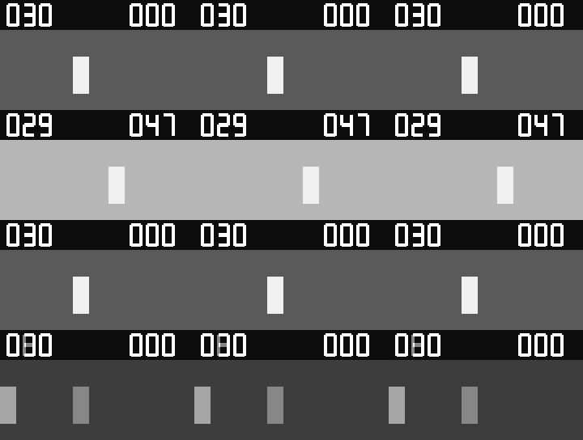

[原视频 A](docs/assets/nested-transitions-20261018/source-a.mp4) · [原视频 B](docs/assets/nested-transitions-20261018/source-b.mp4) · [原声](docs/assets/nested-transitions-20261018/sound-a.wav) · [无转场输入](docs/assets/nested-transitions-20261018/C03-input.mp4) · [倒放成片](docs/assets/nested-transitions-20261018/C03-actual.mp4) · [二倍速成片](docs/assets/nested-transitions-20261018/C04-actual.mp4) · [曲线成片](docs/assets/nested-transitions-20261018/C05-actual.mp4) · [有声无损 MKV](docs/assets/nested-transitions-20261018/C03-actual.mkv) · [对照 MP4](docs/assets/nested-transitions-20261018/comparison.mp4) · [22 组、失败与复现](docs/validation/嵌套转场与父级重映射实测_2026-10-18.md)。

原片自制 CC0、240×136/10 fps/80 帧/8 秒；对照 720×544/40 帧/4 秒、无声，GIF **20 编码帧/4000 ms**。920 新主帧、440 无转场输入和 720 固定子级参照帧分计，另有 40 固定旧版兼容帧。22 组全部按固定子级和解析父时钟核对；其中 12 组/520 帧另有独立源 RGB 参照，六组/144 万立体声采样帧有独立 PCM，变速其余组仅验长度/有限性。[112 文件来源/SHA](docs/assets/nested-transitions-20261018/verification.json)、[复解码审计](docs/validation/evidence/nested-transitions-media-audit-20261018.json)、[首中末静帧目检](docs/validation/evidence/nested-transitions-static-review-20261018.json)。未连续播放或听审，0 新模型推理；[二倍速原失败](docs/validation/evidence/nested-transitions-development-20261018/C04-before.mkv)及开发原日志保留。

**正式产品 CLI V35：真实源句柄、双剪口、改长/擦除、剪口白场和倒放 2 倍。** 两列为作者输入 / 实际 CLI 输出，四行依次 C01–C04；片段源帧号可见，作者剪口与总长不变。全部素材为程序自制 CC0，无模型/外部字体。

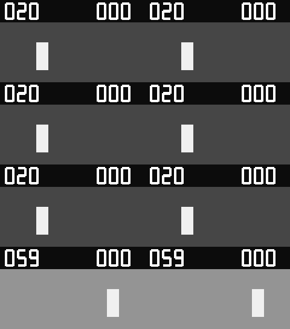

[原片 A](docs/assets/source-transitions-20261017/source-a.mp4) · [原片 B](docs/assets/source-transitions-20261017/source-b.mp4) · [原片 C](docs/assets/source-transitions-20261017/source-c.mp4) · [原声音源](docs/assets/source-transitions-20261017/sound-a.wav) · [编辑前](docs/assets/source-transitions-20261017/authored-input.mp4) · [双剪口成片 MP4](docs/assets/source-transitions-20261017/C01-actual.mp4) · [原始无损 MKV](docs/assets/source-transitions-20261017/C01-actual.mkv) · [独立像素参考](docs/assets/source-transitions-20261017/C01-independent-reference.mp4) · [倒放 2 倍成片](docs/assets/source-transitions-20261017/C04-actual.mp4) · [对照 MP4](docs/assets/source-transitions-20261017/comparison.mp4) · [十五组实测与四项开发记录](docs/validation/真实源句柄转场与可逆编辑实测_2026-10-17.md) · [来源/SHA](docs/assets/source-transitions-20261017/verification.json)。

十五组成片各 60 帧/6 秒；900 新帧、432 万新立体声采样帧。四组全像素独立参考最大 RGB 差 1.8，十五组无损 PCM 独立包络参考差 0；其余类型只验实际执行、窗外和恢复。GIF 480×544、30 帧/6 秒、5 fps；对照 MP4 60 帧/10 fps，无声。已目检第 0/20/59 张静帧，未连续播放/听审；AAC 仅预览，不替代无损采样证据。[原白场失败成片](docs/assets/source-transitions-development-20261017/C03-actual.mp4)仍保留，修正后在作者剪口达到白场。自然广告画质与完整剪映功能继续未验。

**历史正式产品 CLI V34：中文/英文字幕分段、双语与局部回写。** 三列为整句作者输入 / CLI 实际输出 / 手工文字和时钟参考。原片与音频由本地程序构造，人工标记、非 ASR；下面的真实 Whisper 测试另计。参考使用同一渲染器。

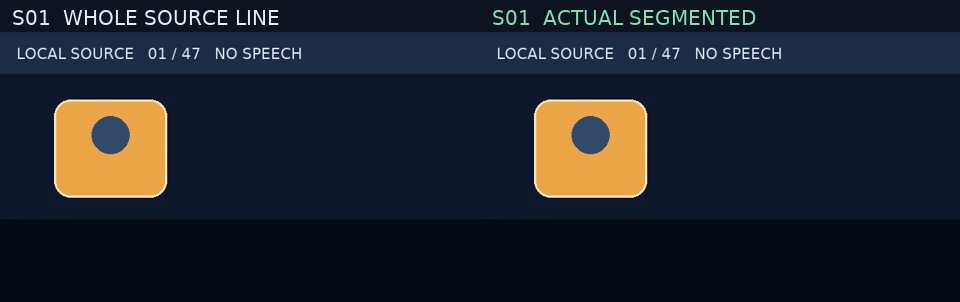

[自制原片](docs/assets/subtitle-segments-20261017/source.mp4) · [原声](docs/assets/subtitle-segments-20261017/tone.wav) · [中文输出](docs/assets/subtitle-segments-20261017/S01-segmented.mp4) · [双语输出](docs/assets/subtitle-segments-20261017/S02-segmented.mp4) · [局部回写输出](docs/assets/subtitle-segments-20261017/S03-segmented.mp4) · [对照 MP4](docs/assets/subtitle-segments-20261017/comparison.mp4) · [四组及真实 ASR 实测](docs/validation/本地字幕分段与双语回写实测_2026-10-17.md) · [来源/SHA](docs/assets/subtitle-segments-20261017/verification.json)。4×48=192 新帧；编辑前后解码 PCM 一致。真实 Whisper 是一次新 CPU 推理、5 原句→9 字幕、CER 2%，沿用既有中文语料，时间仍为估算，未核验权利的音视频只留本地。GIF 24 秒/48 帧，已看三张静帧，未连续播放或听审。

**历史正式产品 CLI V33：关联剪辑、同步锁与主轨联动。** 三列依次为编辑前作者输入 / CLI 实际输出 / 手工时间线参考。四行展示同步删除、字幕跟随、保留音量的冲突换轨和连续移位 SRT；参考视频使用同一渲染器，音频另做独立 PCM 求和。


[自制原片](docs/assets/linked-edit-20261017/source.mp4) · [编辑前](docs/assets/linked-edit-20261017/L01-input.mp4) · [同步删除成片](docs/assets/linked-edit-20261017/L01-after.mp4) · [冲突换轨成片](docs/assets/linked-edit-20261017/L05-after.mp4) · [字幕成片](docs/assets/linked-edit-20261017/L07-after.mp4) · [三列 MP4](docs/assets/linked-edit-20261017/comparison.mp4) · [九组与失败](docs/validation/关联剪辑与主轨联动真实音画实测_2026-10-17.md)。

公开 175 文件及来源/SHA，原片/每组为 240×136、8 fps、40 帧/5 秒；三列预览 720×980、40 帧/5 秒，无声，GIF **20 编码帧/5000 ms**。360 新输出帧、360 输入、360 手工参考和 40 固定 V32 控制帧分计；216 万新立体声采样帧最大误差 0。59 视频/69 音频已重新解码，首/中/末图静态目检，**未连续播放或听审**。原声与无损 MKV 有声，AAC MP4 仅供播放。[字体/CC0 来源](docs/assets/linked-edit-20261017/fixture-provenance.json)、[包与原始 CLI 记录](docs/validation/关联剪辑与主轨联动真实音画实测_2026-10-17.md#3-原片gif工程及复现)、[完整证据](docs/validation/evidence/linked-edit-20261017.json)。主轨磁吸重排、源边缘裁切及完整剪映等价未验收。

**历史正式产品 CLI V32：高频缩小与透明面积采样。** 从左至右为固定 V31 / 当前默认双线性 / 显式 area / 独立单元重叠参考。三像素黑/黑/白纹理的三倍缩小均值误差由 85 降为 0；九组最大 RGB 差 4（门槛 4）。


[真实输入 PNG](docs/assets/sequence-sampling-20261017/S01-source.png) · [源预览 MP4](docs/assets/sequence-sampling-20261017/S01-source.mp4) · [旧版](docs/assets/sequence-sampling-20261017/S01-before.mp4) · [area 成片](docs/assets/sequence-sampling-20261017/S01-area.mp4) · [四列 MP4](docs/assets/sequence-sampling-20261017/comparison-readable.mp4) · [九组原输入/全部成片/失败](docs/validation/序列面积采样与工作配额实测_2026-10-17.md)。实际输入为自制 CC0 PNG，源预览 MP4 是黑底展示；软 Alpha 原输入见 S07 PNG。各组视频 16 帧/8 fps/2 秒；预览 768×588、无声，GIF **8 编码帧/2000 ms**。144 area 帧、144 旧帧、144 默认控制与 144 参考分计；45 视频重新解码、27 路预期静音核对，103 文件 SHA/来源见[机器证据](docs/validation/evidence/sequence-sampling-20261017.json)。静态查看首末帧，**未连续播放或听审**；一般旋转只验源轴矩形核，配额不是进程 RSS 上界。原跨列标题预览与开发夹具失败保留。

**正式产品 CLI V31：独立竖屏子画布与父级投影。** 左至右为固定 V30 / 新版实际解码 / 独立空间参考；四行展示 fit、fill 后旋转、锚点动画与父蒙版。九组分别通过声明门槛，C01–C08 最大 RGB 差 2，继承控制逐字节一致。


[自制原输入](docs/assets/sequence-canvas-20261017/source-portrait.mp4) · [旧版实际](docs/assets/sequence-canvas-20261017/C01-before.mp4) · [新版实际](docs/assets/sequence-canvas-20261017/C01-after.mp4) · [独立参考](docs/assets/sequence-canvas-20261017/C01-reference.mp4) · [三列对照 MP4](docs/assets/sequence-canvas-20261017/comparison.mp4) · [九组编号、失败与复现](docs/validation/独立序列画布与原生坐标投影实测_2026-10-17.md)。

预览 960×920；MP4 12 fps、24 帧/2 秒，无音轨；GIF **12 编码帧/2000 ms**，降低帧率和调色板仅供展示。原输入 CC0，24 帧/12 fps/2 秒，字体许可及全部 SHA-256 见[来源](docs/assets/sequence-canvas-20261017/fixture-provenance.json)和[63 文件清单](docs/validation/evidence/sequence-canvas-20261017.json)。216 新主帧中 168 帧有独立空间参考，24 帧只验局部字形投影，24 帧只验继承兼容；24 单独子级帧另计，0 新模型推理。已机器逐帧/静音复核、静态目检首末帧，**未连续播放或听审**；[错误参考与开发失败](docs/validation/独立序列画布与原生坐标投影实测_2026-10-17.md#5-失败记录与参考修正)保留，不证明任意高频细节/自然画质或完整剪映等价。

**历史正式产品 CLI V30：分段变速的实际音频与完整尾部。** 三列为原始输入 / 固定 V29 / V30 真实解码，上下分开显示 L/R。T01 内部零采样帧 82→0，六组 DC 完整有效区间均通过；自然声音与听感仍未验收。


[原视频](docs/assets/audio-tempo-context-20261017/source.mp4) · [DC 原声](docs/assets/audio-tempo-context-20261017/dc.wav) · [旧失败 MP4](docs/assets/audio-tempo-context-20261017/T01-before.mp4) · [当前 MP4](docs/assets/audio-tempo-context-20261017/T01-after.mp4) · [无损 MKV](docs/assets/audio-tempo-context-20261017/T01-after.mkv) · [解码 WAV](docs/assets/audio-tempo-context-20261017/T01-after.wav) · [三列预览 MP4](docs/assets/audio-tempo-context-20261017/comparison.mp4) · [完整尾部对照](docs/assets/audio-tempo-context-20261017/slow-tail-comparison.png) · [11 组编号、来源与复现](docs/validation/分段音频上下文与完整尾部实测_2026-10-17.md)。

预览 960×544；MP4 12 fps、36 帧/3 秒，GIF **18 编码帧/3000 ms**，均无声；原 WAV/正式成片有声。自制 CC0，0 新模型推理，[来源与 SHA-256](docs/assets/audio-tempo-context-20261017/fixture-provenance.json)。396 个新视频帧及 1,584,000 个新立体声采样帧完成声明范围的自动检查；目检首末/慢速尾部静态图，**未连续播放或听审**。这不等于全部采样与独立高质量变速参考相等；AAC MP4 仅供播放。另公开[开发版尾部缺样](docs/assets/audio-tempo-context-20261017/development-context-only-T05.mkv)、[错误参考截图](docs/assets/audio-tempo-context-20261017/development-preview-invalid-reference.png)与[失败说明](docs/assets/audio-tempo-context-20261017/development-verification.json)。

**历史 V29 正式产品 CLI：分层混音与逐采样核验。** 左至右为固定 V28 / 新版实际解码 / 独立参考 PCM；上下独立显示 L/R 通道。12 组无损采样检查通过，旧版 11 组失败、1 正控制；自然声音与听感仍未验收。


[原视频](docs/assets/audio-buses-20261017/source.mp4) · [A 原声](docs/assets/audio-buses-20261017/tone_a.wav) · [B 原声](docs/assets/audio-buses-20261017/tone_b.wav) · [旧包络失败 MP4](docs/assets/audio-buses-20261017/B04-before.mp4) · [新包络 MP4](docs/assets/audio-buses-20261017/B04-after.mp4) · [无损新 MKV](docs/assets/audio-buses-20261017/B04-after.mkv) · [参考 WAV](docs/assets/audio-buses-20261017/B04-reference.wav) · [三列预览 MP4](docs/assets/audio-buses-20261017/comparison.mp4) · [12 组编号、原始日志与复现](docs/validation/分层音频总线与真实采样实测_2026-10-17.md)。

预览 960×1074；MP4 12 fps、24 帧/2 秒，GIF **12 编码帧/2000 ms**，均无声；正式成片/WAV 有声。源素材为自制双声道正弦波和移动帧码，[CC0 来源/许可](docs/assets/audio-buses-20261017/fixture-provenance.json)。全部 1,152,000 新采样帧及 288 新视频帧已自动检查，并目检预览首末图，**未连续播放或听审**。MKV float PCM 用于精度验收，AAC MP4 仅供播放。另公开[非线性 atempo DC 失败](docs/assets/audio-buses-20261017/dc-diagnostic-retimed-plain.mkv)及[采样诊断](docs/assets/audio-buses-20261017/dc-diagnostic-verification.json)；该 V29 历史输出保留；V30 对同字节输入的受控重验已消除检查区 82 个零采样帧，通用音高/相位与听感仍开放。旧多轨工程音量可能因关闭自动归一化而变化，未自动加限制器。

补充 [S01 容器内部画面静音对照](docs/assets/audio-buses-20261017/S01-verification.json)：只有子容器提供画面时，静音/有声版 24 帧逐像素一致，静音 PCM 为零、有声 PCM 与原 WAV 一致；10 次额外 CLI 与主批次分计。[有声 MP4](docs/assets/audio-buses-20261017/S01-audible.mp4) · [静音 MP4](docs/assets/audio-buses-20261017/S01-muted.mp4)。

**历史 V28 正式产品 CLI：子序列先合成，再处理父级。** 左至右为固定 V27 / 新版实际视频 / 独立参考，展示重叠 opacity、父枢轴、父 mask 和整组旋转。14 组全部像素最大 RGB 差 3；原视频和旧失败成片同时公开。


[原红色视频](docs/assets/sequence-compositing-20261017/source-red.mp4) · [原蓝色视频](docs/assets/sequence-compositing-20261017/source-blue.mp4) · [旧重叠失败](docs/assets/sequence-compositing-20261017/G01-before.mp4) · [新重叠成片](docs/assets/sequence-compositing-20261017/G01-after.mp4) · [完整旋转成片](docs/assets/sequence-compositing-20261017/G11-after.mp4) · [三列 MP4](docs/assets/sequence-compositing-20261017/comparison.mp4) · [14 组原片/新旧/参考与复现](docs/validation/嵌套序列隔离合成与逐帧像素实测_2026-10-17.md)。

MP4 960×920、12 fps、24 帧/2 秒；GIF 同尺寸、**12 编码帧/2000 ms**，平均 6 fps，均无声。输入是自制移动图形，非自然广告。已做全帧检查和首末静态图目检，**未连续播放或听审**。[来源/许可](docs/assets/sequence-compositing-20261017/fixture-provenance.json)、102 文件 SHA-256 与原日志保留。另公开[开发动态栅格失败](docs/assets/sequence-compositing-20261017/development-raster-before.mp4)和[同源修复](docs/assets/sequence-compositing-20261017/development-raster-after.mp4)，57 帧补充回归单独计数；其“修复前”是开发中实现，不是固定 V27。

**历史 V27 正式产品 CLI：R3 声道策略，音高失败保留。** 左至右为原片 / 固定 V26 together / V27 apart；下方绿色/蓝色是实际左右声道 PCM，原音频横轴 4 ms、成片横轴 250 ms，幅度同尺度。两种模式均未通过极短音高门槛。


[原视频](docs/assets/audio-channel-modes-20261017/source.mp4) · [原双音](docs/assets/audio-channel-modes-20261017/stereo-tones.wav) · [原反相](docs/assets/audio-channel-modes-20261017/antiphase.wav) · [together 实际成片](docs/assets/audio-channel-modes-20261017/after-tiny-forward-together.mp4) · [apart 实际成片](docs/assets/audio-channel-modes-20261017/after-tiny-forward-apart.mp4) · [apart 无损 WAV](docs/assets/audio-channel-modes-20261017/after-tiny-forward-apart.wav) · [普通慢放通过样例](docs/assets/audio-channel-modes-20261017/after-scalar-slow-apart.mp4) · [反相失败成片](docs/assets/audio-channel-modes-20261017/after-antiphase-apart.mp4) · [对照 MP4](docs/assets/audio-channel-modes-20261017/waveform-comparison.mp4) · [20 组结果与复现](docs/validation/R3声道策略与立体声权衡实测_2026-10-17.md)。

预览 MP4 1536×548、24 fps、24 帧/1 秒；GIF 1152×411、**24 编码帧/1000 ms**，预览无声，正式成片/WAV 有声。波形按列抽样，音高由完整 PCM 另算。全帧/PCM 自动检查、首末静态图目检已做，未连续播放或听审；[来源/许可](docs/assets/audio-channel-modes-20261017/fixture-provenance.json)及 153 份公开文件 SHA-256 保留。极短双音主峰 together 约 797.24/797.24 Hz，apart 375/819.95 Hz；8 组极短音高失败、1 组 apart 反相混合失败仍属未通过内容。

**历史 V26 正式产品 CLI：本地 R3 整段离线音频变速。** 左至右为原片、固定 V25、显式本地 R3 的实际视频；下方为真实解码的左声道波形，原音频横轴 4 ms、成片横轴 250 ms，幅度同尺度。音高和双声道另行检查。


[原视频](docs/assets/offline-audio-stretch-20261017/source.mp4) · [原双声道音频](docs/assets/offline-audio-stretch-20261017/stereo-tones.wav) · [前轮原脉冲](docs/assets/offline-audio-stretch-20261017/pulses.wav) · [旧版静音成片](docs/assets/offline-audio-stretch-20261017/before-tiny-forward.mp4) · [R3 实际成片，音高失败](docs/assets/offline-audio-stretch-20261017/after-tiny-forward.mp4) · [无损 WAV](docs/assets/offline-audio-stretch-20261017/after-tiny-forward.wav) · [普通慢放通过样例](docs/assets/offline-audio-stretch-20261017/after-scalar-slow.mp4) · [波形 MP4](docs/assets/offline-audio-stretch-20261017/waveform-comparison.mp4) · [八组结果与复现](docs/validation/离线音频伸缩与真实采样实测_2026-10-17.md)。

预览 MP4 为 1536×470、24 fps、24 帧/1 秒；GIF 为 1152×353、24 编码帧/1000 ms。预览无声，正式 MP4/WAV 带实际音频。全部双声道采样/视频已自动核对，首末帧和波形已静态目检，未连续播放或听审；[来源与许可](docs/assets/offline-audio-stretch-20261017/fixture-provenance.json)、命令和全部输出 SHA-256 保留，0 新模型推理。

**未通过：4 组极短音高。** 原脉冲正/倒放主峰约 386.72 Hz（原 400 Hz），双声道样例两路约 797.24 Hz（原 400/800 Hz），超过 ±5 Hz 门槛。采样数和非静音通过不能关闭这些交付失败；未配置 R3 继续默认 atempo，瞬态/相位/听感待验收。

**历史 V25 正式产品 CLI：嵌套倒放首尾帧修复。** 左列按独立作者时钟从原视频选择真实源帧（作者留白为黑）；中、右列分别为固定旧版和本轮 CLI 实际成片。第 50/51 帧此前仅剩文字，本轮恢复原视频背景。


[原视频](docs/assets/nested-frame-coverage-20261017/source.mp4) · [原音频](docs/assets/nested-frame-coverage-20261017/pulses.wav) · [分数帧率输入](docs/assets/nested-frame-coverage-20261017/source-fractional.mp4) · [旧版失败](docs/assets/nested-frame-coverage-20261017/before-retained-typing-tail.mp4) · [修复后成片](docs/assets/nested-frame-coverage-20261017/after-retained-typing-tail.mp4) · [三列 MP4](docs/assets/nested-frame-coverage-20261017/nested-frame-comparison.mp4) · [10 组编号表和复现](docs/validation/嵌套视频帧区间与结束时钟实测_2026-10-17.md)。

三列预览 MP4 为 1536×332、24 fps、52 帧/2.166667 秒；GIF 为 1152×249、**45 个编码帧、2170 ms**，52 个显示时隙的相邻相同画面已合并。预览无声，正式成片保留实际音轨。自动全帧/PCM 检查及 0/26/51 接触表、尾帧静态目检已做，未连续播放或听审；[来源/字体许可](docs/assets/nested-frame-coverage-20261017/fixture-provenance.json)、命令、probe 和全部 85 份公开文件 SHA-256 保留，0 新模型推理。

**未通过：[4 毫秒正放音频](docs/assets/nested-frame-coverage-20261017/after-tiny-forward.mp4)与[倒放音频](docs/assets/nested-frame-coverage-20261017/after-tiny-reverse.mp4)** 拉伸到 250 毫秒后解码全静音，质量 CLI 返回 `OUTPUT_TRUE_PEAK_UNAVAILABLE`。两组视频帧正确，整体交付失败；原生 `atempo` 探针为 0 输出样本，该轮补静音或更换滤镜的诊断不算修复。V26 已接入显式 R3，同源脉冲恢复声音仍未通过音高门槛。

**历史 V24 正式产品 CLI：文字动画、高亮与原生打字机，3 秒。** 左至右为原视频 / 固定旧版实际输出 / 新版实际输出。文字基于完整段落居中，逐字显示时保持锚点和行基线；普通/激活文字同步更新。


[原视频](docs/assets/text-animation-20261017/source.mp4) · [原音频](docs/assets/text-animation-20261017/pulses.wav) · [旧版失败](docs/assets/text-animation-20261017/before-typing-center.mp4) · [新版实际成片](docs/assets/text-animation-20261017/after-typing-center.mp4) · [整段普通对照](docs/assets/text-animation-20261017/full-typing-center.mp4) · [三列 MP4](docs/assets/text-animation-20261017/text-animation-comparison.mp4) · [12 组编号表和复现](docs/validation/文字动画高亮组合与原生打字机实测_2026-10-17.md)。

预览 MP4 1536×332、24 fps、72 帧/3 秒；GIF 1152×249、72 帧、40/50 ms 合计 3000 ms，无声。50 份正式渲染变体有实际脉冲音轨。自动全帧/PCM 检查、0/36/71 帧接触表静态目检已做，未连续播放或听审；[来源/字体许可](docs/assets/text-animation-20261017/fixture-provenance.json)与逐文件 SHA-256 保留。0 新模型推理。

**V24 历史失败（V25 已另行复验修复，原证据保留）：[裁切倒放实际成片](docs/assets/text-animation-20261017/after-typing-nested-trim.mp4)** 末尾第 50/51 帧背景视频消失，文字显示仍正确；该组交付未通过。另保留 [29.97 fps 首次发布拒绝](docs/validation/evidence/text-animation-initial-media-20261017.log)，最终样例明确设为 90 帧/3.003 秒，不宣称任意时长均可发布。

**历史 V23 正式产品 CLI：文字颜色与透明度，3 秒。** 左至右为原视频 / 固定旧版实际输出 / 新版实际输出 / 数值公式参考。修复半透明文字过暗、alpha 重复相乘；第四列是独立计算的参考图，不是 CLI 成片。


[原视频](docs/assets/text-paint-20261016/source.mp4) · [原音频](docs/assets/text-paint-20261016/pulses.wav) · [旧版失败](docs/assets/text-paint-20261016/before-styled.mp4) · [新版实际成片](docs/assets/text-paint-20261016/after-styled.mp4) · [不透明字面覆盖率对照](docs/assets/text-paint-20261016/fontcolor-styled.mp4) · [空白底片](docs/assets/text-paint-20261016/blank-styled.mp4) · [四列 MP4](docs/assets/text-paint-20261016/text-paint-comparison.mp4) · [九组编号误差表、全部对照和复现](docs/validation/文字颜色透明度与实际合成实测_2026-10-16.md)。

预览 MP4 为 2048×332、24 fps、72 帧/3 秒；GIF 为 1536×249、72 帧，40/50 ms 帧时长合计 3000 ms，两者无声。39 份正式渲染变体带真实脉冲音轨；逐帧/PCM 自动核对及接触表 0/36/71 帧静态目检已做，未做连续播放或听审。素材/字体许可与 SHA-256 见[来源记录](docs/assets/text-paint-20261016/fixture-provenance.json)。

**历史 V22 正式产品 CLI：逐字高亮原生排版，3 秒。** 左至右为原视频 / 固定旧版 / 新版实际输出；相同整段字形只切换颜色，修复错位残字、重复词居中和多行串色。


[原视频](docs/assets/word-layout-20261016/source.mp4) · [原音频](docs/assets/word-layout-20261016/pulses.wav) · [旧输出](docs/assets/word-layout-20261016/before-inline.mp4) · [新输出](docs/assets/word-layout-20261016/after-inline.mp4) · [普通字幕对照](docs/assets/word-layout-20261016/reference-inline.mp4) · [对照 MP4](docs/assets/word-layout-20261016/word-layout-comparison.mp4) · [九组全部视频与复现](docs/validation/逐字高亮原生排版与真实成片实测_2026-10-16.md)。

原片和对照均 72 帧/24 fps/3 秒，GIF 72 帧、40/50 ms、合计 3 秒，无声；27 份正式变体带实际脉冲音轨。独立逐词复核覆盖 632 个新主帧和 632 个普通字幕对照帧。公开自制 CC0 输入、两种字体独立许可、原始日志及 SHA-256；CJK 只验四字。已抽帧目检 0/36/71 和部分第 40 帧，未连续播放/听审。

[开发失败多行](docs/assets/word-layout-failures-20261016/failed-multiline.mp4) · [开发失败换行](docs/assets/word-layout-failures-20261016/failed-wrap.mp4) · [失败与当前抽帧](docs/assets/word-layout-failures-20261016/failed-vs-current.png)。两次失败各有 15/40 帧词状态不匹配；R/G 轮廓仍可通过，因此保留逐词核对和失败媒体，最终九组已重验通过。

**历史 V21 正式产品 CLI：嵌套字幕原时钟，约 2.46 秒。** 左至右：原片前缀 / 固定旧版本 / V21 CLI，黄色为激活词。该轮时间对应通过、字形仍偏移；原失败画面保留，后续排版修复见 V22。


[原视频](docs/assets/subtitle-clock-20261016/source.mp4) · [原音频](docs/assets/subtitle-clock-20261016/pulses.wav) · [原 SRT](docs/assets/subtitle-clock-20261016/clip-cues.srt) · [旧输出](docs/assets/subtitle-clock-20261016/before-words-inline.mp4) · [新输出](docs/assets/subtitle-clock-20261016/after-words-inline.mp4) · [对照 MP4](docs/assets/subtitle-clock-20261016/subtitle-clock-comparison.mp4) · [八组全部成片/复现与失败](docs/validation/嵌套字幕与文字动画原时钟实测_2026-10-16.md)。

原片 72 帧/24 fps/3 秒；对照 59 帧/2.458333 秒，GIF 59 帧/40–50 ms/2.460 秒，无声。左列仅原片前 59 帧。105 次正式 CLI 含 20 次渲染、12 次质量；448 主帧与 288 校准帧分别核对。静态目检 0/29/58 帧，无连续播放/听审；自制 CC0 媒体与 DejaVu 字体许可证分开记录，未分发字体。


**正式产品 CLI：速度 easing/Bezier 与原动画时钟。** 左至右为原片前缀 / 旧版线性化 / 新版实际曲线；各帧保留可读源帧号。


[完整原视频](docs/assets/speed-easing-20261016/source.mp4) · [原始 WAV](docs/assets/speed-easing-20261016/pulses.wav) · [旧成片](docs/assets/speed-easing-20261016/before-forward.mp4) · [新成片](docs/assets/speed-easing-20261016/after-forward.mp4) · [Bezier 动画新成片](docs/assets/speed-easing-20261016/after-animated.mp4) · [对比 MP4](docs/assets/speed-easing-20261016/speed-easing-comparison.mp4) · [全部七组、复现与边界](docs/validation/速度Easing与Bezier原时钟实测_2026-10-16.md)。

完整源视频 72 帧、3 秒、24 fps；演示源面板只取前 59 帧。对比 MP4 为 59 帧、2.458333 秒；GIF 同 59 帧、40/50 ms 量化后为 **2.460 秒**，无声，不能说时长完全一致。十四份实际前后成片含脉冲音轨。已静态目检 0/29/58 帧，未连续播放或听审。额外三帧 PTS 诊断确认了长时低速数值修复，原失败记录保留。素材/字体许可、独立积分、源码/媒体摘要分别保留；不把受控零源帧误差推广为整体剪映等效。

**正式产品 CLI：嵌套变速与倒放的源时钟修复。** 左至右为原视频前缀 / 旧版 / 新版；源帧号可直接核对。旧版从本地固定 Git 提交真实运行。


[完整原视频](docs/assets/nested-time-20261016/source.mp4) · [原始脉冲 WAV](docs/assets/nested-time-20261016/pulses.wav) · [旧成片](docs/assets/nested-time-20261016/before-forward.mp4) · [新成片](docs/assets/nested-time-20261016/after-forward.mp4) · [关键帧缩放新成片](docs/assets/nested-time-20261016/after-animated.mp4) · [对比 MP4](docs/assets/nested-time-20261016/nested-time-comparison.mp4) · [全部五组前后成片、复现和边界](docs/validation/嵌套变速倒放与关键帧时钟实测_2026-10-16.md)。

完整源视频 72 帧、24 fps、3 秒；对比面板只用前 33 帧。对比 MP4 为 33 帧、1.375 秒，GIF 同 33 帧、40/50 ms 量化后为 **1.380 秒**，无声；十份实际前后成片含脉冲音轨。自制素材与字体许可分别保留，0 新模型实测推理。已静态目检 0/16/32 帧，未连续播放或听审。全组最大源帧误差≤1，不能将主样例零误差推广到全部视频。

**正式产品 CLI：动态裁切、旋转与独立文字的透明合成修复，4 秒。** 上排为原背景 / 旧实现 / 新实现；下排为原 RGBA / 旧白底 / 新白底核验。白图层和白字叠白底应保持白色，另有深底可见性对照，未以删除图层通过核验。


[原视频](docs/assets/alpha-geometry-20261016/source.mp4) · [原 RGBA](docs/assets/alpha-geometry-20261016/marker-black.png) · [旧组合成片](docs/assets/alpha-geometry-20261016/before-combined.mp4) · [新组合成片](docs/assets/alpha-geometry-20261016/after-combined.mp4) · [旧白底核验](docs/assets/alpha-geometry-20261016/before-white.mp4) · [新白底核验](docs/assets/alpha-geometry-20261016/after-white.mp4) · [完整对照 MP4](docs/assets/alpha-geometry-20261016/alpha-geometry-comparison.mp4) · [全部输入/输出、复现与失败边界](docs/validation/仿射动态裁切与文字透明合成实测_2026-10-16.md)。

原视频和六份实际成片均为 32 帧、8 fps、4 秒；GIF 为 32 帧、120/130 ms 交替、4 秒，无声。旧版固定本地 Git 提交真实执行。背景/RGBA 自制 CC0，字体采用有独立许可证的本地 DejaVuSans，未分发字体二进制。已静态目检 0/16/31 帧，未据此声明连续播放/听审或整体剪映质量通过。


**正式产品 CLI：透明标签缩放修复，4 秒。** 左至右为原视频、旧实现、新实现；下方放大窗来自实际解码像素。两份原标签仅全透明 RGB 不同，旧版从本地固定 Git 提交执行，没有用新代码模拟旧效果。


[原视频](docs/assets/alpha-resize-20261016/source.mp4) · [原黑标签](docs/assets/alpha-resize-20261016/marker-black.png) · [原绿标签](docs/assets/alpha-resize-20261016/marker-green.png) · [旧黑标签成片](docs/assets/alpha-resize-20261016/before-black.mp4) · [新黑标签成片](docs/assets/alpha-resize-20261016/after-black.mp4) · [旧绿标签成片](docs/assets/alpha-resize-20261016/before-green.mp4) · [新绿标签成片](docs/assets/alpha-resize-20261016/after-green.mp4) · [完整对照 MP4](docs/assets/alpha-resize-20261016/alpha-resampling-comparison.mp4) · [复现和失败边界](docs/validation/透明素材缩放边缘与标签精度实测_2026-10-16.md)。

原视频和实际 MP4 均为 32 帧、8 fps、4 秒；GIF 为 32 帧、120/130 ms 交替、总 4 秒，无声。自制 CC0 素材、10 次真实 CLI、SHA-256 和媒体探测见[本批机器记录](docs/assets/alpha-resize-20261016/evidence.json)。自然人物原片权利未核验，只公开测量记录；标签门槛通过不代表蒙版语义或整体剪映质量通过。


以下为实际输出的本地媒体，均随仓库提交。GIF 无声并降低色数便于预览，部分演示降低帧率；MP4 保留展示帧率，多轨合成组包含实际渲染音频。所有公开输入为本地合成素材；未确认发布权利的自然人物视频仅保留实测记录。

**正式产品 CLI：蒙版驱动锚定、变换后重算与竖屏，4 秒。** 从左到右：原视频 / 跟随标签 / 源缩放旋转后重新绑定 / 自动竖屏。选区为自制几何，未调用分割模型。


[原视频](docs/assets/mask-track-20261016/source.mp4) · [原 alpha 蒙版](docs/assets/mask-track-20261016/selected-mask.mov) · [横屏输出](docs/assets/mask-track-20261016/bound.mp4) · [变换后输出](docs/assets/mask-track-20261016/bound-transformed.mp4) · [竖屏输出](docs/assets/mask-track-20261016/portrait.mp4) · [对照 MP4](docs/assets/mask-track-20261016/mask-tracking-comparison.mp4) · [16 次调用/逐帧测量与摘要](docs/assets/mask-track-20261016/evidence.json)

原输入和 MP4 均为 16 fps、64 帧；GIF 间隔取样 32 帧、平均 8 fps、4 秒、无声。已修复透明标签黑色补边，修复前[实际成片](docs/assets/mask-track-20261016/before-alpha-fix-bound.mp4)和[抽帧](docs/assets/mask-track-20261016/before-alpha-fix-contact-frame-32.png)同样保留。自然 SAM2 选区手腕仍漏选，补边修复时标签最大 4.10 px 超过 3 px；后续 V17 预乘 alpha 缩放已将同一样例降至 2.07 px，原失败保留，详情见[实测和复现](docs/validation/本地蒙版驱动锚定与重构图实测_2026-10-16.md)。

**正式蒙版核验：漏选失败与补全几何通过，4 秒。** 从左到右：完整输入 / 漏选蒙版 / 恢复几何的样例。核验报告来自实际产品 CLI；恢复几何由脚本完成，未调用修复模型。


[完整原蒙版 MOV](docs/assets/mask-review-20261016/mask-full.mov) · [漏选原蒙版 MOV](docs/assets/mask-review-20261016/mask-under-test.mov) · [对照 MP4](docs/assets/mask-review-20261016/mask-review-comparison.mp4) · [检查点 JSON](docs/assets/mask-review-20261016/expectations.json) · [失败报告](docs/assets/mask-review-20261016/under-test-report.json) · [通过报告](docs/assets/mask-review-20261016/full-report.json)

MP4 与原蒙版均为 8 fps、32 帧；GIF 保留全部 32 帧，帧时长交替 120/130 ms，总计 4 秒。自然场景另有真实 SAM2 修正记录：目标是男孩（对象 2），女孩（对象 1）应保留；修正后女孩前臂误选消除，男孩手腕仍漏选。该自然样例继续失败，源与衍生画面因发布权利未核验而不公开，见[逐点实测和未通过项](docs/validation/本地蒙版范围与正负检查点实测_2026-10-16.md)。

**正式产品 CLI：多轨与运镜合成，5.5 秒。** 图形和音频由脚本生成，编辑、合成、编码由产品 CLI 执行。


[原视频 A](docs/assets/readme-20261016/source-a.mp4) · [原视频 B](docs/assets/readme-20261016/source-b.mp4) · [原音频](docs/assets/readme-20261016/source-audio.wav) · [实际成片 MP4（含音频）](docs/assets/readme-20261016/cli-showcase.mp4) · [可导入项目包](docs/assets/readme-20261016/cli-showcase.aevpkg.zip)

**研究对照：独立平移表面，12 帧。** 从左到右：遮挡输入 / 回退填充 / 前序光流 / 当前参考选择 / 未遮挡真值。


[原输入 MP4](docs/assets/readme-20261016/translation-input.mp4) · [完整对照 MP4](docs/assets/readme-20261016/translation-comparison.mp4)

**研究对照：独立运动与形变的双表面，12 帧。** 保留当前方法相对前序略退化的样例，列顺序同上。


[原输入 MP4](docs/assets/readme-20261016/two-surfaces-input.mp4) · [完整对照 MP4](docs/assets/readme-20261016/two-surfaces-comparison.mp4)

研究数组没有原始播放时钟，公开动画统一按 5 fps 展示，每组 2.4 秒；PSNR 在原始无损数组上计算，GIF/MP4 不用于指标计算。已完成全部媒体解码和抽帧目检，尚未做连续播放/听审。复现命令、素材哈希、检查边界与维护规则见[演示核验记录](docs/validation/README功能核验与实测演示_2026-10-16.md)。

## 当前状态

- 当前模块进度见[构建进度总表](docs/构建进度总表_2026-10-16.md)：V68 工程/协议完整 1520/1520，65 定向为子集，135 包内资源/28 隔离 CLI；真实 VACE 条件质量与完整剪映等价仍未验收。
- 新增 `--mask-asset-id` 接通 `media track / track-bind / reframe`，支持显式检查点门禁、源时钟映射及源/蒙版/模型权利依赖。受控全帧几何通过，自然漏抠继续失败；标签像素门槛在 V17 复验通过，见[契约](docs/specs/本地分割蒙版轨迹与锚定契约_v0.1_2026-10-16.md)和[实测](docs/validation/本地蒙版驱动锚定与重构图实测_2026-10-16.md)。
- 蒙版核验使用原生 FFmpeg 和 Python 标准库，支持 alpha/luma、明确正负检查点、切点及解码存储预算，失败仍保存报告。公开样例通过实际 CLI 验证；V14 真实 SAM2 提示修正后手腕仍漏选、从 3/5 到 4/5；V43 显式笔刷后同五点通过，不自动接入发布门禁或证明完整分割。见[契约](docs/specs/本地蒙版逐帧核验与检查点契约_v0.1_2026-10-16.md)与[实测](docs/validation/本地蒙版范围与正负检查点实测_2026-10-16.md)。
- VACE 五组同源采样/输入尺度对照 **5/5 已完成，画质均未通过**：暗矩形补丁仍存在，4 倍输入或 50 步未改善该样例。CLI 已接入显式 `--flow-shift` 和 `--model-input-scale {1,2,4}`，默认仍为 3/1；输入数组预算按倍率平方计入，输出画布不变。详见[校准证据](docs/validation/evidence/vace-calibration-20261016.json)和[正式参数验证](docs/validation/evidence/vace-profiles-20261016.json)。
- VACE 实验性联合编辑：提示词/seed、窗口/重叠/切点和原生 CUDA 已接入；Windows 进度快照/原子替换冲突已修复。真实 **32 帧/3 窗口/30 步 SAM2→VACE→原声/入轨→MP4** 正式链路成功，蒙版外 RGB 改变 0、全部 alpha 一致；Torch 峰值已分配约 6.75 GiB。**自然画质未通过**：彩色块、形体残影、纹理不连续，部分抽样帧明显差于匹配源/蒙版的 LaMa 对照。前序 direct 的 8 帧/2 窗口/30 步受控正式链路也通过，但有暗矩形补丁；许可、长期时序和广泛效果继续验收。见[契约](docs/specs/本地VACE联合视频编辑契约_v0.1_2026-10-16.md)、[实测与缺口](docs/validation/VACE本地多帧编辑与生成填充实测_2026-10-16.md)和[机器证据](docs/validation/evidence/vace-smoke-20261016.json)。
- 区域色差融合已接入 LaMa/VACE：显式 `--repair-blend harmonic`，默认 direct；浮点预测/窗口混合后修正、实际选区预算前置检查、收敛报告及失败回滚。受控 masked PSNR：LaMa 47.45 dB、VACE 42.90 dB；均完成音频/入轨/MOV/MP4，独立 PCM 核对一致。LaMa 全空 8 帧不加载权重；自然 32 帧交付成功，残影/纹理仍未通过。见[契约](docs/specs/本地修复区域色差融合契约_v0.1_2026-10-16.md)、[实测](docs/validation/本地区域色差融合实测_2026-10-16.md)和[机器证据](docs/validation/evidence/repair-blend-smoke-20261016.json)。
- 多运动参考选择研究：新增背景特征配准、相机/DIS 候选与可见上下文评分，同一帧不重复计票；新增 12 项，合并研究 **22/22** 通过。匹配输入下，墙面 PSNR 从前序 30.11→32.46 dB、床单 24.80→25.36 dB；独立双表面合计 33.448→33.410 dB 略退化，自然残影/涂抹仍未通过，未接入产品或替换默认。该批次 89 份生产相关源码未改，该研究批次没有重跑完整产品回归。见[实测与复现](docs/validation/本地多运动参考选择与双表面真值实测_2026-10-16.md)和[机器证据](docs/validation/evidence/temporal-reference-selection-20261016.json)。
- 前序光流背景传播研究：新增可复现诊断 CLI 与 10/10 独立研究检查；真实画面人工遮挡真值中，墙面 PSNR 25.61→30.11 dB、床单 23.45→24.80 dB。自然人物移除仍有残留/接缝，未接入产品；无新增模型运行。该批次 89 份生产/测试/烟测源码与 363 项回归版本一致，该研究批次未重跑完整产品回归。见[实测与复现](docs/validation/本地光流背景传播与遮挡真值实测_2026-10-16.md)和[机器证据](docs/validation/evidence/temporal-background-flow-20261016.json)。
- LaMa 区域修复：`media inpaint` 接入显式本地 TorchScript/CPU/CUDA、alpha/luma 蒙版、时钟/几何校验、ROI、蒙版外 RGB/全部 alpha 保留、音频/入轨、取消恢复及源/蒙版/模型权利依赖。LaMa 轮新增 25 项，当轮完整回归 303/303；受控真值与两种 SAM2→修复→成片样例通过功能链路，自然运动仍有腿部残影和纹理涂抹，该引擎为逐帧修复，广泛广告质量未验收；联合窗口/提示词填充由 VACE 实验增量提供。见[契约](docs/specs/本地LaMa区域修复与对象移除契约_v0.1_2026-10-16.md)、[实测](docs/validation/LaMa本地区域修复与物体移除实测_2026-10-16.md)和[机器证据](docs/validation/evidence/lama-smoke-20261016.json)。此前[仅在建状态核对](docs/validation/evidence/build-progress-checked-lama-20261016.json)保留为历史快照。
- SAM2 对象分割：本地 CPU/CUDA、点/框、多对象选择、修正/重置及概率掩码已接入 `media matting`。真实受控人物/头盔与自然双人运动完成透明素材、两背景成片、音频/权利门禁；新增 21 项，完整回归 278/278。重置选区变化、边缘漏抠和概率残影仍需复核，见[契约](docs/specs/本地SAM2对象分割与提示修正契约_v0.1_2026-10-16.md)及[实测](docs/validation/SAM2本地对象分割与提示修正实测_2026-10-16.md)。
- 人物视频抠像：`media matting` 使用显式登记的本地 RVM FP32 ONNX/CPU，输出软 alpha 的 QTRLE/ARGB MOV，保留音频并支持视频及显式 audio 轨道应用。真实 3 秒/36 帧样例完成两背景 MP4 和透明 WebM；首帧边缘缺失、手持头盔被排除，广泛质量与商业许可尚未验收。见[契约](docs/specs/本地RVM人物视频抠像与透明素材契约_v0.1_2026-10-16.md)和[实测](docs/validation/RVM本地人物抠像与透明成片实测_2026-10-16.md)。
- P0 CLI 闭环已实现：项目初始化、媒体摄取与探测、时间线变更、关键帧与运镜、字幕、音频、遮罩、转场、渲染、项目内持久化渲染队列、质量检查、权利门禁、快照/迁移/跨文件事务恢复、确定性素材索引/搜索/重复组、增量刷新、FFmpeg 感知候选和受限互操作（OTIO canonical Stack/Gap 与 MLT 帧时间映射）；队列默认顺序执行，也支持显式 `queue run --workers N --continue-on-error` 的有界本地 FFmpeg 并发，项目写入由原生 Windows 文件锁串行化，元数据事务由 `operations/project-transaction.json` 保护，队列取消在渲染持锁时仍可递交并异步确认。
- 本地项目包：`convert export --target-format package` 会把 Agent Project、Rights Ledger、项目内支持文件和引用素材写成可移植 `.aevpkg.zip`，重写资产 URI 并生成逐文件 SHA-256 manifest；`convert import` 会在落盘前拒绝路径穿越、符号链接、未登记成员和哈希篡改。项目包不含 renders/cache/operations/history，不调用网络或剪映运行时，契约见 [`docs/specs/本地项目包与交换清单契约_v0.1_2026-10-15.md`](docs/specs/本地项目包与交换清单契约_v0.1_2026-10-15.md)。
- 本地明文草稿支持 `convert import` 自动识别，并提供 `convert export --target-format jianying-draft-json`：支持基础媒体/轨道/源目标时钟、变换/裁切/线性关键帧、文字/本地字体和显式视频原声；`--strict` 在近似、不支持或失败项出现时拒绝写入，私有资源仅脱敏保留。已通过本地音画往返渲染，尚未验证商业版本兼容性、复杂效果与视觉等效，见[适配器契约](docs/specs/本地明文草稿双向适配器契约_v0.1_2026-10-15.md)。同时修复音频尾部补齐和 Windows 中文目录下本地字体渲染。
- 中文离线配音：已接入显式登记的 SoulX HF/BF16 + CUDA，支持原样参考逐字稿、模型/声源完整性核验、生成 WAV 资产与可选音频入轨；真实 3.44 秒中文样例已完成渲染、质量/本地策略校验，未核验权利仍阻断发布。见[配音契约](docs/specs/本地SoulX中文配音与声线登记契约_v0.1_2026-10-15.md)和[实测记录](docs/validation/SoulX中文离线配音实测_2026-10-15.md)。
- 中文离线转写：新增 `asr adapter register/list/inspect`，显式登记本地 Python、完整 Whisper safetensors、设备与证据；CPU/CUDA 实测通过，38.04 秒输入返回 15 段字幕、末段到 38.02 秒。`subtitle evaluate` 提供明确归一化的 CER 报告，原始中文样例为 2%，繁简差异另行如实记录；不代表广泛质量通过。配套修复字体导入、空字幕、相对输出、绝对输出幂等和失败回滚，见[实测记录](docs/validation/Whisper中文离线转写实测_2026-10-15.md)与[契约](docs/specs/本地Whisper模型登记与转写验收契约_v0.1_2026-10-15.md)。
- 原生模型跟踪：新增显式本地 `yolov10-onnx-cpu-tracking-v1`，CPU ONNX 检测与常速度/IoU 全局关联；4 秒受控双目标样例记录 29/32 次观测，已完成文字绑定、竖屏重构图及实际渲染。模型权利进入片段依赖，registry 随快照/事务/项目包保留；长滤镜图使用本地 SHA-256 文件规避 Windows 命令长度。自然遮挡、同类交叉和嵌套父层等完整坐标空间仍待验收，见[实测](docs/validation/YOLO本地多目标跟踪与重构图实测_2026-10-15.md)与[契约](docs/specs/本地YOLO检测与多目标跟踪契约_v0.1_2026-10-15.md)。
- 持久跟踪画布绑定：`media track-bind --source-track-id <track> --source-clip-id <clip>` 保存源哈希及源时钟观测，按源裁切/fit/fill/stretch、旋转/锚点/缩放、镜像和剪辑时钟，在每次输出画布上重算。新增 17 项专项回归，受控像素定位 ≤3 px；真实 YOLO + 动态重构图 + 标签已完成横竖两版本地渲染。支持解除绑定、项目包保留关系和外部导出烘焙报告；嵌套/VFR/遮挡与高分辨率性能仍需专项验收，见[坐标契约](docs/specs/本地跟踪绑定坐标空间与渲染重算契约_v0.1_2026-10-15.md)与[实测](docs/validation/跟踪坐标绑定与组合渲染实测_2026-10-15.md)。
- 本地人声/伴奏分离：`torchaudio-hdemucs-local-v1` 使用显式本地权重、原生 Python 和证据，支持 CPU/CUDA、分段重叠拼接、精确采样、浮点 WAV、音轨应用及源/模型双权利依赖。受控 12.68 秒语音+合成伴奏实测改善约 12.66 dB，策略检查通过，未核验许可仍阻断发布；自然音乐、听感和广泛广告质量待验收。见[契约](docs/specs/本地HDemucs人声伴奏分离契约_v0.1_2026-10-16.md)及[实测](docs/validation/HDemucs本地人声伴奏分离实测_2026-10-16.md)。
- 历史回归：RVM 257/257、LaMa 303/303、VACE 首轮 338/338、显式参数 344/344、区域融合 363/363（其中融合子集 73 项）。前轮蒙版核验完整 **379/379**，详见[回归记录](docs/validation/回归验证记录_2026-10-13.md)和[该轮机器证据](docs/validation/evidence/mask-review-20261016.json)。
- 当前实现仍会明确报告近似和未支持能力，不能把 P0 底座描述成已经完全等同于剪映。对象跟踪的真实模型质量、遮挡/交叉身份恢复、分割/姿态、复杂路径逐点动画、GPU 效果、多语言/情绪配音的广泛质量验收、完整外部工程映射和黄金素材集仍按路线图推进。
- 生产 Skill 统一使用 `video-cut-` 前缀，并只保留本地 FFmpeg、本地模型和离线编排入口；可用 `$video-cut-技能名` 调用，清单见 [`video-cut-install-manifest.json`](video-cut-install-manifest.json)。

## 快速开始

在 PowerShell 中从仓库根目录执行：

```powershell
.\ai-ad-editor.ps1 doctor
.\ai-ad-editor.ps1 version
```

直接调用 Python CLI 时：

```powershell
$env:PYTHONPATH = "$(Get-Location)\product\src"
python -X utf8 -m ai_ad_editor project init .\workspace\demo
python -X utf8 -m ai_ad_editor media ingest --project .\workspace\demo --input C:\media\source.mp4
python -X utf8 -m ai_ad_editor convert export --project .\workspace\demo --output .\exports\demo.aevpkg.zip --target-format package
python -X utf8 -m ai_ad_editor convert import --input .\exports\demo.aevpkg.zip --output .\workspace\demo-imported
python -X utf8 -m ai_ad_editor convert import --input E:\media\draft_info.json --output .\workspace\draft-imported
python -X utf8 -m ai_ad_editor convert export --project .\workspace\draft-imported --output .\exports\draft_info.json --target-format jianying-draft-json
python -X utf8 -m ai_ad_editor media track --project .\workspace\demo --asset-id source --mask-asset-id selected_mask --step-frames 1 --dry-run
python -X utf8 -m ai_ad_editor media track-bind --project .\workspace\demo --asset-id source --mask-asset-id selected_mask --source-track-id track_video_1 --source-clip-id product --target-track-id labels --target-clip-id label --apply --dry-run
python -X utf8 -m ai_ad_editor media reframe --project .\workspace\demo --asset-id <asset_id> --roi 0.20,0.20,0.20,0.35 --clip-id talking_head --track-id track_video_1 --dry-run
python -X utf8 -m ai_ad_editor media track-bind --project .\workspace\demo --asset-id <asset_id> --roi 0.20,0.20,0.20,0.35 --target-clip-id product_label --target-track-id track_text_1 --scale-mode roi --dry-run
python -X utf8 -m ai_ad_editor media adapter register --project .\workspace\demo --adapter-id tracker_local --engine command-json-tracking-v1 --model-path E:\models\tracker.bin --executable E:\models\tracker_runner.py --license-spdx Apache-2.0 --verification-status verified --evidence local://tracker-evidence --dry-run
python -X utf8 -m ai_ad_editor media adapter list --project .\workspace\demo
python -X utf8 -m ai_ad_editor media adapter register --project .\workspace\demo --adapter-id rvm_local --engine rvm-onnx-cpu-matting-v1 --model-path E:\models\rvm_mobilenetv3_fp32.onnx --executable E:\python\python.exe --evidence E:\models\rvm-evidence.json --threads 4 --dry-run
python -X utf8 -m ai_ad_editor media matting --project .\workspace\demo --asset-id <asset_id> --adapter-id rvm_local --derived-asset-id person_alpha --track-id track_video_1 --audio-track-id track_audio_1 --apply --dry-run
python -X utf8 -m ai_ad_editor media track --project .\workspace\demo --asset-id <asset_id> --adapter-id tracker_local --roi 0.20,0.20,0.20,0.35 --dry-run
python -X utf8 -m ai_ad_editor media track --project .\workspace\demo --asset-id <asset_id> --adapter-id tracker_multi --roi 0.20,0.20,0.20,0.35 --object-id person_2 --dry-run
python -X utf8 -m ai_ad_editor media track --project .\workspace\demo --asset-id <asset_id> --adapter-id tracker_multi --roi 0.20,0.20,0.20,0.35 --all-objects --dry-run
python -X utf8 -m ai_ad_editor media smart-cut --project .\workspace\demo --track-id track_video_1 --clip-id speech_clip --linked-track-id track_audio_1 --linked-clip-id speech_audio --dry-run
python -X utf8 -m ai_ad_editor media smart-cut --project .\workspace\demo --track-id track_video_1 --clip-id speech_clip --transcript .\workspace\demo\validation\captions.srt --remove-phrase "嗯" --dry-run
python -X utf8 -m ai_ad_editor media multicam --project .\workspace\demo --source-asset-id camera_wide --source-asset-id camera_close --reference-asset-id camera_wide --switch-seconds 4 --track-id track_video_1 --dry-run
python -X utf8 -m ai_ad_editor audio extract --project .\workspace\demo --asset-id camera_source --derived-asset-id camera_audio --track-id track_audio_1 --apply
python -X utf8 -m ai_ad_editor audio separate --project .\workspace\demo --asset-id camera_source --center-asset-id camera_center --side-asset-id camera_side --track-id track_audio_1 --stem center --apply
python -X utf8 -m ai_ad_editor audio adapter register --project .\workspace\demo --adapter-id hdemucs_local --engine torchaudio-hdemucs-local-v1 --model-path E:\models\hdemucs.pt --executable E:\python\python.exe --evidence E:\models\evidence.json --device cpu --dry-run
python -X utf8 -m ai_ad_editor audio adapter list --project .\workspace\demo
python -X utf8 -m ai_ad_editor audio adapter inspect --project .\workspace\demo --adapter-id hdemucs_local
python -X utf8 -m ai_ad_editor audio separate --project .\workspace\demo --asset-id source_audio --adapter-id hdemucs_local --vocals-asset-id vocals_01 --accompaniment-asset-id accompaniment_01 --stem vocals --track-id track_audio_1 --apply --dry-run
python -X utf8 -m ai_ad_editor media beat-cut --project .\workspace\demo --input .\media\music.wav --source-asset-id <asset_id> --track-id track_video_1 --dry-run
python -X utf8 -m ai_ad_editor media highlights --project .\workspace\demo --asset-id <asset_id> --beats --top-k 5
python -X utf8 -m ai_ad_editor media highlights --project .\workspace\demo --asset-id <asset_id> --track-id track_video_1 --top-k 5 --apply --replace-track
python -X utf8 -m ai_ad_editor subtitle transcribe --project .\workspace\demo --asset-id <asset_id> --model-path E:\models\ggml-small.bin --transcribe-engine ffmpeg-whisper --dry-run
python -X utf8 -m ai_ad_editor media stabilize --project .\workspace\demo --asset-id <asset_id> --derived-asset-id stabilized-source --smoothing 15 --dry-run
python -X utf8 -m ai_ad_editor validate --project .\workspace\demo
python -X utf8 -m ai_ad_editor project recover --project .\workspace\demo
python -X utf8 -m ai_ad_editor render --project .\workspace\demo --output .\workspace\demo\renders\ad.mp4
python -X utf8 -m ai_ad_editor tts synthesize --project .\workspace\demo --text 'Hello local advertising voice' --output .\workspace\demo\assets\voice.wav
python -X utf8 -m ai_ad_editor ad plan --project .\workspace\demo --input .\workspace\brief.json --output .\workspace\demo\validation\ad-plan.json
python -X utf8 -m ai_ad_editor ad apply --project .\workspace\demo --input .\workspace\demo\validation\ad-plan.json
python -X utf8 -m ai_ad_editor effects list --query color
python -X utf8 -m ai_ad_editor effects inspect --name curves
python -X utf8 -m ai_ad_editor motion list --query position
python -X utf8 -m ai_ad_editor motion inspect --name push-in
python -X utf8 -m ai_ad_editor motion apply --project .\workspace\demo --clip-id <clip_id> --preset ken_burns --amount 0.2 --dry-run
python -X utf8 -m ai_ad_editor queue enqueue --project .\workspace\demo --input .\workspace\queue.json
python -X utf8 -m ai_ad_editor queue run --project .\workspace\demo --workers 2 --continue-on-error --progress jsonl
python -X utf8 -m ai_ad_editor queue list --project .\workspace\demo --status failed
python -X utf8 -m ai_ad_editor policy audit --project .\workspace\demo
python -X utf8 -m ai_ad_editor rights list --project .\workspace\demo
python -X utf8 -m ai_ad_editor rights export --project .\workspace\demo --target commercial_ad --output .\workspace\demo\exports\release.json
python -X utf8 -m ai_ad_editor rights impact --project .\workspace\demo --asset-id <asset_id>
python -X utf8 -m ai_ad_editor rights decide --project .\workspace\demo --asset-id <asset_id> --action replace --replacement-asset-id <replacement_asset_id> --status approved --reason "replace historical usage"
python -X utf8 -m ai_ad_editor rights apply --project .\workspace\demo --decision-id <decision_id>
python -X utf8 -m ai_ad_editor quality golden --project .\workspace\demo --input .\workspace\demo\renders\ad.mp4 --mode capture --require-audio --expensive
python -X utf8 -m ai_ad_editor quality golden --project .\workspace\demo --input .\workspace\demo\renders\ad.mp4 --mode verify --require-audio --expensive
```

渲染前要为可发布素材补齐 Rights Ledger；没有许可证、来源和允许用途的素材会被发布门禁阻断。当前 Rights Ledger 0.2.0 支持不可变修订、模板/父资产依赖闭包、哈希校验、批量修订、撤下/争议/过期状态、渠道校验、历史影响报告、非破坏性的历史成片 replace/delete 决策、决策审批/撤销链、替代资产依赖门禁、已批准处置发布阻断、本地 `rights apply` 当前项目变更、审计历史和确定性发布清单。素材库 `0.3.0` 的增量刷新、感知候选和复核边界见 [`docs/specs/本地素材库增量刷新与感知候选契约_v0.1_2026-10-14.md`](docs/specs/本地素材库增量刷新与感知候选契约_v0.1_2026-10-14.md)。模板变量支持类型、枚举、数值/字符串范围、默认值和字符串内嵌替换，模板操作支持追加、更新/替换/删除片段、轨道和标记，并把解析后的变量写入 `template_snapshot`；具体边界见 [`docs/specs/广告模板变量契约_v0.1_2026-10-14.md`](docs/specs/广告模板变量契约_v0.1_2026-10-14.md)。队列状态文件位于项目 `operations/render-queue.json`；默认顺序执行，也可用 `queue run --workers N --continue-on-error` 启用有界本地并发，worker 只运行 FFmpeg/质量检查，项目输出、操作记录和队列 JSON 由主线程串行提交；项目写命令使用 `operations/project-write.lock`，冲突返回 `PROJECT_WRITE_LOCKED`，元数据事务日志位于 `operations/project-transaction.json`，可通过 `project recover` 恢复中断写入；`queue cancel` 在锁被占用时写入原子取消标记并返回已递交/待确认状态。失败或取消作业需要显式 `queue run --job-id ID` 重试，相同输出路径会在并发批次启动前返回 `QUEUE_OUTPUT_CONFLICT`。完整命令契约见 [`docs/specs/AgentCLI契约_v0.1_2026-10-13.md`](docs/specs/AgentCLI契约_v0.1_2026-10-13.md)，事务状态机见 [`docs/specs/跨文件项目事务恢复契约_v0.1_2026-10-15.md`](docs/specs/跨文件项目事务恢复契约_v0.1_2026-10-15.md)，队列状态机见 [`docs/specs/本地渲染队列与任务状态契约_v0.1_2026-10-14.md`](docs/specs/本地渲染队列与任务状态契约_v0.1_2026-10-14.md)，并发与取消语义见 [`docs/specs/本地项目写锁与取消通道契约_v0.1_2026-10-14.md`](docs/specs/本地项目写锁与取消通道契约_v0.1_2026-10-14.md)，实现入口见 [`docs/产品实现入口与P0使用说明_v0.1_2026-10-13.md`](docs/产品实现入口与P0使用说明_v0.1_2026-10-13.md)。

### 给定原文的离线字词对齐

使用已有完整标准 Wav2Vec2 CTC safetensors、原生 Torch/Transformers Python 和权利证明；运行时不下载。先登记，再预览；执行时去掉 `--dry-run`，按需显式添加 `--apply --track-id captions --font-asset-id font`。这条路径保留 `ALIGNMENT_REVIEW_REQUIRED`，当前精度门槛未通过。

```powershell
python -m ai_ad_editor asr adapter register --project <项目> --adapter-id ctc --engine transformers-wav2vec2-ctc-local-v1 --python-executable <原生Python> --model-path <本地safetensors目录> --device cuda --evidence <本地证明.json> --license-spdx Apache-2.0
python -m ai_ad_editor subtitle align --project <项目> --asset-id speech --adapter-id ctc --transcript <UTF-8原文.txt或.srt> --output assets/aligned/new.json --granularity whitespace --dry-run
```

## 目录

| 路径 | 用途 |
|---|---|
| [`product/`](product/) | Agent CLI、项目领域模型、FFmpeg 渲染器和测试 |
| [`skills/`](skills/) | 可编辑的本地 `video-cut-*` Skills |
| [`sources/`](sources/) | 上游仓库快照、ZIP、提交和许可证证据 |
| [`research/`](research/) | 开源社区调研、Skill 审计和上游证据脚本 |
| [`docs/`](docs/) | 产品需求、架构、规范、路线图和验收记录 |
| [`ai-ad-editor.ps1`](ai-ad-editor.ps1) | 原生 Windows CLI 包装入口 |
| [`register-video-cut-skills.ps1`](register-video-cut-skills.ps1) | 建立本地 Skill 发现目录联接 |
| [`enable-auto-push.ps1`](enable-auto-push.ps1) | 安装 Git 提交后自动推送钩子 |

项目文档统一放在 `docs/`；新增需求、架构、研究结论和验收记录应先更新对应文档，再修改代码或 Skill。

## 主要能力

- 编码蒙版修正：`media mask-edit` 以显式绑定的笔刷/框/椭圆/多边形、有序布尔覆盖、关键帧和切镜修正选区，计划随包保留并可重建；`quality mask` 后显式交给修复。RGB 固定白色，不是自动语义补全；[真实结果与边界](docs/validation/本地蒙版笔刷与关键帧修正实测_2026-10-18.md)。
本地字幕分段使用固定原算法和已有原生 Node ≥22.2，无 npm/npx、GUI 或浏览器。`subtitle segment --project <项目> --input <本地文件> --output assets/segments-new.json --dry-run` 先返回计划；移除 dry-run 并增加 `--apply --track-id <字幕轨> --font-asset-id <本地字体资产>` 入轨，双语另传 `--mode bilingual`。规则/纠正文件和源 SHA 进入幂等指纹，生成文本默认未核验，发布前须复核权利。输入 ASS/TTML 等仅提取文字及时钟，不迁移样式。见[契约](docs/specs/本地字幕分段与局部回写契约_v0.1_2026-10-17.md)和[实际成片/失败](docs/validation/本地字幕分段与双语回写实测_2026-10-17.md)。

`timeline edit --project <项目> --input <请求JSON> --dry-run` 提供整片段 link/unlink/remove/close_gap/close_gaps/shift；正式省略 dry-run，可用 --expected-project-sha256 校验计划摘要。compose 的 linked_edit 可加入批次事务。先检查 short_tick、锁定成员、新轨处理与字幕偏移，见[契约](docs/specs/关联片段与主轨联动规划契约_v0.1_2026-10-17.md)。

序列独立像素画布、子坐标 crop/anchor 与父画布 position/mask 已接入，支持多级隔离投影和选中子级 render/quality/queue；`timeline compose` 通过 `add_sequence.canvas` / `update_sequence.patch` 修改或清除。输出临时覆盖不改作者项目。见[契约](docs/specs/独立序列画布与父级投影契约_v0.1_2026-10-17.md)和[实际成片](docs/validation/独立序列画布与原生坐标投影实测_2026-10-17.md)；显式 area/配额见[采样契约](docs/specs/序列面积采样与工作栅格预算契约_v0.1_2026-10-17.md)，一般重建核/叶采样、子 FPS/色域/SAR 和长片资源仍待验。

嵌套序列采用[隔离合成契约](docs/specs/嵌套序列隔离合成契约_v0.1_2026-10-17.md)：子画布先合成，父级空间操作和透明混合统一执行，时间映射沿用原作者时钟。manifest 可审计每个组节点；V29 的[分层音频总线](docs/specs/分层音频总线与采样包络契约_v0.1_2026-10-17.md)已扩展为 V55 序列局部命名 DAG、发送/返回和侧链，完整子总线先于父级时间映射。路由数量、双声道、固定效果顺序与迁移边界见[路由契约](docs/specs/命名音频总线发送返回与侧链契约_v0.1_2026-10-18.md)；完整群组及自然声音验收仍开放。V30 的[分段音频上下文与实际末端](docs/specs/分段音频变速上下文契约_v0.1_2026-10-17.md)限定在作者选区内，资源拒绝及通用质量未验标志可审计。

自动字幕流水线提供登记模型路径：先执行 `asr adapter register --project <项目> --adapter-id <ID> --python-executable <现有原生Python.exe> --model-path <本地Whisper目录> --evidence <本地证据文件> --device cpu --threads 4 --dry-run`，复核后正式登记并使用 `asr adapter inspect`；再将 `--adapter-id` 传给 `subtitle transcribe` 或 `media understand --transcribe`。登记模型经独立原生进程执行，字幕应用保留源素材与模型的权利依赖；`subtitle evaluate --input <SRT> --reference <UTF8逐字稿> --max-cer <阈值>` 可执行字符错误率门禁，默认不转换繁简。

原有自动字幕入口继续提供 `subtitle transcribe`：可选择显式本地 Transformers 模型目录或 FFmpeg `whisper.cpp` 模型文件，生成项目内 SRT；使用 `--apply` 时会在源素材已有 Rights Ledger 记录的前提下登记派生字幕资产、创建独立字幕轨道片段、快照、校验和操作记录。模型不会自动下载，FFmpeg Whisper 只有在本机构建暴露 `whisper` 滤镜时才运行，具体边界见 [`docs/specs/本地AI适配器与字幕流水线规范_v0.1_2026-10-13.md`](docs/specs/本地AI适配器与字幕流水线规范_v0.1_2026-10-13.md)。

当前渲染器覆盖多轨时间线、裁切/滑移/涟漪编辑、静态和 cubic Bezier 关键帧、12 项本地关键帧运镜预设（`motion list/inspect/apply`，含别名和参数边界）、本地模板或已登记视觉 runner 对象跟踪（v1 单目标与 v2 多目标 `object_id` 选择）、目标画幅的 `media reframe` 动态裁切、将选定跟踪结果绑定到独立文字/贴纸/效果片段的 `media track-bind`、`media smart-cut` 静音与字幕短语裁切计划、`media beat-cut` 本地能量节拍卡点混剪计划、`media multicam` 本地多机位音频偏移估计与固定/显式机位切换计划、`audio extract` 本地第一条音频流无损 WAV 派生资产与 audio 轨道应用、`audio separate` 本地 mid/side center/side stem 派生与选定 stem 轨道应用、`media stabilize` 基于本地 `vidstabdetect`/`vidstabtransform` 的两遍防抖派生资产、倒放与反向速度曲线段反射、任意位置视频定格、默认同点音频静音插入、常用 FFmpeg xfade 转场（含连续片段的显式 `auto_handle`）、独立文字轨道与视频轨道按 `track.order` 统一层级排序、图层锚点定位、文字片段的缩放/旋转/透明度关键帧、遮罩、混合、fade/dissolve 透明层转场和 slide/wipe 空间转场、纯文字画布与本地透明层旋转、字幕动画与高级 drawtext 样式、字体 advance width 换行和源文本逐字时间匹配、固定点数路径/多边形遮罩、line/cubic 曲线控制点关键帧、动态 feather、blend、动态 crop、序列级全局和局部区间调节层、项目内 LUT3D（`.cube/.3dl/.csp/.dat`）及可审计的 `lut register/list/inspect` 资产库、`.cube` 静态 `intensity` identity 混合缓存、效果参数逐帧关键帧、通过 `effects list/inspect` 可发现的 46 项本地 FFmpeg 效果目录（含 HSL、RGB 曲线、三向色轮、曝光、色阶、曲线、降噪、时域混合、镜头校正、框线、去闪烁和本地 `minterpolate` 光流补帧）、音频轨道的 mute/solo/volume/pan/role 控制、片段音量/声像自动化、降噪/压缩/均衡/响度/旁白闪避、多画布输出、10-bit 像素格式、WebM `yuva420p` 透明画布、显式本地 HDR tone map、FFmpeg 内置 flite ASCII/英文离线 TTS、色彩元数据、确定性本地素材 token/字幕侧车搜索、SHA-256 精确重复组、stat 签名增量刷新、可选 FFmpeg `ahash-v1` 感知候选、项目内 JSON 渲染队列、无 GUI 的 waveform/vectorscope/histogram 色彩审查图、固定质量 golden 清单和 JSONL 进度/取消/安全恢复。

`media stabilize` 会把稳定化视频登记为项目派生资产并继承父素材权利；它不自动修改时间线，执行前应先 dry-run，执行后检查防抖报告和质量门禁。参数、快照、两遍 FFmpeg 流程和质量边界见 [`docs/specs/本地视频防抖与稳定化派生素材契约_v0.1_2026-10-15.md`](docs/specs/本地视频防抖与稳定化派生素材契约_v0.1_2026-10-15.md)。

`media beat-cut` 会用本地 FFmpeg 音频能量峰值生成卡点混剪计划，并可将已登记的本地视频素材按节拍写入视频轨道；默认只生成报告，`--apply` 才创建 `before-beat-cut` 快照并应用。它不声称音乐语义理解，节拍不足、源素材复用或慢放都会进入报告和 JSON warning。参数、源范围、重叠门禁和验收边界见 [`docs/specs/本地节拍卡点与混剪时间线契约_v0.1_2026-10-15.md`](docs/specs/本地节拍卡点与混剪时间线契约_v0.1_2026-10-15.md)。

`media highlights` 会用本地镜头、静音和可选节拍证据生成 hash 绑定的高光候选报告；默认只写报告，`--apply --asset-id --track-id` 才会创建 `before-highlights` 快照并把候选按源时间顺序写入视频轨道。目标轨道重叠必须显式使用 `--replace-track`，应用结果保留 `HIGHLIGHTS_HEURISTIC` 与 `HIGHLIGHTS_REVIEW_REQUIRED` warning；该能力不宣称语义高光选择或剪映智能导演。字段和错误边界见 [`docs/specs/本地高光候选与自动粗剪时间线契约_v0.1_2026-10-15.md`](docs/specs/本地高光候选与自动粗剪时间线契约_v0.1_2026-10-15.md)。

广告工作流还提供本地 `ad plan` / `ad apply`：先从 brief 生成阶段和标记，再在快照、项目校验和重复标记门禁下写入序列，便于 Agent 继续用模板和素材库完成换料；契约见 [`docs/specs/广告计划与时间线应用契约_v0.1_2026-10-15.md`](docs/specs/广告计划与时间线应用契约_v0.1_2026-10-15.md)。

关键帧运镜目录和独立应用入口见 [`docs/specs/关键帧运镜预设契约_v0.1_2026-10-15.md`](docs/specs/关键帧运镜预设契约_v0.1_2026-10-15.md)：Agent 可先用 `motion list/inspect` 获取本地预设，再用 `motion apply` 以快照、校验和操作记录的方式写入片段关键帧。

智能剪口播入口见 [`docs/specs/本地智能剪口播与静音裁切契约_v0.1_2026-10-15.md`](docs/specs/本地智能剪口播与静音裁切契约_v0.1_2026-10-15.md)：Agent 可先执行 `media smart-cut --dry-run` 生成可审计计划，再用 `--apply` 在 `before-smart-cut` 快照后同步切片直接媒体视频片段和显式指定的音频片段；除本地 `silencedetect` 外，可通过项目内 SRT/VTT/ASS/SSA/TTML 与重复的 `--remove-phrase` 指定明确短语，按整条字幕 cue 生成可审计删除区间。该规则是词法匹配，不猜测逐词时间，也不宣称语义理解；嵌套序列、speed curve 与 freeze 片段仍会结构化拒绝。

多机位入口见 [`docs/specs/本地多机位同步与切换契约_v0.1_2026-10-15.md`](docs/specs/本地多机位同步与切换契约_v0.1_2026-10-15.md)：`media multicam` 先用本地 FFmpeg/NumPy 音频特征估计相对偏移，再用 `--switch-seconds` 或显式本地 JSON 生成切换计划；`--apply` 创建 `before-multicam` 快照并写入直接媒体片段。它不把低置信度音频互相关描述成视觉自动导演，必须复核 `score`、偏移和报告 warning。

音频提取入口见 [`docs/specs/本地音频提取与派生资产契约_v0.1_2026-10-15.md`](docs/specs/本地音频提取与派生资产契约_v0.1_2026-10-15.md)：`audio extract` 使用本地 FFmpeg 将视频/音频的第一条音频流写为项目内 16-bit PCM WAV，正式执行创建 `before-audio-extract` 快照、继承父 Rights Ledger，并可用 `--apply --track-id` 写入音频轨道；该入口提供可复用原声资产，不把结果描述成人声/伴奏 AI 分离。

音频 stem 入口见 [`docs/specs/本地音频mid-side与源分离适配器边界契约_v0.1_2026-10-15.md`](docs/specs/本地音频mid-side与源分离适配器边界契约_v0.1_2026-10-15.md)：`audio separate` 使用本地 FFmpeg `aformat`/`pan` 生成 center mono 与 side stereo 派生资产，正式执行创建 `before-audio-separate` 快照、继承父 Rights Ledger，并可选择一个 stem 写入 audio 轨道；该能力是声道相位近似，保留 `AUDIO_SEPARATION_APPROXIMATE`，不宣称模型级人声/伴奏分离。


音频和视觉适配器 registry 只登记已存在的本地模型/执行器路径、稳定哈希、许可证和 Rights Ledger 证据；视觉 `media adapter` 使用 `models/visual-adapters.json`，`command-json-tracking-v1` 通过 `agent-video-object-tracking-v1` 生成严格归一化单目标框/置信度，`command-json-tracking-multi-v1` 通过 v2 生成唯一 `object_id` 的多目标轨迹，接入 `track`、`track-bind` 和 `reframe`。v2 的 `--object-id` 才能应用，`--all-objects` 只用于报告；两类 runner 都拒绝 shell wrapper、不会访问网络或静默 fallback，模型质量仍需项目 golden 复核。详见[本地模型适配器注册与音频分离门禁契约](docs/specs/本地模型适配器注册与音频分离门禁契约_v0.1_2026-10-15.md)、[本地视觉模型适配器与对象跟踪协议契约](docs/specs/本地视觉模型适配器与对象跟踪协议契约_v0.1_2026-10-15.md)和[本地多目标视觉跟踪与对象选择协议契约](docs/specs/本地多目标视觉跟踪与对象选择协议契约_v0.1_2026-10-15.md)。

自动重构图入口见 [`docs/specs/本地自动重构图与对象跟踪应用契约_v0.1_2026-10-15.md`](docs/specs/本地自动重构图与对象跟踪应用契约_v0.1_2026-10-15.md)：Agent 可把本地模板或已登记视觉 runner 跟踪转换为目标画幅的 `crop.x/y/width/height` 关键帧，应用前检查置信度、主体越界警告和 `before-reframe` 快照；嵌套、变速和倒放片段会结构化拒绝。

跟踪绑定入口见 [`docs/specs/本地跟踪绑定与对象锚定契约_v0.1_2026-10-15.md`](docs/specs/本地跟踪绑定与对象锚定契约_v0.1_2026-10-15.md)：Agent 可把本地模板或已登记视觉 runner 的归一化位置和可选 ROI 尺寸映射到独立文字、贴纸或效果片段，先 dry-run，再用 `--apply` 创建 `before-track-bind` 快照、报告、provenance、操作记录和项目校验。目标必须是视觉片段；音频片段和嵌套序列会结构化拒绝，源跟踪时钟到目标片段时长的映射、模板漂移和外部模型质量会保留 warning。

字幕入口支持 SRT、VTT、ASS/SSA 与本地 TTML/DFXP 时码，`subtitle validate/normalize` 会拒绝外部实体、负时码和缺少结束时间的 cue，并统一输出项目内 SRT。

所有不确定能力通过 `capabilities` 清单和渲染 warning 披露。运行：

```powershell
python -X utf8 -m ai_ad_editor capabilities
python -X utf8 -m ai_ad_editor library index --root .\library --output .\work\library.json
python -X utf8 -m ai_ad_editor library search --catalog .\work\library.json --query "product launch" --kind video --has-audio
python -X utf8 -m ai_ad_editor library duplicates --catalog .\work\library.json
python -X utf8 -m ai_ad_editor library index --root .\library --output .\work\library.json --previous .\work\library.json --incremental --visual-hash
python -X utf8 -m ai_ad_editor library similar --catalog .\work\library.json --max-distance 12
python -X utf8 -m ai_ad_editor lut register --project .\work\demo --input .\looks\warm.cube --lut-id lut_warm --license-spdx CC0-1.0 --verification-status verified
python -X utf8 -m ai_ad_editor lut list --project .\work\demo
python -X utf8 -m ai_ad_editor lut inspect --project .\work\demo --lut-id lut_warm
# 在效果参数中使用：{"type":"lut3d","parameters":{"lut_id":"lut_warm","intensity":0.5}}
python -X utf8 -m ai_ad_editor quality scopes --project .\work\demo --input .\work\demo\renders\ad.mp4 --at-seconds 1.25
python -X utf8 -m ai_ad_editor quality golden --project .\work\demo --input .\work\demo\renders\ad.mp4 --mode verify --require-audio
```

## 验证

```powershell
$env:PYTHONPATH = "$(Get-Location)\product\src"
$env:AI_AD_EDITOR_RUNTIME_DIR = "$(Get-Location)\product\.runtime"
python -X utf8 -m compileall -q product\src product\tests
python -X utf8 -m unittest discover -s product\tests -v
python -X utf8 research\audit_video_cut_skills.py
```

运行时临时文件、模型目录、Python 字节码和库缓存固定在 `product/.runtime/`，不写回 C 盘旧路径。当前 `doctor` 应报告 `network=disabled`、`docker_or_wsl_started=false`、`jianying_runtime_enabled=false`；`policy audit` 应报告项目产物无远程引用。

## Git 发布约定

主分支为 `main`，远端为 `origin`：

```text
git@github.com:Tonscriptions/agent-video-kit.git
```

首轮初始化推送使用：

```powershell
git push -u origin main --force
```

后续提交后执行 `git push origin main`。运行 `.\enable-auto-push.ps1` 会安装原生 Git `post-commit` 钩子，让后续在 `main` 分支上的成功提交自动推送；钩子不会在其他分支或未配置 `origin` 时强行推送。也可以直接执行 [`git-auto-push.ps1`](git-auto-push.ps1)。

自动推送仍受 GitHub SSH 凭据、网络和远端保护规则约束；推送失败会保留本地提交并返回错误，不会删除或重写工作区文件。

## 约束与路线

根目录 [`AGENTS.md`](AGENTS.md) 是本地工作区约束。产品需求、能力差异、Concat/FFmpeg 评估、开源素材版权和剪映项目互操作边界均已归档在 [`docs/README.md`](docs/README.md)。当前工作区迁移记录见 [`docs/工作区迁移记录_2026-10-13.md`](docs/工作区迁移记录_2026-10-13.md)。

离线音频伸缩的本地配置、依赖/许可摘要、整段时间图、PCM 缓存和资源边界见[契约](docs/specs/离线音频伸缩与PCM输出契约_v0.1_2026-10-17.md)。MKV 支持 16/24/32-bit 与 float32 PCM；R3 需显式本地配置，产品运行不下载工具。

R3 声道策略可显式设置 `settings.audio_stretch.channel_mode` 为 `together`（默认）或 `apart`；相位和单声道兼容代价见[契约](docs/specs/R3声道策略契约_v0.1_2026-10-17.md)，极短音高问题仍未关闭。

序列容器投影可临时选择 `render --sequence-sampling area --sequence-memory-mib 1024`；quality check/golden 使用相同覆盖，队列字段为 `sequence_sampling` / `sequence_memory_mib`。作者配置 `settings.sequence_sampling` 也可声明 method/max_working_bytes。默认 bilinear 保留，1 GiB 配额适用于可达容器；超预算结构化拒绝，不自动降质。见[契约](docs/specs/序列面积采样与工作栅格预算契约_v0.1_2026-10-17.md)和[真实成片](docs/validation/序列面积采样与工作配额实测_2026-10-17.md)。
