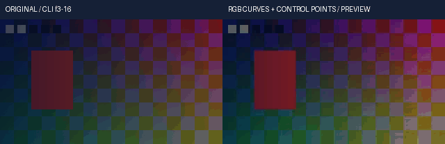
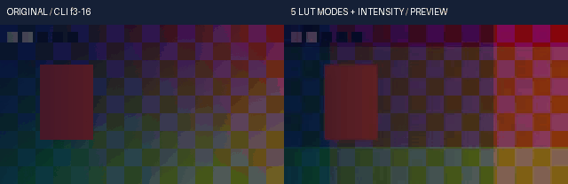
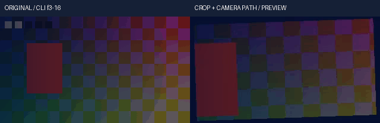
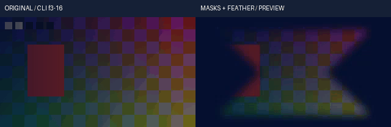
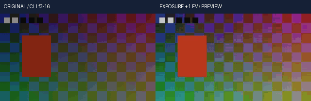
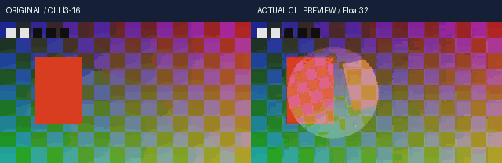

# Concat 与剪映：细化功能差异矩阵

<!-- R111-FLOAT-COLOR-KEYER-DIAGNOSTICS -->
R111 最终共同浮点调色/模糊/锐化/抠像与 HTML 准备诊断：源码 实际 8 项，66.297 秒，0 跳过；离线安装 实际 804 项，3870.651 秒，0 跳过；完整 实际 2897 项，6886.667 秒，0 跳过。旧 V103 2,537 项失败及未执行的中间全量保留，不以分项累加为完成率。自然素材、HDR、长片与剪映全部等价仍未验收。
[编号证据、原片与限制](validation/浮点调色抠像合并验收与诊断恢复_2026-10-23.md)。
<!-- /R111-FLOAT-COLOR-KEYER-DIAGNOSTICS -->

<!-- V102-CONTINUOUS-FLOAT-RGB-CURVES -->
### V102 连续浮点RGB曲线与作者控制点

显式 `float32-native-v1` 工程的正式render和预览共用连续RGB曲线。空间natural/PCHIP、独立通道、后置总曲线与作者控制点关键帧直接浮点求值，无整数曲线表。默认后端迁移、其余浮点算子及完整剪映功能仍未完成。

| 编号 | 功能性核验 | 实际内容与范围 | 证据 |
|---|---|---|---|
| FC102-01 | 共同内核 | 新增float_curves及40项测试，父LUT候选309→311输入、5条产品路径改变；正式render、区间预览与PNG16共用有序效果链 | [接口契约](../docs/specs/连续浮点RGB曲线与后置总曲线契约_v0.1_2026-10-22.md) |
| FC102-02 | 连续曲线 | natural三对角求解、PCHIP保形插值；独立稠密矩阵与Hermite基函数对照。1..256固定点、常量端点延伸、曲线输出夹0..1；不是8/16位网格 | [实际200项相关回归](../docs/validation/evidence/float-curves-20261022-lab/native-r3/verification.json) |
| FC102-03 | RGB与总曲线 | all仅给未独立声明通道提供默认；旧master别名指all；post_master为独立后置总曲线；动态通道从静态all分叉后独立 | [控制点与顺序断言](../docs/validation/evidence/float-curves-20261022-lab/native-r3/unittest.log) |
| FC102-04 | 作者时钟 | all/R/G/B/post_master的点x/y和强度，六种时间插值；Bezier直接求值，四控制值用48次求根；保留超2^53有理tick偏移、作者窗口和嵌套倒放左极限 | [实际执行源码](../docs/validation/evidence/float-curves-20261022-lab/native-r3/verification.json) |
| FC102-05 | 浮点与信号 | 65536级灰阶与相邻Float32保留；明确输入/输出信号，转回线性工作RGB后混强度；alpha位型与隐藏RGB单独核验；强度0逐位复制 | [精度/信号断言](../docs/validation/evidence/float-curves-20261022-lab/native-r3/unittest.log) |
| FC102-06 | 原生对照边界 | natural/PCHIP的真实RGB16单阶段及后置总曲线；分别建模原生格起点、截断和两次量化，每阶段独立误差≤1码；合并原生结果与真实两阶段逐字节相同。连续结果另对照数学基准 | [原生命令/I/O/4组记录](../docs/validation/evidence/float-curves-20261022-lab/native-r3/verification.json) |
| FC102-07 | 有序效果与预算 | 曝光/曲线、LUT/曲线顺序、禁用项、只读输入、分块逐位相同；晚块非法值、取消和工作区拒绝保留输入；预算含保留LUT，不是进程总RSS | [实际断言](../docs/validation/evidence/float-curves-20261022-lab/native-r3/unittest.log) |
| FC102-08 | 公开CLI | 20脚本调用/29检查；2次正式render、3次preview；原创320×180、10fps、2秒各20帧，5段覆盖空间插值、点x/y、后置总曲线、Bezier强度及效果顺序 | [原始命令与输出](../docs/validation/evidence/float-curves-20261022-lab/media-r2/verification.json) |
| FC102-09 | 独立全选区参考 | 作者帧3..16共2,419,200个线性RGB值，最大绝对误差7.45058059692e-09；正式96000及选区67200双声道PCM采样帧相同；PNG16与选区对应作者帧误差≤1码 | [独立执行参考](../docs/validation/evidence/float-curves-20261022-lab/media-r2/executed-oracle.py.txt) |
| FC102-10 | 原视频/GIF | 原创RGB16图形、alpha与正弦音频，CC0；GIF左原片、右真实CLI预览，14×100ms；静看3/10/16共6幅画面，不代替连续播放或试听 | [原片](../docs/assets/float-curves-20261022-r2/original-range.mp4) · [实际预览](../docs/assets/float-curves-20261022-r2/range.mp4) · [Float32](../docs/assets/float-curves-20261022-r2/range.master.nut) · [PNG16](../docs/assets/float-curves-20261022-r2/frame.png) · [查看记录](../docs/validation/evidence/float-curves-20261022-lab/static-review-r1.json) |
| FC102-11 | 离线安装 | **400项 /873.416秒 /0跳过**；186份source/wheel/site资源、8个固定离线wheel、NumPy931文件及原许可一致；安装版实际CLI音画、Float32及PNG16与源码版一致。 | [安装收据](../docs/validation/evidence/float-curves-20261022-lab/installed-r1/verification.json) · [作者工程](../docs/assets/float-curves-20261022-r2/author-project.json) · [权利账](../docs/assets/float-curves-20261022-r2/rights-ledger.json) · [CC0](../docs/assets/float-curves-20261022-r2/LICENSE.txt) |
| FC102-12 | 完整回归 | **2495项 /6957.906秒 /0跳过**；311产品输入、8外部夹具和9依赖不变。 200源码、400安装与完整套件分别记录，覆盖重叠不累计成完成率 | [本轮报告](../docs/validation/连续浮点RGB曲线与作者控制点实测_2026-10-22.md) |
| FC102-13 | 保留失败与未验收 | 源码r1实际40项3失败、r2实际200项1失败；真实样例r1因末关键帧缺少公开入口必填插值被拒绝。自然素材、动态增删点、HDR/ICC、实时/长片RSS和完整剪映等价尚未验收 | [失败与精度边界](../docs/validation/evidence/float-curves-20261022-lab/failure-analysis-r1.json) |

<!-- /V102-CONTINUOUS-FLOAT-RGB-CURVES -->

<!-- V101-FLOAT-LOCAL-LUT -->
### V101 浮点本地LUT与有序调色链

显式 `float32-native-v1` 工程的正式render和预览共用本地LUT。完整3D CUBE支持五种插值、明确输入/输出色彩信号与作者关键帧强度；曝光和LUT按作者顺序执行。默认后端迁移、其余浮点效果及完整剪映功能仍未完成。

| 编号 | 功能性核验 | 实际结果与范围 | 证据 |
|---|---|---|---|
| FL101-01 | 共同内核 | 新增float_lut、float_effect_chain及37项测试；父候选306输入→309输入，6条产品路径改变；正式render、区间及PNG16共用 | [契约](../docs/specs/浮点LUT色彩信号与作者强度契约_v0.1_2026-10-22.md) |
| FL101-02 | 本地CUBE | red-fastest不可变Float32表；2..256边长、DOMAIN_MIN/MAX、标题/注释；项目内路径或登记ID/SHA，资源变化拒绝；1D shaper及3dl/csp/dat尚未迁入浮点路径 | [37项新增方法](../docs/validation/evidence/float-lut-20261022-lab/native-r3/unittest.log) |
| FL101-03 | 五种插值 | nearest/trilinear/tetrahedral/pyramid/prism；独立多项式与重心线性方程参考；实际原生29宽标量与32宽默认CPU各核验全部五种，含边界/同坐标 | [原生I/O与结果](../docs/validation/evidence/float-lut-20261022-lab/native-r3/verification.json) |
| FL101-04 | 色彩与混合 | 共同线性工作RGB→明确LUT输入信号→查表→明确输出信号→线性工作RGB后混合；alpha独立。DOMAIN先归一化再夹边，不裁剪表输出 | [信号与范围测试](../docs/validation/evidence/float-lut-20261022-lab/native-r3/unittest.log) |
| FL101-05 | 作者强度 | 静态0..1、6种关键帧插值、Bezier overshoot显式夹0..1；作者窗口和嵌套反向保留各自时钟，预览选区不重启动画 | [160项相关回归](../docs/validation/evidence/float-lut-20261022-lab/native-r3/verification.json) |
| FL101-06 | 有序效果 | exposure→LUT与LUT→exposure结果区分，多LUT按序，禁用项跳过；相同本地表共享；未接入效果明确拒绝 | [顺序与作者IR测试](../docs/validation/evidence/float-lut-20261022-lab/native-r3/unittest.log) |
| FL101-07 | 精度与拒绝 | 65536级中性色、负值/超1表输出、极小alpha、强度0逐位保留；分块逐位一致、只读输入、晚块非法值、预算和中途取消均核验 | [实际执行源码](../docs/validation/evidence/float-lut-20261022-lab/native-r3/verification.json) |
| FL101-08 | 真实公开CLI | 20脚本调用/29检查，2次render+3次preview；原片/结果各320×180、10fps、20帧；5段各4帧覆盖五种插值、动态强度和两种效果顺序 | [命令与检查](../docs/validation/evidence/float-lut-20261022-lab/media-r1/verification.json) |
| FL101-09 | 独立像素与声音 | 作者帧3..16的2,419,200个线性RGB值，最大绝对误差0；正式96000、选区67200双声道采样帧逐一一致；PNG16与对应帧误差≤1码 | [独立执行参考](../docs/validation/evidence/float-lut-20261022-lab/media-r1/executed-oracle.py.txt) |
| FL101-10 | 原视频/GIF | 左原片、右实际CLI预览；GIF14×100ms；静态看过作者帧3/10/16的6个画面。五种均做数值核验，未据此声称五种均完成视觉、连续播放或试听验收 | [原片MP4](../docs/assets/float-lut-20261022-r1/original-range.mp4) · [结果MP4](../docs/assets/float-lut-20261022-r1/range.mp4) · [Float32母参考](../docs/assets/float-lut-20261022-r1/range.master.nut) · [PNG16](../docs/assets/float-lut-20261022-r1/frame.png) · [查看记录](../docs/validation/evidence/float-lut-20261022-lab/static-review-r1.json) |
| FL101-11 | 权利与安装 | **360项 /914.334秒 /0跳过**；8个固定离线wheel、185份source/wheel/site资源、NumPy931文件一致；安装版实际CLI视频/PCM/Float32/PNG16与源码版一致。 原CUBE、图形/alpha及正弦音频为本次CC0生成，标签用Pillow默认字体；23份源码演示资产单独校验SHA | [原CUBE](../docs/assets/float-lut-20261022-r1/original-look.cube) · [作者工程](../docs/assets/float-lut-20261022-r1/author-project.json) · [权利账](../docs/assets/float-lut-20261022-r1/rights-ledger.json) · [声明](../docs/assets/float-lut-20261022-r1/LICENSE.txt) |
| FL101-12 | 完整回归 | **2455项 /8764.631秒 /0跳过**；309产品输入、8外部夹具和9依赖不变。 160项源码、360项安装及完整套件覆盖重叠，分别记录 | [本轮报告](../docs/validation/浮点LUT五种插值与有序调色链实测_2026-10-22.md) |
| FL101-13 | 失败与限制 | r1实际159项有2失败：更宽坐标改变pyramid分面、夹具误比较修改时间；r2实际160项有1夹具字段错误，均保留。另观察到本机原生29宽tetrahedral加速差异；已分开核验标量及对齐默认路径。自然质量/HDR/实时性/长片总RSS/完整剪映均未验收 | [失败与修正](../docs/validation/evidence/float-lut-20261022-lab/failure-analysis-r1.json) |

<!-- /V101-FLOAT-LOCAL-LUT -->

<!-- V100-FLOAT-CROP-PROJECTION -->
### V100 浮点作者裁剪与单次运镜投影

显式 `float32-native-v1` 工程的正式render和预览共用作者裁剪投影。支持裁剪位置/宽高关键帧和fit/fill/stretch，并把裁剪、适配与位移/缩放/旋转合并为一次浮点采样。默认后端迁移与全剪映功能仍未完成。

| 编号 | 功能性核验 | 实际结果与范围 | 证据 |
|---|---|---|---|
| FC100-01 | 共同内核 | NumPy独立实现；源像素单位、归一化单位及width/w、height/h别名；正式render、区间和PNG16预览共用 | [契约](../docs/specs/浮点作者裁剪与运镜投影契约_v0.1_2026-10-22.md) |
| FC100-02 | 三种适配 | fit透明留边、fill保留原始裁剪纹理、stretch独立宽高缩放；半像素中心映射和半开窗口 | [28项新增方法](../docs/validation/evidence/float-crop-20261022-lab/native-r2/unittest.log) |
| FC100-03 | 原生坐标舍入 | 叶片段固定尺寸及仅移动窗口采用ties-to-even舍入；实际FFmpeg planar-float裁剪对照，并单独诊断10个边界值 | [原生边界诊断](../docs/validation/evidence/float-crop-20261022-lab/native-rounding-analysis-r1/receipt.json) |
| FC100-04 | 作者动画 | clip与crop本地轨、6种插值、局部同名覆盖、尺寸overshoot夹限；预览选区不重启原作者tick，嵌套反向时钟分层 | [123项相关回归](../docs/validation/evidence/float-crop-20261022-lab/native-r2/verification.json) |
| FC100-05 | 运镜/透明 | 单次crop-fit-TRS；fill旋转可露出静止视窗外纹理；双线性在预乘RGB/alpha内计算，极小alpha和扩展RGB保留 | [独立逐像素与原生I/O](../docs/validation/evidence/float-crop-20261022-lab/native-r2/verification.json) |
| FC100-06 | 数值/资源错误 | 65536级RGB、分块逐位一致、只读输入；晚块NaN/Inf/非法alpha、预算和中途取消均拒绝并保留输入 | [执行源码](../docs/validation/evidence/float-crop-20261022-lab/native-r2/verification.json) |
| FC100-07 | 真实公开CLI | 20脚本调用/29检查，2次render+3次preview；原片/结果各320×180、10fps、20帧；96000双声道采样帧一致 | [命令与检查](../docs/validation/evidence/float-crop-20261022-lab/media-r1/verification.json) |
| FC100-08 | 独立像素参考 | 作者帧3..16的2,419,200个线性RGB值，独立正向齐次矩阵求解与预乘插值参考最大绝对误差1.49011611938e-08；选区67200双声道采样帧一致 | [实际执行参考](../docs/validation/evidence/float-crop-20261022-lab/media-r1/executed-oracle.py.txt) |
| FC100-09 | 原视频/GIF | 左原片、右实际CLI预览；GIF14×100ms；静态看过作者帧3/10/16的6个画面，未连续播放/试听或接受自然素材质量 | [原片MP4](../docs/assets/float-crop-20261022-r1/original-range.mp4) · [结果MP4](../docs/assets/float-crop-20261022-r1/range.mp4) · [Float32母参考](../docs/assets/float-crop-20261022-r1/range.master.nut) · [PNG16](../docs/assets/float-crop-20261022-r1/frame.png) · [查看记录](../docs/validation/evidence/float-crop-20261022-lab/static-review-r1.json) |
| FC100-10 | 权利与安装 | **323项 /1064.478秒 /0跳过**；8个固定离线wheel、183份source/wheel/site资源、NumPy931文件一致；安装版实际CLI视频/PCM/Float32/PNG16与源码版一致。 原输入图形/alpha/正弦音频为本次CC0生成，标签用Pillow默认字体 | [原生输入](../docs/assets/float-crop-20261022-r1/original.native.mkv) · [作者工程](../docs/assets/float-crop-20261022-r1/author-project.json) · [权利账](../docs/assets/float-crop-20261022-r1/rights-ledger.json) · [声明](../docs/assets/float-crop-20261022-r1/LICENSE.txt) |
| FC100-11 | 完整回归 | **2418项 /5301.952秒 /0跳过**；306产品输入、8外部夹具和9依赖不变。 | [本轮报告](../docs/validation/浮点作者裁剪与单次运镜投影实测_2026-10-22.md) |
| FC100-12 | 失败与限制 | r1实际28项有1失败：误把原生仅移动窗口舍入当截断；已修内核并保留原始失败。双线性不等于area/Lanczos或旧整数滤镜逐位一致；自然素材、HDR、实时性、长片总RSS和全剪映均未验收 | [失败与修正](../docs/validation/evidence/float-crop-20261022-lab/failure-analysis-r1.json) |

<!-- /V100-FLOAT-CROP-PROJECTION -->

<!-- V99-FLOAT-ALPHA-MASKS -->
### V99 浮点蒙版、曲线路径与羽化

显式 `float32-native-v1` 工程的正式render与预览现在共用蒙版核。支持矩形、圆、椭圆、多边形、采样三次曲线路径，以及蒙版本地关键帧、反选、静态和动画羽化；默认后端迁移及全剪映功能仍未完成。

| 编号 | 功能性核验 | 实际结果与范围 | 证据 |
|---|---|---|---|
| FM99-01 | 共同宿主 | 解码/曝光后、仿射前处理alpha；嵌套组在子序列合成后处理；正式render、区间和PNG16预览共用 | [契约](../docs/specs/浮点作者蒙版与羽化契约_v0.1_2026-10-22.md) |
| FM99-02 | 多边形/曲线 | 凹多边形、自相交偶奇填充、逐点动画、线段与三次Bezier控制点动画；最多32候选点/8段，不静默截断 | [21个新增方法](../docs/validation/evidence/float-mask-20261022-lab/native-r3/unittest.log) |
| FM99-03 | 作者关键帧 | clip与mask本地轨道、别名与局部覆盖；六种插值、原作者tick、裁切窗口与嵌套加速均实际核验 | [95项相关回归](../docs/validation/evidence/float-mask-20261022-lab/native-r3/verification.json) |
| FM99-04 | 羽化与透明 | 静态为源alpha乘蒙版后进行alpha-only对称边界盒模糊H/H/V/V；动画为形内距离线性覆盖；反选在乘alpha前 | [独立逐项平均/线段距离与原生alpha16对照](../docs/validation/evidence/float-mask-20261022-lab/native-r3/unittest.log) |
| FM99-05 | 浮点精度与错误 | 65536个alpha值、微小alpha、隐藏RGB/负零/扩展RGB、分块一致；晚块NaN/Inf/越界alpha、预算与中途取消拒绝且输入不变 | [执行源码与原生I/O](../docs/validation/evidence/float-mask-20261022-lab/native-r3/verification.json) |
| FM99-06 | 真实公开CLI | 20个脚本级调用/29项检查；2次render和3次preview；原片/结果各320×180、10fps、20帧；各96000双声道采样帧相同 | [原始命令/检查](../docs/validation/evidence/float-mask-20261022-lab/media-r4/verification.json) |
| FM99-07 | 独立像素基准 | 作者帧3..16共14帧、2,419,200个实际线性RGB值与独立多边形/曲线/羽化/源alpha/sRGB背景合成计算一致，最大误差0；选区67200双声道采样帧一致 | [独立基准](../docs/validation/evidence/float-mask-20261022-lab/media-r4/executed-mask-media-oracle.py.txt) |
| FM99-08 | 原视频/GIF | 下图左原片、右真实CLI预览；14×100ms。静态看过作者帧3/10/16的6个画面；未连续播放、试听或接受自然素材质量 | [原片MP4](../docs/assets/float-mask-20261022-r4/original-range.mp4) · [结果MP4](../docs/assets/float-mask-20261022-r4/range.mp4) · [浮点母参考](../docs/assets/float-mask-20261022-r4/range.master.nut) · [PNG16](../docs/assets/float-mask-20261022-r4/frame.png) · [查看记录](../docs/validation/evidence/float-mask-20261022-lab/static-review-r1.json) |
| FM99-09 | 素材/权利 | 本次生成RGB16图形、alpha梯度与正弦波，原输入CC0；工程和权利账保留。标签使用Pillow附带默认字体，不分发字体文件 | [原生输入](../docs/assets/float-mask-20261022-r4/original.native.mkv) · [作者工程](../docs/assets/float-mask-20261022-r4/author-project.json) · [权利账](../docs/assets/float-mask-20261022-r4/rights-ledger.json) · [声明](../docs/assets/float-mask-20261022-r4/LICENSE.txt) |
| FM99-10 | 实际离线安装 | **295项 /1077.141秒 /0跳过**；8个固定离线wheel、182份source/wheel/site资源及NumPy931文件一致；安装版实际CLI音画/Float32/PNG16与源码版相同。 | [本轮报告](../docs/validation/浮点蒙版曲线羽化与真实CLI实测_2026-10-22.md) |
| FM99-11 | 完整回归 | **2390项 /4666.622秒 /0跳过**，304产品输入、8外部夹具和9依赖不变。 | [完整回归状态与范围](../docs/validation/浮点蒙版曲线羽化与真实CLI实测_2026-10-22.md) |
| FM99-12 | 原失败/限制 | 原r1关键帧边界/透明输出夹具、r2理想Y亮度断言、媒体r1缺插值/r2背景信号误设均保留；未据合成图案接受全剪映、HDR、实时性或长片总RSS | [失败与修正](../docs/validation/evidence/float-mask-20261022-lab/failure-analysis-r1.json) |

<!-- /V99-FLOAT-ALPHA-MASKS -->

<!-- V98-LINEAR-FLOAT-EXPOSURE -->
### V98 线性 Float32 曝光共同宿主

显式 `settings.pixel_pipeline.engine=float32-native-v1` 工程现在可在共同 FloatTimeline 中执行静态 `exposure`，正式 `render` 与 `preview` 复用同一实现。相关源码回归74项中14项为新增曝光测试，其余60项为既有预览、正式渲染与宿主回归；不将测试数量作为剪映等价证明。

| 编号 | 功能性核验 | 实际结果与边界 | 证据 |
|---|---|---|---|
| FE98-01 | 曝光接入 | 线性straight RGB、蒙版/仿射前；嵌套组在子序列合成后执行；启用的未接入效果仍明确拒绝 | [接口契约](../docs/specs/线性浮点曝光接入契约_v0.1_2026-10-22.md) |
| FE98-02 | 65,536级与alpha | +1EV全部65,536灰阶保留；相邻Float32、负值/超一值、隐藏RGB及alpha原位位型、负零身份运算；不引入整数中间层 | [实际源码断言](../docs/validation/evidence/float-exposure-20261022-lab/native-r2/unittest.log) |
| FE98-03 | 原生交叉对照 | 12组真实FFmpeg Float32输入/输出，含分数EV、黑位、接近零分母、黑位大于白位和精确相等；Decimal验证声明的Float32运算边界 | [73次相关套件原生调用](../docs/validation/evidence/float-exposure-20261022-lab/native-r2/verification.json) |
| FE98-04 | 顺序与资源 | 静态链按序执行，禁用项跳过；分块、工作区准入、中途取消、晚块非法alpha/NaN/Inf与溢出均明确失败，输入字节保留 | [74项相关回归](../docs/validation/evidence/float-exposure-20261022-lab/native-r2/verification.json) |
| FE98-05 | 真实公开CLI | 20个脚本级调用、29项检查；2次正式render、3次preview；320×180/10fps/2秒各20帧，完整PCM各96000双声道采样帧相同 | [原始命令/检查](../docs/validation/evidence/float-exposure-20261022-lab/media-r1/verification.json) |
| FE98-06 | 独立曝光像素基准 | 帧3..16共14帧，2,419,200个实际线性RGB值与独立源16位解码/逆OETF/曝光计算一致，最大误差0；单帧PNG16与区间帧11独立OETF对照通过 | [真实媒体生成器](../docs/validation/evidence/float-exposure-20261022-lab/media-r1/executed-script.py.txt) |
| FE98-07 | 原视频/GIF | 下方GIF左原片、右本次真实CLI曝光预览；14×100ms。查看作者帧3/10/16共6幅图，未连续播放、试听或测自然素材/HDR | [原片MP4](../docs/assets/float-exposure-20261022-r1/original-range.mp4) · [实际预览MP4](../docs/assets/float-exposure-20261022-r1/range.mp4) · [Float32母参考](../docs/assets/float-exposure-20261022-r1/range.master.nut) · [PNG16](../docs/assets/float-exposure-20261022-r1/frame.png) · [查看记录](../docs/validation/evidence/float-exposure-20261022-lab/static-review-r1.json) |
| FE98-08 | 素材与可复现 | 程序生成RGB16图形与双声道正弦波，CC0；保留原生输入、作者工程、权利账和全部产物SHA | [原生原片](../docs/assets/float-exposure-20261022-r1/original.native.mkv) · [作者工程](../docs/assets/float-exposure-20261022-r1/author-project.json) · [权利账](../docs/assets/float-exposure-20261022-r1/rights-ledger.json) · [CC0声明](../docs/assets/float-exposure-20261022-r1/LICENSE.txt) |
| FE98-09 | 离线安装 | **274 方法 /750.66 秒 /0 跳过**；181 资源 source/wheel/site 相同，8 个固定离线 wheel、NumPy 931 文件及原许可相同；安装版真实音画/Float32/PNG16 SHA 与源码版相同。 | [安装收据](../docs/validation/evidence/float-exposure-20261022-lab/installed-r1/verification.json) |
| FE98-10 | 全套产品回归 | **2369 方法 /6251.995 秒 /0 跳过**；302产品输入、8外部夹具和9依赖一致。 | [当前报告](../docs/validation/线性浮点曝光共同宿主与真实CLI实测_2026-10-22.md) |
| FE98-11 | 保留失败与修正 | 首轮14方法中2个边界子例失败：错误地保留白位减黑位的符号。修正为绝对差后74项相关回归通过，原输入/输出和执行源码均保留 | [首轮失败](../docs/validation/evidence/float-exposure-20261022-lab/native-r1/verification.json) · [修正说明](../docs/validation/evidence/float-exposure-20261022-lab/native-r1-correction.json) |
| FE98-12 | 未验收边界 | 仅静态曝光；默认后端迁移、其余浮点算子、自然素材质量、ICC/PQ/HLG/HDR、长片并发总RSS及完整剪映功能仍待完成；MP4观看副本不作理想量化验收 | [功能/验收边界](../docs/specs/线性浮点曝光接入契约_v0.1_2026-10-22.md) |

<!-- /V98-LINEAR-FLOAT-EXPOSURE -->

<!-- V97-CUMULATIVE-NATIVE-FLOAT-DELIVERY -->
### V94–V97 原片 Float32 渲染、预览与缓存合并交付

显式浮点工程的 `preview frame` / `preview range` 使用标准渲染的原片窗口与 FloatTimeline，保留完整作者帧号。源码相关回归 **57 方法 /532.355 秒 /0 跳过**，包括18项新增预览、22项既有预览及17项标准浮点渲染；不将57项全算作新功能。默认迁移及未接入算子、自然/HDR质量和完整剪映功能仍需继续实现。

| 编号 | 功能性核验 | 实际内容与限制 | 证据 |
|---|---|---|---|
| FD97-01 | 共同内核 | 原片SHA与原生PTS窗口、作者IR、变换/混合/基础蒙版及嵌套时钟复用正式浮点宿主；未接算子明确拒绝 | [契约](../docs/specs/浮点时间线预览与缓存契约_v0.1_2026-10-22.md) |
| FD97-02 | PNG16与alpha16 | 真实PNG逐码保留65,536灰阶和全部65,536透明度值；PNG独立16位交付，不当作Float32参考 | [57项实际命令/断言](../docs/validation/evidence/float-preview-20261022-lab/native-r2/verification.json) |
| FD97-03 | Float32区间参考 | `master.nut`为straight BT.709 linear GBRAP Float32；实际保存小于一个RGB16码阶的合成变化；格式对照包含相邻Float32、负值及超一值，作者范围策略另行执行 | [格式逐字节往返](../docs/validation/evidence/float-preview-20261022-lab/formats-r1.json) |
| FD97-04 | 作者视频时钟 | 5秒起点的真实VFR在嵌套倒放选帧中匹配独立区间参考，保留全片帧号；selected sequence canvas不改写全局作者画布 | [源码回归](../docs/validation/evidence/float-preview-20261022-lab/native-r2/unittest.log) |
| FD97-05 | PCM独立端点 | 非整数作者结束保留60001末样本端点；区间样本逐字节匹配；真实样例帧3..16共14帧，67200双声道PCM采样帧相同 | [实际CLI样例](../docs/validation/evidence/float-preview-20261022-lab/media-r1/verification.json) |
| FD97-06 | 线性预乘缩放 | 完整合成后按像素中心双线性缩放，独立2×2透明颜色加权参考通过；不是大比例缩小的面积抗锯齿 | [独立像素测试](../docs/validation/evidence/float-preview-20261022-lab/native-r2/verification.json) |
| FD97-07 | 持久内容缓存 | 作者/实际素材/信号/本地代码/NumPy原生依赖绑定SHA；同大小、恢复mtime的运行时变化仍失效。命中不新建图、provider、probe或编码器；真实第二CLI进程命中 | [真实复用与原始收据](../docs/validation/evidence/float-preview-20261022-lab/media-r1/verification.json) |
| FD97-08 | 只读与失败清理 | dry-run不打开provider或写缓存；真实中途取消及失败编码器清理线程/临时目录；损坏参考拒绝，原导出保留，显式导出可在prune后保留 | [失败边界及原始输出](../docs/validation/evidence/float-preview-20261022-lab/native-r2/verification.json) |
| FD97-09 | 真实公开CLI媒体 | 20个脚本级原生/CLI调用、27检查；2次正式render、3次preview（区间、单帧、复用）；原始/编辑完整片各20帧、2秒、96000双声道采样 | [生成器](../docs/validation/evidence/float-preview-20261022-lab/media-r1/executed-script.py.txt) |
| FD97-10 | 原视频与实际预览 | 原创RGB16输入；下方GIF左为原始CLI输出帧3..16，右为本轮真实CLI预览，共14×100ms；已查看3/10/16共6幅图，未连续播放或试听 | [原始选段](../docs/assets/float-preview-20261022-r1/original-range.mp4) · [实际预览MP4](../docs/assets/float-preview-20261022-r1/range.mp4) · [Float32参考](../docs/assets/float-preview-20261022-r1/range.master.nut) · [PNG16帧11](../docs/assets/float-preview-20261022-r1/frame.png) · [查看/GIF时钟](../docs/validation/evidence/float-preview-20261022-lab/static-review-r1.json) |
| FD97-11 | 全新离线安装 | **260 方法 /784.525 秒 /0 跳过**；180 资源 source/wheel/site 相同，8 个离线 wheel；NumPy 931 文件与许可相同。安装版原生 Float32/PCM/PNG16 与开发版真实 CLI 样例相同。 | [安装收据](../docs/validation/evidence/float-preview-20261022-lab/installed-r1/verification.json) |
| FD97-12 | 完整回归 | **2355 方法 /5277.023 秒 /0 跳过**；300产品输入、8外部夹具、9依赖及冻结运行器一致。 | [合并实测报告](../docs/validation/原片浮点渲染与预览合并交付实测_2026-10-22.md) |
| FD97-13 | 保留失败与观看副本边界 | 首轮18项2失败已保留；显式OETF修复观看亮度。原生去alpha使观看副本减损精度，原理想半码探针仍保留失败；不影响独立Float32参考/PNG16的验收，不宣称MP4理想量化 | [失败与分段测量](../docs/validation/浮点时间线预览与缓存实测_2026-10-22.md) |
| FD97-14 | 逐级源码与安装 | 292→296→298→300 输入衔接一致；安装182/203/220/260方法分别有终态，分别绑定176/178/179/180资源；不相加为当前通过数 | [四份原门禁核验](../docs/validation/evidence/float-delivery-20261022/prepared-r1.json) |
| FD97-15 | 正式render、队列与恢复 | 显式`settings.pixel_pipeline.engine=float32-native-v1`进入共享render/queue/resume；原片窗口、视频与原生音频共用作者时钟；默认后端及未接算子继续实施 | [CLI契约](../docs/specs/标准CLI浮点渲染接入契约_v0.1_2026-10-22.md) · [CLI原片/输出](../docs/validation/标准CLI浮点交付实测_2026-10-22.md) |
| FD97-16 | 合并验收范围 | 最终快照相对已发布V93/R16改变20产品路径，其中12新增；V95/V96早期快照各自的2320/2337项完整回归未执行，不登记通过 | [交付契约](../docs/specs/原片浮点渲染与预览合并交付契约_v0.1_2026-10-22.md) |
| FD97-17 | 历史等待失败 | 原四个等待进程因前序发布字节断言停止，均在测试启动前；原状态保留，使用新的拥有进程和完整证据目录 | [保留状态与准备记录](../docs/validation/evidence/float-delivery-20261022/prepared-r1.json) |

<!-- /V97-CUMULATIVE-NATIVE-FLOAT-DELIVERY -->

<!-- V93-AUTHOR-CLOCK-FLOAT-HOST -->
V93 新增作者时钟 Float32 帧宿主和只读帧包源。完整原生回归 **2280方法 /13313.967秒 /0跳过**；288产品输入和8外部夹具保持相同。

| 编号 | 已实际执行 | 产品边界 |
|---|---|---|
| FTH-01 | CPU/作者时钟/缓存源 46 项专项；33 次实际 FFmpeg 交叉核验 | 库层，未连接默认渲染、音频、预览与缓存 |
| FTH-02 | 原创 16 位媒体 20 帧，全部像素与独立参考相同；原始/编辑 MP4/GIF 与 16 位无损核验 | SDR 演示，未连续播放/听审、未验收自然素材或 HDR |
| FTH-03 | 新安装 163 项/0跳过，174资源、931 NumPy文件、216模块来源；安装媒体 Float32 与开发版相同 | 全部效果、统一精度策略与完整剪映对标继续实施 |

[规格](../docs/specs/作者时钟浮点帧宿主与缓存源边界_v0.1_2026-10-22.md) · [实际核验/原视频/GIF/失败](../docs/validation/作者时钟浮点帧宿主与真实媒体独立实测_2026-10-22.md) · [安装](../docs/validation/evidence/float-timeline-20261022-lab/installed-r1/verification.json)。
<!-- /V93-AUTHOR-CLOCK-FLOAT-HOST -->

<!-- V92-NATIVE-FLOAT-SURFACE -->
V92新增Agent原生浮点帧包CLI和独立线性光核心。完整原生回归 **2234方法 /7549.898秒 /0跳过**；282产品输入、8外部夹具、17启动时脚本及9依赖文件保持相同。

| 编号 | 已执行 | 当前边界 |
|---|---|---|
| F32-01 | 八模块/七测试，86项专项；三原色/五传递函数、原生RGB/YUV/alpha及VFR时钟、仿射、32混合模式 | 相对D65；未做ICC/PQ/HLG/HDR、自然素材或全剪映等价 |
| F32-02 | 真实CLI15次、34检查；20/20/20/5帧包；两段20帧/10fps/2s MP4/GIF与16-bit回写 | surface为中间数据，电影由独立核心脚本编码 |
| F32-03 | 新八轮离线安装117项/0跳过，171资源与931 NumPy文件相同，213模块来源核验 | 安装版实际帧包和合成RGBA与开发版相同；默认时间线/预览/缓存未采用浮点核心 |

[规格](../docs/specs/浮点表面合成与高精度边界_实验_v0.1_2026-10-22.md) · [实际测试/原片/GIF/失败](../docs/validation/浮点表面合成与高精度边界独立实测_2026-10-22.md) · [Agent命令](../docs/Agent浮点帧包CLI使用与验收边界_2026-10-22.md) · [安装证据](../docs/validation/evidence/color-precision-20261021-lab/installed-r1/verification.json)。OpenFilm R14/R15复用结论保留，不重复计工或计测试。

完整回归：[2234方法实际终态](../docs/validation/evidence/color-precision-20261021-lab/full-r1.json) · [额外冻结门禁](../docs/validation/evidence/color-precision-20261021-lab/complete-gate-r1.json)。
<!-- /V92-NATIVE-FLOAT-SURFACE -->

<!-- V91-NATIVE-AUDIO-INTERVAL-CLOCK -->
### V91 源音频内部缺口、重叠与派生缓存

V91 完整原生回归 **2148方法 /4714.461秒 /0跳过**；267产品输入、8外部夹具、16验证脚本和9依赖文件保持相同。源内部缺口/重叠按原生采样时钟处理，原始工程引用保留；合入、17份Skill注册和普通推送以发布审计为准。

| 编号 | 核验内容 | 实际执行结果与边界 | 证据 |
|---|---|---|---|
| V91-01 | 原生源时钟 | 解码帧PTS/样本数建整数索引；正缺口补零，后解码帧覆盖重叠；精确采样格保留真实单采样缺口 | [规格](../docs/specs/源音频内部时钟与硬缺口缓存_v0.1_2026-10-21.md) |
| V91-02 | 原实现失败 | 同6原片13项实际11失败/2连续对照通过/0错误/0跳过；原日志和旧实现保留 | [before](../docs/validation/evidence/audio-discontinuity-20261021-lab/before-r1.json) |
| V91-03 | AAC粗时基修复 | 另9原片先5通过/4失败，修复后9份实际解码PCM逐采样相同；粗PTS已丢失的亚tick跳变不能恢复 | [补充前后](../docs/validation/evidence/audio-discontinuity-20261021-lab/extra-native-after-r1/verification.json) |
| V91-04 | 缓存与生命周期 | 源/工具/实现/派生字节SHA绑定，流式管道、损坏拒绝、原子写入、明确list/prune及登记源保护；队列合法空派生仍绑定SHA，原素材非空门禁保留；31专项通过 | [队列修复](../docs/validation/evidence/audio-discontinuity-20261021-lab/queue-cache-fix-r1.json) |
| V91-05 | 全部音频入口 | scalar/reverse/曲线/嵌套、真实R3输入及多机位只读分析通过；R3仅在实际视频覆盖内允许音频EOF静音，超界源句柄拒绝 | [路径12项](../docs/validation/evidence/audio-discontinuity-20261021-lab/paths-r2.json) |
| V91-06 | 原生CLI与所有帧/样本 | 32次CLI＋22条其他原生命令、37检查；forward/reverse各120帧及230400样本/声道，R3为96帧及184320样本/声道 | [实际收据](../docs/validation/evidence/audio-discontinuity-20261021-lab/native-r1/verification.json) |
| V91-07 | 全新八轮离线安装 | 163资源源/wheel/安装字节相同；官方NumPy2.4.2及原生数学前向；27隔离CLI、92方法/338.389s/0跳过，含31队列方法；三组媒体重新运行 | [安装收据](../docs/validation/evidence/audio-discontinuity-20261021-lab/installed-r3/verification.json) |
| V91-08 | 历史专项和失败完整 | 2145全量4个队列失败保留；队列修复只变2输入，旧native/152表面其余265输入相同；更早r2三组另差能力发现及测试，明确分开 | [纪元及完整绑定](../docs/validation/evidence/audio-discontinuity-20261021-lab/audit-r2.json) |
| V91-09 | 原片/失败片/MP4/GIF | 66实际文件、11GIF、37次原生ffprobe，包含新安装重新生成结果；MP4每帧PTS/二进制ID另验，AAC不声明波形无损 | [逐文件SHA](../docs/validation/evidence/audio-discontinuity-20261021-lab/media-manifest-r2.json) |
| V91-10 | 完整回归 | 2148方法 /4714.461秒 /0跳过；专项与隔离各自保留，不累计 | [当前完整](../docs/validation/evidence/audio-discontinuity-20261021-lab/full-r2.json)、[原失败](../docs/validation/evidence/audio-discontinuity-20261021-lab/full-r1.json) |
| V91-11 | 文档/Skill/发布 | 4份Skill由固定17父版衍生；发布时重验全部17注册、链接与索引字节，普通推送；OpenFilm R14/R15结论保留 | [完整实测](../docs/validation/源音频硬缺口与重叠缓存实测_2026-10-21.md) |
| V91-12 | 未验收范围 | 仅目检1张PCM诊断PNG；未试听、未连续播放；自然设备异常、任意编解码变化、长片/HDR/RSS、完整AI及剪映等价继续待验 | [目检记录](../docs/validation/evidence/audio-discontinuity-20261021-lab/static-review-r1.json) |

[原创含音轨NUT](../docs/assets/audio-discontinuity-20261021-lab/native-r1/original.nut) · [原视频MP4（无音轨）](../docs/assets/audio-discontinuity-20261021-lab/native-r1/original-video-only.mp4) · [原始GIF](../docs/assets/audio-discontinuity-20261021-lab/native-r1/original.gif) · [forward MP4](../docs/assets/audio-discontinuity-20261021-lab/native-r1/forward.mp4) · [reverse MP4](../docs/assets/audio-discontinuity-20261021-lab/native-r1/reverse.mp4) · [R3 MP4](../docs/assets/audio-discontinuity-20261021-lab/native-r1/R3.mp4) · [V90真实失败无损](../docs/assets/audio-discontinuity-20261021-lab/native-r1/before-forward-lossless.nut)

这些是限定原创样例的真实输出；诊断GIF不代替自然录音试听或特效质量验收。
<!-- /V91-NATIVE-AUDIO-INTERVAL-CLOCK -->

<!-- V90-MULTICAM-AFFINE-CLOCK -->
### V90 多机位仿射时钟与浮点PCM

V90 完整原生回归 **2084 方法/3875.245秒/0跳过**；263产品输入、8外部夹具、14验证脚本和9依赖文件前后相同。新增显式仿射设备时钟和scalar音频float上采样；默认offset保持不变。合入与注册以发布审计收据为准。

| 编号 | 核验 | 实际结果 / 边界 | 证据 |
|---|---|---|---|
| V90-01 | 时钟模型 | `source=b+a*reference`；显式 `--clock-model affine`，默认 offset 不变。最多600秒前缀，3–31锚点、4–60秒窗口和20000ppm参数上限，默认5000ppm | [契约](../docs/specs/多机位仿射时钟与漂移校准_实验_v0.1_2026-10-21.md) |
| V90-02 | 拟合、绑定和规划方法 | 当前33方法通过，含±漂移、100ppm/600秒、坏锚点、歧义、SHA / ID / digest / inverse / ppm / duration 篡改与覆盖策略 | [记录](../docs/validation/evidence/multicam-affine-clock-20261021-lab/after-validation-r2.json) |
| V90-03 | 音频重采样修复前后 | 同8个真实PCM方法：修复前6失败/2对照通过；修复后8通过，5.426秒，0跳过。初轮夹具缺视频导致8ERROR，另存为失败，未当作量化缺陷 | [修复后](../docs/validation/evidence/multicam-affine-clock-20261021-lab/audio-precision-after-r2.json) |
| V90-04 | 当前相关回归 | 157个不同方法/283.522秒/0跳过，263输入前后相同；历史141与149是旧源码时点，不与157累计 | [记录](../docs/validation/evidence/multicam-affine-clock-20261021-lab/related-r3.json) |
| V90-05 | 真实CLI与远距离选段 | 参考事件覆盖590秒；取0、295、586秒起各4秒。原生39CLI+21其他命令/52检查；两相机真值+1500ppm/-100ppm | [原生](../docs/validation/evidence/multicam-affine-clock-20261021-lab/native-r3/verification.json) |
| V90-06 | 独立源帧覆盖 | 固定offset对照最大错21/1源帧，affine两例均0；每个无损输出300帧，24,883,200 RGBA字节，与独立的所选原始帧完全相同 | [实测](../docs/validation/多机位仿射时钟与浮点音频独立实验_2026-10-21.md) |
| V90-07 | 参考主音轨 | 每输出每声道576000样本/共4,608,000字节，与先整源float重采样后取样的独立期望逐字节一致；修复8k单声道先s16上采样导致的二次量化 | [诊断](../docs/validation/evidence/multicam-affine-clock-20261021-lab/native-r2-mono-format-controls.json) |
| V90-08 | 隔离交付 | 8轮离线包，162资源源码/轮/安装同字节；安装20检查及隔离媒体52检查已通过。wrapper末段字段误读保留failed，由补验闭合 | [原失败wrapper](../docs/validation/evidence/multicam-affine-clock-20261021-lab/installed-r1/verification.json) |
| V90-09 | 隔离补验 | -I -S实跑41方法/7.075秒/0跳过；累计43次隔离CLI。补验不重复媒体或安装，不借用父版的成片 | [补验](../docs/validation/evidence/multicam-affine-clock-20261021-lab/installed-postflight-r3/verification.json) |
| V90-10 | 媒体资产 | 33资产/9个实际GIF，含短原片、原生/安装输出、原始590秒区间素材和失败夹具；SHA/大小/帧率/时长见清单 | [清单](../docs/validation/evidence/multicam-affine-clock-20261021-lab/media-manifest-r1.json) |
| V90-11 | 静态目检 | 实际GIF帧0/100/200，未连续播放或听审。相机采样相位不同，下行事件计数偶尔比参考少1，符合覆盖源帧契约 | [联系表](../docs/assets/multicam-affine-clock-20261021-lab/review-r1/actual-frame-contact-sheet.png) |
| V90-12 | 未验收 | 非线性/不连续漂移、真实录制/房间回声/自然质量、完整长片/HDR/RSS与播放听审、全剪映功能等价均未验收。MP4只验PTS和身份码；AAC不宣称全PCM相同 | [报告](../docs/validation/多机位仿射时钟与浮点音频独立实验_2026-10-21.md) |
| V90-13 | 完整回归 | 2084方法/3875.245秒/0跳过；专项157为其子集，不累计 | [完整记录](../docs/validation/evidence/multicam-affine-clock-20261021-lab/full-r1.json) |
| V90-14 | 生产发布与Skill | 4份变更与原父版逐项校验；发布时再审全部17份注册、链接和源码SHA，保留历史失败。 | [规格](../docs/specs/多机位仿射时钟与漂移校准_v0.1_2026-10-21.md) |

[参考短MP4](../docs/assets/multicam-affine-clock-20261021-lab/review-r1/source-selected-reference.mp4) · [参考完整MKV](../docs/assets/multicam-affine-clock-20261021-lab/native-r2/source-reference.mkv) · [正漂移输入](../docs/assets/multicam-affine-clock-20261021-lab/native-r2/source-positive.mkv) · [小负漂移输入](../docs/assets/multicam-affine-clock-20261021-lab/native-r2/source-small-negative.mkv)

固定偏移对照与仿射结果（实际MP4解码制作）：

<!-- /V90-MULTICAM-AFFINE-CLOCK -->

<!-- V89-OFFLINE-MEDIA-PROFILE -->
### V89 八轮离线媒体运行时

V89 八轮离线媒体运行时完成2043方法/3988.673秒/0跳过的完整源码回归；260产品输入、8既有外部夹具、15验证脚本和9依赖文件（8上游artifact＋lock）前后相同。默认构建包含NumPy2.4.2，安装会实际执行原生矩阵/FFT核验；没有复制宿主NumPy。

| 编号 | 核验 | 实际结果与边界 | 证据 |
|---|---|---|---|
| V89-01 | 完整源码回归 | 2043方法/3988.673秒/0跳过；260输入、8夹具、15脚本。全量为源码原生环境；新安装另有独立CLI证据。 | [记录](validation/evidence/offline-media-profile-20261021-lab/full-r1.json) |
| V89-02 | 固定依赖冻结 | 8上游artifact＋lock共9文件；包含7个运行时依赖及1个不发行的历史非运行时wheel。运行时加产品共8wheels。完整回归前后字节不变。 | [记录](validation/evidence/offline-media-profile-20261021-lab/full-dependencies-r1.json) |
| V89-03 | 相关回归 | 260不同方法/708.130秒/0跳过＝父226＋旧安装22＋新安装12。旧34及12属于此子集，不重复累计。 | [记录](validation/evidence/offline-media-profile-20261021-lab/related-r1.json) |
| V89-04 | 相同断言修复前后 | 同12方法修复前6FAIL/1ERROR/5控制通过，修复后12/1.004秒通过；原测试和错误日志保留。 | [记录](validation/evidence/offline-media-profile-20261021-lab/after-r1.json) |
| V89-05 | 正式离线NumPy交付 | 官方NumPy2.4.2/cp313 Windows x64；932RECORD文件核对。新安装中931原文件除pip重写RECORD外完全相同，原通知在包和安装中保留。 | [记录](validation/evidence/offline-media-profile-20261021-lab/wheelhouse-r1.json) |
| V89-06 | 新隔离安装及原生运算 | 8个依赖模块来源审计、两个NumPy.pyd均来自安装site；实际dot=285、2×2求解及FFT通过。20安装检查，无宿主site复制。 | [记录](validation/evidence/offline-media-profile-20261021-lab/installed-r1/verification.json) |
| V89-07 | 默认入口实际执行 | 不传--wheelhouse的新构建＋全新安装＋1次-I/-S隔离CLI，8检查通过；另一次独立运行，未重复执行媒体或并入完整方法数。 | [记录](validation/evidence/offline-media-profile-20261021-lab/default-profile-r1/verification.json) |
| V89-08 | 新原生及安装媒体 | 开发23CLI＋32其他命令/39检查；安装26CLI＋1来源进程/14模块、20安装＋39媒体检查。161产品资源源码/wheel/site同字节。 | [记录](validation/evidence/offline-media-profile-20261021-lab/installed-r1/verification.json) |
| V89-09 | 完整无损帧与PCM | 原点0/5秒、首音频PTS1/6秒；每输出75帧/17,280,000RGBA字节、1,152,000float32PCM字节/每声道144000样本独立一致。视频切换显式选择参考主音轨。 | [记录](validation/evidence/offline-media-profile-20261021-lab/native-r2/verification.json) |
| V89-10 | 原片/MP4/GIF及静态审查 | 42资产/14GIF两次新生成。MP4各75帧、PTS=n/25、身份色块最大误差1。AAC每声道144384含填充；不作编码整帧/PCM一致或播放听审声明。 | [记录](validation/evidence/offline-media-profile-20261021-lab/media-manifest-r1.json) |
| V89-11 | 保留验证器失败 | native-r1在0CLI时因旧audit路径停止，native-r2只重绑路径/260输入后通过；相关生成器相对路径失误在写runner前失败。产品源码没有因这些修复改变。 | [记录](validation/evidence/offline-media-profile-20261021-lab/audit-r1.json) |
| V89-12 | Skills与范围 | 四Skill只合并新块与精确条款，并更新两份通用安装指引；17份总审。固定平台/版本限定；通用依赖求解、完整模型发行、自然/HDR/长片/RSS/播放听审及全部剪映功能效果仍待验收。 | [记录](specs/离线媒体运行时与NumPy交付_v0.1_2026-10-21.md) |

[完整实测](validation/八轮离线媒体运行时实测_2026-10-21.md)。源码全量、子集、独立安装和默认入口命令分别报告，不累计为额外完整方法。
<!-- /V89-OFFLINE-MEDIA-PROFILE -->

<!-- V88-NATIVE-AUDIO-SOURCE-ORIGIN -->
### V88 原生音频起点与同步

V88 原生音频起点与同步已完成 2031 方法、4718.468 秒、0 跳过的完整回归；259 产品输入、8 已提交外部夹具和18份验证脚本前后相同。源音频首先按 demux 相对 PTS 保留前置静音，再选择、反向、变速或分析同步；不启用 async 漂移校正。

| 编号 | 核验 | 实际结果与边界 | 证据 |
|---|---|---|---|
| V88-01 | 完整回归 | 2031 方法/4718.468秒/0跳过；259输入、8夹具、18脚本。 | [记录](validation/evidence/audio-source-origin-20261021-lab/full-r1.json) |
| V88-02 | 当前相关检查 | 226个不同方法：12本轮＋104父相关＋110既有音频方法。是完整套件子集，各次12方法不重复累计。 | [记录](validation/evidence/audio-source-origin-20261021-lab/related-r1.json) |
| V88-03 | 修复前后相同控制 | 同12方法：修复前7FAIL/1ERROR/4通过；修复后12通过。中间两次各1个置信度断言失败，均保留。 | [记录](validation/evidence/audio-source-origin-20261021-lab/after-controls-r3.json) |
| V88-04 | 真实源时钟 | 容器原点0/5秒，音频首PTS1/6秒，两例均有1秒相对缺口；零原点及等原点不得增加错误静音。 | [记录](validation/evidence/audio-source-origin-20261021-lab/native-r1/verification.json) |
| V88-05 | 完整无损样本与帧 | 每个输出75帧、17,280,000 RGBA字节；立体声float32 PCM 1,152,000字节/每声道144000样本，与独立期望完全相同。 | [记录](validation/evidence/audio-source-origin-20261021-lab/native-r1/verification.json) |
| V88-06 | 同步与显式主音轨 | 实际CLI偏移1秒，原速source[1,3)放置reference[0,2)，末25帧保留背景；显式作者参考主音轨。score=1仅为此确定性样例。 | [记录](validation/evidence/audio-source-origin-20261021-lab/installed-r1/media/verification.json) |
| V88-07 | 原生与新隔离安装 | 原生23CLI＋32其他命令/39检查；隔离26CLI＋1来源进程/14模块、15安装＋39媒体检查；161资源同字节。 | [记录](validation/evidence/audio-source-origin-20261021-lab/installed-r1/verification.json) |
| V88-08 | 离线依赖范围 | 7基础wheel不含NumPy；隔离实测只读复制现有NumPy2.4.2的933个RECORD/许可文件，不能视为安装器已内置。 | [记录](validation/evidence/audio-source-origin-20261021-lab/installed-r1/verification.json) |
| V88-09 | 观看副本与静态目检 | 42资产/14GIF来自两次新生成；实际MP4各75帧、PTS=n/25、身份色块最大误差1。AAC解码每声道144384样本，编码填充单列。 | [记录](validation/evidence/audio-source-origin-20261021-lab/media-manifest-r1.json) |
| V88-10 | 反向/曲线/嵌套/R3 | 实际R3输入/输出帧和全静音选区检查；不代表R3输出全PCM相同或听感/音高/立体声相位质量已验收。 | [记录](validation/evidence/audio-source-origin-20261021-lab/after-controls-r3.json) |
| V88-11 | 保留失败与研究边界 | 最早观察夹具字段错误的渲染结果无效，另有更正后的before-r2；未执行smoke缺import及检查点编码拼写错误均保留，不归为产品故障。 | [记录](validation/evidence/audio-source-origin-20261021-lab/audit-r1.json) |
| V88-12 | Skill及尚缺验收 | 四Skill仅增量＋精确父版条款更新，17份再审。压缩priming/edit-list、负/不连续时间戳、漂移、自然/HDR/长片/RSS/播放听审与完整剪映等价未验收。 | [记录](specs/原生音频起点与作者采样时钟_v0.1_2026-10-21.md) |

[完整实测](validation/原生音频起点与同步实测_2026-10-21.md)。完整套件、方法子集、CLI命令和安装检查分开报告。
<!-- /V88-NATIVE-AUDIO-SOURCE-ORIGIN -->

<!-- V87-MULTICAM-NATIVE-STREAM-COVERAGE -->
### V87 多机位原生视频覆盖

V87 多机位原生视频覆盖已完成 2019 方法、3210.232 秒、0 跳过的完整回归；258 个冻结输入、8 个已提交外部夹具及 15 份验证脚本前后相同。视频覆盖取原生首/末帧区间，独立于较长音轨和容器时长；原速剪辑保留真实缺口。

| 编号 | 核验 | 实际结果与边界 | 证据 |
|---|---|---|---|
| V87-01 | 完整回归 | 2019 方法 /3210.232 秒 /0 跳过；258 输入、8 夹具、15 验证脚本。 | [记录](validation/evidence/multicam-stream-coverage-20261021-lab/full-r1.json) |
| V87-02 | 相关回归 | 104 个不同方法：24 本轮＋22 父多机位＋16 空选区＋32 嵌套时钟＋10 CLI；属于完整套件子集，旧 102 不累计。 | [记录](validation/evidence/multicam-stream-coverage-20261021-lab/related-r2.json) |
| V87-03 | 真实视频边界 | 两组视频实际范围 [0,.32) 与 [1,1.32)，音轨/容器均 2 秒；33 原生 CLI＋25 其他命令、54 检查。 | [记录](validation/evidence/multicam-stream-coverage-20261021-lab/native-r1/verification.json) |
| V87-04 | 完整无损 RGBA/PCM | 每组 50 帧、11,520,000 RGBA 字节与 768,000 float32 PCM 字节 /每声道 96,000 样本独立一致。主音轨须显式创作。 | [记录](validation/evidence/multicam-stream-coverage-20261021-lab/native-r1/verification.json) |
| V87-05 | MP4/GIF 与静态目检 | trim/stretch 均 50 帧、PTS=n/25；trim 身份色块最大误差 1，非编码整帧一致。源 GIF 8 帧/320 ms，输出 GIF 2000 ms，黑帧会合并。 | [记录](validation/evidence/multicam-stream-coverage-20261021-lab/static-review-r1.json) |
| V87-06 | 只读索引与损坏拒绝 | 命中经 SHA 核验的既有原生索引时 0 次源帧探针，仍读 SHA。损坏索引拒绝保留，工程/报告/快照/缓存不被自动修复。 | [记录](validation/evidence/multicam-stream-coverage-20261021-lab/installed-r1/media/verification.json) |
| V87-07 | 当前源码的新隔离安装 | 161 资源源码/包/安装相同；36 CLI＋1 次 14 模块来源探针、14 安装检查＋54 媒体检查。7 wheels 不含 NumPy，实验只读复制既有 2.4.2 的 933 个 RECORD 文件及许可。 | [记录](validation/evidence/multicam-stream-coverage-20261021-lab/installed-r1/verification.json) |
| V87-08 | 仅音频及未知 EOF | 有效音频分析可返回偏移与 unknown 视频诊断，生成该机位切换时拒绝；未知视频状态采用模拟，音频真实生成。完整性错误仍拒绝。 | [记录](validation/evidence/multicam-stream-coverage-20261021-lab/audio-only-after-r1.json) |
| V87-09 | 保留失败与生成器修复 | 真实修复前 8 方法有 7 方法/9 断言失败；另保留子测试错误、仅音频过度拒绝、汇总清单名及生成器数字替换失误。修复未冒称旧结果重跑。 | [记录](validation/evidence/multicam-stream-coverage-20261021-lab/audit-r1.json) |
| V87-10 | 契约与范围 | 4 Skill 只合并本轮增量，17 份再审。自然/HDR/长片/RSS/漂移/非零音频流起点/连续播放听审及完整剪映功能效果仍待验收。 | [记录](specs/多机位原生帧覆盖与只读索引契约_v0.1_2026-10-21.md) |

[完整实测](validation/多机位原生视频覆盖实测_2026-10-21.md)。方法子集、原生命令、安装检查分开报告，不累计为额外完整方法或剪映等价。
<!-- /V87-MULTICAM-NATIVE-STREAM-COVERAGE -->

<!-- V86-MULTICAM-SOURCE-COVERAGE -->
### V86 多机位源覆盖与原速事件同步

V86 多机位源覆盖策略已完成 1995 方法、3072.832 秒、0 跳过的完整回归；257 个冻结输入、8 个已提交外部夹具及 10 份验证脚本前后相同。默认拒绝源覆盖不足，显式 trim 保持原速并保留参考事件位置和缺口；stretch 明示事件时钟改变。

| 编号 | 核验 | 实际结果及边界 | 证据 |
|---|---|---|---|
| V86-01 | 完整回归 | 当轮 1995 方法 /3072.832 秒 /0 跳过，冻结 257 输入、8 夹具及 10 验证脚本。 | [记录](validation/evidence/multicam-source-range-20261021-lab/full-r1.json) |
| V86-02 | 关联回归 | 当轮候选 80 个不同方法：22 多机位＋16 空选区＋32 嵌套时钟＋10 既有 CLI；为完整回归子集。 | [记录](validation/evidence/multicam-source-range-20261021-lab/related-r1.json) |
| V86-03 | 真实原生 CLI | 15 次 CLI＋11 条其他原生命令，23 检查；2 秒 /25 fps /50 帧原创参考，短机位 .4..1.84 秒。 | [记录](validation/evidence/multicam-source-range-20261021-lab/native-r1/verification.json) |
| V86-04 | 完整无损帧和显式主音轨 | 50 帧、11,520,000 RGBA 字节及 768,000 PCM 字节 /每声道 96,000 采样与独立生成参考完全相同；两端缺口均核验。 | [记录](validation/evidence/multicam-source-range-20261021-lab/native-r1/verification.json) |
| V86-05 | 编码输出与静态目检 | trim/stretch 各 50 帧、全部 PTS=n/25；trim 帧身份色块实测最大误差 1。联系表已静态查看；未连续播放或听审。 | [记录](validation/evidence/multicam-source-range-20261021-lab/frame-review-r1.json) |
| V86-06 | 隔离发行与 NumPy 边界 | 161 资源、7 基础 wheels；另将现有 NumPy 2.4.2 的 933 个 RECORD 文件复制至隔离 E 盘 site。18 次隔离 CLI＋1 次来源探针 /14 模块、12 安装检查。基础包未新增 NumPy。 | [记录](validation/evidence/multicam-source-range-20261021-lab/installed-r1/verification.json) |
| V86-07 | 失败、变基与未重跑声明 | 初次 22 方法 4 FAIL /3 ERROR、数组加载修复及单数 test 解析失误保留。后续仅继承未打包的父 test_cli.py；原媒体/隔离结果保留原冻结图，161 运行时资源相同，未冒称重跑。 | [记录](validation/evidence/multicam-source-range-20261021-lab/audit-r2.json) |
| V86-08 | 契约、Skills 与局限 | 4 份 Skill 只追加本轮指导，全部 17 份再审。单偏移、容器时长边界；设备漂移、每流真实 EOF、自然/HDR/长片/RSS/听审及完整剪映等价未验收。 | [记录](specs/多机位源覆盖与显式缺口策略_v0.1_2026-10-21.md) |

[完整实测](validation/多机位源覆盖与原速同步实测_2026-10-21.md)。80 项与原生/隔离检查分别报告，不累计成额外完整方法或剪映等价。
<!-- /V86-MULTICAM-SOURCE-COVERAGE -->

<!-- V85-NATIVE-EMPTY-WINDOW -->
2026-10-21 V85：完整原生回归 **1973 项、3623.367 秒、0 跳过**；256 产品输入与 8 外部夹具不变（本轮限定验收）。293 项专项、媒体与隔离安装保留运行时完全相同的原执行；仅继承父版测试断言后新跑 4 项旧 CLI 控制，未将历史记录标为重跑。293 个不同专项方法、真实 CLI、完整无损画面/PCM 与离线隔离分别记录；补齐 V84 已知的完全空视频选区拒绝缺口。完整剪映目标仍未验收。

[实测与原视频/GIF](validation/原生空视频选区与显式音频保留实测_2026-10-21.md) · [空区间契约](specs/原生视频空区间契约_v0.1_2026-10-21.md)
<!-- /V85-NATIVE-EMPTY-WINDOW -->

<!-- V84-NESTED-NATIVE-CLOCK -->
2026-10-21 V84：完整原生回归 **1957 项、4856.958 秒、0 跳过**；255 产品输入与 8 外部夹具不变（本轮限定验收）。277 个不同专项方法、两段真实原生/隔离输出分别记录；原生视频叶片保留源时钟，中间表面遵守子级 CFR。完整剪映功能与效果目标保持不变。

[实测与原视频/GIF](validation/嵌套原生VFR时钟与多层速度曲线实测_2026-10-21.md) · [时钟契约](specs/嵌套原生VFR时钟契约_v0.1_2026-10-21.md)
<!-- /V84-NESTED-NATIVE-CLOCK -->

<!-- V81-CURVE-CLOCK -->
2026-10-21 **V81**：完整原生回归1838项、4452.737秒、0跳过（本轮限定验收）。242冻结输入、8外部夹具；14时钟／5哈希／110自动化专项，5组真实时钟媒体、157资源离线隔离及合并曲线复测已通过。修正1个旧测试断言后162运行时输入字节不变，原媒体通过明确桥接保留。原V80全量失败、未发布，保留历史；[当前限定结果、原视频/GIF及失败](validation/%E6%9C%89%E7%90%86%E6%95%B0%E8%A7%86%E9%A2%91%E6%97%B6%E9%92%9F%E4%B8%8E%E6%9B%B2%E7%BA%BF%E5%80%99%E9%80%89%E5%90%88%E5%B9%B6%E5%AE%9E%E6%B5%8B_2026-10-21.md)、[时间与读取边界](specs/%E7%89%87%E6%AE%B5%E6%9C%89%E7%90%86%E6%95%B0%E6%97%B6%E9%97%B4%E5%9F%BA%E4%B8%8ECFR%E8%BE%B9%E7%95%8C%E5%A5%91%E7%BA%A6_v0.1_2026-10-21.md)。自然质量、VFR倒放、HDR和完整剪映等价未验收。
<!-- /V81-CURVE-CLOCK -->

<!-- V80-FOLLOWUP -->
2026-10-21 **V80（RGB 曲线控制点动画限定验收）**：补齐差异 #60 的固定拓扑曲线控制点时间动画。`curves/rgb_curves` 支持 `all/red/green/blue.<点号>.x/y`，六种时间插值、完整作者时钟、剪入剪出、倒放嵌套和区间调节层。逐通道整曲线命令保留独立 RGB，拒绝六位小数后交叉／重合的 8-bit x 采样格；共享递归预算与内容寻址缓存。效果目录 **0.9.0／46 项**；原数值引擎仍为 10 家族／34 通道，分色 HSL 25 通道另计。原V80的1819项完整回归因MemoryError失败，未独立发布；本段239输入为历史，当前状态以V81为准；相关专项 **110/110、191.855 秒、0 跳过**，属于全量子集。开发 **32 CLI／44 检查**，5 组×24 帧独立静态参考、原始透明度、PCM 与 PTS、包／片段重建；离线 **156 资源／7 wheels／35 隔离 CLI＋1 来源探针**，开发和安装解码一致；4 份相关 Skill 已更新；17 份发现联接待 main 核对。附加非线性变速／祖先倒放探针 2 组通过；分数帧率与非整帧起点探针暴露 **CFR-01：静态路径也缺末帧覆盖**，该场景未验收。未验收动态增删控制点、HDR／线性光、自然广告质量、连续播放审片、实时性能或完整剪映效果等价。

[当前契约](specs/RGB曲线控制点动画契约_v0.1_2026-10-21.md) · [实测证据](validation/RGB曲线控制点动画离线实测_2026-10-21.md)
<!-- /V80-FOLLOWUP -->

| 文档编号 | RESEARCH-2026-10-008 |
|---|---|
| 状态 | 有效 |
| 本次审计复核 | 2026-10-13 |
| 证据性质 | 功能差异基线；需持续补充实测状态 |
更新时间：2026-10-12  
比较对象：Concat（开源、Agent/API 导向）与剪映（Jianying/CapCut 产品线）。  
使用场景：只评估开源方案能否在不使用剪映的前提下，替代剪映的功能内核。

## 1. 比较口径

“剪映”没有公开一份完整、可机器验证的功能清单。因此本矩阵把[剪映官网](https://www.jianying.com/)、[CapCut 官方编辑功能页](https://www.capcut.com/tools/video-editing-software)、[CapCut 官方 AI 工具页](https://www.capcut.com/tools/ai-tools)和相关官方功能页作为公开产品面基线。具体版本、地区、账号和平台可能影响可用性；标为“官网未逐项核实”的项目不代表剪映绝对没有。

Concat 的主证据是[当前 GitHub README](https://github.com/jub0t/concat)。本地源码快照和审计文件位于 research/agent-video-kernels/sources/jub0t__concat/code，只用于发现实现线索与风险，不替代当前上游验证。Concat 目前仍处于 Beta；[Windows x86_64 v0.2.6 发布问题](https://github.com/jub0t/concat/issues/303)在本报告日期仍是公开未关闭问题。

证据标记：

- **J1**：剪映官网当前明确列出。
- **J2**：CapCut/Jianying 产品线官方页面列出，但存在版本、地区或账号差异。
- **J?**：当前官方公开页未逐项核实。
- **C1**：Concat 当前上游 README 明确声称。
- **C2**：本地源码/审计/变更记录出现实现线索；可能落后于当前上游，且带有已知缺陷或验证限制。
- **C3**：可以由 FFmpeg、MLT、Whisper、开源视觉模型等外接实现，但不是当前 Concat 的明确原生承诺。
- **C?**：当前公开资料没有足够证据确认。

“差异”列描述的是达到可交付结果时的工程差距，不是把“未找到证据”写成绝对不存在。

## 2. 总览判断

| 结论 | 评估 |
|---|---|
| Concat 已接近的区域 | 本地非线性剪辑、多个轨道/时间线、切分/修剪、关键帧、基础变速/冻结、转场/滤镜/效果包、标题、自动字幕、TTS/音色克隆、背景移除、代理与本地导出。 |
| Concat 明显领先的区域 | JSON-RPC/gRPC/MCP/CLI 方向、可被 Agent 直接编排、可审计的本地项目和无云端依赖取向。 |
| Concat 与剪映差距最大的区域 | 移动/对象跟踪、自动重构图、智能镜头/口播粗剪、模板与素材生态、数字人/营销成片、生成式视频/图像、成品级美颜与智能调色、跨设备协作。 |
| 关键风险 | README 的 API 能力需要按固定 commit 实测；本地审计记录过“README 声称的 MCP API 尚未完全存在”、字幕项目串线、预览/导出差异、缓存清理和部分转场/遮罩问题。 |
| 适合作为 Agent 内核吗 | 适合做“可编排的本地 NLE 内核候选”，不适合直接宣称已经达到剪映全量能力。需要把 AI 分析、跟踪、模板资产和质量门禁补成外围服务。 |

## 3. 功能差异矩阵

### A. 项目、时间线与剪辑基本功（1–15）

| 编号 | 细化功能 | 剪映公开面 | Concat 当前证据 | 差异与风险 | Agent 结论 |
|---:|---|---|---|---|---|
| 1 | 非破坏编辑与草稿保存 | J2：草稿式编辑 | C1/C2：本地项目模型 | 概念接近；需验证异常退出后的恢复 | 可直接编排，需加恢复测试 |
| 2 | 一个项目多条时间线 | J1：官网列出多时间线，最多 50 条 | C1/C2：多时间线 | 结构相近，UI 与交互成熟度不同 | 可直接编排 |
| 3 | 多视频/音频轨道 | J2：多轨时间线 | C1/C2：多轨与虚拟化时间线 | Concat 的公开示例与边界覆盖较少 | 可直接编排，需压力测试 |
| 4 | 音视频链接与联动剪切 | J2：常规 NLE 能力 | C2：存在 linked A/V 与 ripple 线索 | 需验证跨轨移动、锁轨和解链规则 | 需要契约测试 |
| 5 | 分割、修剪、删除 | J2：常规能力 | C1/C2：split、trim | 接近 | 可直接编排 |
| 6 | 插入、覆盖、波纹编辑 | J2：常规时间线行为 | C2：ripple、insert 线索 | Concat 的波纹边界需测空隙、锁轨、转场句柄 | 可直接编排，需边界测试 |
| 7 | Slip、Slide、Rolling Edit | J?：当前官网页未逐项核实 | C?：未见当前公开证据 | 这是专业 NLE 细节，不能从基础 trim 推断 | 需要补内核或降级 |
| 8 | 复合片段/嵌套时间线 | J2：模板/组合片段工作流常见 | C2：项目与模板线索，嵌套边界不清 | 需验证递归时基、音频路由、导出 | 需要专项验证 |
| 9 | 标记点、章节、广告锚点 | J2：标记/时间线工作流常见 | C2：markers 线索 | Agent 可生成，但 UI/渲染语义需固定 | 可编排，建议纳入 schema |
| 10 | 撤销、重做 | J2：常规能力 | C2：本地审计有 undo/redo 线索 | 需要保证 API 操作也进入同一历史栈 | 可直接编排，需 API 测试 |
| 11 | 自动保存、草稿快照 | J2：草稿与云草稿工作流 | C2：快照/项目持久化线索 | Concat 的崩溃恢复和版本保留规则未完整公开 | 需补快照服务 |
| 12 | 多机位剪辑 | J1：官网列出 4/9 机位和自动/声音对齐 | C?：未见明确多机位切换承诺 | 有显著差距 | 需补多机位分析与切换器 |
| 13 | 声音对齐/同步 | J1：官网列出声音方式对齐 | C3：可用 FFmpeg/音频分析外接 | 不是 Concat 当前确定原生功能 | 需外接分析器 |
| 14 | 智能镜头分割 | J1：官网列出智能镜头分割 | C?：未见当前公开证据 | 有显著差距 | 需接 VAD/镜头检测模型 |
| 15 | 可编辑项目交换 | J?：面向用户的草稿格式不开放 | C2/C3：本地 JSON 模型，OTIO/MLT 适配可外接 | 尚不能保证与其他 NLE 双向保真 | 建议定义版本化 JSON/OTIO 层 |

### B. 素材、媒体管理和缓存（16–25）

| 编号 | 细化功能 | 剪映公开面 | Concat 当前证据 | 差异与风险 | Agent 结论 |
|---:|---|---|---|---|---|
| 16 | 素材导入、探测、时长/编码读取 | J2：常规导入 | C1/C2：media probe | 接近；错误媒体的诊断信息需标准化 | 可直接编排 |
| 17 | 丢失素材重链接 | J2：草稿媒体管理常见 | C?：当前公开证据不足 | 批量换根目录与哈希匹配规则不清 | 需补 media relink |
| 18 | 代理文件生成与切换 | J2：专业版常见 | C1/C2：proxies | 本地审计指出缓存清理和 HDR 代理命名风险 | 可用但要加缓存门禁 |
| 19 | 媒体缓存、预取、GPU 解码 | J2：官方强调硬件加速 | C1/C2：GPU compositor、hardware decode/proxy | Concat 的缓存上限和回收曾被审计标为风险 | 需运行时监控 |
| 20 | 图片序列、GIF、透明素材 | J2：常规素材类型 | C2/C3：FFmpeg 路径可实现 | 透明通道、色彩空间和循环规则需测 | 可编排，需格式测试 |
| 21 | 屏幕录制、摄像头、录音 | J2：创作工具常见 | C?：未见 Concat 当前明确承诺 | 有显著差距 | 需独立采集服务 |
| 22 | 内置音乐、音效、贴纸、素材库 | J2：官方素材/模板生态 | C?：无同规模内置商业素材库 | 生态差距，不是渲染器差距 | 需本地素材仓库 |
| 23 | 语义搜索素材 | J1：官网列出智能搜索素材 | C?：未见当前公开证据 | 需视觉/ASR embedding 索引 | 需外接索引服务 |
| 24 | 文件夹、标签、智能集合、去重 | J2：用户素材管理工作流 | C2：媒体模型有基本管理线索 | 智能集合与感知哈希未确认 | 需补资产索引 |
| 25 | 离线素材与云端协作切换 | J2：云草稿/跨设备产品能力 | C1/C2：本地优先 | Concat 的优势是本地；云协作明显缺失 | Agent 场景优先本地即可 |

### C. 时基、速度和关键帧/运镜（26–40）

| 编号 | 细化功能 | 剪映公开面 | Concat 当前证据 | 差异与风险 | Agent 结论 |
|---:|---|---|---|---|---|
| 26 | 常速变速 | J2：常规能力 | C1/C2：speed | 接近 | 可直接编排 |
| 27 | 速度曲线/速度预设 | J2：剪映常用能力 | C2：speed curve 线索 | 本地审计记录曲线片段可能造成大量解码 | 需性能门禁 |
| 28 | 定格/冻结帧 | J2：常规能力 | C1/C2：freeze | 审计记录过关键帧在 hold 头部处理风险 | 需回归测试 |
| 29 | 倒放 | J2：常规能力 | C2：reverse 线索 | 接近；音频倒放策略需明确 | 可编排 |
| 30 | 时间重映射/自定义时基 | J?：当前官网页未逐项核实 | C?：未见完整公开契约 | 复杂度高于简单 speed | 需补时基模型 |
| 31 | AI 补帧/光流 | J1：官网明确列出 AI 补帧 | C?：未见当前 Concat 原生 AI 补帧承诺 | 有显著差距 | 需接 RIFE/开源补帧服务 |
| 32 | 位置、缩放、旋转关键帧 | J1：官网明确列出 | C1/C2：keyframes | 核心能力接近；键值边界仍需测试 | 可作为 Agent 锚点核心 |
| 33 | 不透明度、音量、效果参数关键帧 | J1：官网明确列出淡入淡出；效果参数属专业工作流 | C1/C2：opacity、volume、effect params | 语义接近，但不同效果参数可动画化范围需查 schema | 需效果能力清单 |
| 34 | 缓动、贝塞尔、曲线编辑器 | J2：关键帧曲线工作流 | C1：README 声称 curve editor；C2：部分键值有边界问题 | 宣称与验证需分开 | 固定 commit 后再开放 |
| 35 | 关键帧运镜预设 | J2：关键帧可实现推拉摇移；预设属于产品层 | C1：可用关键帧组合，未见成熟预设库 | Concat 缺少剪映式一键运镜资产库 | 需建立 JSON 预设层 |
| 36 | 裁剪、旋转、翻转、画布比例 | J2：常规能力 | C1/C2：crop、flip、transform | 接近；比例适配的裁切策略需固定 | 可直接编排 |
| 37 | 自动重构图/主体跟随 | J2：移动端/AI 工具常见，当前页未逐项展开 | C?：未见当前公开证据 | 有显著差距 | 需检测+跟踪+重构图服务 |
| 38 | 防抖/稳定化 | J2：产品线常见，当前页未逐项展开 | C?：未见明确原生承诺 | 有差距 | 需 FFmpeg/vidstab 或模型 |
| 39 | 运动模糊、快门角、拖影 | J?：当前官网页未逐项核实 | C?：未见明确公开证据 | 电影级运动控制不足 | 需 GPU effect |
| 40 | 按节拍自动剪辑/卡点 | J2：模板与短视频工作流常见 | C3：可用节拍检测+timeline API 外接 | Concat 本身不是节拍推荐系统 | 需外接 beat analyzer |

### D. 转场、效果、遮罩、跟踪和画面处理（41–63）

| 编号 | 细化功能 | 剪映公开面 | Concat 当前证据 | 差异与风险 | Agent 结论 |
|---:|---|---|---|---|---|
| 41 | 淡入淡出、叠化、擦除、推拉转场 | J2：官方编辑功能页列出 transitions | C1：170+ effects/filters/transitions；C2：部分转场预览/导出差异 | 数量接近的说法不能等同视觉保真 | 需渲染金样回归 |
| 42 | 滤镜、风格、色彩预设 | J2：filters/looks | C1/C2：effect packages | Concat 资产库规模和商业风格较小 | 可用，需扩充包 |
| 43 | 可搜索的效果库 | J2：模板/效果搜索生态 | C1/C2：效果目录与包 | Agent 可列目录；推荐能力缺失 | 需加 catalog API |
| 44 | 混合模式 | J2：专业叠加常见 | C1/C2：blend modes；审计发现部分透明度计算风险 | 有功能但需像素验证 | 需金样测试 |
| 45 | 调整层/全局调色层 | J2：专业剪辑工作流 | C?：未见当前 README 明确承诺 | 需要统一作用域和栈顺序 | 需补 timeline node |
| 46 | 模糊、锐化、降噪、颗粒 | J2：filters/effects | C1/C2：effect packages、GPU/FFmpeg 路径 | 接近；CPU/GPU parity 需验证 | 可用但需效果白名单 |
| 47 | 故障、光效、粒子、闪白、镜头光晕 | J2：效果库/模板生态 | C1/C2：170+ 公开总数，具体覆盖未逐项核实 | 不能以总数推出每个效果存在 | 需包级能力查询 |
| 48 | 镜头畸变、鱼眼、色差、透镜 | J2：产品效果常见 | C?：未见当前明确证据 | 需专用 shader | 需补效果包 |
| 49 | 色键/绿幕 | J2：官方编辑能力常见 | C?：未见当前 README 明确承诺 | 有显著差距 | 需补 chroma-key effect |
| 50 | 线性、圆形、文字、钢笔等遮罩 | J1：官网明确列出 | C2：crop/blend/masks 线索，但审计标 partial | 剪映工具面更完整；Concat 需验证 mask 形状/羽化/反转；本地 Agent 内核已覆盖基础形状、固定点动态路径、静态羽化和 invert | 需专项回归 |
| 51 | 路径/钢笔遮罩动画 | J1：官网明确列出钢笔蒙版 | C?：未见当前完整路径编辑契约 | 有差距 | 需路径模型+关键帧 |
| 52 | 对象/相机运动跟踪 | J2：官方运动跟踪页明确列出 | C?：未见当前 Concat 原生承诺 | 这是关键缺口 | 需接开源跟踪器 |
| 53 | 跟踪后绑定文字、贴纸、特效 | J2：官方运动跟踪页明确列出 | C?：无明确证据 | 依赖 52，差距明显 | 需跟踪数据层 |
| 54 | 人脸美颜、瘦脸、美体 | J1：官网明确列出美颜美体 | C?：未见当前原生承诺 | 视觉模型和参数空间缺失 | 需外接人像模型 |
| 55 | 智能抠像/人像分离 | J1：官网明确列出智能抠像 | C1：README 声称 background removal | 方向接近；模型质量、发丝和边缘需实测 | 需质量门禁 |
| 56 | 物体移除、局部修复、生成填充 | J2：AI 工具产品线常见 | C?：未见当前原生承诺 | 生成式能力缺口 | 需外接修复/扩图模型 |
| 57 | 效果叠加顺序、参数暴露、复合效果 | J2：用户可叠加效果 | C1/C2：效果包/参数关键帧 | Concat 需要能力清单与依赖解析，审计记录过 replaces 风险 | 需 schema 与依赖验证 |
| 58 | 色轮：阴影/中间调/高光 | J1：官网明确列出色轮 | C2：色轮线索 | 可能接近；需验证预览与导出一致性 | 可用，需色彩测试 |
| 59 | HSL/色相饱和度 | J1：官网明确列出 HSL | C?：未见当前完整公开契约 | 有差距或需效果包 | 需补 color module |
| 60 | RGB/色相饱和度曲线 | J1：官网明确列出曲线 | C2：曲线/调色线索但审计称曲线动画不完整 | 静态调色可能可用，动态调色需谨慎 | 需补可动画化曲线 |
| 61 | LUT 导入、管理、强度 | J2：专业调色常见 | C2：LUT import 已有线索，65×以上限制 | 功能接近但格式兼容需测 | 可用，需 LUT 校验 |
| 62 | 示波器、直方图、波形图、矢量示波器 | J?：当前官网页未逐项核实 | C?：未见当前明确证据 | 专业监看缺口 | 需补监看模块 |
| 63 | HDR、色彩管理、10-bit 导出 | J2：官网列出 RTX/4:2:2 硬件编解码，具体 HDR 需版本核实 | C1：H.264/HEVC/AV1、4K60、10-bit；C2：HDR proxy/预览有风险记录 | 编码能力有基础，色彩全链路仍需验证 | 需固定色彩管线 |

### E. 文字、字幕、口播和语言（64–76）

| 编号 | 细化功能 | 剪映公开面 | Concat 当前证据 | 差异与风险 | Agent 结论 |
|---:|---|---|---|---|---|
| 64 | 普通文本层、标题、贴纸 | J2：titles/text | C1：titles、fonts、stroke、shadow、background | 接近 | 可直接编排 |
| 65 | 字体选择、字体回退、字重 | J2：字体与模板生态 | C2：CJK 字体选择/回退线索 | Concat 资产库与跨机一致性较弱 | 需字体清单锁定 |
| 66 | 描边、阴影、背景框、圆角、透明度 | J1/J2：官网编辑功能与文字模板 | C1：README 明确列出 | 接近 | 可直接编排 |
| 67 | CJK 竖排、标点、双语、RTL | J?：当前官网页未逐项核实 | C2：CJK 选择有线索，复杂排版未确认 | 中文广告场景需额外排版测试 | 需排版回归 |
| 68 | SRT 导入/导出 | J2：字幕工作流常见 | C2：本地审计把 SRT import/export 列为需求/风险项 | 不能默认等同完整支持 | 需明确 API |
| 69 | ASS/TTML/WebVTT 与样式保真 | J?：版本相关 | C?：未见当前完整契约 | 交换格式差距 | 需字幕转换层 |
| 70 | 自动字幕/本地 Whisper | J2：字幕和 AI 创作常见 | C1：local captions/Whisper | 方向接近；审计记录过字幕落错项目和流起点偏移 | 需任务隔离和时间码门禁 |
| 71 | 逐字高亮、卡拉 OK、歌词动画 | J2：歌词/字幕模板常见 | C?：未见当前完整公开证据 | 有显著差距 | 需 caption renderer |
| 72 | 字幕模板、动态文字动画 | J2：模板生态 | C1：text animations；C2：效果包 | Concat 有底层能力，模板数量和中文风格差距大 | 需建立本地模板包 |
| 73 | OCR、画面文字提取、按文字搜素材 | J2：智能搜索/文字工具 | C?：未见当前公开证据 | 需 OCR+索引 | 需外接视觉索引 |
| 74 | 文本朗读/TTS | J1：官网明确列出文本朗读 | C1/C2：TTS、Kokoro/Pocket/Chatterbox 线索 | 能力方向接近；模型下载与许可要核查 | 可编排，需模型锁定 |
| 75 | 音色克隆/参考音色 | J1：官网明确列出音色克隆 | C1：voice cloning；C2：参考音频实现线索但下载未验证 | Concat 可做本地化，但质量/许可差异大 | 需模型与授权门禁 |
| 76 | 翻译、配音、字幕时间轴重排 | J2：多语言/配音产品能力 | C3：Whisper/翻译/TTS 可组合；Concat 原生契约不清 | 需外接语言流水线 | 需工作流层编排 |

### F. 音频、音乐与声音设计（77–90）

| 编号 | 细化功能 | 剪映公开面 | Concat 当前证据 | 差异与风险 | Agent 结论 |
|---:|---|---|---|---|---|
| 77 | 多音频轨、音量、淡入淡出 | J1：官网列出音频剪辑 | C1/C2：多轨与音量关键帧 | 接近；混音语义需统一 | 可直接编排 |
| 78 | 波形、剪音频、对齐口播 | J2：常规编辑 | C2：playback/audio 线索 | 本地审计指出混音扫描与性能风险 | 需音频压力测试 |
| 79 | 从视频分离音频、替换原声 | J1：官网列出声音分离；J2：常规操作 | C3：FFmpeg 可稳定实现 | 外接实现稳定 | 可直接编排 |
| 80 | 人声/背景声分离 | J1：官网明确列出人声分离 | C?：未见 Concat 当前原生明确承诺 | 有显著差距 | 需接 Demucs/UVR 等开源模型 |
| 81 | 环境降噪、去混响 | J1：官网明确列出音频降噪 | C1：voice cleanup/denoise；C2：需看模型/效果包 | 方向接近，质量需按样本验证 | 可用但需样本门禁 |
| 82 | 人声增强、磁性/圆润等音色 | J1：官网明确列出人声美化 | C1：enhance/voice effects；C2：参数范围不明 | 剪映成品预设更成熟 | 需本地 preset |
| 83 | 响度统一、峰值/真峰值控制 | J1：官网明确列出响度统一 | C1：loudness；C2：导出质量需测 | 接近 | 需 EBU R128/平台门禁 |
| 84 | EQ、压缩、限制器、混响、立体声 | J1：官网列出升降调/立体声平衡；J2：专业混音 | C2：audio effects 包线索 | 参数 UI/预设数量差距 | 需效果包与验证 |
| 85 | 升降调、变速不变调、音色效果 | J1：官网明确列出升降调 | C1：voice effects；C3：FFmpeg/SoX 可外接 | 接近但效果音质需测 | 需固定算法 |
| 86 | 自动闪避、侧链、对白优先 | J2：短视频成片常见 | C?：未见当前公开证据 | 有差距 | 需 mixer graph |
| 87 | 内置音乐/SFX、版权检索 | J1：官网列出 AI 音效/AI 音乐；J2：素材库 | C?：无同等版权库 | 资产与许可差距 | 需本地授权素材库 |
| 88 | 节拍检测、节拍标记 | J2：模板/卡点工作流 | C3：可由音频分析器外接 | Concat 没有公开推荐层 | 需 beat service |
| 89 | AI 生成音乐、自动配音效 | J1/J2：官网列出 AI 音乐、AI 音效 | C?：未见当前原生生成音乐承诺 | 有显著差距 | 需接开源生成模型 |
| 90 | 口型同步、对白对齐 | J2：数字人/配音工作流 | C?：未见当前公开证据 | 需人脸/音频时序模型 | 需外接 lip-sync |

### G. AI 创作、广告自动化和理解能力（91–103）

| 编号 | 细化功能 | 剪映公开面 | Concat 当前证据 | 差异与风险 | Agent 结论 |
|---:|---|---|---|---|---|
| 91 | 文案、脚本、营销卖点生成 | J1：官网列出智能文案/营销成片 | C?：Concat 是编辑内核，不是营销策略引擎 | 有显著差距 | 由 Agent/独立 LLM 负责 |
| 92 | 文本生成视频 | J1/J2：官网列出视频生成/文本到视频 | C?：未见当前原生生成视频 | 有显著差距 | 接开源视频模型或外部服务 |
| 93 | 图像生成视频/首尾帧视频 | J2：AI 视频工具产品线 | C?：未见当前原生承诺 | 有显著差距 | 作为上游素材生成器 |
| 94 | 自动抠像与背景替换 | J1：官网列出智能抠像 | C1：background removal | 功能方向接近，模型质量/发丝边缘是差异 | 需质量分级 |
| 95 | 生成背景、扩图、局部重绘 | J2：AI 工具常见 | C?：未见当前公开证据 | 生成式差距 | 需外接模型 |
| 96 | 数字人、虚拟主播、声音形象 | J1：官网列出数字人 | C?：未见当前原生承诺 | 有显著差距 | 需独立 avatar pipeline |
| 97 | 换脸、表情迁移、人物重定向 | J2：产品线可能提供，需地区/版本核实 | C?：未见当前公开证据 | 高风险且非 Concat 核心 | 需独立模型与合规门禁 |
| 98 | 智能剪口播、去无效词/静音 | J1：官网明确列出智能剪口播 | C?：Concat 有字幕/音频基础，但未见该一键能力 | 有显著差距 | Agent 可用 ASR+规则补齐 |
| 99 | 长视频高光提取、自动短视频 | J2：短视频产品常见 | C?：未见当前公开证据 | 有显著差距 | 需 VLM/ASR 评分器 |
| 100 | 自动分镜、镜头排序、粗剪 | J1：官网列出智能解说粗剪；J2：模板/AI 成片 | C?：未见当前自动导演层 | Concat 能执行计划，不能替代计划生成 | 由 Agent 生成 edit plan |
| 101 | 语义理解、人物/物体/场景检索 | J1：官网列出智能搜索素材 | C?：未见当前 VLM 索引 | 有显著差距 | 需向量索引与 VLM |
| 102 | 素材推荐、风格匹配、音效匹配 | J1：官网列出 AI 音效匹配 | C?：未见当前推荐系统 | 有显著差距 | 需推荐服务 |
| 103 | 广告品牌安全、敏感内容和版权提示 | J?：平台产品通常有审核体系，当前页未逐项核实 | C?：未见当前明确承诺 | 需要独立策略和检测器 | 需放在 Agent 交付门禁 |

### H. 模板、资产生态、协作和本地化（104–110）

| 编号 | 细化功能 | 剪映公开面 | Concat 当前证据 | 差异与风险 | Agent 结论 |
|---:|---|---|---|---|---|
| 104 | 一键模板套用、替换素材、自动成片 | J1/J2：官网列出模板、营销成片 | C2：templates 线索；规模远小于剪映生态 | 底层模板可做，生态规模无法同日而语 | 需建立本地模板仓 |
| 105 | 品牌包：Logo、字体、色板、片尾 | J2：商业广告工作流常见 | C?：未见完整 brand kit 契约 | Agent 可在 schema 层实现 | 需补 brand preset |
| 106 | 社区效果包、标题包、转场包 | J2：官方/社区资产生态 | C1/C2：效果包、社区包方向 | 许可、版本、依赖和审计是主要差异 | 需签名/版本锁定 |
| 107 | 多语言界面与中文素材生态 | J1：中文产品与本地模板生态 | C1：README 声称 16 languages；C2：本地审计记录过未完全国际化字符串 | 语言数量不等于中文模板生态 | 需锁定中文资产和术语 |
| 108 | 云端协作、评论、权限、多人同时编辑 | J2：云草稿/团队工作流 | C?：Concat 本地优先，未见完整协作 | 有显著差距 | Agent 场景可先用 Git/对象存储 |
| 109 | 跨设备同步、移动端接续 | J2：剪映/CapCut 的产品优势 | C?：未见移动端同等工作流 | 有显著差距 | 不作为 Concat 当前目标 |
| 110 | 一稿多比例、多平台批量变体 | J2：广告/短视频常见工作流 | C3：多个 composition/export job 可外接 | Concat 可做执行层，缺少成品规则库 | 需 variant planner |

### I. 编码、导出、质量门禁和 Agent 接口（111–130）

| 编号 | 细化功能 | 剪映公开面 | Concat 当前证据 | 差异与风险 | Agent 结论 |
|---:|---|---|---|---|---|
| 111 | 常用容器与编码器导出 | J2：MP4/常用平台导出 | C1：H.264/HEVC/AV1 | Concat 编码范围清晰 | 可直接编排 |
| 112 | 4K、60fps、10-bit | J2：专业版与硬件加速；具体组合依平台 | C1：README 明确声称 up to 4K60 10-bit | 需按显卡和源素材做实测矩阵 | 可用，需设备门禁 |
| 113 | 4:2:2 硬件编解码 | J1：官网当前列出 RTX 50 系列与 4:2:2 硬件编解码 | C?：当前 README 未明确 4:2:2 | 有差距 | 需查硬件后端 |
| 114 | HDR 元数据、色彩管理、显示预览 | J2：专业产品能力，官网未完整展开 | C2：审计记录 HDR 代理/预览问题 | 导出可用不等于全链路 HDR 正确 | 需色彩测试场 |
| 115 | Alpha/透明背景/中间格式 | J2：贴纸/抠像工作流 | C?：未见完整交付契约 | 需验证 ProRes/PNG sequence 等路径 | 需补中间格式 |
| 116 | 批量导出与多版本队列 | J2：平台成片/广告变体工作流 | C2/C3：render/export job 方向可外接 | Concat 当前队列状态与恢复契约需固定 | 需 render queue |
| 117 | 断点续渲染、失败重试、原子产物 | J2：用户感知为稳定导出 | C2：本地审计关注 partial file/device loss | Concat 有工程基础但需外部作业层 | 需作业状态机 |
| 118 | 输出时长、流、A/V 同步、响度、黑帧检查 | J2：一般不向用户暴露完整门禁 | C3：Kdenlive-MCP 有明确验证范式；Concat 当前未完整公开 | 这是 Agent 交付必须补的层 | 必须补质量门禁 |
| 119 | 缩略图、contact sheet、关键帧预览 | J2：素材与时间线预览 | C2：本地预览/海报线索 | 有实现线索但需 API 固化 | 可编排 |
| 120 | 输出可追溯：输入哈希、参数、模型、版本 | J2：云端平台通常隐藏 | C?：未见 Concat 完整 provenance 契约 | Agent 场景需要自行补齐 | 必须补 manifest |
| 121 | 可编辑项目 JSON/版本迁移 | J?：剪映草稿格式未公开 | C1/C2：本地项目模型与 API 契约方向 | Concat 更适合 Agent，但 schema 仍需版本化 | 必须固定 schema |
| 122 | 原生 CLI | J?：剪映面向用户，不以公开 CLI 为核心 | C1：README 声称 CLI | 当前二进制/命令覆盖需按版本实测 | 适合 Agent，先做 smoke test |
| 123 | MCP 工具/资源/提示 | J?：未提供公开官方 MCP | C1：README 声称 MCP；C2：本地审计曾记录 README 与实际 API 不一致 | 这是 Concat 的潜在优势，也是最大验证风险 | 固定 commit 后再接 Agent |
| 124 | JSON-RPC、gRPC、HTTP 服务 | J?：无公开官方服务协议 | C1：README 声称 JSON-RPC/gRPC；C2：审计记录过 transport 限制 | 接口方向领先，但要测权限、超时、并发 | 需 API contract tests |
| 125 | Dry-run、计划预览、确定性执行 | J?：用户操作以 GUI 为主 | C2/C3：项目模型适合实现，当前公开证据不足 | 这是 Agent 产品必需能力 | 必须在外层实现 |
| 126 | 日志、结构化错误、审计报告 | J?：通常不暴露完整日志 | C2：源码有事件/服务线索，完整交付报告未确认 | Concat 的 GUI 错误不足以替代 Agent 报告 | 需统一 error taxonomy |
| 127 | 效果包/插件安装、版本、依赖 | J2：效果和模板由平台管理 | C1/C2：manifest、catalogue、community packages | 本地审计指出替换关系、许可字段和试运行问题 | 需签名与依赖锁 |
| 128 | 路径、权限、网络、模型下载安全 | J2：云平台统一管理 | C2：审计关注路径输入、下载校验、gRPC caps 等 | 本地 Agent 暴露面更大 | 必须加 sandbox/policy |
| 129 | 开源许可、商业再分发、素材/模型许可 | J2：平台服务条款统一处理 | C1：Concat 为 AGPL-3.0；模型/效果/字体另行许可 | 商业闭源集成需法务评估 | 先做许可清单 |
| 130 | 稳定性、版本节奏、平台覆盖 | J2：成熟商业产品 | C1：Concat Beta；Windows #303 公开未关闭 | 这是当前最大非功能差异 | 生产使用需 pin、回滚、备用渲染器 |

## 4. 结论：对 Agent 的实际含义

1. **Concat 可以承担“时间线执行器 + 本地渲染器 + 部分 AI 媒体能力”。** 它在关键帧、基础运镜参数、轨道、效果包、字幕、TTS、背景移除和导出编码上已经形成可用的内核候选。
2. **Concat 不能单独承担“剪映全功能 AI 产品”。** 智能跟踪、自动重构图、口播粗剪、高光提取、数字人、生成式视频、版权素材、模板生态、云协作和成品级美颜仍需要外围开源服务或自行开发。
3. **对 Agent 最重要的差异不是按钮数量，而是契约质量。** 需要锁定版本、定义项目 JSON、把每个效果的参数和能力声明结构化，并给每次导出产出 manifest、缩略图、媒体哈希、日志和质量检查结果。
4. **当前推荐定位：** Concat Core + Agent Orchestrator + Open-source AI Workers + Quality Gate。Concat 负责确定性时间线与渲染；Whisper/VAD/跟踪/抠像/补帧/音频分离等作为可替换 worker；Agent 负责理解、规划、调用和复核。
5. **验收标准：** 不以“README 写了多少功能”验收，而以固定素材集逐项验证时间码、关键帧、字幕、音频响度、HDR/10-bit、失败重试、产物可复现和 Windows/Linux/macOS 兼容性。

## 5. 参考链接

- [剪映官网](https://www.jianying.com/)
- [CapCut 官方视频编辑软件功能页](https://www.capcut.com/tools/video-editing-software)
- [CapCut 官方 AI 工具页](https://www.capcut.com/tools/ai-tools)
- [CapCut 官方运动跟踪页](https://www.capcut.com/tools/motion-tracking)
- [CapCut 官方文本转视频页](https://www.capcut.com/tools/text-to-video-ai)
- [CapCut 官方文本朗读页](https://www.capcut.com/tools/ai-voice-reader)
- [Concat GitHub](https://github.com/jub0t/concat)
- [Concat Windows v0.2.6 issue #303](https://github.com/jub0t/concat/issues/303)
- [FFmpeg 官方文档](https://ffmpeg.org/documentation.html)
- [FFmpeg filters 文档](https://ffmpeg.org/ffmpeg-filters.html)
