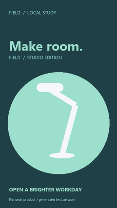
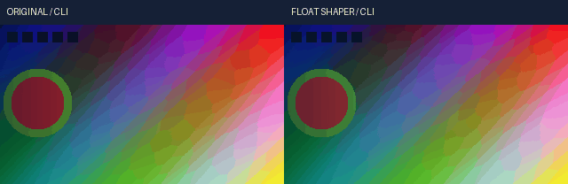
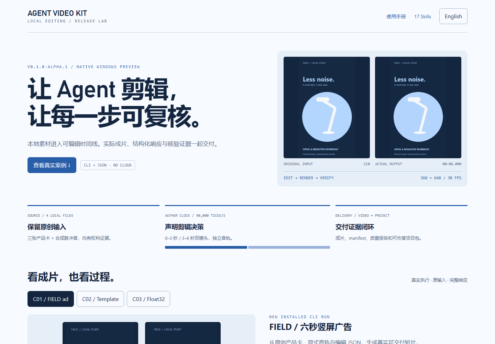

# 完整案例 / Complete cases

[README 中文](../../../README.md) · [English](../../../README.en.md) · [Usage](USAGE.md) · [Skills](SKILLS.md)

本轮真实案例在全新离线安装的 `-I -S` CLI 上运行；媒体均为虚构产品原创图形与合成音，0 次新增模型推理。
The new cases run against a fresh native offline install using `-I -S`. Inputs are original fictional-product graphics and synthetic audio, with zero new model inference.

## C01 / 6 秒 FIELD 竖屏广告 / Six-second vertical ad

目标：保留可编辑结构、显式音轨、商业用途证据，生成可交付短片。Brief: deliver a short fictional desk-light ad with editable structure, explicit audio and reviewed synthetic-asset provenance.

| Stage | Actual artifact |
|---|---|
| Original input | [Card 1](../../assets/release-v0.1.0-alpha.1-r2/input/card-1.png), [Card 2](../../assets/release-v0.1.0-alpha.1-r2/input/card-2.png), [synthetic pulse](../../assets/release-v0.1.0-alpha.1-r2/input/pulse.wav), [input MP4](../../assets/release-v0.1.0-alpha.1-r2/input.mp4) |
| Composition | [Actual edit JSON](../../validation/evidence/release-v0.1.0-alpha.1-r2/changes.json), [authored project](../../validation/evidence/release-v0.1.0-alpha.1-r2/author-project.json) |
| Local gates | [Validate](../../validation/evidence/release-v0.1.0-alpha.1-r2/validate.stdout.json), [rights](../../validation/evidence/release-v0.1.0-alpha.1-r2/rights-check.stdout.json), [policy](../../validation/evidence/release-v0.1.0-alpha.1-r2/policy-audit.stdout.json) |
| Plan / output | [Dry plan](../../validation/evidence/release-v0.1.0-alpha.1-r2/render-plan.stdout.json), [actual render response](../../validation/evidence/release-v0.1.0-alpha.1-r2/render.stdout.json), [MP4](../../assets/release-v0.1.0-alpha.1-r2/field.mp4), [GIF](../../assets/release-v0.1.0-alpha.1-r2/field.gif) |
| Checks | [Quality](../../validation/evidence/release-v0.1.0-alpha.1-r2/quality.stdout.json), [scopes](../../validation/evidence/release-v0.1.0-alpha.1-r2/scopes.stdout.json), [stream/frame probes](../../validation/evidence/release-v0.1.0-alpha.1-r2/media-probes.json) |


The input MP4 previews the first source card; the complete original inputs are the individual PNG/WAV files. This case is a deliberate card-cut ad, not a generative-video, keyframe or tracking demonstration. Two cards occupy 0–3 and 3–6 seconds; the synthetic pulse occupies its own 0–6 second audio track. Output is 360×640, 30 fps, 180 frames; exact stream metadata is in the probe receipt.
该案例验证导入、结构化拼接、显式音轨、权利门禁、输出和交付；不把卡片剪切当作 AI 特效或运镜展示。

## C02 / 模板换款 / Parameterized variant

同一基础模板接收真实 `asset_id` 和 `duration_tick`，插入 [第三张原始产品卡](../../assets/release-v0.1.0-alpha.1-r2/input/card-3.png)。
The basic template takes an actual asset ID and duration to create an editable three-second variant.
[Template](../../validation/evidence/release-v0.1.0-alpha.1-r2/template.json) · [Variables](../../validation/evidence/release-v0.1.0-alpha.1-r2/variables.json) · [Apply response](../../validation/evidence/release-v0.1.0-alpha.1-r2/template-apply.stdout.json) · [Render response](../../validation/evidence/release-v0.1.0-alpha.1-r2/template-render.stdout.json) · [MP4](../../assets/release-v0.1.0-alpha.1-r2/variant.mp4).



This is one actually rendered template variant, not a claimed large batch benchmark. It is silent by design; its quality check does not require an audio stream.

## C03 / 原生浮点色彩链 / Native Float32 color chain (dated evidence)

既有 V112 安装版本实测：保持作者信号和时钟，明确声明 1D LUT/shaper 与 3D LUT 的顺序。
Dated V112 installed-runtime evidence covers ordered 1D LUT/shaper and 3D LUT evaluation with explicit signal and clock declarations.
[Original](../../assets/float-shaper-20261023-installed-r1/original.mp4) · [Edited](../../assets/float-shaper-20261023-installed-r1/edited.mp4) · [Contact sheet](../../assets/float-shaper-20261023-installed-r1/formal-contact.png) · [Authored project](../../assets/float-shaper-20261023-installed-r1/author-project.json) · [Original receipt](../../validation/evidence/float-shaper-20261023-lab/installed-r1/verification.json).



This case is historical, not a new release-run inference or a general HDR/ICC/perceptual-quality acceptance. Its original inputs, per-case metrics and limitations remain authoritative. A separate 4K single-frame oracle does not establish continuous 4K performance.

## C04 / 可恢复交付与真实拒绝 / Delivery and truthful refusal

实际执行 `convert export --target-format package` → `convert import` → `validate`，保留[导出](../../validation/evidence/release-v0.1.0-alpha.1-r2/export-package.stdout.json)、[导入](../../validation/evidence/release-v0.1.0-alpha.1-r2/import-package.stdout.json)和[复核](../../validation/evidence/release-v0.1.0-alpha.1-r2/restored-validate.stdout.json)响应。
An actual package round trip exports, imports to a new project and validates it on the same native host. The examples asset includes the project package with embedded media. Original absolute license/evidence paths remain in its Rights Ledger: when relocating, point `rights update --license-url ... --evidence ... --reason ...` at the provided reviewed CC0 LICENSE file, then recheck rights. Cross-machine evidence-path portability was not tested.

A local file with `--source-url https://example.invalid/asset.png` is rejected before remote access. [Full error JSON](../../validation/evidence/release-v0.1.0-alpha.1-r2/remote-refused.stdout.json) and nonzero exit are retained in the command ledger. This is a policy refusal, not a simulated network failure.
首轮脚本将输出路径误写为工作目录相对路径，失败记录[保留](../../validation/evidence/release-v0.1.0-alpha.1-r1/failure.json)；改用项目内绝对路径后整轮重跑。

## 响应内容、截图与录制 / Responses, screenshots and recording

[Every command, exit code and timing](../../validation/evidence/release-v0.1.0-alpha.1-r2/commands.json) · [Case verification, SHA-256 and rights](../../validation/evidence/release-v0.1.0-alpha.1-r2/verification.json) · [Source generator](../../../scripts/first_release_cases.py) · [CC0 evidence](../../assets/release-v0.1.0-alpha.1-r2/LICENSE.txt).

The local [case page](../../demo/index.html) loads complete JSON responses, lets readers switch cases/commands, copy commands, inspect original inputs and play output media. Serve the repository locally to use it:

```powershell
C:\Python313\python.exe -E -B -X utf8 -m http.server 8765 --bind 127.0.0.1 --directory E:\dev\sandbox\AI广告剪辑
# Open http://127.0.0.1:8765/docs/demo/index.html ; Ctrl+C stops the server.
```

GitHub renders Markdown and media links; it does not execute this HTML page in the repository file viewer. No public website deployment is implied.



[Mobile capture](../../assets/release-v0.1.0-alpha.1-r2/mobile.png) · [response-panel capture](../../assets/release-v0.1.0-alpha.1-r2/responses.png) · [MP4 recording](../../assets/release-v0.1.0-alpha.1-r2/workflow.mp4) · [GIF recording](../../assets/release-v0.1.0-alpha.1-r2/workflow.gif) · [capture checks](../../validation/evidence/release-v0.1.0-alpha.1-r2/browser-verification.json).

录制内容是本地文档页对已执行 CLI 日志的逐步回放，**不是实时终端录像**。所有响应来自保留的 stdout，未编造成功返回。媒体可以自动复解码并做静态目检；未完成自然素材连续播放和人工听审，不据此宣称达到剪映观感。
The recording is a documentation replay of executed CLI responses, **not a live terminal capture**. Responses come from retained stdout. Decode checks and static review are distinguished from unperformed continuous natural-media playback and human listening.
