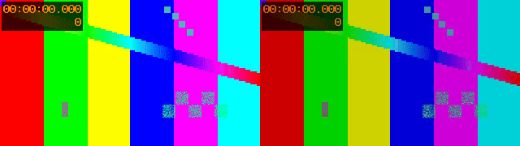

# 开源 LUT 与风格库补齐评估 / Open look-library feasibility

**后续实施状态 / Subsequent implementation:** 本报告保留最初研究与单 LUT 小样的时间边界。后续已将 51 个 Hald 与 49 个 CUBE 整合为 `alpha.2` 的 100 预设，并更新本地 Skills；请看[实际目录](../local/LOOK_PRESETS.md)、[新使用逻辑](../releases/v0.1.0-alpha.2/USAGE.md)与[新核验](../validation/LOOK_PRESETS_20261024.md)。The assessment below is historical; follow these links for the implemented catalog and its actual acceptance boundaries.

日期：**2026-10-24，Asia/Taipei**。对象：Agent Video Kit 已安装的 `v0.1.0-alpha.1`。本轮为来源研究和单个社区 LUT 接入小样，未发布新的产品功能或修改已发布安装包。

## 结论 / Decision

**可以沿用现有引擎，补齐面向 Agent 的开源成品风格库。** 建议先做 50–100 个经过筛选的风格，覆盖富士/柯达/伊尔福等胶片模拟、电影色调、暖调、冷调、黑白和复古。现有 CUBE 加载、强度和时间线机制可复用，新增工作集中在素材、格式转换、色彩契约、检索、应用和质量验收。

**Yes: a curated open look library can use the existing engine.** Start with 50–100 reviewed looks, provenance, color contracts, previews and Agent discovery/application. This is a proposed product increment. One community CUBE was actually rendered below; neither a finished library nor CapCut/Leica equivalence has been accepted.

徕卡方向存在社区候选，但当前找到的具体项目涉及厂商 LUT/恢复的厂商变换及特定相机输入，需逐项核对。也可以自行设计高反差纪实、暖高光冷阴影、浓郁色彩和黑白等原创风格；不把这些命名为“官方徕卡”或宣称与某款相机/剪映滤镜一致。

## 1. 来源清单，按本轮 Star 数排序

Star 来自 GitHub API 抓取快照，页面可能与实时值略有不同；这是**已检查的 10 个项目排序**，不是全 GitHub 完整榜。锁定 commit、完整文件树、README/许可原文和 SHA-256 见 [upstreams.json](../validation/evidence/lut-research-20261024-r1/upstreams.json)。文件树均未截断。数字为文件数量，未经跨库去重和视觉验收，不能直接相加为“可用滤镜数”。

| # | 项目 / Source | Star | 可复用内容 / Candidate content | 许可与接入判断 / Assessment |
|---|---|---:|---|---|
| OS01 | [spektrafilm](https://github.com/andreavolpato/spektrafilm) | 1,091 | 胶片负片/相纸/扫描模型；有独立 LUT 烘焙 CLI/API，支持输出 CUBE；当前树不是现成 CUBE 合集 | 代码 GPL-3.0，profiles 和直接派生 LUT 为 CC BY-SA-4.0；适合第二阶段生成胶片风格，需固定输入/输出和配置；未安装或执行其程序 |
| OS02 | [t3mujinpack](https://github.com/t3mujinpack/t3mujinpack) | 1,071 | **51 个 Hald PNG、53 个 dtstyle、1 个 identity TIFF**；富士、柯达、伊尔福等模拟 | MIT。**首批优先**，使用已烘焙 Hald 转 CUBE；dtstyle 不能直接导入当前引擎，53 不能当作 53 个现成 Hald |
| OS03 | [V-Log-Alchemy](https://github.com/shenmintao/V-Log-Alchemy) | 409 | **43 个 CUBE 文件**，包含转换器/版本；有 Leica Classic/Natural、富士、哈苏等方向 | 仓库 Apache-2.0；README 明确涉及厂商官方 LUT 或恢复的变换。**有条件研究**，不能据根许可证就认定所有厂商派生资产均可随包分发；主要输入为 Panasonic V-Log/V-Gamut，另有指定型号 Standard 适配器 |
| OS04 | [cedeber/hald-clut](https://github.com/cedeber/hald-clut) | 325 | **350 个 PNG**；RawTherapee、PictureFX，以及 Apple Photos、Pixelmator 等来源 | 仓库 GPL-3.0；存在混合上游来源。**不整包进入默认库**，只允许在逐项来源核清后复用子集 |
| OS05 | [NatronGitHub/clut](https://github.com/NatronGitHub/clut) | 26 | **347 个 Hald PNG**，黑白、反转、负片、拍立得、印片等 | README 明示 CC BY-SA-4.0，并列出作者。**扩展库候选**，按作者/子集核对、转换、去重、保留署名和许可；非 Natron GUI 依赖 |
| OS06 | [slaycamera/luts](https://github.com/slaycamera/luts) | 8 | **5 个 33³ CUBE**：Amber/Fade/Neon/Film/Portrait | 许可文件为 CC BY-4.0；README 同时出现不允许原样出售的描述。先保留为候选，明确分发条款后再随包；App 的 38 个风格不属于这 5 个开放文件 |
| OS07 | [sguyader/FilmSim](https://github.com/sguyader/FilmSim) | 4 | **4 个 TIFF Hald + 4 个 pp3**；Acros、Classic Chrome、Provia、Velvia | CC0-1.0。**首批优先**，转换 Hald；需审查其输入色彩约定，不能据名字保证与富士原算法一致 |
| OS08 | [stripedpurple/color-grading-luts](https://github.com/stripedpurple/color-grading-luts) | 1 | **49 个 CUBE**，电影年代、风景、创意色彩和胶片方向 | MIT，作者说明为其创作的 Photoshop 导出 LUT。**首批优先**，可以直接走现有 CUBE 路径；输入传递函数未充分说明，需补充素材验收。本轮已实测其中 1 个 |
| OS09 | [ChristophWurst/haldclut](https://github.com/ChristophWurst/haldclut) | 1 | **3 个 TIFF Hald**，作者自制调色 | CC BY-SA-4.0，体量小，可作为署名清楚的补充候选，尚未转换/渲染 |
| OS10 | [frogbf/Film-Luts](https://github.com/frogbf/Film-Luts) | 0 | **296 个 CUBE**，G'MIC 相关集合的一个 fork | 仓库 MIT，但 README 明确维护者不主张拥有这些 LUT、需自行确认上游权利。**不整包默认采用**，避免把仓库许可误当每份素材的授权 |

重要许可细节：spektrafilm 的 README 仍有“no resale/custom license”措辞；本轮锁定版本的 [专用许可文件](https://github.com/andreavolpato/spektrafilm/blob/3bb2c2d2801ff68b92019cf1dbcbb133d60832bc/SPEKTRAFILM_LICENSE.txt) 则明确以 CC BY-SA-4.0 为法律条款，并把不单独售卖、不商业训练等列为额外请求，不能把请求误报成许可证硬性禁止。它对代码和 LUT 使用不同许可，不能把 GPL 代码复制进来后只标注素材许可。

CC BY-SA 素材可在遵守署名和相同方式共享等条件下用于商业目的，具体以 [官方条款](https://creativecommons.org/licenses/by-sa/4.0/) 和资产原文为准。我们的资产清单应逐文件保存许可，不给整个资源包套一个笼统 MIT 标签。上述为本轮来源筛选结论，不是逐资产分发批准。

## 2. 徕卡方向能做到什么

| # | 目标 | 可行性 | 当前证据与限制 |
|---|---|---|---|
| LC01 | 类似的浓郁色彩、深黑、冷阴影暖高光、纪实黑白 | 可自行创作，也可筛选许可清楚的社区风格 | 可由现有曲线、色彩平衡、LUT、暗角等组合；具体配方和自然素材质量尚待开发/验收 |
| LC02 | 接入社区标注为 Leica Classic/Natural 的 LUT | 格式可行，输入和素材授权有条件 | V-Log-Alchemy 有明确文件/流程；本轮未下载这些 LUT 或测试。普通 Rec.709 成片不能当成 V-Log 输入直接套用 |
| LC03 | 任意手机素材一键获得某台徕卡相机一致输出 | 不能据 LUT 承诺 | 传感器、曝光、白平衡、镜头、局部处理和动态范围影响结果；成片里已丢失的信息不能靠反向编码恢复 |
| LC04 | 完整复现剪映里全部品牌/风格滤镜 | 未有可验收依据 | 需要版本化参考、合法比较样本和逐项质量准则；社区资源数量不能证明等价 |

V-Log-Alchemy 的 [锁定 README](https://github.com/shenmintao/V-Log-Alchemy/blob/e51ba9a23458ff5c316f630b860eb0201139d126/README.md) 说明了 V-Log → ACES → 目标空间/厂商变换的链路。本轮没有将其列为无条件可分发的 Leica 开源资源包。

## 3. 技术接入路径

1. **资产层**：锁定上游 commit 和文件、校验 SHA-256、解析完整表、去重并保存许可原文、作者、来源、修改记录和允许用途。可审核的 MIT/CC0 子集优先。
2. **格式层**：现有 `.cube` 直接进入项目 LUT 注册器。Hald PNG/TIFF 增加离线转换器，保留位深、轴顺序、域和颜色元信息，生成标准 CUBE。用 identity、通道置换、边界值和 FFmpeg `haldclut` 对照验证转换，而不是仅改扩展名。FFmpeg 有 [haldclut](https://ffmpeg.org/ffmpeg-filters.html#haldclut) 和 [lut3d](https://ffmpeg.org/ffmpeg-filters.html#lut3d)；当前产品尚无公开 Hald 输入适配器，本轮没有测试转换。
3. **色彩层**：为每个风格记录输入/输出 primaries、transfer、range、domain，以及未知项；不能把 sRGB、Rec.709、Log 或线性光假定为相同。SDR 首批、Log 独立适配；不以套 LUT 声称 HDR 正确。
4. **风格层**：命名 ID、中文/英文标题、作者、标签、适用题材、推荐强度、缩略图，以及 LUT + 现有算子的有序配方。颗粒、暗角可作为组合效果；辉光/卤化光晕、空间扩散、人物局部保护需要各自内核和验收，不能烘进单一 3D LUT 代替。
5. **Agent 层**：新增风格发现、检查、应用和预览入口，内部复用 LUT 注册、时间线、关键帧和权利台账；技能仍使用 `agent-ffmpeg-local-` 命名。下列 `look` 命令仅为拟议 API，当前 release **不存在**：

```text
look list --category film
look inspect --id <stable-look-id>
look apply --project <local-project> --id <stable-look-id> --strength 0.65
```

现在可用的是 `lut register/list/inspect` + 时间线 `lut3d`，以及 `$agent-ffmpeg-local-editor`。详细格式、默认 FFmpeg 与显式 Float32 路径差异见 [FILTERS](../local/FILTERS.md)。本轮不改变基础安装内 LUT 数量为 0 的既有库存结论；外部研究项目登记了一个 LUT。

拟议 manifest 最低字段：`id/version/name_zh/name_en/category/tags/author/upstream_commit/original_path/sha256/license_spdx/license_evidence/modifications/input_signal/output_signal/domain/recommended_strength/recipe/preview/verification_status`。不明来源与不明色彩域必须显式标记，禁止静默当作已验收。

## 4. 工程量估算 / Effort estimate

以下是**1 名熟悉本仓库和调色的开发者的人日估算**，不等于本轮用时或交付承诺；素材授权等待、自然画面人工审美迭代及新增空间效果会影响日历时间。

| # | 交付项 | 估算人日 | 完成判据 |
|---|---|---:|---|
| WP01 | 首批资产筛选、锁版、许可台账、解析与去重 | 1–2 | 每个交付文件有哈希与来源，未知资产不混入默认包 |
| WP02 | Hald → CUBE 与输入/输出色彩契约 | 1–2 | identity/轴顺序/位深/边界值与参考实现一致，记录精度阈值 |
| WP03 | 风格 manifest、搜索/检查/应用命令及 Skill | 2–3 | Agent 可按 ID 或分类发现，应用到工程并可重链、恢复 |
| WP04 | 缩略图、对照预览、原片/成片/GIF 和案例说明 | 1–2 | 预览来自真实渲染，画面与应用参数对应 |
| WP05 | 自然素材抽样、强度/路径验证、打包和双语文档 | 2–3 | 已选 50–100 项的机器检查、代表性自然素材评审和失败边界可追踪 |
| 合计 | 首批经过筛选的风格库产品化 | **7–12 人日** | 数量取决于去重、来源和效果筛选；不是简单把 104 个候选文件改名 |

- **小样**：单个标准 CUBE 已完成，见下一节；它不包含整套目录、自然素材适配或 Hald 转换。
- **200–300 个可检索、可预览、有出处的扩展库**：约 **3–6 周**，包含去重、标签和素材质量评审；许可不明的集合不计入承诺数量。
- **高级胶片质感**：另预留 **2–4 周**，针对光晕、辉光、时序颗粒、局部保护等空间/时序效果；需要新增测量与自然画面验收，不能靠 LUT 数量取代。
- 上述范围只针对风格库，不包含补齐剪映全部 AI 特效、转场、素材生态或完整功能对等。

## 5. 本轮真实小样 / Actual installed-release probe

**使用 Striped Purple / Amber Haze（MIT）的 32³ CUBE，通过已注册的 `$agent-ffmpeg-local-editor` 启动器执行已安装发行版。** 资源按 commit `9757e8b5147693cab49c3fd674bf23dbe28d6c8e` 获取，并与 GitHub 文件树的 Git blob SHA-1 一致；另记 SHA-256。没有执行上游程序，没有调用剪映、Docker、WSL 或新模型。

| 项目 / Check | 实际结果 / Observation |
|---|---|
| 输入 | 新生成的 FFmpeg 合成测试图；3 秒、320×180、12 fps；不是自然素材 |
| 应用 | 本地登记 CUBE、写入时间线 `lut3d`；强度 0.65、tetrahedral |
| 安装版调用 | 最终流程 13 次结构化 CLI 命令成功；使用注册 Skill 启动器，未回落源码 |
| 输出 | H.264 MP4；36 帧、3 秒，完整解码无错误；质量命令通过 |
| 声音 | 无作者音轨；渲染器生成静音 AAC，解码 PCM 峰值 0；未人工听审 |
| 像素 | 首帧原图/输出 RGB 平均绝对差 20.476481（0–255），证明像素发生改变，不代表色彩精度或美学评分 |
| 目检 | 查看首帧左右对照；观察到暖色/对比变化。未连续播放、未验收肤色/风景/夜景或品牌一致性 |
| 警告 | 保留 `RENDER_FEATURE_APPROXIMATE/lut_intensity`：默认路径静态强度由 identity 混合 CUBE 实现，域外/非线性与舍入可能不同于像素混合 |
| 未实施 | 0 个新产品功能；未安装整库，未转换 Hald，未执行 spektrafilm 或 V-Log-Alchemy |

左：原输入；右：Amber Haze，强度 0.65。**仅接入研究小样**。



[原视频 / Original](../assets/lut-research-20261024-r1/original.mp4) · [实际输出 / Output](../assets/lut-research-20261024-r1/edited.mp4) · [静帧 / Still](../assets/lut-research-20261024-r1/comparison.png) · [许可 / Notices](../assets/lut-research-20261024-r1/LICENSE.txt) · [核验 / Verification](../validation/evidence/lut-research-20261024-r1/probe/verification.json) · [命令与警告 / Commands](../validation/evidence/lut-research-20261024-r1/probe/commands.json)

保留两次检查问题：首次将 `effects inspect` 错写成位置参数，CLI 拒绝；已改为 `--name lut3d`，见 [原失败日志](../validation/evidence/lut-research-20261024-r1/probe-first-attempt/lut-effect.stderr.txt)。渲染成功后的初次验证假设无音轨就没有音频流，实际发行版补静音 AAC；已改为检查解码采样，未重新渲染或修改产品，见 [验证失败记录](../validation/evidence/lut-research-20261024-r1/probe/first-validation-failure.json)。GitHub API/原始文件 HTTPS 获取遇到限流/连接重置，改用公开 Git SSH 只读取锁定版本对象，并用已捕获文件树校验；没有执行第三方脚本。

## 6. 复现与下一阶段准则

```powershell
# 研究获取允许联网；产品渲染流程仅使用已落盘本地文件。
& C:/Python313/python.exe -E -B -X utf8 docs/validation/scripts/research_lut_sources_20261024.py --transport git-ssh
# 小样脚本保护已有项目和证据；需使用新的运行目录，不能覆盖本轮记录。
& C:/Python313/python.exe -E -B -X utf8 docs/validation/scripts/probe_open_lut_20261024.py
```

研究采集器复用已保存的 API 快照以避免限流；要更新 Star/commit，需新建研究目录和日期，不能把旧缓存伪装成实时数据。小样原视频是自行生成内容，下载的是 LUT 数据。没有打开浏览器 UI tab。

下一轮开发建议优先 OS02/OS07/OS08，并将 OS05 分作者扩充。接入前先确定 50–100 项实际清单；默认 FFmpeg 与 Float32 分开列出通过情况，测试 0/0.5/1 强度、保存/重链/导出/恢复和不支持输入的明确失败，既检查数值也审看授权自然素材。任何不能复现的滤镜、来源不明的素材或域不匹配的结果不能计入完成数量。风格库作为新版本发布，保留 `v0.1.0-alpha.1` 的标签和附件。

## English assessment

The ten inspected repositories are ranked by captured GitHub stars, with immutable commits, file trees and notice hashes in the evidence. Counts describe files, not deduplicated or visually accepted looks. The first candidates are t3mujinpack (MIT, 51 Hald PNGs), FilmSim (CC0, four Hald TIFFs) and Striped Purple (MIT, 49 CUBEs). Natron's 347 Hald PNGs provide an attributed CC BY-SA expansion candidate. Mixed-source collections and vendor-derived camera looks require individual provenance review.

The engine already accepts project-local CUBEs. Product work adds Hald conversion, explicit color domains, a versioned catalog, discovery/application commands, previews and QA. Proposed `look` commands are not available in the current release. A first curated 50–100-look library is estimated at 7–12 engineer-days; a reviewed 200–300-look collection at 3–6 weeks, subject to asset clearance and material review. Spatial/temporal effects such as halation need separate work.

One 32³ MIT CUBE was actually registered and rendered at 0.65 strength using the installed release through the registered Skill launcher. The output is 320×180, 12 fps, 36 frames/three seconds; decoding and quality checks pass. The encoded audio is silent, with decoded peak zero. The static-intensity approximation warning is retained. The GIF above is original on the left and graded on the right. This synthetic probe does not establish Hald conversion, natural footage quality, Leica matching or CapCut parity. The frozen application still bundles zero creative LUT assets.
