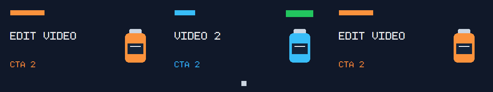

# HTML 组件字段与逐片段参数离线实测

<!-- V79-DETAIL -->
2026-10-21 **V79（HTML 组件字段与逐片段取值限定验收）**：落实 OpenFilm 接入契约 CP-01..06。新命令 `motion html-fields` 无浏览器返回稳定 ID、独立定义／取值、JSON Schema、类型／范围／单位／默认来源及图片选项；`html-render/controls/quality` 共用有类型的组件补丁、单项 null 与全量 reset。本地图片限定原源码登记闭包并检查实际 SHA 与 strict commercial_ad 权利；boolean 在每帧作者动画后执行，并恢复原页面属性。`--replace-clip-id` 仅更换指定片段资产引用，保留作者时间、变换、特效和其他片段。完整原生回归 **1796/1796、5798.792 秒、0 跳过，237 冻结输入＋8 外部夹具前后相同**；专项 **28/28、222.167 秒、0 跳过**，属于全量子集。开发 **28 成功 CLI＋3 明确拒绝／41 检查**；7 组×20 帧无损 RGBA、稳定 ID 改名保值、局部／全量复位、图片与逐帧显隐独立像素、包／片段重建、2 个实际队列输出均核验。离线 **155 资源／7 wheels／34 次隔离 CLI＋1 来源探针**；源码／平台 wheel／安装资源逐字节一致，开发与安装 7 组解码相同；17 Skills／326 本地引用及发现联接已核对。未验收自动字段发现、任意网页／完整 OpenFilm 时间线、自然广告质量、实时连续播放、HDR或完整剪映效果等价。

| 编号 | 核验内容 | 实际结果与边界 | 证据 |
|---|---|---|---|
| V79-01 / CP-01,02 | 字段与机器发现 | 稳定 ID 改名保值、独立定义／逐资产值；四类型、JSON Schema、范围／单位／默认／选项；无需 GUI | [收据](evidence/html-components-20261021-v79/targeted-r3.json) |
| V79-02 / CP-03,04 | 预算与本地图片 | 128 项／64 KiB 合并预算、512 字符 selector、n≤1024；闭包、SHA、权利，非法值在浏览器前拒绝 | [收据](evidence/html-components-20261021-v79/targeted-r3.json) |
| V79-03 / CP-05 | 显隐与复位 | 原来显／隐／display:none／visibility:hidden、动画帧、空文字、0／false、单项／全量 reset、3 子帧快门 | [收据](evidence/html-components-20261021-v79/targeted-r3.json) |
| V79-04 / CP-06 | 真实 CLI 与复用 | 28 成功＋3 拒绝／41 检查；7×20 RGBA 帧，包／片段重建和2次队列渲染 | [收据](evidence/html-components-20261021-v79/native-r2/verification.json) |
| V79-05 | 离线安装 | 155 资源／7 wheels；34 隔离 CLI／12 检查＋1 来源探针；7组像素及源包与开发相同 | [收据](evidence/html-components-20261021-v79/installed-r1/verification.json) |
| V79-06 | 完整回归 | 完整原生回归 **1796/1796、5798.792 秒、0 跳过，237 冻结输入＋8 外部夹具前后相同** | [收据](evidence/html-components-20261021-v79/full-r1.json) |
| V79-07 | 失败留证与审片边界 | 专项 r1/r2、演示 r1、Skill YAML 格式拦截原始记录保留；修正4份 Skill 后重验；仅静态 PNG 目检，无连续播放／听审／新模型推理 | [收据](evidence/html-components-20261021-v79/skill-format-r1/verification.json) |

原创输入 → 字段编辑 → 组件复位（复位保留普通 CTA 覆盖）：

[原视频](../assets/html-components-20261021-v79-native-r2/original.mp4) · [编辑后](../assets/html-components-20261021-v79-native-r2/edited.mp4) · [复位视频](../assets/html-components-20261021-v79-native-r2/restored.mp4) · [原始 HTML／资源清单](../assets/html-components-20261021-v79-native-r2/template/manifest.json) · [原图](../assets/html-components-20261021-v79-native-r2/template/product-original.png) · [替换图](../assets/html-components-20261021-v79-native-r2/template/product-blue.png) · [逐文件摘要](../assets/html-components-20261021-v79-native-r2/files.json)

384×216、10 fps、2 秒、20 帧；GIF 为三列并排。MP4/GIF 仅观看副本，像素判定来自无损 RGBA／FFV1 NUT。输入、字体与脚本原创 CC0，不含音轨。

字段由作者清单声明，不是模型自动识别页面。字段与取值保存在工程元数据，原 HTML 与源码 ZIP 字节不变；包／片段仍可重新编辑，资产 ID 的默认值／选项／实际值跟随资源闭包映射。单片段替换仅改变 asset_id。继承值与改名输出完全相同；全量组件复位与未应用组件的基线全部 RGBA 相同，普通 CTA／变量覆盖仍保留。

专项 r1（25 方法，1 failure/10 errors）为演示 helper 重名及 Schema 夹具缺 probe；r2（25 方法，3 failures）包含 policy 对对象 engine 做集合查询的实际错误、hidden="until-found" 背景绘制的错误预期、手写夹具未设置序列时长。修正后 r3 为28方法全部通过，并加入真实片段资源映射、三子帧与 policy 回归；旧方法数不累加。实片 r1 严格字体检查拒绝缺字 O 与系统回退；为原创网格字体增加原创字形后用新目录复测，没有放宽字体门槛或像素阈值。

可见性 false 保留布局；true 只恢复目标自身 hidden/display/visibility，不能显示仍被祖先隐藏或裁切的内容。重置后恢复页面逐帧状态。类型更换或删除已设值字段需要明确补丁；图片添加到闭包须重新登记源码。普通模板覆盖保持兼容；组件图片执行更严格的事前权利门槛。

首轮发布已复制候选文件，但17 Skill 注册核验拦下错误的 YAML：新标记段落被插在首个 --- 后，落入 frontmatter。保留4份原始坏文档、当时同步/发布脚本和 stderr；修正为在完整 YAML 头之后插入，再单独验证4份格式与main的17份联接/本地引用。恢复只覆盖首轮已复制且摘要未变的本轮文件，不回滚其他文件。产品代码与237个全量冻结输入未改，复用本次1796项终态收据。

该实现只借鉴固定 OpenFilm component-props／template-controls 的字段设计，新 Python 协议和宿主显隐逻辑由本项目实现；现有6个 MIT 模块及许可未变。R13 的65个上游纯函数测试是研究记录，不加到本轮1796项产品回归。未取得同条件从零／复用工时对照，不能量化总工程成本节省比例。

复现使用 `scripts/smoke_html_components.py --work <新的product/.runtime目录> --evidence <新的docs目录> --assets <新的docs/assets目录> --html-runtime <已有本地JSON>`；安装验证使用 `scripts/verify_html_components_install.py`，另传已有 wheelhouse 和开发收据。完整回归使用绑定8个夹具的 wrapper，禁止运行中修改冻结输入。所有脚本拒绝覆盖旧结果。原生 Windows，无 Docker／WSL／虚拟环境；原生浏览器 worker 按 Job 回收，本轮不打开交互 tab。
<!-- /V79-DETAIL -->
