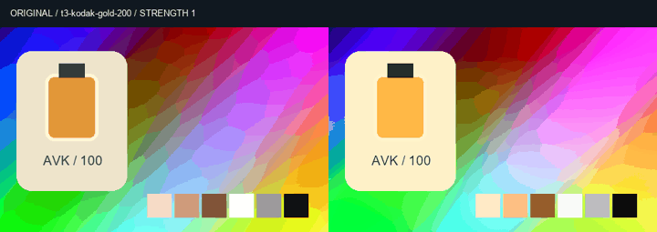

# 100 个离线预设核验 / Offline look verification

日期：2026-10-24（Asia/Taipei）。构建：`v0.1.0-alpha.2`，CLI `0.1.1`。环境：原生 Windows x64 / CPython 3.13 / 已有 FFmpeg，工作、安装和临时数据位于 E 盘。未调用 Docker、WSL、容器或虚拟环境；未进行新的模型推理，未打开浏览器 UI。

This increment adds 100 offline MIT creative color looks. The public alpha.1 assets remain unchanged. Tests, installed CLI runs, Skill runs and visual review are recorded separately; old suite totals are not added to current checks.

## 已完成的检查 / Completed checks

| # | 内容 / Check | 实际结果 / Result | 原始证据 / Evidence |
|---|---|---|---|
| V01 | 固定来源文件 / Pinned original blobs | 51 Hald + 49 CUBE，Git blob 与 SHA-256 匹配；MIT 原文留存 / Verified source bytes and notices | [Source manifest](../../sources/lut-research-20261024/look-sources.json), [pinned notices and trees](evidence/lut-research-20261024-r1/upstreams.json) |
| V02 | 目录与独立性 / Catalog and uniqueness | 100 个稳定 ID、100 个数值变换哈希、100 个缩略图哈希 / Distinct IDs, numerical tables and thumbnails | [Packaged catalog](../../product/src/ai_ad_editor/look_data/catalog.json) |
| V03 | 定向单元与回归 / Targeted unit and regressions | **83 通过 / passed**，无跳过；包括 Hald 色轴/原生位深、强度、替换/叠加、锁、试运行、幂等、文件保护、事务、包往返、LUT 与安装器 / Behavioral and independent pixel checks | [Full log](evidence/look-presets-20261024-r1/unit-tests.txt) |
| V04 | 新包与原生离线安装 / New package and isolated install | 8 个固定 wheels；manifest/ZIP/依赖审计通过，安装到 E / Eight verified wheels, native audit passed | [Build](evidence/look-presets-20261024-r1/build.txt), [install](evidence/look-presets-20261024-r1/install/installation.json), [audit](evidence/look-presets-20261024-r1/install/dependency-audit.json) |
| V05 | 本地 Skill / Local Skill validation and calls | **17 个入口格式/联接/哈希检查通过；14 次真实调用：13 成功 + 1 预期拒绝** / Includes preview, apply and an encoded render through Codex discovery | [Skill receipt](evidence/look-presets-20261024-r1/skills/verification.json), [full commands](evidence/look-presets-20261024-r1/skills/commands.json) |
| V06 | 逐一预览/成片/上游像素对照 / All-100 previews and renders | **100/100 通过；425 次隔离 CLI 调用，2 次预期拒绝；100 预览、100 成片逐片解码 / 100 passed** | [Per-preset results](evidence/look-presets-20261024-r1/installed/presets.json), [commands](evidence/look-presets-20261024-r1/installed/commands.json) |

原始回归脚本：`product/tests/test_look_presets.py`、`test_lut_automation.py`、`test_offline_install.py`、`test_offline_media_profile.py`。83 项包含重叠资源覆盖，不能与首版的 2,930 项历史回归累加。本轮修改了产品代码，历史冻结输入的测试回执不构成本轮完整回归。

The 83 targeted methods do not constitute a new full-suite run. The initial Hald-axis oracle found a swscale RGB8→RGB16 expansion offset. The converter now reads native RGB8 bytes directly, supports native RGB16 decoding and passes the independent channel-permutation/linear interpolation check. A preliminary asset test was started before catalog regeneration completed and therefore rejected mismatched hashes; the final tests ran after the completed catalog.

## 可复现路径 / Reproduction

```powershell
# Existing native dependencies only; no upstream code is executed.
& C:/Python313/python.exe -E -B -X utf8 scripts/acquire_look_sources.py
& C:/Python313/python.exe -E -B -X utf8 scripts/build_look_catalog.py
& C:/Python313/python.exe -E -B -X utf8 product/offline/build.py --output 'E:/path/to/new-bundle'
& C:/Python313/python.exe -E -B -X utf8 scripts/install_look_release.py --activate --evidence 'E:/dev/sandbox/AI广告剪辑/docs/validation/evidence/fresh-look-install'
& C:/Python313/python.exe -E -B -X utf8 scripts/update_agent_ffmpeg_local_skills.py
```

固定上游 Git 快照须已经存在；来源获取脚本只恢复锁定的数据文件并检查 blob，不执行上游代码。旧版 Git 对部分克隆无法补齐 blob；本次使用已有原生 Git 2.53 完整补齐锁定快照，然后关闭 `autocrlf` 取得原始字节。首次错误没有被计作成功。

The source acquisition script expects the pinned clones on disk; acquisition is development work, while the installed runtime is offline. Older Git failed to hydrate partial-clone blobs; existing native Git 2.53 fetched the complete pinned snapshot. Restoring with autocrlf disabled preserved exact source hashes. No failed acquisition was counted as a verified asset.

独立安装实测脚本是 `scripts/verify_look_release.py`，Skill 实测脚本是 `scripts/verify_look_skills.py`；都保留 stdout/stderr、命令和预期拒绝，已有运行目录不覆盖。重新运行需选择新目录，并相应调整脚本中的固定本轮工作目录。

## 色彩与验收边界 / Acceptance boundaries

49 个 CUBE 保留上游网格，51 个 Hald 采用原生 RGB8 数据并转换为 33³。目录记录每个预设在固定种子 8,192 个随机 RGB 点上的误差。最大全库单通道采样误差 0.064490，最大单预设平均误差 0.001164（0–1 归一化）；不是全域误差上界。此转换是近似，不宣称 Hald 原样逐像素复现。

Installed `look preview` and video output are executed by native FFmpeg. Upstream comparisons execute the original CUBE/Hald with FFmpeg independently of the Python converter. The 100 distinct numerical transforms and outputs establish different looks, not proprietary equivalence or natural-footage quality.

测试卡为合成渐变、肤色色块和虚构产品；音频为明确编排音轨的合成 440 Hz 音。自动解码、帧数/尺寸/时长、像素哈希、音频非空、静态抽帧、连续观看和人工听审分别记录。未完成自然人像/夜景/风景素材验收、连续播放审查或人工听审；GIF 无声音。未覆盖 Log/HDR/ICC、官方徕卡、剪映专属风格、空间胶片颗粒/光晕、美颜、AI 特效或完整剪映功能。

The preset CLI requires prepared SDR encoded RGB. Float32/Log/HDR application is refused explicitly. Underlying separately configured LUT engines retain their own contracts. Static partial strength mixes the LUT with identity in encoded RGB and preserves an approximation warning. MIT notices are retained, but community film names imply neither manufacturer endorsement nor official filter matching.

## 最终安装实测 / Final installed run

[最终回执](evidence/look-presets-20261024-r1/installed/verification.json)：100 个预设分别产生 1 秒、12 fps、12 帧、480×300 MP4；预览和实际视频首帧各 100 个不同哈希。共 425 次独立 `-I -S` CLI 进程，含缺失 ID 和非法强度两次预期拒绝。完整解码、结构化警告、全局部分强度、幂等重试、包导出/导入后的首帧一致、权利门禁和音频非空均已执行。

All 100 installed looks were individually previewed, applied, rendered and decoded. Package-roundtrip decoded first-frame pixels matched, and explicit audio was nonempty. All 49 original CUBE previews matched native upstream FFmpeg output exactly on the synthetic reference. The 51 resampled Hald looks had at most 0.344053 mean absolute 8-bit code error per look and 30 maximum channel error on this reference; this is not a bound on other footage. [Per-look error data](evidence/look-presets-20261024-r1/installed/presets.json).



上图按预设切换实际静态预览；[动态成片 GIF](../assets/look-presets-20261024-r1/motion-comparison.gif) / [MP4](../assets/look-presets-20261024-r1/motion-comparison.mp4) 则来自原视频与三套实际成片的逐帧解码合成，静音、3 秒、36 帧。全库[总览图](../assets/look-presets-20261024-r1/contact-sheet.jpg)与[完整编号案例](../local/LOOK_PRESETS.md)提供其余预设。两种演示均不是模型生成效果，也不代表连续观看或听感验收。
