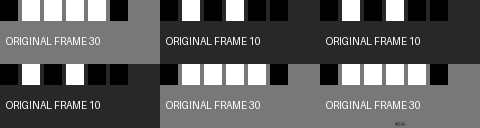
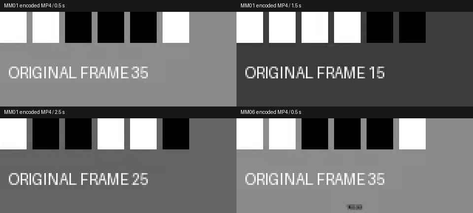

# 主轨磁吸模式与跨剪口同步拆分实测

2026-10-18，产品 V56。新增持久磁吸模式、整数 tick 剪口吸附、主轨插入/删除/裁切，以及连续音频/字幕/嵌套作者输出跨不同位移剪口的自动分段。功能按[先行契约](../specs/主轨磁吸模式与跨剪口同步拆分契约_v0.1_2026-10-18.md)验收，完整剪映功能及效果仍未达成。

## 当前结果

| 编号 | 实际执行 | 结果与边界 |
|---|---|---|
| CHECK-01 | 最终磁吸集成回归 | **66/66、5.333 秒、0 跳过**；含 26 个新增方法与 40 个既有重排方法，181 个源码/测试/发行文件前后相同。[终态](evidence/magnetic-mode-20261018-v56/magnetic-integration-final.json)、[日志](evidence/magnetic-mode-20261018-v56/magnetic-integration-final.log) |
| CHECK-02 | 最终完整产品回归 | **1289/1289、1986.638 秒、0 跳过**；181 文件前后冻结一致。[终态](evidence/magnetic-mode-20261018-v56/full-final.json)、[日志](evidence/magnetic-mode-20261018-v56/full-final.log)。66 集成/26 新增为全量子集，历史及安装不相加 |
| CHECK-03 | 六组真实开发版工程 | **44 次 CLI、236 主帧、1,132,800 个立体声采样帧**；43 次成功、1 次预期非法几何拒绝。RGB 最大差 1（门槛 2），PCM 最大差 0（门槛 2e-6）；[原始逐次输出](../assets/magnetic-mode-final-20261018-v56/calls.json)、[完整冻结与文件摘要](../assets/magnetic-mode-final-20261018-v56/verification.json) |
| CHECK-04 | 同机原生离线安装 | 七个本地 wheel，**121 个安装文件**与 wheel/源码一致，**39 次 `python -I -S` CLI**；六工程及跨项目片段组重新渲染 **316 帧、1,516,800 个立体声采样帧**。全部与开发版解码 RGB/PCM 一致；片段组根级按 2/2e-6 门槛验收，实际差也为 0。[安装证据](evidence/magnetic-mode-native-final-20261018-v56/verification.json) |
| CHECK-05 | 公开编码与静帧复核 | 六份 MP4 逐帧 PTS、10 fps、160×64、音视频起点 0、时长/采样核对通过。GIF 为 480×192、40 帧、4 秒；[媒体审计](evidence/magnetic-mode-20261018-v56/media-final.json)。两张实际合成图已静态查看，[目检记录](evidence/magnetic-mode-20261018-v56/static-review.json)；无连续播放或人工听审 |
| CHECK-06 | Skills 与发行绑定 | **14 Skills /198 本地引用**及目录联接/格式/SHA 通过。[技能记录](evidence/magnetic-mode-20261018-v56/skills.json)；[最终发行审计](evidence/magnetic-mode-20261018-v56/release.json)绑定全量终态后发布，不将安装调用、研究或历史测试相加 |

## 原输入与实际输出

输入由[实际执行脚本](../../scripts/smoke_magnetic_mode.py)在本机生成：六秒 160×64/10 fps 无损原帧，每帧有二进制灰阶身份和 `ORIGINAL FRAME` 编号；六秒 48 kHz/16-bit 立体声时钟音。主轨 A/B/C/D 分别引用原片 1–2/2–3/3–4/4–5 秒。连续副音轨原本覆盖整个四秒主轨。

原始 [FFV1 MKV](../assets/magnetic-mode-final-20261018-v56/source.mkv)、[输入预览 MP4](../assets/magnetic-mode-final-20261018-v56/source-preview.mp4)、[WAV](../assets/magnetic-mode-final-20261018-v56/source.wav)、[字幕 SRT](../assets/magnetic-mode-final-20261018-v56/captions.srt)、[来源与权利](../assets/magnetic-mode-final-20261018-v56/source-provenance.json)均公开。自制图像/声音/字幕为 CC0；DejaVu 字体按其原许可证保留，不包含未核实权利的自然素材。


| 编号 | 真实操作 | 时长 / 主帧 / 立体声采样帧 | 参照及差异 | 输出与可编辑包 |
|---|---|---|---|---|
| MM01 | 开启持久磁吸；shift C 到头部，连续音轨自动切成四个作者输出窗 | 4 秒 /40 /192,000 | 独立原视频帧和原 PCM 重排；RGB 1、PCM 0 | [MP4](../assets/magnetic-mode-final-20261018-v56/MM01.mp4)、[母版](../assets/magnetic-mode-final-20261018-v56/MM01.mkv)、[工程包](../assets/magnetic-mode-final-20261018-v56/MM01.aevpkg.zip) |
| MM02 | compose 删除主轨 B，副音轨同步 extract 并闭隙 | 3 秒 /30 /144,000 | 独立原帧及原 PCM 选区；RGB 1、PCM 0 | [MP4](../assets/magnetic-mode-final-20261018-v56/MM02.mp4)、[母版](../assets/magnetic-mode-final-20261018-v56/MM02.mkv)、[工程包](../assets/magnetic-mode-final-20261018-v56/MM02.aevpkg.zip) |
| MM03 | append E 请求 1.3 秒，吸附 1 秒剪口并插入 | 5 秒 /50 /240,000 | 独立原帧插入、原 PCM 加一秒精确静音；RGB 1、PCM 0 | [MP4](../assets/magnetic-mode-final-20261018-v56/MM03.mp4)、[母版](../assets/magnetic-mode-final-20261018-v56/MM03.mkv)、[工程包](../assets/magnetic-mode-final-20261018-v56/MM03.aevpkg.zip) |
| MM04 | trim B 为原可见窗口 0.2–0.8 秒，联动头尾删除 | 3.6 秒 /36 /172,800 | 独立原帧与 PCM 头尾选区；RGB 1、PCM 0 | [MP4](../assets/magnetic-mode-final-20261018-v56/MM04.mp4)、[母版](../assets/magnetic-mode-final-20261018-v56/MM04.mkv)、[工程包](../assets/magnetic-mode-final-20261018-v56/MM04.aevpkg.zip) |
| MM05 | 有压缩器及采样增益的完整子音频，经父反向、音量/淡变后，再随 C/A/B/D 分段 | 4 秒 /40 /192,000 | 画面为独立原帧；音频用同版渲染器的编辑前完整作者输出重排，**不是独立压缩/反向算法**；RGB 1、PCM 0 | [MP4](../assets/magnetic-mode-final-20261018-v56/MM05.mp4)、[母版](../assets/magnetic-mode-final-20261018-v56/MM05.mkv)、[工程包](../assets/magnetic-mode-final-20261018-v56/MM05.aevpkg.zip) |
| MM06 | 四条外部 SRT 与连续音轨关联，自动共同分区并重新分配后续 link_id | 4 秒 /40 /192,000 | 字幕字形按同版编辑前完整画面重排；PCM 为独立原源。RGB/PCM 均 0；不独立验收字形算法/排版质量 | [MP4](../assets/magnetic-mode-final-20261018-v56/MM06.mp4)、[母版](../assets/magnetic-mode-final-20261018-v56/MM06.mkv)、[工程包](../assets/magnetic-mode-final-20261018-v56/MM06.aevpkg.zip) |

各组实际渲染清单、逐帧时钟、原帧与 PCM 摘要随公开目录保存。MP4 为 AAC 试听预览，精度判定用母版浮点 PCM；GIF 不包含声音。包导入后的 MM05 额外重渲染与原 RGB/PCM 一致，未重复计入上表 236 主帧。





静态图可见 MM01 在 0.5/1.5/2.5 秒分别呈现原帧 35/15/25。MM06 底部小字号 `THREE` 保留；本轮不以该探针字号验收自然广告字幕的可读性。没有连续播放、人工听审或新模型前向。

## 实现、原生安装与片段组

`magnetic_mode.py` 在既有事务/范围规划器上实现持久模式与剪口选择；`magnetic_sync.py` 复用完整作者图之后的 `presentation_window`，避免把分段当作重新求值音频、字幕、速度曲线或定格。分段 ID 在全项目避碰；关联副轨共同按旧主轨区域分区。普通模式仍默认拒绝不同位移的同步跨剪口内容，可明确请求 `sync_span_policy: split`。

磁吸序列局部片段组保存会扩展到该序列全部片段并报告 selection 扩展，保持从零紧邻的主轨时钟。实际原生安装只选 MM06 中的 `a` 保存，扩展后包含 12 个根片段；跨项目应用保留模式、字幕/关联映射和原作者钟。选中子序列输出与 MM06 逐像素/采样一致；根级容器按预定有界门槛检查，实际差也是 0。

本机离线包：[ZIP](../assets/magnetic-mode-final-20261018-v56/agent-video-kit-cp313-win_amd64.zip)、[完整清单](../assets/magnetic-mode-final-20261018-v56/release-manifest.json)、[安装回执](../assets/magnetic-mode-final-20261018-v56/install-receipt.json)。ZIP SHA-256 为 `a557721c1c1cf1f1525770bf7690475d57aa37bbde0ae691c423eba07de96f6c`；清单 SHA-256 为 `b5142ea352b99a1c1828d060e6e1136053e6f406d49bde6aff9559b38ed22cde`。Python 和 FFmpeg 仍需原生本地安装，未包含在包内；未使用 Docker、WSL、venv、在线依赖或闭源服务。这不是另一台干净机器的发行验收。

## 失败与中断保留

| 编号 | 原记录 | 结论 / 修复 |
|---|---|---|
| FAIL-01 | [真实局部片段组探针](evidence/magnetic-mode-20261018-v56/fragment-probe-first.json)三次 CLI：保存成功、目标初始化成功、应用 exit 2 `FRAGMENT_PROJECT_INVALID` | 原保存只留处于非零时钟的主片段，磁吸校验正确拒绝间隙；已改为完整序列选择闭包，新增真实 CLI 回归，最终离线安装再次完成保存/跨项目应用/子序列和根渲染 |
| FAIL-02 | [第一次完整回归](evidence/magnetic-mode-20261018-v56/full-first.json)、[日志](evidence/magnetic-mode-20261018-v56/full-first.log)、[主动中断记录](evidence/magnetic-mode-20261018-v56/full-first-interruption.json)、[原产品 wheel](evidence/magnetic-mode-20261018-v56/failed-fragment-product.whl) | 发现上述真实集成缺口后，只终止本轮拥有的回归 Python 父子进程，再修源码；不把未到终态的回归写成通过。最终 full-final 使用新冻结从头运行 |
| HISTORY-01 | [首次定向 25/25](evidence/magnetic-mode-20261018-v56/targeted-first.json)、[首次集成 65/65](evidence/magnetic-mode-20261018-v56/magnetic-integration-first.json)、[第一版六组演示](../assets/magnetic-mode-first-20261018-v56/verification.json) | 所述受控范围通过，但对应修复前源码；不作为最终文件冻结或完整产品成功的替代。首次演示未复制渲染 manifest，原 CLI 回执仍保留实际位置；最终演示已复制 |

最终 44 次开发调用和 39 次隔离调用各有一次预期非法几何拒绝，磁吸项目文件原字节不变。这些拒绝是成功验证的保护行为，与 FAIL-01 的产品缺口分别记录。

## 复现与尚未完成部分

从仓库根目录执行，输出均选择不存在的新目录；工具路径必须指向本机已有原生文件。

```powershell
C:/Python313/python.exe -B -X utf8 scripts/run_frozen_regression.py --output docs/validation/evidence/<新目录>/integration.json --pattern 'test_magnetic*.py'
C:/Python313/python.exe -B -X utf8 scripts/smoke_magnetic_mode.py --work product/.runtime/<新实测目录> --public docs/assets/<新公开目录>
C:/Python313/python.exe -B -X utf8 scripts/verify_magnetic_mode_native_install.py --bundle product/.runtime/magnetic-mode-final-release-v56 --work product/.runtime/<新安装目录> --public docs/assets/<新公开目录> --evidence docs/validation/evidence/<新安装证据>
C:/Python313/python.exe -B -X utf8 scripts/audit_magnetic_mode_media.py --public docs/assets/<新公开目录> --output docs/validation/evidence/<新目录>/media.json
```

模式开关请求为 `{"action":"magnet","enabled":true}`，通过现有 `timeline edit --project <路径> --input <请求.json> --dry-run` 先生成可审阅计划；确认计划的位移、分区、轨道、字幕和引用后使用同一摘要执行。`shift` 的 delta_tick 指向剩余主轨最近**原始剪口**，不是屏幕像素吸附；默认不同于 GUI 拖拽手势。`trim_clip` 在磁吸模式不同时接受独立 timeline_start，移动应另作 shift。

速度/曲线/定格作者改写后自动联动主轨长度、全局标记与序列总线自动化的新时钟、全部剪映手势尚未实现；产生间隙或重叠的事务会拒绝。真实源转场端点、跟踪源/目标、锁定关联、旧跨片段转场等仍拒绝自动分段；非线性轨道及命名检测器不能被静默迁移。预计输出超过 20,000 片段在扩张前拒绝。自然广告画质/听感、CTC 精度、长片/HDR、另一台机器及完整剪映功能和效果仍须继续开发与验收。
