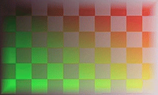
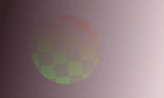
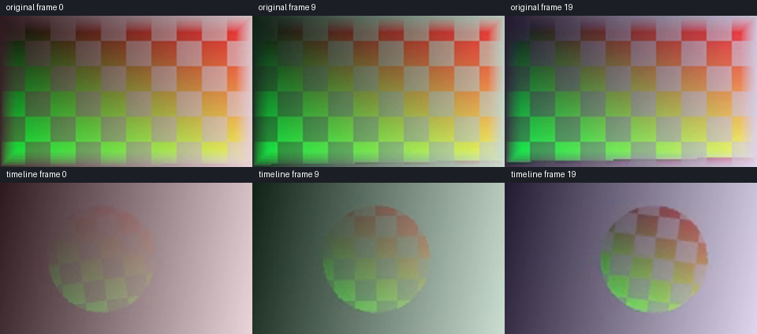

# 作者时钟浮点帧宿主与真实媒体独立实测

**库层专项、新鲜安装和完整回归已通过；发布状态以主线审计与 Git 提交为准。** 新增 CPU 合成、作者时钟帧宿主及只读帧包源。已完成 46 方法专项和真实 16 位媒体；新鲜安装与完整回归均有独立终态记录，不以父版本测试替代。

| 编号 | 实际执行 | 结果与证据 |
|---|---|---|
| FTV-01 | 隔离来源 | 从当时仍在完整回归的 V92 复制 282 冻结输入、8 夹具、9 依赖和 3 运行器，共 302 文件。未修改父候选。[创建收据](evidence/float-timeline-20261022-lab/foundation-r1.json) |
| FTV-02 | 首轮 CPU 核 | 14 方法 /7.268 秒 /0 失败/0 错误/0 跳过，另 33 次实际 FFmpeg 进程；覆盖 32 混合、Decimal 参考、透明隐藏色、极小 alpha、全部 65,536 级灰阶、掩码、预算和取消。[原始结果](evidence/float-timeline-20261022-lab/composite-r1.json) |
| FTV-03 | CPU 交叉精度 | 32 模式及另 1 组蒙版/透明度均与实际 FFmpeg 比较，无自动格式转换；32 模式登记的最大通道绝对差 `1.7881393432617188e-7`；另 1 蒙版组实际断言差不超过 `4e-7`，未单列保存其最大值。不是自然素材效果验收 |
| FTV-04 | 作者宿主首轮失败 | 实跑 39 方法，38 通过/1 失败/0 错误/0 跳过；背景 sRGB 参考式从 Float64 的 128/255 开始，遗漏公开 Float32 输入舍入。保留 [失败](evidence/float-timeline-20261022-lab/host-r1.json)、原日志、4 份当时源文件及其 [SHA](evidence/float-timeline-20261022-lab/implementation-host-r1/manifest.json) |
| FTV-05 | 修正参考式后 | 产品实现不变，参考式以原始 Float32 输入计算后只舍入一次；39 方法全部通过。[r2](evidence/float-timeline-20261022-lab/host-r2.json) |
| FTV-06 | 作者宿主与缓存源 | 新增缓存源后实际 **46 方法 /6.698 秒 /0 失败/0 错误/0 跳过**，其中 CPU 14、作者时钟 25、缓存源 7；包含 33 次 FFmpeg 交叉核验。288 冻结输入前后相同。[r3](evidence/float-timeline-20261022-lab/host-r3.json) |
| FTV-07 | 独立时钟预期 | VFR、容器非零起点、超过 `2⁵³` 的原始 PTS、30000/1001 帧率、常速、倒放半开区间、未知末帧 duration 拒绝、图片持续、部分包原始帧号、冻结、作者窗口、曲线闭式积分、嵌套双倒放和组透明度。全部已纳入 FTV-06，不额外重复计方法数 |
| FTV-08 | 真实媒体首次失败 | 原生演示尚未编码时，打包 schema 拒绝缺少 `interpolation` 的演示关键帧。补齐样例字段后执行 r2；保留 [r1 失败](evidence/float-timeline-20261022-lab/media-r1/verification.json) 和实际脚本。没有为演示放宽 schema |
| FTV-09 | 实际 16 位输入 | 复用 V92 程序生成的 foreground RGB16 和 background YUV16 原片与线性帧包，复制 SHA 完全一致。编辑工程通过实际打包 schema；mmap 源匹配登记原片 SHA 并在完成后复核关闭。[r2](evidence/float-timeline-20261022-lab/media-r2/verification.json) |
| FTV-10 | 全帧真实合成 | 输出 20 帧/10 FPS/2 秒；逐帧与独立 NumPy 几何、预乘双线性、圆形覆盖和 source-over 公式比较，全部 RGBA 通道相同，最大差 **0**。倒放与冻结的实际原帧号 `15,14,13,12,11,10,10,10,10,10,9,8,7,6,5,4,3,2,1,0` 全部相同 |
| FTV-11 | 实际编码核验 | r2 共 **14 个原生工具进程、56 项检查、17 份媒体/工程/缓存文件**；未调用新增公开 CLI。原片及编辑结果各有无损 RGB16 MKV、MP4 与 GIF，16 位每个编码通道字节相同；两套 MP4/GIF 的全部 20 个 PTS 与 100ms duration 均检查 |
| FTV-12 | 抽帧目检 | 已实际查看原片与输出各第 0、9、19 帧，共 6 张解码帧；圆形区域移动、旋转并改变透明度，小图未见明显黑边或错位。[查看收据](evidence/float-timeline-20261022-lab/media-r2/visual-reviewed.json)。未连续播放、未生成或听审声音，不代表自然素材、HDR 或剪映等价 |

新鲜隔离安装现已实际通过：**163 方法 /457.535 秒 /0 跳过**，174 份 source/wheel/site 资源、931 份 NumPy 原始文件与许可字节一致，216 个实际测试运行模块均来自新安装目录。[安装终态](evidence/float-timeline-20261022-lab/installed-r1/verification.json)。另在 `-I -S` 进程中重做 20 帧真实媒体、14 次原生工具调用，Float32 输出与开发版逐字节相同，145 个媒体运行模块均来自安装目录；新增公开宿主 CLI 调用数为 0，仅另有 3 次既有发现 CLI。[安装版媒体](evidence/float-timeline-20261022-lab/media-installed-r1/verification.json)。

完整回归现已实际通过：**2,280 方法 /13313.967 秒 /0 跳过**，288 产品输入、8 外部夹具及拥有进程记录的启动脚本、9 依赖均保持相同。[完整终态](evidence/float-timeline-20261022-lab/full-r2.json) · [实际父发布绑定](evidence/float-timeline-20261022-lab/parent-binding-r2.json)。r1 等待进程曾在测试启动前主动停止，原记录与 9 份旧脚本 [保留](evidence/float-timeline-20261022-lab/aborted-complete-r1/verification.json)；r2 是实际全量执行，不将 r1 计成测试失败。默认渲染、预览、音频、队列、缓存和全部效果仍未连接此库层宿主，完整剪映对标未完成。

媒体脚本现支持 `--source-root`，在已发布仓库默认使用本仓库的 V92 原片与帧包，实验目录仅作为开发时的默认来源。修复后以同一新鲜安装、`-I -S`、显式素材根重新执行：**20 帧、14 原生调用、最大参考差 0**，Float32 与开发版字节相同，全部媒体运行模块仍来自安装目录。[独立便携重放收据](evidence/float-timeline-20261022-lab/media-installed-r2/verification.json)。这次重放独立记录，不增加 163 项测试的方法数。

原始输入：[前景 RGB16](../assets/float-timeline-20261022-lab/media-r2/inputs/foreground-16bit.mkv)、[背景 YUV16](../assets/float-timeline-20261022-lab/media-r2/inputs/background-16bit.mkv)。可读工程：[project.json](../assets/float-timeline-20261022-lab/media-r2/project.json)。

| 实际编码 | 原始组合 | 作者编辑结果 |
|---|---|---|
| MP4，20 帧/10 FPS/2 秒，无音频 | [original.mp4](../assets/float-timeline-20261022-lab/media-r2/original.mp4) | [timeline.mp4](../assets/float-timeline-20261022-lab/media-r2/timeline.mp4) |
| 无损 16 位 SDR 验证 | [original-16bit.mkv](../assets/float-timeline-20261022-lab/media-r2/original-16bit.mkv) | [timeline-16bit.mkv](../assets/float-timeline-20261022-lab/media-r2/timeline-16bit.mkv) |
| GIF，实际 MP4 转码 |  |  |

数字精度接受范围是 linear Float32 中间表面；演示 MP4/GIF 是单独编码的 SDR 观看副本。没有以 8 位 GIF 的外观判断内核位深。原生 Windows 执行，没有 Docker、WSL、虚拟化、运行时网络或交互浏览器 tab。

复现：`C:/Python313/python.exe -E -B -X utf8 scripts/run_timeline_tests.py --revision <新编号>`；媒体使用 `scripts/smoke_float_timeline_media.py --revision <新编号>`，可通过 `--source-root <素材仓库根>` 显式选择同 SHA 的 V92 原片。发布后的脚本优先在本仓库查找对应素材；开发实验可显式指定来源。按固定 SHA 核对原片，使用已有本地 FFmpeg 与依赖，不自动下载。这些是实测脚本，尚未登记成普通宿主 CLI 功能。

后续要求与限制见 [宿主契约](../specs/作者时钟浮点帧宿主与缓存源边界_v0.1_2026-10-22.md)。
