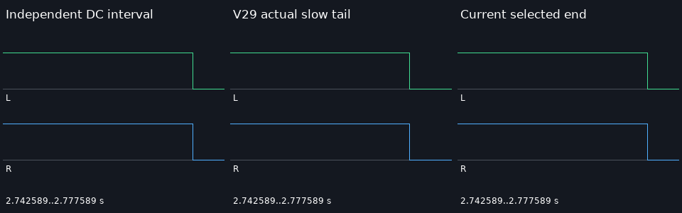

# 分段音频上下文与完整尾部实测

| 项目 | 内容 |
|---|---|
| 文档编号 | VALIDATION-TEMPO-CONTEXT-2026-10-17 |
| 状态 | 有效 |
| 日期 | 2026-10-17，Asia/Taipei |
| 固定旧版 | `d7acaa2933be8d8d6ac77fa54b0f9a1d9982cdf4`（V29），真实本地解包执行 |
| 环境 | 原生 Windows / Python / FFmpeg 8.1；无 GUI、Docker、WSL、云请求或新模型推理 |
| 契约 | [分段音频变速上下文](../specs/分段音频变速上下文契约_v0.1_2026-10-17.md) |

本轮 V30：默认分段 atempo 使用作者选区内的 float32 上下文，末段从实际伸缩结果取尾；超过 64 MiB 估算末端 PCM 时在规划阶段拒绝。完整 **618/618，1529.147 秒**，0 跳过，107 Python+1 Schema 共 108 文件原字节冻结；12 新增及 94 关联方法均为完整子集。固定 V29 同测 12 项为 6 失败/6 控制。11 组、88 次正式 CLI 全成功；396 新视频帧与旧版像素一致。1,584,000 新立体声采样帧检查长度/有限性及各自声明的内容条件；六组 DC 完整有效区间均通过，T01 检查区零采样帧 82→0。S01 资源拒绝另计 6 次 CLI；开发尾部缺样和错误参考预览保留。未连续播放或听审，通用音高/相位/瞬态、极短输入、自然声音及完整剪映等价仍未验收。

## 1. 改动与实际验收范围

V29 的短段 atempo 每次重建原生 WSOLA 状态，按名义比例裁切后补齐，可能在本应有声的 DC 区间插入静音。V30 先转 48 kHz float32 并裁出作者选区，再为每个分段读取该选区内的前后上下文；非单位末段取实际伸缩输出的最后 N 个采样，而不是假设原生输出长度严格等于输入/tempo。累计积分边界、父级布局、作者倒放顺序、分层总线和显式离线 R3 路线保留。

末端通过 `areverse→atrim→areverse` 读取实际信号，不复制尾采样、不循环素材、不从作者选区之外借声音。原生输出仍不足时，现有 `apad` 补静音继续存在；该机制不是任意输入的修复证明。64 MiB 是单份末端 float32 PCM 的规划估算阈值，不是总 RAM 上限、严格原生输出界或长片性能验收。

本轮关闭的是下列受控音频条件。完整回归、CLI 成功、全量采样有限和音高/相位/听感是不同证据；不能把前几项推导为最后一项通过。

## 2. 11 组真实成片与原输入

原视频为程序生成的移动条/帧码，320×160、12 fps、3 秒/36 帧，无声。七个原 WAV 均为 2 秒、48 kHz、立体声 PCM16：DC=10000/32768；selection 只有 [0.5,1.5) 秒保持 DC，外侧为强信号；gap 含作者静音；antiphase 为左右反相 400 Hz；left_only 的右声道为零；stereo 为 400/800 Hz；tail_marker 最后 0.1 秒从 10000 变成 25000。它们是自制 CC0 测试素材，0 新模型推理。T01 的 DC WAV 与 V29 诊断输入逐字节一致。

[原视频](../assets/audio-tempo-context-20261017/source.mp4) · [DC 原声](../assets/audio-tempo-context-20261017/dc.wav) · [选区原声](../assets/audio-tempo-context-20261017/selection.wav) · [静音区原声](../assets/audio-tempo-context-20261017/gap.wav) · [反相原声](../assets/audio-tempo-context-20261017/antiphase.wav) · [左单通道](../assets/audio-tempo-context-20261017/left_only.wav) · [双音原声](../assets/audio-tempo-context-20261017/stereo.wav) · [尾部标记原声](../assets/audio-tempo-context-20261017/tail_marker.wav) · [来源、生成器和许可](../assets/audio-tempo-context-20261017/fixture-provenance.json)。预览使用 DejaVu 字体，字体文件不分发，[字体许可](../assets/audio-tempo-context-20261017/font-license.txt)与摘要保留。

每组新旧结果均经正式 `render --publish` 生成。验收成片为 lossless H.264 4:4:4 + pcm_f32le MKV；WAV 是该成片的独立解码结果。AAC MP4 仅供播放，不能代替无损 PCM 做精度判定。每组 3 秒/144,000 立体声采样帧和 36 视频帧；作者有声段之后保留明确留白。

| 编号 | 细化功能 | 固定 V29 实际结果 | V30 实际结果 | 实际文件 |
|---|---|---|---|---|
| T01 | 嵌套 1→2 曲线 DC | 有效区最大差 0.3051757812；零采样帧 124 | 最大差 0.0002341866493≤0.001；有效区零采样帧 0 | [旧 MKV](../assets/audio-tempo-context-20261017/T01-before.mkv) · [新 MKV](../assets/audio-tempo-context-20261017/T01-after.mkv) · [MP4](../assets/audio-tempo-context-20261017/T01-after.mp4) · [WAV](../assets/audio-tempo-context-20261017/T01-after.wav) · [数据](../assets/audio-tempo-context-20261017/T01-verification.json) |
| T02 | 倒放曲线 DC | 有效区最大差 0.3051757812；零采样帧 124 | 最大差 0.0002341866493≤0.001；有效区零采样帧 0 | [旧 MKV](../assets/audio-tempo-context-20261017/T02-before.mkv) · [新 MKV](../assets/audio-tempo-context-20261017/T02-after.mkv) · [MP4](../assets/audio-tempo-context-20261017/T02-after.mp4) · [WAV](../assets/audio-tempo-context-20261017/T02-after.wav) · [数据](../assets/audio-tempo-context-20261017/T02-verification.json) |
| T03 | 直接曲线 DC | 有效区最大差 0.3051757812；零采样帧 124 | 最大差 0.0002341866493≤0.001；有效区零采样帧 0 | [旧 MKV](../assets/audio-tempo-context-20261017/T03-before.mkv) · [新 MKV](../assets/audio-tempo-context-20261017/T03-after.mkv) · [MP4](../assets/audio-tempo-context-20261017/T03-after.mp4) · [WAV](../assets/audio-tempo-context-20261017/T03-after.wav) · [数据](../assets/audio-tempo-context-20261017/T03-verification.json) |
| T04 | 嵌套标量 2 倍速正控制 | 有效区最大差 0.000244140625；零采样帧 0 | 最大差 0.000244140625≤0.001；有效区零采样帧 0 | [旧 MKV](../assets/audio-tempo-context-20261017/T04-before.mkv) · [新 MKV](../assets/audio-tempo-context-20261017/T04-after.mkv) · [MP4](../assets/audio-tempo-context-20261017/T04-after.mp4) · [WAV](../assets/audio-tempo-context-20261017/T04-after.wav) · [数据](../assets/audio-tempo-context-20261017/T04-verification.json) |
| T05 | 0.5→1 慢速 DC | 有效区最大差 0.3051757812；零采样帧 5683 | 最大差 0.0002341866493≤0.001；有效区零采样帧 0 | [旧 MKV](../assets/audio-tempo-context-20261017/T05-before.mkv) · [新 MKV](../assets/audio-tempo-context-20261017/T05-after.mkv) · [MP4](../assets/audio-tempo-context-20261017/T05-after.mp4) · [WAV](../assets/audio-tempo-context-20261017/T05-after.wav) · [数据](../assets/audio-tempo-context-20261017/T05-verification.json) |
| T06 | 只读选区，外部强信号不进入上下文 | 有效区最大差 0.3051757812；零采样帧 82 | 最大差 0.0002341866493≤0.001；有效区零采样帧 0 | [旧 MKV](../assets/audio-tempo-context-20261017/T06-before.mkv) · [新 MKV](../assets/audio-tempo-context-20261017/T06-after.mkv) · [MP4](../assets/audio-tempo-context-20261017/T06-after.mp4) · [WAV](../assets/audio-tempo-context-20261017/T06-after.wav) · [数据](../assets/audio-tempo-context-20261017/T06-verification.json) |
| T07 | 作者静音区间保留 | 静音内部峰值 0，控制通过 | 静音内部峰值 0；有声区保留 | [旧 MKV](../assets/audio-tempo-context-20261017/T07-before.mkv) · [新 MKV](../assets/audio-tempo-context-20261017/T07-after.mkv) · [MP4](../assets/audio-tempo-context-20261017/T07-after.mp4) · [WAV](../assets/audio-tempo-context-20261017/T07-after.wav) · [数据](../assets/audio-tempo-context-20261017/T07-verification.json) |
| T08 | 反相立体声精确相消 | max abs(L+R)=0，控制通过 | max abs(L+R)=0；有声区峰值非零，未验一般相位 | [旧 MKV](../assets/audio-tempo-context-20261017/T08-before.mkv) · [新 MKV](../assets/audio-tempo-context-20261017/T08-after.mkv) · [MP4](../assets/audio-tempo-context-20261017/T08-after.mp4) · [WAV](../assets/audio-tempo-context-20261017/T08-after.wav) · [数据](../assets/audio-tempo-context-20261017/T08-verification.json) |
| T09 | 右声道静音、左声道有声 | 右峰值 0，控制通过 | 右峰值 0；左有声，未验一般音高 | [旧 MKV](../assets/audio-tempo-context-20261017/T09-before.mkv) · [新 MKV](../assets/audio-tempo-context-20261017/T09-after.mkv) · [MP4](../assets/audio-tempo-context-20261017/T09-after.mp4) · [WAV](../assets/audio-tempo-context-20261017/T09-after.wav) · [数据](../assets/audio-tempo-context-20261017/T09-verification.json) |
| T10 | 单位速度每个原采样恒等 | 全原采样误差 0，控制通过 | 全原采样及尾部静音误差 0 | [旧 MKV](../assets/audio-tempo-context-20261017/T10-before.mkv) · [新 MKV](../assets/audio-tempo-context-20261017/T10-after.mkv) · [MP4](../assets/audio-tempo-context-20261017/T10-after.mp4) · [WAV](../assets/audio-tempo-context-20261017/T10-after.wav) · [数据](../assets/audio-tempo-context-20261017/T10-verification.json) |
| T11 | 慢速末尾真实源标记与作者留白 | 最后 512 采样帧最大差 0.7629394531，失败 | 最后 512 采样帧误差 0；作者尾部静音峰值 0 | [旧 MKV](../assets/audio-tempo-context-20261017/T11-before.mkv) · [新 MKV](../assets/audio-tempo-context-20261017/T11-after.mkv) · [MP4](../assets/audio-tempo-context-20261017/T11-after.mp4) · [WAV](../assets/audio-tempo-context-20261017/T11-after.wav) · [数据](../assets/audio-tempo-context-20261017/T11-verification.json) |

新旧各 1,584,000 个立体声采样帧（各 3,168,000 个通道数值）解码并检查长度、有限性和本例声明的条件；新旧各 396 视频帧逐像素比较，完全相同。**这不是全部音频数值与独立高质量变速参考逐采样相等。** DC 六例检查完整有效区间；T07 仅检查静音内部及保留有声区，T08 仅精确相消与有声，T09 仅声道保留，T10 检查每个单位速度原采样及尾静音，T11 检查独立 DC 主体、最后 512 帧标记和作者留白。

T01 的 [0.2,1.0) 秒内零采样帧 **82→0**，最长连续零段 53→0，DC 最大绝对偏差 **0.30517578125→0.00023418664932250977**，阈值 0.001。完整有效区间的零采样帧 **124→0**。T02 旧版中间检查区本来通过，但完整有效区间仍有 124 个零帧，因此不能以中间区通过冒充整段通过。六个新版 DC 完整有效区间均无零帧，最大偏差≤0.000244140625；单位速度与恒定 2 倍速是正控制。

按声明的内部/专项门槛，固定旧版 5 组失败、6 组控制通过，新版 11 组通过；若看 DC 完整有效区间，旧版 T02 另有失败，统计口径不能混写。T08/T09 新版各有 1108 个字面零采样帧，其最长仅 1 帧，来自正弦波的自然过零；T10 也有自然过零，T07 含作者静音，均不能把所有数值零当作缺样。

11 次质量 CLI 与 11 次策略审计全部通过，作者工程与 Rights Ledger 在渲染前后保持一致。S01 另用 **6 次 CLI** 构造曲线嵌套慢速的大末端上下文；退出码依次为 0/0/0/0/**2**/0，结构化错误 `AUDIO_TEMPO_CONTEXT_LIMIT` 按预期在规划期阻断，未生成输出，作者/台账未变。[S01 原始记录](../assets/audio-tempo-context-20261017/S01-budget-verification.json)。它是预期资源拒绝，不是正式成片失败，也不是内存性能基准。

[全部 88 次正式 CLI 与逐例数据](../assets/audio-tempo-context-20261017/verification.json)、[第二次独立解码/原字节冻结/开发记录](evidence/tempo-context-20261017.json)。

## 3. GIF、原片、波形与实际检查方式

[三列预览 MP4](../assets/audio-tempo-context-20261017/comparison.mp4)：960×544、12 fps、36 帧/3 秒，无声。GIF 同尺寸，18 编码帧、3000 ms，每三帧时长 170/160/170 ms。三列为原始输入 / 固定 V29 真实解码 / V30 真实解码；L/R 分开显示。全区间显示 0..3 秒，下方 60 ms 放大窗 [0.31315625,0.37315625) 秒依据旧版最长零段选定。虚线只是独立 DC 幅度导线，原视频三列不宣称独立渲染参考。

静态尾部图左列是独立计算的 DC 有效区间及其后留白，中/右是真实成片解码。实际目检当前 GIF 对应的首图、末图和此尾图，并核对 L/R、标签、零段与参考位置；完整帧数、时长及 PCM 由自动流程核对。**未连续播放或听审**，图示平滑不能证明听感、瞬态或相位连续。首/末截图：[首图](../assets/audio-tempo-context-20261017/comparison-first.png)、[末图](../assets/audio-tempo-context-20261017/comparison-last.png)。有声原 WAV 与新旧 MKV/MP4 在上表提供。

## 4. 真实失败、开发对照与复现边界

只有上下文、没有实际末端截取的开发版曾通过内部区间，却在 T05 慢速尾部留下 **85** 个零采样帧、T06 裁切尾部留下 **26** 个零采样帧；这两组实际失败 PCM/视频与 108 份当时源码/测试/Schema 保留。修正末端后当前两组完整有效区间均为 0 缺样。

[失败慢速 MKV](../assets/audio-tempo-context-20261017/development-context-only-T05.mkv) · [失败慢速 WAV](../assets/audio-tempo-context-20261017/development-context-only-T05.wav) · [失败裁切 MKV](../assets/audio-tempo-context-20261017/development-context-only-T06.mkv) · [失败裁切 WAV](../assets/audio-tempo-context-20261017/development-context-only-T06.wav) · [当时源码 ZIP](../assets/audio-tempo-context-20261017/development-context-only-source.zip) · [开发数据](../assets/audio-tempo-context-20261017/development-verification.json)。开发 10 组/80 CLI 不加进最终 11 组/88 CLI。

初次最终预览的独立尾部参考列，把已经为秒的 duration 又除了一次工程时基，画成几乎全零；实际旧/新 PCM、视频和门槛数据不受该绘图错误影响。[错误参考截图](../assets/audio-tempo-context-20261017/development-preview-invalid-reference.png)仅作为失败记录，不能当有效参考。修正单位后重跑完整 11 组/88 正式+6 补充 CLI；两批全部 11 组 PCM 指标及新旧视频摘要逐一一致，当前公开 GIF/尾图来自修正后批次，重跑次数不叠加为覆盖量。

首次正式生成还因未显式设置容器 timeline_start_tick，容器被追加到背景之后，render 返回 `PROJECT_INVALID`、退出码 **7**，cause 内为 `CLIP_OUTSIDE_SEQUENCE`；其 5 次 CLI（0/0/0/0/7）和实际失败已保留，修正起点为 0 后重跑。最早一轮完整回归在末端修复前主动终止，没有 Ran 汇总，不计完整通过。终止仅限核对过的本轮测试子进程，不涉及用户模型/服务。曾用标量纯嵌套做预算夹具，因正确走恒速路径并未触发上下文限制，随后换成外层曲线夹具；夹具失配不记成产品预算实现回归。

连续 tempo 指令探针减少了中间零段，但其 DC 输出比积分目标少 1532 个采样帧，未接入产品。不同上下文长度及极慢末端探针都作为开发研究保存，不混入正式数量。原始日志、探针 JSON、生成/核验助手原文及 SHA-256 均见[汇总证据](evidence/tempo-context-20261017.json)。

## 5. 完整回归、冻结与本轮数量

| 范围 | 实际结果 | 计数边界 |
|---|---|---|
| 最终完整产品 | 618/618，1529.147 秒，0 跳过；107 Python+1 Schema 共 108 文件前后原字节一致 | 耗时不是独立性能基准 |
| 新增 12 方法 | 12/12，27.585 秒；相同最终冻结源码 | 属于 618 子集，不累加 |
| 固定 V29 同 12 方法 | 6 失败/6 控制，27.397 秒；6 failure records | 其中包含规划资源拒绝，不等于媒体的 5 失败/6 控制 |
| 94 关联方法 | 开发版 94/94，328.976 秒；同名 94 方法在最终完整套件再次通过 | 开发源码不同，原摘要保留，不冒充最终独立专项执行 |
| 预算单例 | 1/1，1.722 秒，最终源码 | 也是完整 618 的子集 |
| 最终正式媒体 | 11 组/88 CLI：11 init、22 ingest、11 compose、22 render、11 quality、11 policy；全成功 | 396 新主帧/1,584,000 新立体声采样帧；旧版同量另计 |
| S01 预算拒绝 | 6 CLI；第 5 步按预期退出 2，其他退出 0 | 与 88 正式 CLI 分计，0 成片 |
| 开发/历史 | 尾部缺样、错误参考和不完整回归全部保留 | 不与最终次数/覆盖量累加 |
| Skill | 14 项格式、联接和本地引用有效 | 不是语义任务/画质验收 |

[完整原始日志](evidence/tempo-context-full-20261017.log) · [新增方法](evidence/tempo-context-new-methods-20261017.log) · [固定 V29 失败](evidence/tempo-context-fixed-v29-before-20261017.log) · [正式 CLI 日志](evidence/tempo-context-media-20261017.log) · [14 Skill 审计](evidence/skills-audit-tempo-context-20261017.json) · [文档审计](evidence/docs-audit-tempo-context-20261017.json)。

正式生成脚本：[scripts/smoke_audio_tempo_context.py](../../scripts/smoke_audio_tempo_context.py)。使用有 NumPy/Pillow 的原生 Python、PATH 中的 FFmpeg/ffprobe 和显式本地字体/许可；要求工作目录与输出目录为尚不存在的新路径，并能由当前 Git 读取固定 V29。示例参数 `--output <新演示路径> --work <新临时路径> --font <本地字体.ttf> --font-license <本地许可文件>`。新机器需自行准备运行时，项目不捆绑外部二进制。执行命令、原字节 SHA 和完整助手原文在机器证据内，不暗示无依赖一键运行。

## 6. 仍未验收

当前仍分段重启 WSOLA，`audio_speed_curve_piecewise` 告警保留；实际局部瞬态的采样定位、连续相位、自然语音/音乐音高与听感、极短默认输入、3..8 声道、长片总内存与性能均未接受。既有 R3 8 组极短音高失败与 1 组 apart 反相混合失败未被本轮关闭。命名 send/return、空间音频、通用效果自动化、独立子画布、嵌套 freeze/VFR、HDR、自然 AI 特效质量及完整剪映功能/效果等价继续开放。
