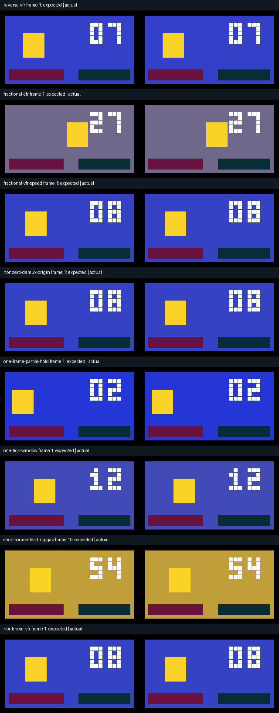

# 原生 VFR 倒放帧区间原型实测

<!-- V82-HISTORICAL-BOUNDARY -->
本文保留旧原型的证据与限制；本轮候选与对应源码见[分块倒放实测](原生分块倒放与离线缓存实测_2026-10-21.md)。不同源码指纹的计数不合并。
<!-- /V82-HISTORICAL-BOUNDARY -->

日期：2026-10-21。状态：**独立原型专项通过，未合并或推送 main，未运行本原型完整回归**。这是在 V81 候选源码的原生副本中继续处理的倒放缺口，不能回写为主线已发布功能，也不能作为全部剪映等价结论。

## 本次修复

FFmpeg 的 `reverse` 会反转帧内容，但不能直接把不等长 VFR 显示区间的原顺序 PTS 当作倒序时钟。本原型流式读取原始帧索引，对裁切后的显示区间进行镜像，再在全局 CFR 网格取样；保留常速、非线性速度曲线、非整帧源入/出点和容器非零起点。

扩展测试还暴露了另一处问题：片段超出序列窗口时，原映射从源入点选择子区间，导致倒放选中其他帧。现按原叶片段的倒放方向从源出点取区间，再应用父级方向。这个修改已通过相邻的 73 项嵌套回归。

为限制当前整段 FFmpeg 倒放缓冲，新增共享 **256 MiB** 的保守解码栅格估算。时间不重叠的实例和子图也累计，超限在编码前明确拒绝。这不是进程 RSS 上限，也不等于完成了长片缓存或高分辨率性能优化。详见[原型契约](../specs/原生倒放帧区间与缓冲配额契约_原型_2026-10-21.md)。

## 证据与计数

| 编号 | 核验项目 | 实际结果 | 原始记录 |
|---|---|---|---|
| RVT-01 | 新增倒放与缓冲专项 | 13 个方法，19.702 秒，0 跳过 | [JSON](./evidence/vfr-reverse-20261021-lab/targeted-with-budget-r1.json) / [日志](./evidence/vfr-reverse-20261021-lab/targeted-with-budget-r1.log) |
| RVT-02 | 相邻嵌套序列回归 | 73 个方法，157.908 秒，0 跳过 | [JSON](./evidence/vfr-reverse-20261021-lab/existing-nested-r2.json) / [日志](./evidence/vfr-reverse-20261021-lab/existing-nested-r2.log) |
| RVT-03 | 相邻有理数视频时钟回归 | 14 个方法，14.130 秒，0 跳过 | [JSON](./evidence/vfr-reverse-20261021-lab/existing-clock-r2.json) / [日志](./evidence/vfr-reverse-20261021-lab/existing-clock-r2.log) |
| RVT-04 | 公开原生 CLI 成片 | 42 次 CLI 调用、69 项检查、8 组各 45 帧；每帧独立 RGB 最大误差均为 0，alpha 全字节一致 | [核验](./evidence/vfr-reverse-20261021-lab/native-r3/verification.json) |
| RVT-05 | 时间戳与配乐 | 每组 NUT 与 MP4 的所有视频 PTS 符合 30000/1001 网格；独立正向配乐完整 72,000 帧立体声 PCM 精确 | 同 RVT-04；这不是倒放音频联合验收 |
| RVT-06 | 跨项目重建 | 项目包导出、异根导入、重建无损画面与独立配乐字节相同 | RVT-04 的 `package-isolated-root-rebuild-equal` |
| RVT-07 | 离线发行 | 158 个源码/wheel/安装资源字节相同，7 个现有 wheels；45 次 `-I -S` 隔离 CLI＋1 次模块来源探针，8 组解码结果与开发版相同 | [安装核验](./evidence/vfr-reverse-20261021-lab/installed-r1/verification.json) / [安装成片核验](./evidence/vfr-reverse-20261021-lab/installed-r1/media/verification.json) |
| RVT-08 | 证据审计 | 100 个去重方法 ID，245 个核心输入在各当前通过批次前后保持一致，127 项证据/媒体/GIF 检查通过 | [审计](./evidence/vfr-reverse-20261021-lab/prototype-audit-r1.json) |

13＋73＋14＝**100 个不同的专项/相邻回归方法**，已从原始日志核对完整方法 ID，没有把 CLI 调用、逐帧检查或失败重跑叠加为测试方法数。原型完整回归尚未执行。另一目录中的 V81 全量 r2 正在验证其自身 242 个冻结输入，不能用于接受本原型新增代码。

本副本的基础 `test_cli.py` 仍为 V81 首轮旧断言版本；V81 候选后来只修正了一个图文本断言。未来合并必须对齐该单一测试差异并重新冻结最终源码，不能直接拿本副本 245 个哈希声明为新提交的精确输入。

## 原始视频、成片与 GIF

原始来源是本地原创、CC0-1.0 的索引几何 RGBA 帧和合成立体声正弦 PCM，包含透明区域和每帧可读编号，没有第三方素材或模型。VFR 的实际源 PTS 为 0、33、101、188、195、441、499、800、1002、1221、1600、1800 毫秒，数值参考使用实际探测结果。

- [CFR 原视频](../assets/vfr-reverse-20261021-lab/native-r3/source-cfr.nut) / [MP4 观看副本](../assets/vfr-reverse-20261021-lab/native-r3/source-cfr-preview.mp4)
- [VFR 原视频](../assets/vfr-reverse-20261021-lab/native-r3/source-vfr.nut) / [MP4 观看副本](../assets/vfr-reverse-20261021-lab/native-r3/source-vfr-preview.mp4)
- [视频 2.2 秒、静音音频 3 秒的真实短视频流素材](../assets/vfr-reverse-20261021-lab/native-r3/source-short-video-long-audio.mkv)
- [独立配乐原 WAV](../assets/vfr-reverse-20261021-lab/native-r3/independent-soundtrack.wav) / [逐文件 SHA 与大小](../assets/vfr-reverse-20261021-lab/native-r3/files.json) / [素材许可证](../assets/vfr-reverse-20261021-lab/native-r3/LICENSE.txt)

| 编号 | 实际场景 | 成片 | GIF |
|---|---|---|---|
| RVM-01 | 不等长 VFR 帧显示区间倒序 | [MP4](../assets/vfr-reverse-20261021-lab/native-r3/reverse-vfr.mp4) | [GIF](../assets/vfr-reverse-20261021-lab/native-r3/reverse-vfr.gif) |
| RVM-02 | CFR 的 0.113～1.113 秒非整帧源裁切 | [MP4](../assets/vfr-reverse-20261021-lab/native-r3/fractional-cfr.mp4) | [GIF](../assets/vfr-reverse-20261021-lab/native-r3/fractional-cfr.gif) |
| RVM-03 | VFR 非整帧裁切＋1.5 倍速 | [MP4](../assets/vfr-reverse-20261021-lab/native-r3/fractional-vfr-speed.mp4) | [GIF](../assets/vfr-reverse-20261021-lab/native-r3/fractional-vfr-speed.gif) |
| RVM-04 | 非零容器起始时间 | [MP4](../assets/vfr-reverse-20261021-lab/native-r3/nonzero-demux-origin.mp4) | [GIF](../assets/vfr-reverse-20261021-lab/native-r3/nonzero-demux-origin.gif) |
| RVM-05 | 裁切完全位于一张 VFR 帧的显示区间中 | [MP4](../assets/vfr-reverse-20261021-lab/native-r3/one-frame-partial-hold.mp4) | [GIF](../assets/vfr-reverse-20261021-lab/native-r3/one-frame-partial-hold.gif) |
| RVM-06 | 1 个作者 tick 的源/输出窗口 | [MP4](../assets/vfr-reverse-20261021-lab/native-r3/one-tick-window.mp4) | [GIF](../assets/vfr-reverse-20261021-lab/native-r3/one-tick-window.gif) |
| RVM-07 | 真正短视频流在倒放时保留前导空白，公开窗口裁切 | [MP4](../assets/vfr-reverse-20261021-lab/native-r3/short-source-leading-gap.mp4) | [GIF](../assets/vfr-reverse-20261021-lab/native-r3/short-source-leading-gap.gif) |
| RVM-08 | VFR＋非整帧源裁切＋0.5→1.5 非线性变速 | [MP4](../assets/vfr-reverse-20261021-lab/native-r3/nonlinear-vfr.mp4) | [GIF](../assets/vfr-reverse-20261021-lab/native-r3/nonlinear-vfr.gif) |

数值检查每组全部 45 帧和全部像素。已人工静看上面的 8 行 PNG；没有连续审片、听审或自然素材审美验收。GIF 可能合并相同帧，每份总时长 1500 毫秒，不能以 GIF 帧数代替 45 帧的无损检查。CFR 视频 45 帧的显示总长为 1.5015 秒，配乐/作者区间为 1.5 秒，所有 PTS 单独核对。

## 保留的失败与限制

| 编号 | 原始发现 | 处理与记录 |
|---|---|---|
| RVF-01 | 未修复实现的 3 项倒放区间测试均失败 | [baseline JSON](./evidence/vfr-reverse-20261021-lab/targeted-baseline-r1.json) / [日志](./evidence/vfr-reverse-20261021-lab/targeted-baseline-r1.log)；不是通过记录 |
| RVF-02 | 扩展 9 项中短源裁切失败，选错倒放源区间 | [extended r1](./evidence/vfr-reverse-20261021-lab/targeted-extended-r1.json) / [原日志](./evidence/vfr-reverse-20261021-lab/targeted-extended-r1.log) / [原 render 快照](./evidence/vfr-reverse-20261021-lab/extended-failure-r1-render.py.txt) / [实际像素与图](./evidence/vfr-reverse-20261021-lab/gap-debug-r1.json)；修复后 9 项及新增配额测试通过 |
| RVF-03 | 首轮相邻回归缺少显式 Rubber Band 原生路径，73 项中跳过 1 项 | [r1](./evidence/vfr-reverse-20261021-lab/existing-nested-r1.json) / [日志](./evidence/vfr-reverse-20261021-lab/existing-nested-r1.log)；补路径后 r2 为 73/73、0 跳过 |
| RVF-04 | 首轮 CLI 夹具未声明缩短序列时允许裁切 | [native r1](./evidence/vfr-reverse-20261021-lab/native-r1/verification.json)；在第 7 个场景被公开接口拒绝，前 6 组不是全批通过 |
| RVF-05 | 第二轮 CLI 夹具请求源出点超过素材总长度 | [native r2](./evidence/vfr-reverse-20261021-lab/native-r2/verification.json)；保留验证器，改用真实视频流短于音频流的合法素材，r3 全批通过 |
| RVF-06 | 整段倒放仍需缓冲所选解码帧 | 已加共享预算和明确拒绝；分块缓存、长片、高分辨率效率与实时预览未完成 |

本次不接受一般 VFR 嵌套倒放、倒放音频与视频时钟逐采样联合等价、HDR/线性光、自然视频质量、跨平台、全部剪映效果与完整产品等价。没有使用线上模型或新增推理。没有进行分段/模板库转移专项，本次只接受已实际运行的项目包重建。

可重放脚本为 `scripts/smoke_reverse_video_clock.py`、`scripts/verify_reverse_video_clock_install.py` 和 `scripts/record_reverse_prototype.py`。各批次保留实际执行的脚本、命令、stdout/stderr、冻结输入、媒体清单和真实渲染 manifest；当前 4 个修改/新增核心文件另存于[源码快照索引](./evidence/vfr-reverse-20261021-lab/prototype-audit-r1.json)。
