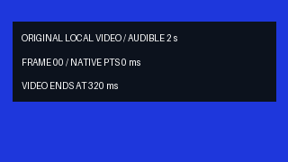
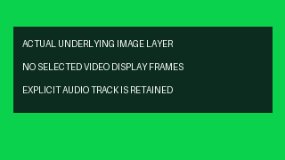

# 原生空视频选区与显式音频保留实测（2026-10-21）

完整原生回归 **1973 项、3623.367 秒、0 跳过**；256 产品输入与 8 外部夹具不变（本轮限定验收）。293 项专项、媒体与隔离安装保留运行时完全相同的原执行；仅继承父版测试断言后新跑 4 项旧 CLI 控制，未将历史记录标为重跑。

| 编号 | 实际功能核验 | 结果与边界 | 证据 |
|---|---|---|---|
| V85-01 | 有效空视频选区 | 新增 16 项；首帧前或实际视频 EOF 后，普通倒放、嵌套正/倒放保留下层画面，未知末帧 duration 仍拒绝。原 8 项复现由 2 通过/6 错误修复为同一断言 8 项通过 | [16 项](evidence/native-empty-window-20261021-lab/after-r3.json) · [修复前](evidence/native-empty-window-20261021-lab/before-r2.json) · [相同断言修复后](evidence/native-empty-window-20261021-lab/after-r1.json) |
| V85-02 | 相邻回归 | 原执行 37＋50＋63＋22＋105＋16＝293 个不同方法、0 跳过；继承父版测试断言后另新跑 4 项既有 CLI 控制，运行时资源不变，16 项包含于 293 与完整回归，不累加历史结果 | [相邻回归](evidence/native-empty-window-20261021-lab/related-r2.json) |
| V85-03 | 公开 CLI 与逐帧输出 | 17 CLI＋18 原生命令，23 检查；两段 320×180 成片各 45 帧/30000÷1001 fps，无损预览 RGBA 各 10,368,000 字节与独立下层 PNG 全帧相同 | [实测](evidence/native-empty-window-20261021-lab/native-r2/verification.json) · [原始尾段源](../assets/native-empty-window-20261021-lab/native-r2/source-audio-tail.mkv) · [原始延迟源](../assets/native-empty-window-20261021-lab/native-r2/source-delayed-video.mkv) |
| V85-04 | 显式音频轨 | 单位变速六组专项及两段公开 CLI 无损预览保留实际声音；每段完整 72,000 每声道/立体声 float PCM、576,000 字节，与独立源解码、裁切、采样对倒序及放置参考一致 | [音频专项](evidence/native-empty-window-20261021-lab/after-r3.json) · [原生实测](evidence/native-empty-window-20261021-lab/native-r2/verification.json) |
| V85-05 | 索引与离线发行 | 161 资源源码/wheel/site 一致、7 现有依赖 wheels；20 隔离 CLI＋1 来源进程/11 模块。索引首次扫描 1 次、命中 0 次；故意破坏索引 exit 6 且不产生成片 | [隔离安装](evidence/native-empty-window-20261021-lab/installed-r1/verification.json) · [明确拒绝](evidence/native-empty-window-20261021-lab/native-r2/corrupt-index-empty-window-rejected.stdout.log) |
| V85-06 | 完整回归与发布基线 | 完整原生回归 **1973 项、3623.367 秒、0 跳过**；256 产品输入与 8 外部夹具不变（本轮限定验收）。293 项专项、媒体与隔离安装保留运行时完全相同的原执行；仅继承父版测试断言后新跑 4 项旧 CLI 控制，未将历史记录标为重跑；绑定已发布 V84 的 255 输入，唯一运行时修改为原生帧区间选择模块，另加测试 | [完整收据](evidence/native-empty-window-20261021-lab/full-r1.json) · [发布基线](evidence/native-empty-window-20261021-lab/published-nested-alignment-r1.json) |
| V85-07 | 保留失败 | 最初空参考项目、漏建音频轨、缺失外部夹具和重复 ID 的请求均保留；缺夹具时套件未启动，补齐准确 8 个已提交文件后完成 293 项 | [历史实测](空视频选区与显式音频保留独立实验_2026-10-21.md) · [夹具恢复](evidence/native-empty-window-20261021-lab/fixture-recovery-r1.json) |
| V85-08 | 尚未验收 | 零选中帧预算不等于零解码或进程 RSS；源图仍可解码前缀。一般嵌套效果、自然/HDR、非单位变速声音品质、长片延迟与完整剪映功能/效果等价未验收 | [契约与边界](../specs/原生视频空区间契约_v0.1_2026-10-21.md) |

| 原始八帧内容 | 实际普通倒放空尾段 | 实际嵌套正放空前段 |
|---|---|---|
|  |  |  |

输入 GIF 为原始 8 帧/320 ms；MKV 保留完整 2 秒声音与真实视频起止时钟。两个输出 GIF 从实际 MP4 的全部 45 帧解码，因下层图像相同而合为 1 帧/1500 ms；实际视频为 30000/1001 fps，作者总时长 1.5 秒，最后视频显示边界可至 1.5015 秒。GIF 为无声 10 ms 时间网格观看副本。

[实际倒放 MP4](../assets/native-empty-window-20261021-lab/native-r2/direct-reverse-tail.mp4) · [实际嵌套正放 MP4](../assets/native-empty-window-20261021-lab/native-r2/nested-forward-prefix.mp4) · [静态抽帧记录](evidence/native-empty-window-20261021-lab/frame-review-r1.json)。已查看两个实际抽帧，未连续播放、未听音；完整 PCM 相等为无损预览检查，不代表 MP4/AAC 逐字节音频相等。

原创源为 8 帧 25 Hz FFV1/BGRA，视频范围 [0,0.32) 秒，两个实际正弦声道共 2 秒；延迟变体将视频 PTS 平移 1 秒，声音仍始于 0。分别选取 [1,1.5) 与 [0,0.5) 秒时，源范围有效但不含视频帧。现在返回显式空视频范围，保留下层图像，不补黑或克隆尾帧；显示时钟端点为 null，倒放栅格预算为零。未知末帧 duration、损坏索引或探测失败仍拒绝。

视频轨不隐式提取声音，需显式音频轨。专项及公开 CLI 以真实根级/子级音频轨验证；参考独立解码源 PCM 后截取 24,000 个每声道采样，倒放按立体声采样对倒序，再放置到作者起点 0.11 秒并保持总长 72,000。完整无损预览 RGBA/PCM 与独立参考相同；MP4/AAC 和 GIF 是有损观看副本，不据此宣称有损输出逐字节相同。

仅修改 `reverse_video_clock.py` 并新增 16 方法测试。293 专项为 1973 完整回归子集。零选中帧不等于无解码，图仍可读取源前缀；索引计数也不含 SHA 文件读取及最终编解码。原 128 GiB 倒放磁盘预约、一般嵌套/自然/HDR、非单位变速声音、长片吞吐和总 RSS 的限制继续有效，完整剪映功能与效果等价尚未实现或验收。

执行脚本为 `scripts/smoke_native_empty_window.py`、`scripts/verify_native_empty_install.py`。所有素材均本地原创生成，CC0 权利记录与源摘要随资产保留。原生 Windows 执行，无 Docker、WSL、容器、虚拟环境、网络依赖下载或模型推理。原失败、冻结源码、执行脚本及文档快照均保留。
