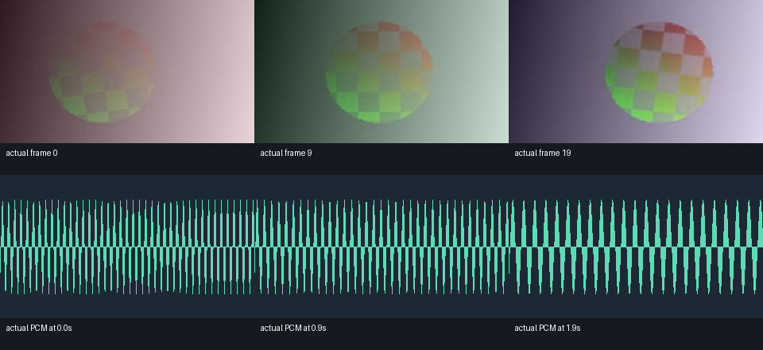

# 原生素材窗口解码与浮点音画合成实测

<!-- FLOAT-CUMULATIVE-DELIVERY-NOTE -->
> 合并交付说明：最终300输入已实际通过完整 **2355方法 /5277.023秒 /0跳过**。 以下保留该候选当时的分项、安装和失败记录；296/298输入早期快照未各自执行2320/2337项完整回归。当前验收以[合并实测](../../docs/validation/原片浮点渲染与预览合并交付实测_2026-10-22.md)及其实际收据为准。
<!-- /FLOAT-CUMULATIVE-DELIVERY-NOTE -->

新增 `float_native_pipe` 和 `float_native_source`：已登记原片按原生时间戳和关键帧解码局部窗口，向现有 Float32 时间线返回独立表面。本次真实成片输入直接使用 RGB16/YCbCr16 原片，**不使用整片 Float32 帧包作为解码输入**。标准 render/preview/queue/cache、全部效果和完整剪映功能效果等价仍未完成。

| 编号 | 实际核验 | 结果与边界 |
|---|---|---|
| V95-01 | 原生管道与来源专项 | 21方法 /59.262842秒 /0失败错误跳过；58次审计原生工具启动、7个实际Python子进程管道收据、13份成功打开来源的关闭收据分别保留 |
| V95-02 | 时钟及16位像素 | 8帧随机RGBA16，VFR、容器起点5秒、独立透明/不透明像素及随机取帧；每个分量精确回读，右边界/原生末帧duration检查通过 |
| V95-03 | B帧与关键帧跳读 | 120帧H.264、24帧GOP、3个B帧配置；远距离随机窗口与独立全片原生YCbCr解码及独立矩阵公式对照。不是长片实时/线性复杂度证明 |
| V95-04 | 有界缓存及所有权 | 两帧预算实际缩小200帧请求；修改返回副本不污染缓存；4×64KiB队列、2×64KiB stderr，实际阻塞/满队列/取消/超时子进程和线程回收通过 |
| V95-05 | 生命周期读锁 | 原片写入、删除和3个持久化索引写入被Windows真实拒绝；独立两源关闭顺序、关闭后允许写入/删除、错误SHA失败释放锁均通过 |
| V95-06 | 隔行与静态图 | 实际隔行MPEG2源拒绝冒充逐行；真实PNG按显式起点重复取帧并返回独立副本。JPEG/yuvj分支未作本轮实片验收 |
| V95-07 | 直接原片音画成片 | 两组各20帧/10FPS/2秒；每个16位分量与既有独立核验参考一致，两组各96000立体声采样帧逐字节一致；2次实际管道编码、86次原生工具启动、16资产/21检查 |
| V95-08 | 实际窗口统计 | 四来源生命周期合计58次窗口解码；每来源最大缓存491520字节=2个160×96 RGBA Float32帧。原片对照在编码后另作一次逐帧参考读取，统计包括该读取；不将缓存字节当峰值RSS或把58当实际codec解码帧数 |
| V95-09 | 全新离线安装 | 实际203方法 /815.381秒 /0跳过；178资源与source/wheel/site相同，931份NumPy文件/许可相同；安装版原片重新解码/编码并比较无损像素及PCM SHA，未复用开发版输出冒充执行 |
| V95-10 | 完整回归 | 已实际发现2320方法；本候选完整回归尚未通过，发现数不代表执行数。完整执行须等待已调度的V94父版发布后串行进行；专项、隔离和父版历史计数不相加 |
| V95-11 | 保留失败 | native-r1实际21方法/60.667秒/1失败：全部RGB16分量先通过，但仅首帧关键帧的FFV1夹具错误要求出现正数seek。r2夹具显式使用-g 1，保留原断言；同时完善异常清理的finally锁释放 |
| V95-12 | 未验收 | 默认CLI/preview/queue/cache、完整作者效果、方向/SAR显示适配、HDR/ICC/PQ/HLG、自然广告与AI质量、连续播放/试听、4K长片RSS和长GOP倒放性能；未宣称完整剪映等价 |

[专项收据](evidence/float-render-20261022-lab/native-r2.json) · [失败原记录](evidence/float-render-20261022-lab/native-r1.json) · [真实媒体](evidence/float-render-20261022-lab/media-r1/verification.json) · [隔离安装](evidence/float-render-20261022-lab/installed-r1/verification.json) · [仅发现](evidence/float-render-20261022-lab/discovery-r1.json) · [契约](../specs/原生素材窗口浮点源_实验_v0.1_2026-10-22.md)。

[原始RGB16](../assets/float-render-20261022-lab/media-r1/inputs/foreground-16bit.mkv) · [原始YCbCr16](../assets/float-render-20261022-lab/media-r1/inputs/background-16bit.mkv) · [原始PCM](../assets/float-render-20261022-lab/media-r1/original-audio.wav) · [原片MKV](../assets/float-render-20261022-lab/media-r1/original-16bit.mkv) · [原片MP4](../assets/float-render-20261022-lab/media-r1/original.mp4) · [剪辑MKV](../assets/float-render-20261022-lab/media-r1/timeline-16bit.mkv) · [剪辑MP4](../assets/float-render-20261022-lab/media-r1/timeline.mp4)。




实际目检MP4的0、9、19帧与对应PCM诊断图；未连续播放，未试听。程序生成原片和新写立体声正弦/扫频音为CC0技术样例，不代表自然广告和AI特效质量。MP4/AAC和GIF为有损预览；无损核验使用FFV1及Float32 PCM。Float32参考文件只作为既有固定SHA像素对照，不是运行内核输入；本次没有新写第二套时间线参考实现。

```powershell
C:/Python313/python.exe -E -B -X utf8 scripts/run_float_native_tests.py --revision <新编号>
C:/Python313/python.exe -E -B -X utf8 scripts/smoke_float_native_media.py --revision <新编号> --source-root <含V93原片与固定参考的仓库根>
C:/Python313/python.exe -E -B -X utf8 scripts/verify_float_native_install.py
```

安装验证使用固定的全新installed-r1目录；再次整套执行须另立目录，保留既有原收据。全程原生Windows、E盘、已有离线依赖，无Docker/WSL、虚拟环境、在线下载或新增交互浏览器tab。
