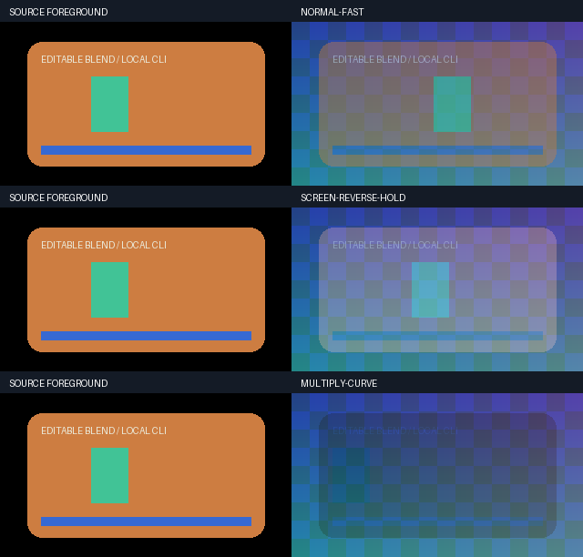

# 外部混合动画变速与静音修复实测（V74）

2026-10-20 **V74（外部混合动画变速限定验收）**：完整输出相对变速现在保留可编辑 `blend.opacity_animation`，支持恒速、既有有界速度曲线、倒放、定格、重复操作和输出窗口；混合仍在原背景上执行，alpha 只乘一次。修复默认 u8 静音进入 tempo 后的 −256 PCM 偏移。完整原生回归 **1667/1667、2517.215 秒、0 跳过、222 冻结输入＋8 外部夹具前后相同**；23 个新增方法是其子集。专项 **23/23、9.975 秒、0 跳过**；原生 **24 CLI/30 检查**，三组各 30 帧独立 RGB 对照最大误差 **0/1/1 个 8 位码值**，输出 alpha 和每组完整 144,000 帧立体声 PCM 精确。离线 **146 资源/7 wheels/27 隔离 CLI＋1 模块来源探针/11 安装检查**；开发/安装解码摘要、作者模型和每帧 PTS 一致。17 Skills / 286 本地引用，发现联接与正文已核对。保留测试输入、旧栅格参考、音频成片失败及中止的 full-r1；静看两张对照 PNG，未连续审片或听审。连续参数与隔离祖先已栅格化帧序有明确边界；HDR、线性光、自然素材、长片性能、全部剪映混合效果与完整等价均未验收。

本轮补齐现有相对变速内核的一个受限缺口，不代表完整剪映目标完成。它是自研增量；OpenFilm 0.2.2 的研究与已移植内容仍见[独立复核](../OpenFilm_0.2.2差异复核与复用取舍_2026-10-20.md)，不将本轮重复计为新的 OpenFilm 移植。所有执行位于 E 盘原生 Windows，没有 Docker、WSL、虚拟环境、联网处理、下载素材或新增模型推理。

| 编号 | 实现 | 验收范围 |
|---|---|---|
| BA01 | 严格 v1 作者点与相对时钟模型 | 4096 点、16 层、1 MiB、有限 0..1 数值和整数 tick；未知字段拒绝；旧顶层曲线优先。 |
| BA02 | 原背景上的原生 alpha 数值命令 | `colorchannelmixer.aa` 仅缩放原 coverage；共享根图 200 万状态、20 万命令、16 MiB 文本和 1024 实例预算。 |
| BA03 | 相对速度/曲线/倒放/定格、关联和窗口 | 保留可编辑作者子序列；非线性曲线由既有有界编译器提供，不将参数插值变成线性。 |
| BA04 | 原生包、片段库、事务、幂等基础设施 | 模型自包含、无临时序列 ID/命令路径；导入后重编译。外部 OTIO/MLT 不执行时钟，明确 Unsupported，嵌套媒体仍可能 Failed。 |
| BA05 | 空总线与插入静音显式浮点 | 在任何祖先 `atempo` 前完成格式转换；无声视觉层变速不改变背景 PCM。 |

三组原生与安装后样片均来自本仓库脚本生成的几何 RGBA 前景、棋盘背景与双音立体声 PCM；CC0 声明也覆盖失败目录。源 NUT 为 21 帧，最后一帧是显式重复端点，原作者半开区间为 20 帧/2 秒。根时间线为 30 帧/3 秒/10 fps，视觉层从 0.5 秒开始。

| 编号 | 场景 | 逐帧独立参照 | 实测 |
|---|---|---|---|
| BV01 | normal、2x、移动前景 | 独立源索引 0、2、…、18；作者强度 0.1→0.9；独立 source-over 算术 | 30 帧全像素最大差 0；alpha 精确。 |
| BV02 | screen、2x、reverse、0.5s 处 hold 0.3s | 独立源索引 19、17、…；hold 保留前一显示帧；反向连续作者强度与独立 screen 算术 | 30 帧最大差 1；alpha 精确。 |
| BV03 | multiply、源域速度 1→3 | 静态几何前景隔离帧选择变量；独立 `exp(t*ln(3)/D)` 积分逆函数与 RGB 相乘 | 30 帧最大差 1；alpha 精确。 |
| BV04 | 三组完整声音与实际 PTS | 3 秒、48 kHz、双声道原 PCM；每帧实际编码时间 | 每组 144,000 立体声样本帧精确；30 个 PTS 均匹配 10 fps。 |
| BV05 | 安装后重演与工程包回读 | `-I -S` 原生 CLI，1 次探针核对 5 个模块来源；开发/安装独立生成来源；导入后重编译 | 146 资源、7 wheels、27 CLI＋1 来源探针、11 安装检查；三组解码、作者模型、PTS 相同。 |

逐帧 RGB 初始阈值为 2 个 8 位码值，未因失败调高；实际最大值为 0/1/1。alpha 与 PCM 使用精确字节比较。无 NumPy 产品依赖。MP4/GIF 是有损预览，算术对照使用 FFV1 RGBA 与未压缩 PCM。顶层强度替代静态 `blend.opacity`，不额外重复相乘。隔离祖先先处理已渲染的子帧：40 帧子序列的 2x 倒放选 39、37、…、1；它与子图连续参数从区间末端求值不同。该区别已单独测试。

失败与修复保留为独立记录：

| 编号 | 原始失败/历史阶段 | 处理与限制 |
|---|---|---|
| BF01 | [targeted-r1](evidence/retime-blend-20261020-v74/targeted-r1.json)：18 方法中 1 失败＋2 错误 | 测试用了全局拆分 tick、关联曲线超出片长，并错误期待嵌套外部导出成功；修正输入，保留原日志。 |
| BF02 | [targeted-r2](evidence/retime-blend-20261020-v74/targeted-r2.json)：22 方法中祖先帧序参照失败 | 隔离子图已栅格化，参照应独立选末帧 39 而非连续时间 4s；未改变像素阈值。 |
| BF03 | [native-r1](evidence/retime-blend-20261020-v74/native-r1/verification.json) 与 [修复前专项](evidence/retime-blend-20261020-v74/targeted-r5-audio-before-fix.json)：无声倒放定格改变背景 PCM | 独立原生探针复现 u8 静音 96,000 样本全部为 −256；显式浮点后全零。修复空总线与插入静音，再按原阈值重跑。 |
| BF04 | [full-r1 中止](evidence/retime-blend-20261020-v74/full-r1-stop.json) | 为修复真实音频故障，仅停止本轮已核身份的测试进程树；原始冻结输入和 8 夹具仍相同。没有完成方法数，不计作完整通过；full-r2 为修复后的独立完整运行。 |
| BF05 | r3/r4、r6、native-r2、installed-r1 等中间通过 | 它们绑定各自冻结阶段，保留历史，不累加为最终方法数。最终源码仅由 r7、native-r3、installed-r2 和完整 full-r2 绑定。 |

最终证据：[旧程序基线](evidence/retime-blend-20261020-v74/baseline-r1.json)、[专项](evidence/retime-blend-20261020-v74/targeted-r7.json)、[原生](evidence/retime-blend-20261020-v74/native-r3/verification.json)、[安装](evidence/retime-blend-20261020-v74/installed-r2/verification.json)、[安装成片](evidence/retime-blend-20261020-v74/installed-r2/media/verification.json)、[静音探针](evidence/retime-blend-20261020-v74/silent-audio-baseline-r2.json)、[完整回归](evidence/retime-blend-20261020-v74/full-r2.json)、[静帧查看](evidence/retime-blend-20261020-v74/static-review-r1.json)。

复现脚本：[原生 CLI 与独立算术](../../scripts/smoke_blend_retime.py)、[离线安装](../../scripts/verify_blend_retime_install.py)、[旧程序拒绝](../../scripts/probe_blend_retime_baseline.py)、[独立静音探针](../../scripts/probe_silent_retime_baseline.py)。输出参数均需新路径；使用已有本地七轮 wheelhouse、FFmpeg、Python，不安装在线依赖。

[原前景 MP4](../assets/retime-blend-20261020-v74-native-r3/source-preview.mp4) · [倒放定格 MP4](../assets/retime-blend-20261020-v74-native-r3/screen-reverse-hold.mp4) · [安装后 MP4](../assets/retime-blend-20261020-v74-installed-r2/screen-reverse-hold.mp4) · [权利声明](../assets/retime-blend-20261020-v74-LICENSE.txt)

仅静看开发与安装后的两张对照 PNG。未连续播放、未听审、不接受自然画面/声音质量、HDR、线性光或长片性能。4096 点/16 映射/1 MiB 和共享命令预算不是内存峰值承诺；既有缓冲、反向缓存及图配额仍适用。没有声称全部 26 种 RGB 模式均做了新增独立画质验收，没有声称全部剪映功能已齐备。
