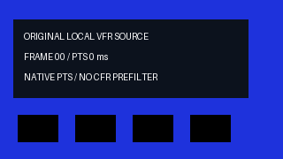
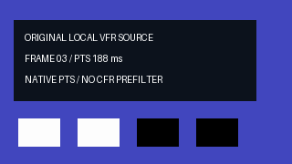

# 嵌套原生 VFR 时钟与多层速度曲线实测（2026-10-21）

完整原生回归 **1957 项、4856.958 秒、0 跳过**；255 产品输入与 8 外部夹具不变（本轮限定验收）。

| 编号 | 实际功能核验 | 结果与边界 | 证据 |
|---|---|---|---|
| V84-01 | 嵌套原生 VFR 与多层曲线 | 新增 32 项：7 ms 帧保持区间内裁切、非零封装原点、真实 EOF、父/叶多重倒放、双层非线性曲线及 30000/1001 网格；采用独立 Decimal/Fraction 参考 | [独立原生参考](evidence/nested-native-clock-20261021-lab/final-native-clock-r1.json) |
| V84-02 | 相邻回归 | r2 为 37＋50＋63＋22＋105＝277 个不同方法、0 跳过；另有 4 项既有 CLI 时钟控制，新 32 包含在嵌套 105 中 | [相关回归](evidence/nested-native-clock-20261021-lab/related-r2.json) |
| V84-03 | 公开 CLI 与真实输出 | 16 次 CLI 属于 26 条执行命令；22 检查。两段各 45 帧，完整无损 RGBA 各 10,368,000 字节，全部编码 PTS/帧身份正确；编码标识色块最大误差观察为 1，未声称编码全帧像素相等 | [实测](evidence/nested-native-clock-20261021-lab/native-r4/verification.json) · [原输入](../assets/nested-native-clock-20261021-lab/native-r4/source-native-vfr.nut) |
| V84-04 | 离线隔离发行 | 161 资源源码/wheel/site 字节一致、7 现有依赖 wheels；19 隔离 CLI＋1 来源进程/11 模块，同样逐帧参考通过；执行绑定原始冻结版本，之后仅测试断言改变，161 运行时资源完全相同，未重复安装 | [安装](evidence/nested-native-clock-20261021-lab/installed-r1/verification.json) |
| V84-05 | 完整回归与发布基线 | 完整原生回归 **1957 项、4856.958 秒、0 跳过**；255 产品输入与 8 外部夹具不变（本轮限定验收）；绑定已发布 V83，保留原 254 输入差异与全部专项证据 | [完整收据](evidence/nested-native-clock-20261021-lab/full-r2.json) · [发布基线](evidence/nested-native-clock-20261021-lab/published-index-alignment-r2.json) |
| V84-06 | 索引与缓冲 | 原生叶片正/倒放复用 PTS/duration 索引；首次扫描 1 次、命中 0 次，精确重复的描述别名只去重完全一致行；虚拟合成表面保留子级 CFR 契约 | [契约](../specs/嵌套原生VFR时钟契约_v0.1_2026-10-21.md) |
| V84-07 | 历史失败 | 修复前 8 项中 1 项丢失短帧保持区间；中间重构、早期脚本及完整 r1 的 1957 项/3263.817 秒/1 失败均保留；退休旧 CFR 警告断言后增加双叶原生协议检查，4 控制通过，再执行完整 r2，未放松逐帧参考 | [实验与失败记录](嵌套原生VFR时钟独立实验_2026-10-21.md) |
| V84-08 | 尚未验收 | 有效选区完全落在视频首帧前或 EOF 后仍有已知拒绝缺口，另有独立候选；一般嵌套效果/VFR、自然/HDR、声音质量、长片延迟、总 RSS 及完整剪映等价未验收 | [限定边界](../specs/嵌套原生VFR时钟契约_v0.1_2026-10-21.md) |
| V84-09 | 发布脚本失败与恢复 | 首次发布在提交前因哈希调用传入字符串而停止；437 个已核验本轮文件先完整备份，再恢复精确干净 V83；调用处改传 Path 后重新执行全部发布门禁，不改动完整回归输入 | [原失败](evidence/nested-native-clock-20261021-lab/publication-failed-r1.json) · [恢复](evidence/nested-native-clock-20261021-lab/publication-owned-recovery-r1.json) · [修复](evidence/nested-native-clock-20261021-lab/publication-path-fix-r1.json) |

| 原输入帧卡 | 实际短保持区间正放 | 实际曲线倒放 |
|---|---|---|
|  |  |  |

源 GIF 为原创帧卡的 12 帧/1840 ms 观看副本；精确 7 ms 区间以原始 NUT 为准。两个输出 GIF 从实际 MP4 解码，分别合并为 7/9 帧、1500 ms；实际视频各 45 帧/30000÷1001 fps。已查看两张逐帧总览，未连续播放、未听音，无模型推理。

[实际正放 MP4](../assets/nested-native-clock-20261021-lab/native-r4/forward-short-hold.mp4) · [实际倒放 MP4](../assets/nested-native-clock-20261021-lab/native-r4/reverse-ramp.mp4) · [静态目检](evidence/nested-native-clock-20261021-lab/frame-review-r2.json)。

修复对象是原生视频叶片在非线性嵌套路径中过早按平均 FPS 重采样的行为。独立源的相邻 PTS 为 188 与 195 ms，190 ms 请求应显示其间 7 ms 保持帧；相同的恒定曲线不应改变帧身份。现在保留覆盖入点的原生帧、真实末帧 duration 与内部 PTS，通过已有解析作者映射后按全局半开 CFR 网格采样；倒放先保留反向原生区间，再恢复源时刻输入嵌套映射。虚拟中间表面继续遵守原来的子级 CFR 契约。

32 项独立新测试属于 277 相邻方法，并属于本版 1957 完整回归，不累加历史计数。真实 4K、一般 HDR、自然视频、音频质量、所有嵌套效果组合和长片性能不由这两段 320×180 原创几何素材验收。有效源选区完全不含视频显示帧时仍可能被拒绝；该缺口正在独立候选中修复，本版未包含该候选的额外测试或源码。源索引扫描 0 次不排除源/运行时 SHA 文件读取及最终视频解码、编码。

完整 r1 的 1 项失败是既有测试要求退休的 CFR 归一化警告；原始失败、九份执行脚本和修改前后测试已保全。仅更新该断言并新增两个子叶的原生时钟协议检查，运行时代码未改变。r2 专项与完整回归使用新收据；native-r4 和 installed-r1 仍引用实际原执行，161 运行时资源与当前逐字节相同，未将旧媒体或安装写为重跑。

公开复现入口为 `scripts/smoke_nested_native_clock.py` 与 `scripts/verify_nested_native_clock_install.py`。源码/wheel/site 字节绑定，执行脚本原文、历史失败与冻结文档快照均保留。全部使用 Windows 原生执行，无 Docker、WSL、容器、虚拟环境或依赖下载。
