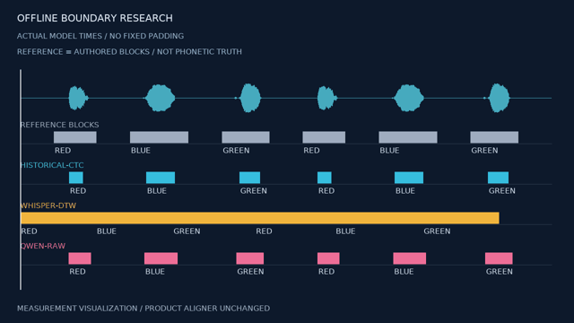

# 开源字词边界模型对照实测

V50 为研究增量。**Qwen 原始预测改善了本轮合成词块的最大误差，但两个预声明门槛仍失败；暂不接入正式 `subtitle align`。** 中文完整保留繁体原稿，出现一个零时长字和六处相邻重叠。Whisper 原文 attention/DTW 基线同样未通过。不能用成功加载、平均误差或上游 benchmark 替代本机质量结论。

本轮实际 **3 个模型 worker /6 次完成的前向**：Whisper 1/2、Qwen 1/3、既有 CTC 新留出 1/1；CTC 使用 **4 次产品 CLI 调用**。原六词 CTC 沿用 V49 历史结果，不重算前向。两份最终研究对照视频合计 **458 帧**，核对全部 PTS 和 **243,835 个原始 16 kHz 单声道采样**；未连续播放或听审。产品源码/测试/发行的 170 文件与 V49 冻结版本逐字节一致，完整 **1135/1135 是历史结果，本轮未重跑**。

## 1. 不改变原门槛

[预声明契约](../specs/字词边界模型对照核验契约_v0.1_2026-10-18.md)保留原六词音频和原稿，又在新模型推理前生成 `rms` 声音的七词留出。两组都要求每个词的起止最大绝对误差 **≤2/30 秒，即 66.6667 ms**。没有固定加减时间、移动参考、删词、均匀分配字符或放宽门槛。评分脚本与 worker 分离；worker 只接收音频和用户原稿，不读取作者放置参考。

| 编号 | 方案 | 原六词最大误差 | 新七词最大误差 | 本轮状态 |
|---|---|---:|---:|---|
| BA01 | Wav2Vec2 CTC | 258.1875 ms，V49 历史 | 286.5 ms，新一次真实前向 | 两组失败；保持正式入口的 review 警告 |
| BA02 | Whisper-small 原文 attention/DTW | 724.3125 ms | 559 ms | 两组失败；没有用自动转写替换原文 |
| BA03 | Qwen3-ForcedAligner-0.6B 原始预测 | 220 ms | 161 ms | 两组失败；80 ms 预测网格，无后处理修补 |

[逐词、带符号的样本误差](evidence/boundary-final-score-20261018.json)覆盖全部起止，没有只报告平均值。这是与**作者放置的修剪词块**比较：绝对 PCM ≥32 的修剪区间可能包含微弱起音和尾音，不能冒充独立人工语音学边界。因此也不能把上表数字当作自然口语的普遍准确率。

留出为 `LOCAL VIDEO EDITOR KEEPS EVERY ORIGINAL WORD`，初始静音 0.3 秒，间隔依次 0.2/0.35/0.25/0.4/0.3/0.15/0.45 秒，117,985 样本、7.3740625 秒。[原 WAV](../assets/boundary-heldout-20261018/input.wav)、[原稿](../assets/boundary-heldout-20261018/transcript.txt)、[原始生成与 SHA](../assets/boundary-heldout-20261018/input-provenance.json)。原六词输入保持 [V49 原件](../assets/ctc-alignment-20261018/input.wav)。

## 2. 实际模型与资源

| 编号 | 执行 | 完成前向 | 实际记录 |
|---|---|---:|---|
| BA04 | Whisper-small，本机已有 safetensors，native Torch /Transformers 5.14.1，CUDA float32/eager | 2 | worker 250.995 秒；两例前向所在处理段约 6.964 /0.506 秒；Torch peak allocated 2,409,545,728 字节；[完整结果](evidence/boundary-whisper-real-20261018/result.json) |
| BA05 | Qwen 固定模型 `c7cbfc20` /源码 `7c6daf77`，CUDA bfloat16/eager | 3 | worker 26.339 秒；三例处理段约 7.508 /0.298 /0.184 秒；Torch peak allocated 1,958,242,304 字节；[完整结果](evidence/boundary-qwen-real-20261018/result.json) |
| BA06 | 既有正式 CTC，另一个全新工程运行留出 | 1 | 4 CLI；原始响应、源码前后冻结和 worker 资源见[证据](evidence/boundary-ctc-heldout-20261018/verification.json)、[实际 CLI 响应](evidence/boundary-ctc-heldout-20261018/04.json) |

时间包含不同的加载、冷启动与框架版本，不能据此做公平吞吐排名。Torch allocated 峰值不等于进程全部显存或系统总显存。三次推理均安装网络守卫、使用明确本地路径和 safetensors，阻止事件为空；运行没有下载或设备回退。

Qwen 权重 **1,835,544,544 字节**，SHA-256 `47831d0e82f96b20e9034dba01a075ee06436654719f6a68289e49f1b65ce0e7`。下载保留了官方连接失败、镜像 403、长分段停滞和两次受控续传；最终所有片段拼接后才接受完整 LFS 摘要。[原始目录检查](evidence/boundary-aligner-sources-20261018/inspection.json)、[终态下载](evidence/boundary-aligner-acquisition-20261018-d/verification.json)。取得模型是开发步骤，产品中没有增加下载入口。

上游锁定 Transformers **4.57.6**。本机 **5.14.1** 的原版源码导入失败，一处显式隔离适配可导入，但构造时仍发生配置接口错误；原始失败均保留。最终采用两份官方 wheel 的本地模块目录：Transformers 4.57.6 /huggingface_hub 0.36.0，PyPI 摘要、解包清单和原 wheel 存在 E 盘，未创建虚拟环境、运行安装脚本或改写原生 site-packages。[两轮包原始证据](evidence/boundary-python-overlay-20261018/verification.json)。只导入原架构/配置/processor，未导入整包的在线音频、ASR、vLLM 或 Web 入口；最终推理使用未修改的上游模型代码。

非空架构、模块目录、配置、权重和输入持 Windows 读锁；Qwen 共 2,427 个非空文件、1,908,286,624 字节。模块目录中的空包标记按摘要在执行前后另核对，未计入非空读锁。这里只完成本机研究执行，尚无正式模型适配器、发行包或干净机器验收。

## 3. 中文原文与异常

| 编号 | 实际核对 | 结果 |
|---|---|---|
| BA07 | S4 原始繁体稿、16 kHz /202,880 样本 | 50 个字级单位与原稿码点映射完整，标点单独记账；未繁简转换；原声不发布 |
| BA08 | 每个起止与相邻顺序 | `我` 为 160–160 ms；六处相邻重叠为 `責/任`、`臺/灣`、`來/規`、`規/劃`、`顧/壓`、`力/將`；不能直接成为有效逐字高亮区间 |
| BA09 | 独立精标 | 没有中文人工词/字边界参考；不报告中文精度通过 |

[原声准备摘要](evidence/boundary-zh-preparation-20261018/verification.json)保留原文件/原稿摘要和明确的 FFmpeg 转换命令。模型原始时间全部落在源时长内；这里的失败是零时长及相邻重叠，没有把它们误写成越界。上游 `fix_timestamp` 会使用单调子序列、邻值和插值修正异常，本轮没有调用或把修正后的合法顺序当成声学证据。

## 4. 可回看的原输入与对照

下图是**研究测量图**，不是新接入内核的产品成片。灰色为作者词块，青色为 CTC，黄色为本轮 Whisper-DTW，粉色为 Qwen 原始预测；全部来自对应记录。原六词 CTC 标为历史。图中播放线只帮助观察时间，没有修补预测。

[原音频](../assets/ctc-alignment-20261018/input.wav) · [MP4](../assets/boundary-known-readable-20261018/comparison.mp4) · [保留原 PCM 的 MKV](../assets/boundary-known-readable-20261018/comparison.mkv) · [236 帧/125,850 样本/全部文件 SHA](../assets/boundary-known-readable-20261018/verification.json)

[原音频](../assets/boundary-heldout-20261018/input.wav) · [MP4](../assets/boundary-heldout-readable-20261018/comparison.mp4) · [保留原 PCM 的 MKV](../assets/boundary-heldout-readable-20261018/comparison.mkv) · [222 帧/117,985 样本/全部文件 SHA](../assets/boundary-heldout-readable-20261018/verification.json)

两组均为 1280×720 /30 fps；逐一核对帧数和编码 PTS，MKV 解码 PCM 与输入完全相同。MP4 音频为 AAC，不宣称无损；GIF 分别为 79 帧/7,900 ms、74 帧/7,400 ms，不作为精确音频时钟。没有独立逐像素校验条形位置；检查了两个中间编码静帧的标签可读性，未连续播放或听审。首版网格字体难以辨认，保留[失败静帧](../assets/boundary-known-comparison-20261018/frame-118.png)及原图/视频，主示例改用已保留原许可的 DejaVu Sans。

## 5. 复用判断与后续缺口

| 编号 | 候选/资料 | 决定及原因 |
|---|---|---|
| BA10 | Qwen3-ForcedAligner | Apache-2.0 声明、真实中英推理可运行；两组既定门槛和中文时长/顺序门禁失败，保留研究 runner，暂不增加正式 engine |
| BA11 | Charsiu 英/中 10 ms frame classifier | MIT 仓库代码与权重许可分开；已查到的两个权重仓库没有许可元数据，没有下载权重或默认接入 |
| BA12 | Where Words Begin and End 发布权重 | CC BY-NC 模型不作为本项目默认可商用开源内核；未取得权重或运行 |
| BA13 | AMI 词级参考 | 官网明确词/音素时间由自动强制对齐生成；不能因压缩包名含 manual 就当作独立人工词边界。没有下载语料、运行 AMI 对齐或宣称自然质量通过 |
| BA14 | 稀疏 CTC、非尖峰训练研究 | 新训练目标可作为后续选择依据；本文没有训练、改损失或验证论文 benchmark；固定补时不构成算法修复 |
| BA15 | OpenFilm 已采用部分 | 分句、关联/转场规则、Saved 工作流、帧时钟、模板控件/恢复和描线仍有实际复用价值；声学字词边界需要另外的模型、文本映射与质量工程，不能计算成搬 OpenFilm 已节省的部分 |

接入条件继续为：保持原文与固定门槛，获得独立可复查的自然边界参考，明确异常拒绝行为，再完成正式适配器的来源读锁、文本/资源预算、取消/事务/权利、发行安装和完整回归。合成词块门槛、自然语音质量、视觉高亮时钟和完整剪映等价分别验收。

原始失败包括：[原版导入](evidence/boundary-qwen-import-20261018/result.json)、[隔离适配仅导入成功](evidence/boundary-qwen-import-20261018-b/result.json)、[新版配置构造失败](evidence/boundary-qwen-meta-20261018/result.json)、[空包标记读锁策略失败](evidence/boundary-qwen-meta-20261018-b/result.json)、[明确版本后 meta 构造成功](evidence/boundary-qwen-meta-20261018-c/result.json)。这些均为零前向探查，不能计为模型准确率通过。

[来源、许可与原文链接](../third-party/字词边界候选与可读字体来源_2026-10-18.md)；[最终独立审计](evidence/boundary-release-audit-20261018.json)。
