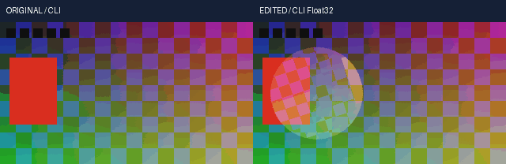

# 标准 CLI 浮点交付实测

<!-- FLOAT-CUMULATIVE-DELIVERY-NOTE -->
> 合并交付说明：最终300输入已实际通过完整 **2355方法 /5277.023秒 /0跳过**。 以下保留该候选当时的分项、安装和失败记录；296/298输入早期快照未各自执行2320/2337项完整回归。当前验收以[合并实测](../../docs/validation/原片浮点渲染与预览合并交付实测_2026-10-22.md)及其实际收据为准。
<!-- /FLOAT-CUMULATIVE-DELIVERY-NOTE -->

本页为 R96 候选的持续记录。源码在 E 盘原生 Windows 隔离实验目录内构建；main 当前由既有完整回归和发布任务串行维护。本页不把未结束的回归、安装检查或排队发布写成完成。

## 1. 证据与实际边界

| 编号 | 实际执行 | 结果与范围 |
|---|---|---|
| V96-01 | 以冻结的 296 个父产品输入创建隔离基础 | [基础收据](evidence/float-standard-20261022-lab/foundation-r1.json)，不修改此前完整回归源树 |
| V96-02 | 两次原生 alpha 平面转换，覆盖全部 256 个码值 | [alpha 边界](evidence/float-standard-20261022-lab/alpha-boundary-r1/verification.json)：码值乘 257 的归一化平面全码正确；左移 8 位的反例有 384 个分量误差，最大 1 |
| V96-03 | 首轮真实标准渲染定向测试 | [实际日志](evidence/float-standard-20261022-lab/standard-r1/unittest.log)：11 方法、101.803 秒、2 失败。新 Schema 摘要及 CLI 夹具登记未同步；10-bit 灰阶最大偏差 4.666982650756836。实际执行源保存在同目录，未覆盖失败 |
| V96-04 | 首轮收据写入故障 | 结果含 TestCase 对象而无法 JSON 序列化；[从实际终端日志恢复的失败记录](evidence/float-standard-20261022-lab/standard-r1/terminal-recovered.json)标明此事实，原 running 收据保留 |
| V96-05 | 独立 65,536 灰阶转换，不经产品宿主或编码器 | [三组原生对照](evidence/float-standard-20261022-lab/color-boundary-r1/verification.json)：当前 swscale 参数及关闭 dithering 均为 64..943，最大误差 3.9223163195239295；显式 zscale 为 64..940、877 个级别，最大误差 0.4999771114671603，Cb/Cr 全部 512 |

当轮最新实际结果见下方编号表；安装和完整回归未结束时不计为通过。实际 alpha 透明 WebM、PCM 倒放定格及分数作者尾点已在首轮对应方法内通过，但不把失败整轮列为通过。

## 2. 修复方向

交付 RGB 16-bit 到 YCbCr 的转换改为显式 zscale 基色/传递函数/矩阵/范围；原始 alpha 平面独立保留。Schema 正文、随包副本与固定摘要一并更新，保持篡改拒绝规则。测试夹具需要正确区分资产 ID、片段 ID、权利账 ID，并继续经过公开校验入口。

功能契约见[标准 CLI 浮点渲染接入契约](../specs/标准CLI浮点渲染接入契约_v0.1_2026-10-22.md)。完整剪映功能仍需持续实现，当前候选不代表默认后端、全部效果、预览缓存、HDR 或自然素材质量验收。

## 4. 原生 Git 预发布检查

首个私有暂存目录因深层证据路径触及 Windows Git 的默认长度限制，`git add` 返回128；只影响新建的私有暂存仓库，没有修改 main。完整失败和原命令见[预发布失败记录](evidence/float-standard-20261022-lab/staging-preflight-r1-failure.json)。后续在该轮新建的私有仓库内显式启用 `core.longpaths`，继续进行实际暂存 blob 与文档链接检查；不修改全局 Git 配置。

第二个私有暂存把所有父文件当作新增文件，空白检查因此报告原有 Markdown 硬换行和原有 EOF 空行，见[原检查输出摘要](evidence/float-standard-20261022-lab/staging-preflight-r2-failure.json)。后续先在私有仓库逐字节提交296个父产品输入和原文档作为基线，再暂存本轮差异，与正式仓库的检查条件一致；不改写冻结父文件，也不关闭本轮代码差异的空白检查。

<!-- R96-ACTUAL-RESULTS -->
## 3. 当前实际结果与保留失败

| 编号 | 实际执行 | 结果 |
|---|---|---|
| R96-A01 | 第一轮修复后17方法的完整定向重测 | [standard-r5](evidence/float-standard-20261022-lab/standard-r5/verification.json)：17方法 /200.249秒 /0跳过；298产品输入SHA前后相同。没有把重复轮次相加成新功能或方法数 |
| R96-A02 | 扩展夹具首轮失败 | [standard-r3](evidence/float-standard-20261022-lab/standard-r3/verification.json)：17方法、3失败。只读断言前的测试保存更新了作者时间；VFR表达式缺转义；NUT容器末帧PTS作为容器时长导致公开校验拒绝。改用真实完整时长MKV作普通CLI夹具，保留NUT作直接VFR时钟夹具，不伪造probe或放宽源范围 |
| R96-A03 | 真实取消续跑故障与修复 | [standard-r4](evidence/float-standard-20261022-lab/standard-r4/verification.json)：17方法、1失败。资源栈用close把异常退出当成功退出，源清理再次轮询取消并覆盖带操作ID的原错误。r5传递真实异常，公开续跑成功；CRF变更的续跑仍拒绝 |
| R96-A04 | 两次正式CLI媒体 | [media-r4](evidence/float-standard-20261022-lab/media-r4/verification.json)：12个脚本级真实调用、16检查，两次CLI render均完成。原始/编辑片各20帧/10fps/2秒、96000立体声采样；逐字节PCM相同，画面SHA不同，作者工程的设置/片段/源范围不重写 |
| R96-A05 | 媒体夹具与来源检查失败 | media-r1拒绝未授权工程外路径；其计数器在成功后递增，字段0表示完成0次，calls中实际发起1次CLI。media-r2缺4个关键帧的interpolation，被Schema与语义校验拒绝。media-r3的两次成片和像素/PCM检查完成，但错误要求开发环境NumPy/Pillow位于产品源码目录；r4只对产品强制源码来源，安装轮仍要求全部运行模块来自安装site。原失败和原执行代码均保留 |
| R96-A06 | 抽帧目检与GIF时钟 | [static-review-r1](evidence/float-standard-20261022-lab/static-review-r1.json)：实际查看0/10/19的原片/编辑片共6帧；GIF20帧、每帧100ms。没有连续播放、试听或自然素材/HDR质量验收 |

当前README编号预览如下，所有数字来自本轮对应收据；完整2337方法未结束前不标为通过。

<!-- V96-STANDARD-NATIVE-FLOAT-RENDER -->
### V96 候选：标准 CLI 原片浮点渲染（未发布）

`settings.pixel_pipeline.engine="float32-native-v1"` 将原片窗口与 Float32 线性光合成接入共同 `render`、持久队列及续跑。当前定向 **17 方法 /200.249 秒 /0 跳过**。显式选择此后端；尚未接入的操作会拒绝。默认后端迁移、所有效果/预览缓存、自然素材、HDR 和完整剪映等价仍需持续实现。

| 编号 | 功能性核验 | 实际执行内容与限制 | 证据 |
|---|---|---|---|
| V96-01 | 标准执行器 | 公共 `render`、持久 `queue run`、取消后的 `render --resume` 使用共同质量检查/指纹/记录；修改 CRF 的续跑被拒绝 | [17项真实测试](../../docs/validation/evidence/float-standard-20261022-lab/standard-r5/verification.json) |
| V96-02 | 高精度交付 | 65,536 原始灰阶经正式 10-bit H.264/MKV；独立亮度参考误差≤1.5码且至少870级；合成到最终16-bit RGB交付前保留Float32 | [契约](../../docs/specs/标准CLI浮点渲染接入契约_v0.1_2026-10-22.md) |
| V96-03 | 色彩边界反例 | 三组真实转换：旧 swscale 参数白点943而非940；zscale 全码最大误差0.499977、877级、Cb/Cr全512；参数/标签与实际转换绑定 | [独立原始对照](../../docs/validation/evidence/float-standard-20261022-lab/color-boundary-r1/verification.json) |
| V96-04 | 透明度 | 全部256个alpha码值及量化边界附近值，经独立平面、lossless VP9/WebM逐码相同；实际透明画面不能默默丢到不透明输出 | [原始alpha反例](../../docs/validation/evidence/float-standard-20261022-lab/alpha-boundary-r1/verification.json) · [实测](../../docs/validation/evidence/float-standard-20261022-lab/standard-r5/unittest.log) |
| V96-05 | 作者视频/音频时钟 | 原始5秒起点VFR在嵌套倒放下逐帧匹配独立区间参考；倒放/定格PCM逐字节相同；分数作者末尾13视频帧和60001立体声采样分别保留 | [实际测试与命令](../../docs/validation/evidence/float-standard-20261022-lab/standard-r5/verification.json) |
| V96-06 | 失败与资源清理 | 只读规划不写缓存/临时成片；源SHA、已知非方形源、未接操作拒绝；编码/质量/manifest暂存/替换失败保留旧文件并关闭自有进程线程。发布二文件不保证强退/断电原子性 | [失败/修复](../../docs/validation/标准CLI浮点交付实测_2026-10-22.md) |
| V96-07 | 正式CLI原片与成片 | 两次独立子进程CLI；脚本级12次调用、16检查；原片/编辑片各20帧、10fps、2秒和96000立体声采样；作者IR不重写，PCM全样本相同 | [真实命令/SHA](../../docs/validation/evidence/float-standard-20261022-lab/media-r4/verification.json) |
| V96-08 | 原视频/MP4/GIF | 自生成RGB16原片与音频；正式10-bit MKV；屏幕混合、圆蒙版、反向源与变换关键帧；MP4/GIF为这两段真实输出的预览 | [原片](../../docs/assets/float-standard-20261022-r4/original.native.mkv) · [原始MP4](../../docs/assets/float-standard-20261022-r4/original.mp4) · [编辑MP4](../../docs/assets/float-standard-20261022-r4/edited.mp4) · [正式10-bit成片](../../docs/assets/float-standard-20261022-r4/edited.mkv) |
| V96-09 | 实际抽帧目检 | 已查看原片/成片0/10/19共6帧；圆形位置/旋转与亮度混合可见，未见明显外围黑矩形；GIF20帧均100ms。未连续播放/试听 | [查看与GIF时钟](../../docs/validation/evidence/float-standard-20261022-lab/static-review-r1.json) |
| V96-10 | 全新离线安装 | **220 方法 /580.36 秒 /0 跳过**；179 资源 source/wheel/site 相同，8 个离线 wheel，NumPy 931 原文件和许可相同，安装版两次真实 CLI 媒体逐像素/PCM 与开发版相同。 | [安装收据](../../docs/validation/evidence/float-standard-20261022-lab/installed-r1/verification.json) |
| V96-11 | 完整回归 | **尚未执行/未结束，不计为通过**；完整 2337 方法按 V95 与 R16 实际发布顺序串行，发现数量不等于已执行。 | [当前实测报告](../../docs/validation/标准CLI浮点交付实测_2026-10-22.md) |
| V96-12 | 保留失败 | r1摘要/夹具/色阶失败与收据序列化故障；r3只读/VFR夹具问题；r4取消清理丢失操作ID；媒体r1外部路径、r2缺插值、r3开发环境来源断言均保留 | [逐轮记录](../../docs/validation/标准CLI浮点交付实测_2026-10-22.md) |

<!-- /V96-STANDARD-NATIVE-FLOAT-RENDER -->

复现入口：[真实CLI媒体生成器](../../scripts/smoke_float_standard_media.py)、[17方法运行器](../../scripts/verify_float_standard.py)、[全新离线安装](../../scripts/verify_float_standard_install.py)、[串行完整回归](../../scripts/run_float_standard_complete.py)。源码、失败样例和派生素材均在E盘，未调用Docker、WSL、虚拟环境、云模型或交互浏览器tab。
<!-- /R96-ACTUAL-RESULTS -->
