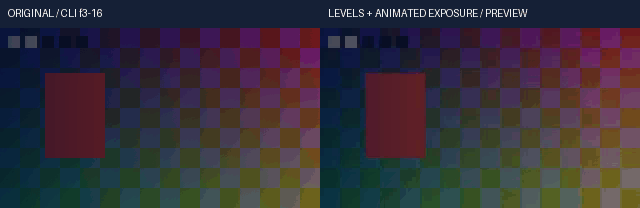

# 浮点RGBA色阶与动态曝光实测

从未改动的曲线311候选复制331个输入：311产品、9依赖、8外部夹具与3份基础运行器。复制时父完整2495项尚未运行/发布。本候选314产品输入、6条产品路径改变。242项相关源码=42新增+200既有；442项隔离安装与完整目标2537项分别执行，不能相加为剪映完成度。完整回归须等待实际V102完整2495项通过并普通发布。

运行内核是本项目的NumPy浮点实现，不调用FFmpeg colorlevels/exposure，不构造整数查表或在线请求。端点/保留度量的数学语义对照[官方colorlevels源码](https://github.com/FFmpeg/FFmpeg/blob/master/libavfilter/vf_colorlevels.c)、[保留度量](https://github.com/FFmpeg/FFmpeg/blob/master/libavfilter/preserve_color.h)及[曝光参数](https://github.com/FFmpeg/FFmpeg/blob/master/libavfilter/vf_exposure.c)；未复制C代码。原生比较实际启动本机FFmpeg8.1，并保留原GBRAPF32输入输出；明确端点、保留模式与自动检测差异分别登记。

首轮r1实际38项/64.4595804秒，2失败/1错误，0跳过。两个测试把原生平面自动端点当成分通道参考，结果不符。隔离三次复现表明：红输入始终.3..7，绿范围.1..9→.2..8→.1..9，使原生红输出.25..75→.166667..833333→.25..75；输出重复字节相同。本项目按自身通道统计，红输出不受绿色变化影响。r2保留原生差异诊断，自动端点另对照独立整平面统计，不扩大原生等价容差，也不模拟跨通道行为。静态明确端点和七模式的原生对照继续保留。NumPy浮点时钟错误改为接受有限Real/Integral并保留有理/大整数路径；另补顶层动态曝光参数和布尔取消返回值处理。

公开CLI仍要求每个关键帧写明interpolation；库编译器省略时默认linear，属于两个接口边界。强度混合在线性工作RGB及显式alpha完成；默认alpha原位型保留，显式映射若最终覆盖率超出0..1则拒绝，绝不静默裁切。零输入跨度会拒绝或按显式output_black策略处理，不输出NaN。

真实样例是原创图形/移动标记/透明度与自制立体声正弦音频，五段共享色阶、独立RGBA、自动端点、lum保留、Bezier强度，均带动态曝光顺序。媒体参考独立推导端点/整平面极值、传递、曝光、强度和alpha合成；没有导入产品数学。静态联系表检查与连续播放/听审区分记录。原生Windows运行，不使用Docker、WSL、容器、虚拟环境、云服务或交互浏览器tab。

<!-- V103-FLOAT-RGBA-LEVELS-AND-ANIMATED-EXPOSURE -->
### V103 候选：浮点RGBA色阶与动态曝光（未发布）

显式 `float32-native-v1` 工程的正式render和预览共用RGBA色阶、曝光关键帧及原作者时钟；局部调色保留浮点负值和超白值。默认后端迁移、其余浮点算子、离线AI质量及完整剪映功能仍未完成。

| 编号 | 功能性核验 | 实际内容与范围 | 证据 |
|---|---|---|---|
| FL103-01 | 共用内核 | 父曲线候选311→314输入、6条产品路径改变；42新增方法；RGBA色阶/动态曝光接入正式render、区间预览和PNG16的共用有序效果链 | [接口契约](../../docs/specs/浮点RGBA色阶与动态曝光契约_v0.1_2026-10-22.md) |
| FL103-02 | 端点与信号 | 共享RGB和独立RGBA各四端点；输入/输出信号明确，强度在线性工作域混合；反向范围、RGB负值/超白保留，alpha默认逐位保留 | [实际242项相关回归](../../docs/validation/evidence/float-levels-20261022-lab/native-r2/verification.json) |
| FL103-03 | 七种保留模式 | none/lum/max/avg/sum/nrm/pwr，与真实GBRAPF32明确端点及独立标量方程对照；lum为max+min，avg含+1，不宣称Rec.709加权亮度 | [原生命令/I/O](../../docs/validation/evidence/float-levels-20261022-lab/native-r2/verification.json) |
| FL103-04 | 自动黑白点 | 按每个自身通道的完整输入表面统计，含隐藏RGB；最小值以1、最大值以0初始化；负端点表示自动检测；零跨度默认拒绝或显式output_black | [端点与分块断言](../../docs/validation/evidence/float-levels-20261022-lab/native-r2/unittest.log) |
| FL103-05 | 原生已知差异 | 本机FFmpeg8.1在GBRAPF32自动端点中出现跨通道依赖：红输入不变，改绿范围使原生红范围由.25..75变为.166667..833333；产品红结果不变。不把原生自动检测差异列为等价通过 | [三次隔离复现/原字节](../../docs/validation/evidence/float-levels-20261022-lab/native-analysis-r1/verification.json) |
| FL103-06 | 作者关键帧 | 色阶共享/独立端点/强度、曝光amount/black的六种时间插值；直接Bezier及超2^53有理tick、作者窗口、嵌套倒放左极限 | [实际断言](../../docs/validation/evidence/float-levels-20261022-lab/native-r2/unittest.log) |
| FL103-07 | 顺序与事务 | 曝光/色阶/曲线/LUT有序执行；只读输入、跨分块逐位一致；晚块非法值、取消和预算拒绝保留输入。预算含保留LUT，是工作区估算，不是进程总RSS | [源码冻结及日志](../../docs/validation/evidence/float-levels-20261022-lab/native-r2/verification.json) |
| FL103-08 | 公开CLI | 20脚本调用/29检查；2次正式render、3次preview；原创320×180、10fps、2秒各20帧，五段覆盖共享/RGBA/自动/保留/Bezier和动态曝光顺序 | [真实命令及输出](../../docs/validation/evidence/float-levels-20261022-lab/media-r1/verification.json) |
| FL103-09 | 独立全选区参考 | 作者帧3..16共2,419,200个线性RGB值，最大绝对误差7.45058059692e-08，预先门槛5e-7；正式96000及选区67200双声道PCM采样帧一致；PNG16与对应作者帧误差≤1码 | [无产品数学导入的参考](../../docs/validation/evidence/float-levels-20261022-lab/media-r1/executed-oracle.py.txt) |
| FL103-10 | 原片与GIF | CC0原创图形、alpha和正弦音频；GIF左原片、右真实CLI预览，14×100ms；静看3/10/16共6幅画面，不代替连续播放或试听 | [原片](../../docs/assets/float-levels-20261022-r1/original-range.mp4) · [实际预览](../../docs/assets/float-levels-20261022-r1/range.mp4) · [Float32](../../docs/assets/float-levels-20261022-r1/range.master.nut) · [PNG16](../../docs/assets/float-levels-20261022-r1/frame.png) · [查看记录](../../docs/validation/evidence/float-levels-20261022-lab/static-review-r1.json) |
| FL103-11 | 离线安装 | **442项 /1525.764秒 /0跳过**；188份source/wheel/site资源、8个固定离线wheel、NumPy931文件及原许可一致；安装版实际CLI音画、Float32及PNG16与源码版一致。 | [安装收据](../../docs/validation/evidence/float-levels-20261022-lab/installed-r1/verification.json) · [作者工程](../../docs/assets/float-levels-20261022-r1/author-project.json) · [权利账](../../docs/assets/float-levels-20261022-r1/rights-ledger.json) · [CC0](../../docs/assets/float-levels-20261022-r1/LICENSE.txt) |
| FL103-12 | 完整回归 | **尚未通过，不计通过**；实际发现2537项，仅在V102完整2495项通过并普通发布后执行。 源码242、安装442和完整套件分别记录，不累加为功能完成率 | [本轮报告](../../docs/validation/浮点RGBA色阶与动态曝光实测_2026-10-22.md) |
| FL103-13 | 保留失败及未验收 | r1实际38项有2失败/1错误：两个原生自动端点参考与分通道契约不符、NumPy时钟被拒绝；原日志保留。没有新模型、自然/HDR、实时/长片RSS、连续播放/听审或完整剪映等价验收 | [失败与修正](../../docs/validation/evidence/float-levels-20261022-lab/failure-analysis-r1.json) |

<!-- /V103-FLOAT-RGBA-LEVELS-AND-ANIMATED-EXPOSURE -->
