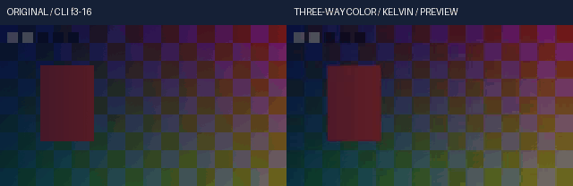

# 浮点三向色轮与创意色温实测

实际源码关联回归 **284项 /1341.286313秒 /0跳过**，其中42项为新增；与离线安装及完整回归分别执行，不累计为剪映完成度。

当前实现为独立NumPy Float32算子，不在运行时调用FFmpeg colorbalance，不使用整数中间层或云请求。参考[FFmpeg n8.1官方源码](https://github.com/FFmpeg/FFmpeg/blob/n8.1/libavfilter/vf_colorbalance.c)的参数及权重语义，使用本机实际整数原生输出和独立binary64方程验证；未复制C代码。首次源码HTTP连接重置保留在reference-r1；reference-r2通过官方Contents API成功取得n8.1正文、blob SHA与完整响应，原始源码SHA256为75e4e9ba06a29ce6d16218fcbb2134c2472ce11d2396e33e982954fb3484f34b。它仅作为研究证据，不参与产品编译或运行。

原生只接受整数RGB。对照从明确uint16 RGB/alpha出发，GBRAP16平面及RGBA64交错两条路径，比较最终16位码，预先容差2码；产品自身始终连续Float32。权重使用max(R,G,B)+min(R,G,B)，既不是平均灰度，也不是Rec.709亮度。原生HSL零分母可使纯白变黑，本实现对纯黑/纯白定义明确有限结果并保留原生差异。

首轮native-r1实际42项/113.2833461秒，1失败、0错误、0跳过。测试把二次ease_in_out在p=.25的值误写为smoothstep的.15625，正确值为2×.25²=.125。只修改测试参考，保留runtime、原失败、原输入输出与原代码；没有放宽容差。native-r2重新运行完整关联范围。两个控制值的Bezier仍为smoothstep，四控制Bezier按时间坐标求根，分别检查。

首轮media-r1执行4调用/3检查，正式edited CLI以FLOAT_STREAM_RANGE拒绝，因为超白示例没有明确最终交付策略。r2仅为演示工程加入既有range_policy=clip，不改变任何产品输入或范围保护。最终正式整数视频、PNG16和Float32预览参考按各自既有交付边缘明确裁切；内核自身仍保留headroom。独立参考保存裁切前峰值/越界分量，并检查实际正式渲染和预览均报告非零裁切数，不把最终裁切后的参考称为无界HDR母版。

已接受媒体执行的status沿用旧验证器的floating-levels标签；它不是本轮操作类型。实际balance_oracle五场景、执行代码、原始命令、316个源码输入与全像素参考共同约束本轮范围，不改写已执行收据。离线重播沿用同一真实执行脚本和标签。

五段真实公开CLI分别覆盖shadow平衡、九通道、曝光后超白midrange、bounded HSL和动态Kelvin；源像素、alpha、曝光、binary64权重和Python colorsys重建形成独立参考，未导入产品数学模块。原片、输出、GIF、Float32参考、PNG16、作者工程与权利账一并保存。静态联系表与连续播放/听审分别登记。

<!-- V104-FLOAT-THREE-WAY-BALANCE-AND-CREATIVE-KELVIN -->
### V104 候选：浮点三向色轮与创意色温（未发布）

显式`float32-native-v1`工程的正式render和预览共用连续浮点色彩平衡、九通道色轮、创意Kelvin映射及原作者关键帧。默认后端迁移、其余浮点算子、自然素材/离线AI质量及完整剪映功能继续开发。

| 编号 | 功能性核验 | 实际内容与边界 | 证据 |
|---|---|---|---|
| FB104-01 | 共用内核 | 父色阶314→316产品输入，5条路径改变；42新增方法；接入正式render、区间预览和PNG16的既有有序效果链 | [接口契约](../../docs/specs/浮点三向色轮与色温契约_v0.1_2026-10-22.md) |
| FB104-02 | 三类调色 | shadow-only RGB平衡、9个shadows/midtones/highlights×RGB通道、1000..40000 K创意映射；Kelvin不是物理白平衡或色适应 | [源码及284项相关回归](../../docs/validation/evidence/float-balance-20261022-lab/native-r2/verification.json) |
| FB104-03 | 连续浮点 | 无整数LUT或中间量化；131073个连续值检查；明确输入/输出信号，强度在线性工作域混合；默认保留负值/超白，alpha逐位保留 | [实际断言](../../docs/validation/evidence/float-balance-20261022-lab/native-r2/unittest.log) |
| FB104-04 | 原生对照 | 本机FFmpeg colorbalance不接受GBRAPF32，关闭自动转换后实际拒绝；直接RGBA64和GBRAP16输入输出对照，预先门槛2码。最大实际码差见收据；不把整数对照称为原生浮点支持 | [真实命令/原始I/O](../../docs/validation/evidence/float-balance-20261022-lab/native-r2/verification.json) |
| FB104-05 | 亮度与色域 | none/native_hsl/midrange；native_hsl只接受算子域0..1 RGB并保留原生边界规则；midrange支持负值/超白；clip是明确算子域策略 | [契约和边界](../../docs/specs/浮点三向色轮与色温契约_v0.1_2026-10-22.md) |
| FB104-06 | 已知原生差异 | 已复现原生pl=1在限定调色下把纯白输出为黑；本实现明确保留纯黑/纯白，防止零分母产生非有限值。不将该差异宣称原生等价 | [保留样例与原始I/O](../../docs/validation/evidence/float-balance-20261022-lab/native-r2/verification.json) |
| FB104-07 | 作者关键帧 | 6种插值、直接4控制Bezier时间根、超2^53有理tick、保持左极限、作者窗口和嵌套倒放；所有九通道及强度可动，Kelvin可动 | [实际断言](../../docs/validation/evidence/float-balance-20261022-lab/native-r2/unittest.log) |
| FB104-08 | 事务与顺序 | 曝光/色阶/曲线/LUT/色轮按作者顺序；alpha映射按实际效果报告；只读输入、跨分块一致、晚块非法值/预算/取消保留输入 | [冻结及执行日志](../../docs/validation/evidence/float-balance-20261022-lab/native-r2/verification.json) |
| FB104-09 | 真实公开CLI | 20调用/31检查；2次正式render、3次preview；原创320×180、10fps、2秒各20帧，五段平衡/色轮/超白midrange/HSL/色温及动态曝光 | [真实命令和媒体](../../docs/validation/evidence/float-balance-20261022-lab/media-r2/verification.json) |
| FB104-10 | 独立参考 | 作者帧3..16共2,419,200线性RGB值，最终交付clip后最大绝对误差3.57627868652e-07，执行前门槛2e-6；参考裁切前峰值1.30213141，越界分量12294；96000/选区67200双声道PCM采样帧一致；PNG16≤1码 | [独立binary64/colorsys参考](../../docs/validation/evidence/float-balance-20261022-lab/media-r2/executed-oracle.py.txt) |
| FB104-11 | 原片/GIF | CC0原创图形/移动标记/透明度及正弦音频；GIF左原片右实际CLI预览，14×100ms；静看3/10/16共6幅画面，不代表连续播放/听审 | [原片](../../docs/assets/float-balance-20261022-r2/original-range.mp4) · [实际输出](../../docs/assets/float-balance-20261022-r2/range.mp4) · [Float32](../../docs/assets/float-balance-20261022-r2/range.master.nut) · [查看记录](../../docs/validation/evidence/float-balance-20261022-lab/static-review-r1.json) |
| FB104-12 | 离线安装 | **484项 /1581.278秒 /0跳过**；189份source/wheel/site资源、8个固定离线wheel、NumPy931文件及许可一致；安装版CLI音画、Float32和PNG16与源码版一致。 | [实际安装收据](../../docs/validation/evidence/float-balance-20261022-lab/installed-r1/verification.json) · [作者工程](../../docs/assets/float-balance-20261022-r2/author-project.json) · [权利账](../../docs/assets/float-balance-20261022-r2/rights-ledger.json) · [CC0](../../docs/assets/float-balance-20261022-r2/LICENSE.txt) |
| FB104-13 | 完整回归 | **尚未通过，不计通过**；目标2579项，仅在V103实际完整2537项通过并普通发布后执行。 源码284、安装484和完整套件分别记录，不相加为功能完成率 | [本轮报告](../../docs/validation/浮点三向色轮与色温实测_2026-10-22.md) |
| FB104-14 | 失败与未验收 | 首轮42项有1个二次ease_in_out测试预期错误；首轮媒体漏写最终范围策略，真实CLI以FLOAT_STREAM_RANGE拒绝。原日志及字节保留，仅修正测试参考/演示工程，未修改运行时曲线、范围保护或放宽容差。无新模型/自然/HDR/长片RSS/连续播放/听审或完整剪映等价验收 | [失败与修正](../../docs/validation/evidence/float-balance-20261022-lab/failure-analysis-r1.json) |

<!-- /V104-FLOAT-THREE-WAY-BALANCE-AND-CREATIVE-KELVIN -->
