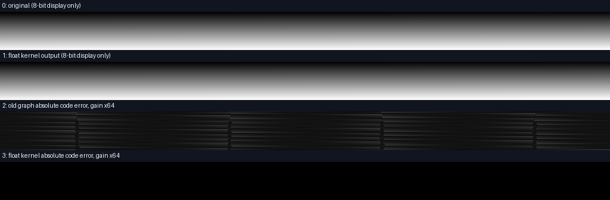
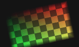
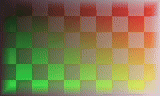
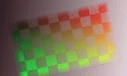
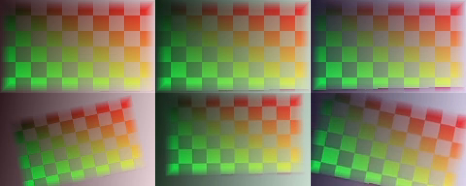
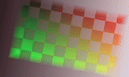
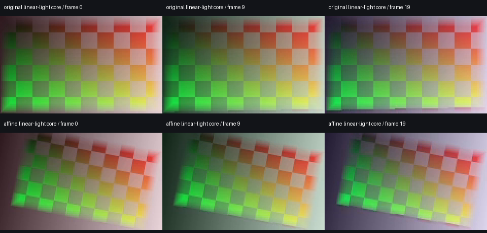

# 浮点表面合成与高精度边界独立实测

<!-- FLOAT-CLI-RELEASE-GATES -->
完整原生回归 **2234方法 /7549.898秒 /0跳过**；282产品输入、8外部夹具、17启动脚本和9依赖文件相同，终态OK。尚未合入或推送。

新八轮离线安装：**117项 /288.585秒 /0跳过**，171资源source/wheel/site一致、NumPy931原文件及许可相同；213个运行模块来自安装site，18次子进程CLI。四份安装版帧包的像素/时钟与开发版逐字节一致，独立线性合成RGBA相同。普通时间线render/preview/cache尚未采用浮点核心。
<!-- /FLOAT-CLI-RELEASE-GATES -->

当前父版是已发布 V91 `18f5dc76`：2148 方法 /4714.461 秒 /0跳过。实验建立时复制了队列修复前的267输入，现已从实际发布版逐字节迁移两个队列文件，并保留迁移前快照。[父版迁移收据](evidence/color-precision-20261021-lab/parent-rebase-r1.json)。原2145回归4失败仍按历史保留。

当前八份核心模块、七份新增测试，282冻结输入、171包内资源。专项 r11 **86方法 /131.691302秒 /0失败 /0错误 /0跳过**，67份原生执行记录与另48份实际进程内CLI记录分别保留；不包含内部所有ffprobe/摘要检查。随后仅迁入两个队列文件，浮点实现和对应测试未变。完整原生回归 **2234方法 /7549.898秒 /0跳过**；282产品输入、8外部夹具、17启动脚本和9依赖文件相同，终态OK。尚未合入或推送。 [专项](evidence/color-precision-20261021-lab/kernel-r11.json)、[当前纪元](evidence/color-precision-20261021-lab/current-epoch-r3.json)、[17份精确源码](evidence/color-precision-20261021-lab/implementation-r3/manifest.json)、[完整约束](../specs/浮点表面合成与高精度边界_实验_v0.1_2026-10-22.md)。

仅原生 Windows、既有 Python/NumPy/Pillow/FFmpeg 8.1；未用 Docker、WSL、容器、虚拟环境或在线模型，没有打开交互浏览器标签页。所有原片由本项目生成，可按 CC0-1.0 公开；无外部图片、字体或模型。

| 编号 | 实际内容 | 结果与证据 |
|---|---|---|
| CPF-01 | 同源 10/16-bit 中性灰阶，1024×64、4 帧、4fps、1 秒；原生 FFV1 编码后逐码解码 | 10-bit 第一帧 1024 灰阶，16-bit 为 65536；原始通道样本均相同。[原始生成和解码](evidence/color-precision-20261021-lab/before-r5/verification.json) |
| CPF-02 | 不透明原尺寸直通对照、全幅 crop 对照 | 10-bit 输出最多差 1 码、保留约 10-bit 精度；早期“直通/crop 必然转成 8-bit”假设被实测否定，原失败断言保留。[r3](evidence/color-precision-20261021-lab/before-r3/verification.json)、[r4](evidence/color-precision-20261021-lab/before-r4/verification.json) |
| CPF-03 | 原编辑器 CLI 给相同原片加覆盖全画面的 rectangle 蒙版 | 8 次 CLI＋14 条其他原生命令；10/16-bit 输出均只剩 220 个灰阶，见下表。[实际 before](evidence/color-precision-20261021-lab/before-r5/verification.json) |
| CPF-04 | FFmpeg 13 项浮点滤镜探针 | geq、premultiply、blend、maskedmerge、gblur 等探针保留 float；rotate/xfade/curves/lutrgb 等会经整数格式，overlay/alpha 合并链出现 8-bit 协商。只证明具体探针和版本。[实际日志](evidence/color-precision-20261021-lab/float-filter-support-r1/verification.json) |
| CPF-05 | 最初核心 r1 | 12 方法、39 个失败条目、40 次实际执行；maskedmerge 不支持 shortest 选项，失败未覆盖。[原收据](evidence/color-precision-20261021-lab/kernel-r1.json)、[原源码](evidence/color-precision-20261021-lab/before-kernel-r1/manifest.json) |
| CPF-06 | 核心 r2 | 删除无效选项后仍有 39 个失败条目；FFmpeg 自动预乘蒙版，禁止以“返回码成功”替代数值验收。[原收据](evidence/color-precision-20261021-lab/kernel-r2.json)、[原源码](evidence/color-precision-20261021-lab/before-kernel-r2/manifest.json) |
| CPF-07 | 核心 r3 | 12 方法 /16.930 秒 /0失败 /0错误 /0跳过，40 次真实 FFmpeg 执行；全过程无自动格式/预乘转换。[当前核心收据](evidence/color-precision-20261021-lab/kernel-r3.json) |
| CPF-08 | 实际透明度、嵌套、蒙版、32 种模式与独立 NumPy 参考 | 常规范围最大绝对误差 1.617×10⁻⁷；负值和大于 1 数值专项最大误差 2.848×10⁻⁶；后者不是 HDR 验收。核心没有编辑器接入声明。 |
| CPF-09 | 16-bit 默认 RGB→Float 解码边界 | 默认 swscale 只剩 56282 灰阶，最多约 4 个原始码误差；即便核心无误，边界转换仍会损失。[失败媒体 r1](evidence/color-precision-20261021-lab/float-media-r1/verification.json)、[边界诊断](evidence/color-precision-20261021-lab/decode-boundary-diagnostic-r1.json) |
| CPF-10 | 实际转换策略比较 | zscale→RGB float 保留 65536 级；再请求 RGBA float 又可能触发 swscale。独立媒体通过精确平面复制添加已知不透明 alpha；输出同样明确去 alpha 后 zscale。[转换探针](evidence/color-precision-20261021-lab/float-conversion-probes-r1.json)、[输出探针](evidence/color-precision-20261021-lab/float-conversion-probes-r2.json) |
| CPF-11 | 两组实际原片、独立浮点蒙版 source-over、无损回写 | 18 条原生命令、16 检查；两组各 786432 通道样本逐码相同，分别保留 1024/65536 灰阶。不是编辑器 CLI 的 after。[实际收据](evidence/color-precision-20261021-lab/float-media-r2/verification.json) |
| CPF-12 | 实际 MP4、GIF、无损 MKV 和原生探测 | 16 个实际资产逐一 SHA；每份 MP4/MKV 原生计 4 帧；GIF 4 帧、各 250ms。MP4/GIF 是浏览副本，16-bit 精度证据来自原始浮点和无损码值。 |
| CPF-13 | 先前失败夹具 | r1 使用本机不支持的 colorspace gbr 编码枚举；r2 的有效 4 帧 NUT 报容器 duration=0.75，编辑器拒绝 1 秒源选区。后者是需要后续修复的源 EOF 校验问题，原片保留。[r1](evidence/color-precision-20261021-lab/before-r1/verification.json)、[r2](evidence/color-precision-20261021-lab/before-r2/verification.json) |
| CPF-14 | 质量检查边界 | 实际目检4张PNG：原16-bit before、当前码差诊断、原几何与仿射实际MP4首帧；[目检记录](evidence/color-precision-20261021-lab/static-review-r1.json)。未连续播放、未试听，尚无自然素材/HDR/长片/RSS/硬件矩阵或剪映等价验收。 |
| CPF-15 | 随机浮点几何探针 | scale/pad/rotate/perspective即使输出标为Float32，也会量化到整数精度；null对照逐字节相同。常量探针不够发现此问题。[实际探针](evidence/color-precision-20261021-lab/float-geometry-probe-r1.json) |
| CPF-16 | 历史r4分块几何与合成专项 | 22方法、0失败/0错误/0跳过；含原40次真实FFmpeg合成，几何另用独立标量、旋转转置、透明边缘、65536灰阶、分块/取消/预算参考。[当前r4](evidence/color-precision-20261021-lab/kernel-r4.json) |
| CPF-17 | 实际几何动画 | 原创RGBA几何20帧/10fps/2秒；逐帧矩阵随时间改变，3个完整输出帧各61440通道值与独立标量参考一致；原图/动画各完整RGB合成与独立公式比较，再验16-bit量化、全部MP4 PTS和GIF时长。14原生命令、13检查、13资产。[实际收据](evidence/color-precision-20261021-lab/geometry-media-r1/verification.json) |
| CPF-18 | 含alpha的原生16-bit源 | 原创RGB置换和alpha均覆盖65536码；FFV1原生RGBA16解码及gray16 alpha逐码相同。zscale直接输出RGB会乘alpha，不能当作straight RGB；明确先去alpha保持16-bit，再zscale才保留原RGB。[原探针](evidence/color-precision-20261021-lab/alpha-decode-boundary-probe-r1/verification.json)、[alpha表示与去alpha对照](evidence/color-precision-20261021-lab/alpha-decode-boundary-probe-r2.json) |
| CPF-19 | 原生RGB/灰度像素边界 | 12个像素方法：原生RGBA16解码、65536码及独立alpha、端序/MSB、整数/Float16/32、分量排列、预算/所有权/取消；[历史34方法r5](evidence/color-precision-20261021-lab/kernel-r5.json)，当前被r8重跑。 |
| CPF-20 | 原生RGB读取与源时钟 | 10方法：4帧VFR绝对PTS=5、5.125、5.375、5.875；逐RGBA16码相同，前缀、取消、提前退出、实际源变化、缓存与共享索引验证；[历史44方法r6](evidence/color-precision-20261021-lab/kernel-r6.json)，当前被r8重跑。 |
| CPF-21 | 历史r8 RGB/YUV/几何/合成专项 | 59方法/0失败/0错误/0跳过；15项YUV测试覆盖矩阵/量程/位深/采样位置/半平面/alpha/逐行声明、独立标量及实际zscale交叉参考；真实2帧YUV VFR保持65536码和源时钟。[当前r8](evidence/color-precision-20261021-lab/kernel-r8.json) |
| CPF-22 | 真实失败：原片生成时被隐式转换 | r7的59方法有1失败；问题在测试原片强制输出标签、输入矩阵未知，编码前自动YUV→RGB→YUV。只补量程仍有最多256码损失；输入标签完整后原生解码全码相同。不是通过放宽精度容差解决。[原失败](evidence/color-precision-20261021-lab/kernel-r7.json)、[r1控制](evidence/color-precision-20261021-lab/yuv-range-probe-r1/verification.json)、[r2控制](evidence/color-precision-20261021-lab/yuv-range-probe-r2/verification.json) |
| CPF-23 | 实际原生源→仿射→浮点合成 | 原生RGBA16及YUV444p16原片，各20帧/10fps/2s；两原片先逐码核验。16条脚本原生命令、另2次读取器解码、26检查、15资产；所有RGB样本对合成公式，3个完整仿射帧对独立标量，再验16-bit回写≤1码、MP4每PTS与GIF每100ms。[实际媒体](evidence/color-precision-20261021-lab/native-source-media-r1/verification.json) |
| CPF-24 | 新媒体目检与限制 | 实际查看一张六帧contact sheet：原始合成/仿射各帧0、9、19；旋转/缩放与透明棋盘符合预期。只作小尺寸抽帧目检，未连续播放、试听、自然素材/HDR验收；当前共同工作空间为作者声明的非线性BT.709。[目检记录](evidence/color-precision-20261021-lab/native-source-review-r1/reviewed.json) |
| CPF-25 | 相对D65 RGB信号转换 | bt709/display-p3/bt2020三组原色；linear/srgb/bt709-oetf/gamma22/gamma24。独立已发表XYZ矩阵和标量传递函数；12项色彩测试；保留负数及超1值、alpha独立。不是ICC、PQ/HLG或HDR验收。[r10](evidence/color-precision-20261021-lab/kernel-r10.json) |
| CPF-26 | 两项实际参考值失败 | r9的71项有2失败，参考值未计入每次公开Float32边界的舍入；保留旧断言与输入。改为最近可表示Float32及逐阶段独立参考，生产实现未改，不将累计误差误报算法错误。[失败r9](evidence/color-precision-20261021-lab/kernel-r9.json)、[旧输入](evidence/color-precision-20261021-lab/before-color-oracle-r1/manifest.json) |
| CPF-27 | `surface export / inspect`实际进程内CLI | 15项帧包测试覆盖RGB/YUV、VFR原始PTS、半开源帧选区、linear和仿射、预算/取消/源变更/路径/损坏、dry-run/只读。r11共86项，进程内CLI与原生命令分开记数。[r11](evidence/color-precision-20261021-lab/kernel-r11.json) |
| CPF-28 | 真实子进程CLI与线性光实片 | 15次CLI、12条脚本级原生命令、另1次核心图进程；34检查、18资产。四包为20/20/20/5帧，源帧索引/PTS/时长逐项相同；所有线性RGB与独立公式比对，三个完整仿射帧逐样本比对。[真实CLI媒体](evidence/color-precision-20261021-lab/surface-cli-media-r1/verification.json) |
| CPF-29 | 真实线性合成回写 | 原始/仿射两段均20帧、10fps、2秒；全部浮点合成RGB和16-bit回写码值检查（量化最多1码），逐PTS、总时长及GIF逐100ms。MP4/GIF是独立核心管线编码副本，`surface`自身只导出帧包，不冒充时间线渲染。 |
| CPF-30 | 当前新媒体实际目检 | 已用view_image查看一张六帧图；固定仿射角度、缩放和透明棋盘符合预期，小尺寸样例未见明显黑边。未连续播放/试听，不代表自然素材、4K性能或HDR验收。[已查看](evidence/color-precision-20261021-lab/surface-cli-review-r1/reviewed.json) |
| CPF-31 | 对齐已发布V91及完整回归 | 只迁移queue_reuse.py及其测试，其他公共差异只有cli/capabilities；新增15输入。完整2234项已取得实际终态，通过；合入与推送另由发布审计核验。[迁移](evidence/color-precision-20261021-lab/parent-rebase-r1.json) |
| CPF-32 | 当前全新八轮离线安装 | 117项/288.585秒/0跳过；171产品资源、931 NumPy原文件/许可逐字节相同，213模块来自安装site；18次子进程CLI，另进程内调用单独记录。四包像素/时钟和两组线性合成RGBA与开发版相同。[实际安装](evidence/color-precision-20261021-lab/installed-r1/verification.json)、[安装版新生成媒体](evidence/color-precision-20261021-lab/surface-cli-media-installed-r1/verification.json) |

| 源精度 | 原编辑器全幅蒙版灰阶数 | 原最大/平均码值误差 | 独立浮点链路灰阶数 | 当前最大/平均码值误差 |
|---|---:|---:|---:|---:|
| 10-bit | 220 /1024 | 4 /1.46875 | 1024 /1024 | 0 /0 |
| 16-bit | 220 /65536 | 277 /92.08046 | 65536 /65536 | 0 /0 |

原输入：[10-bit 原始无损](../assets/color-precision-20261021-lab/before-r5/10bit-original.mkv)、[16-bit 原始无损](../assets/color-precision-20261021-lab/before-r5/16bit-original.mkv)。

实际输出：[10-bit 无损](../assets/color-precision-20261021-lab/float-media-r2/10bit-float-master.mkv)、[16-bit 无损](../assets/color-precision-20261021-lab/float-media-r2/16bit-float-master.mkv)、[10-bit MP4](../assets/color-precision-20261021-lab/float-media-r2/10bit-float-composite.mp4)、[16-bit MP4](../assets/color-precision-20261021-lab/float-media-r2/16bit-float-composite.mp4)。

几何原输入：[原始Float32 RGBA](../assets/color-precision-20261021-lab/geometry-media-r1/original.gbrapf32le)、[原始浏览MP4](../assets/color-precision-20261021-lab/geometry-media-r1/original.mp4)、[实际仿射MP4](../assets/color-precision-20261021-lab/geometry-media-r1/affine.mp4)、[实际16-bit无损](../assets/color-precision-20261021-lab/geometry-media-r1/affine-composite-16bit.mkv)。MP4/GIF展示的是灰色背景上的实际合成；原始alpha另存Float32，未把不透明MP4当作alpha精度证据。

下一步接入默认时间线/预览/缓存及全操作精度策略，保留作者工程与原生时钟。RGB与YCbCr原生源、相对D65色域/传递函数和独立CLI帧包已有明确实现；PQ/HLG、ICC、物理白匹配、HDR交付、自然素材与长片性能仍未验收。发行与完整回归须看实际终态，不能由专项或格式名推断。

新增原片：[原生RGBA16](../assets/color-precision-20261021-lab/native-source-media-r1/foreground-16bit.mkv)、[原生YUV16](../assets/color-precision-20261021-lab/native-source-media-r1/background-16bit.mkv)。实际浏览输出：[原始合成MP4](../assets/color-precision-20261021-lab/native-source-media-r1/original.mp4)、[仿射合成MP4](../assets/color-precision-20261021-lab/native-source-media-r1/affine.mp4)、[16位无损合成](../assets/color-precision-20261021-lab/native-source-media-r1/affine-composite-16bit.mkv)。

当前CLI四份可重读帧包：[原始RGB](../assets/color-precision-20261021-lab/surface-cli-media-r1/bundles/foreground/bundle.json)、[线性仿射](../assets/color-precision-20261021-lab/surface-cli-media-r1/bundles/affine/bundle.json)、[YCbCr](../assets/color-precision-20261021-lab/surface-cli-media-r1/bundles/background/bundle.json)、[源帧3..8](../assets/color-precision-20261021-lab/surface-cli-media-r1/bundles/selected/bundle.json)。相邻文件保存实际Float32像素和int64时钟。读取清单不等于重新核验原片或签名认证。

实际线性管线：[原始合成MP4](../assets/color-precision-20261021-lab/surface-cli-media-r1/original.mp4)、[仿射MP4](../assets/color-precision-20261021-lab/surface-cli-media-r1/affine.mp4)、[16-bit无损](../assets/color-precision-20261021-lab/surface-cli-media-r1/affine-linear-composite-16bit.mkv)。[Agent CLI命令与限制](../Agent浮点帧包CLI使用与验收边界_2026-10-22.md)。

完整终态：[2234项原始收据](evidence/color-precision-20261021-lab/full-r1.json)、[额外冻结门禁](evidence/color-precision-20261021-lab/complete-gate-r1.json)。
