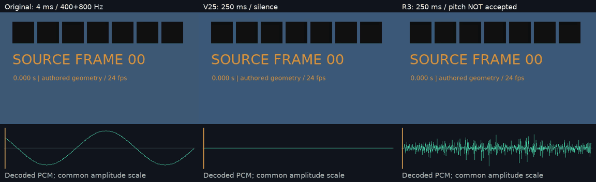

# 离线音频伸缩与真实采样实测

| 项目 | 内容 |
|---|---|
| 文档编号 | VALIDATION-OFFLINE-AUDIO-20261017 |
| 状态 | 有效 |
| 日期 | 2026-10-17，Asia/Taipei |
| 方式 | 原生 Windows/Python/FFmpeg 8.1/Rubber Band 4.0.0 R3；0 Docker/WSL/浏览器/新模型推理 |
| 对照 | 固定 V25 fa781783649a18953bf8e8be0876b3a728ce0dc2，实际运行旧 CLI |
| 素材 | 自制 CC0 视频、400/800 Hz 双声道和 V25 原脉冲，无需剪映运行时 |

完整 **555/555，1598.173 秒**，0 跳过；102 份 Python 源码/测试加 1 份 Schema（共 103 份）原字节冻结。18 项新增与 61 项关联回归均为完整套件子集；固定旧版的 1 项恒速控制也通过，不记作旧版失败。8 组正式实测、72 次 CLI 含 24 渲染/8 质量/8 策略全部成功；210 新主帧、210 精度控制与 210 旧帧分计，三路视频像素相等，源帧身份无误。4 组受控通过；4 组 4 ms→250 ms 已有声，但音高失败：原 400 Hz 脉冲约 386.72 Hz，双声道 400/800 Hz 两路主峰均约 797.24 Hz。瞬态/相位/听感、默认 atempo 极短窗、长片性能和完整剪映等价继续未验收。

[README](../../README.md)、[契约](../specs/离线音频伸缩与PCM输出契约_v0.1_2026-10-17.md)、[机器证据](./evidence/offline-audio-stretch-20261017.json)和[原始公开记录](../assets/offline-audio-stretch-20261017/evidence.json)保留入口、执行细节和结果边界。

## 1. 编号结果

每组有实际旧 MP4、新 MP4、新 float PCM MKV 三次正式发布渲染。8 项 project、16 项 media、8 项 timeline、24 项 render、8 项 quality、8 项 policy 调用，共 72 次全部成功。质量 CLI 8/8 通过；受控交付 4/8 通过，听审 0/8。方法、帧、CLI 和研究计数分别记录。

| 编号 | 场景 | 原音频→目标 | 目标采样帧/声道 | 中段 Hann FFT 主交流峰 | 结果 | 实际输出 |
|---|---|---|---|---|---|---|
| A01 | unity-four-ms | 4.0→4.0 ms | 192 | 401.37/401.37（按原 PCM 相等验收） Hz | 受控通过 | [MP4](../assets/offline-audio-stretch-20261017/after-unity-four-ms.mp4) / [WAV](../assets/offline-audio-stretch-20261017/after-unity-four-ms.wav) / [float MKV](../assets/offline-audio-stretch-20261017/precision-unity-four-ms.mkv) |
| A02 | scalar-slow | 125.0→250.0 ms | 12000 | 399.90/799.44 Hz | 受控通过 | [MP4](../assets/offline-audio-stretch-20261017/after-scalar-slow.mp4) / [WAV](../assets/offline-audio-stretch-20261017/after-scalar-slow.wav) / [float MKV](../assets/offline-audio-stretch-20261017/precision-scalar-slow.mkv) |
| A03 | tiny-forward | 4.0→250.0 ms | 12000 | 797.24/797.24 Hz | **音高失败** | [MP4](../assets/offline-audio-stretch-20261017/after-tiny-forward.mp4) / [WAV](../assets/offline-audio-stretch-20261017/after-tiny-forward.wav) / [float MKV](../assets/offline-audio-stretch-20261017/precision-tiny-forward.mkv) |
| A04 | tiny-reverse | 4.0→250.0 ms | 12000 | 797.24/797.24 Hz | **音高失败** | [MP4](../assets/offline-audio-stretch-20261017/after-tiny-reverse.mp4) / [WAV](../assets/offline-audio-stretch-20261017/after-tiny-reverse.wav) / [float MKV](../assets/offline-audio-stretch-20261017/precision-tiny-reverse.mkv) |
| A05 | tiny-pulse-forward | 4.0→250.0 ms | 12000 | 386.72/386.72 Hz | **音高失败** | [MP4](../assets/offline-audio-stretch-20261017/after-tiny-pulse-forward.mp4) / [WAV](../assets/offline-audio-stretch-20261017/after-tiny-pulse-forward.wav) / [float MKV](../assets/offline-audio-stretch-20261017/precision-tiny-pulse-forward.mkv) |
| A06 | tiny-pulse-reverse | 4.0→250.0 ms | 12000 | 386.72/386.72 Hz | **音高失败** | [MP4](../assets/offline-audio-stretch-20261017/after-tiny-pulse-reverse.mp4) / [WAV](../assets/offline-audio-stretch-20261017/after-tiny-pulse-reverse.wav) / [float MKV](../assets/offline-audio-stretch-20261017/precision-tiny-pulse-reverse.mkv) |
| A07 | scalar-fast | 125.0→62.5 ms | 3000 | 400.27/800.17 Hz | 受控通过 | [MP4](../assets/offline-audio-stretch-20261017/after-scalar-fast.mp4) / [WAV](../assets/offline-audio-stretch-20261017/after-scalar-fast.wav) / [float MKV](../assets/offline-audio-stretch-20261017/precision-scalar-fast.mkv) |
| A08 | nested-bezier | 2600.0→1500.0 ms | 72000 | 399.90/799.80 Hz | 受控通过 | [MP4](../assets/offline-audio-stretch-20261017/after-nested-bezier.mp4) / [WAV](../assets/offline-audio-stretch-20261017/after-nested-bezier.wav) / [float MKV](../assets/offline-audio-stretch-20261017/precision-nested-bezier.mkv) |

A01 双版本正控制：192 个采样帧、每路 189 个非零样本，float PCM 与原片选段逐采样相等。4 ms 短窗频率估计仅作观察，直接相等是其门槛；旧版也通过，不编造成旧版失败。A02/A07/A08 用 ±5 Hz 分别检查 400/800 Hz。A03/A04 两路主峰均约 797.24 Hz，原左声道主音未保留；A05/A06 约 386.72 Hz，相对 400 Hz 偏约 13.28 Hz，四组继续失败。

A05/A06 复用 V25 原 pulses.wav 摘要和 .201–.205 秒源区间、250 ms 正/倒放。新项目采用独立主视频＋嵌套音轨，不等于整个 V25 项目逐字节回放；原历史静音失败文件保留。

## 2. 实际采样与视频

独立核验脚本不导入产品代码。210 新主帧、210 float 精度控制与 210 旧帧三路视频像素完全相等，逐帧源帧身份一致。各 MKV 音频总采样数等于视频帧数×2000（48 kHz/24 fps）；作者区间外全部为零。非恒速的 float 音轨与真正派生缓存逐采样相等，倒放按采样反序后相等；这接受保留和顺序，不接受音高或听感。

Bezier 全部锚点用独立 Simpson 积分复核，最大归一化时钟差 0.000012945 秒。采样锚点是引擎约束，不能据此接受瞬态的逐点对齐。主交流峰使用中间 75% 样本、Hann 窗及补零 FFT，搜索 100–1400 Hz，排除 DC；不把期望频率附近的局部峰误当整体主峰。

真实自动回归另测 24/32-bit 与 float PCM 的容器探测、量化误差≤2^-22、重复缓存字节不变、篡改拒绝且保留原文件、取消清理、短源拒绝补零、NaN/截断 WAV 拒绝、预算/远程路径/未知字段/依赖摘要门禁，以及 dry-run 不解码。测试引擎显式提供，完整套件 0 跳过。

## 3. 原片与 GIF



[原视频](../assets/offline-audio-stretch-20261017/source.mp4) · [原双声道音频](../assets/offline-audio-stretch-20261017/stereo-tones.wav) · [V25 原脉冲](../assets/offline-audio-stretch-20261017/pulses.wav) · [波形 MP4](../assets/offline-audio-stretch-20261017/waveform-comparison.mp4) · [首帧 PNG](../assets/offline-audio-stretch-20261017/waveform-comparison.png) · [末帧 PNG](../assets/offline-audio-stretch-20261017/selected-last-frame.png)。

上方为实际视频帧 0..23；下方只画左声道，源音频横轴 4 ms、旧/新 250 ms，幅度同尺度。全部统计与自动检查覆盖双声道。MP4 1536×470、24 fps、24 帧/1 秒；GIF 1152×353、24 编码帧/1000 ms。预览无声；上表 MP4/WAV 带实际声音。首末帧和波形已静态目检，未连续播放或听审。

## 4. 开发失败与修复

首次测试样例缺少必填 source_in_tick，61 方法中 13 条失败；修正夹具后 8 条失败记录。原生探针确认 0→0 时间图锚点触发 R3 零长比率/NaN，产生错误采样数。现完整计划保留端点，只将内部锚点传给引擎，无内部点不传 timemap；NaN 警告、采样数错误和丢声道都失败，不补静音凑长度。

另一个缺陷是 libsndfile WAV PEAK 区块带当前时间，相同 PCM 重复渲染仍缓存冲突，开发专项保留 3 条失败。现记录引擎原 WAV 摘要，再逐字节复制 float PCM 到固定 fmt/data WAV，去除随时间变化的非音频元数据。采样不改写；真篡改仍拒绝，保留旧缓存。

首次媒体夹具将 clip ID 与 asset ID 同名 sound，按预期 ID_DUPLICATE 阻断；修正后六组开发预检成功，最终八组正式批次另计。基线日志解析器首次只匹配复数 tests，实际 1 test/OK 被错误标成元数据未通过；修正后重新运行正控制 1/1。17 个新离线方法依赖新模块，未声称对缺少模块的旧版跑出 18 条失败。

完整、关联、旧版正控制、开发失败和正式媒体日志见[机器证据](./evidence/offline-audio-stretch-20261017.json)。

## 5. 复现与许可来源

准备已有本地 FFmpeg、原生 R3 exe、同目录 sndfile.dll/COPYING.txt、开源字体和许可。生成器和生产运行不下载资源；使用新目录保留原证据。

```powershell
$env:AI_AD_EDITOR_TEST_RUBBERBAND = 'E:/local-tools/rubberband/rubberband.exe'
$env:PYTHONPATH = (Join-Path (Get-Location) 'product/src')
python -B -X utf8 -m unittest discover -s product/tests -v
& $EvidencePython -I -B -X utf8 scripts/smoke_offline_audio_stretch.py --output product/.runtime/audio-recheck --work product/.runtime/audio-recheck-work --rubberband $env:AI_AD_EDITOR_TEST_RUBBERBAND --font $LocalFont --font-license $LocalFontLicense
```

EvidencePython 是已有 NumPy/Pillow 的原生 Python，字体路径由调用者提供。缺少显式 R3 时离线专项会跳过，本次完整验收确认 0 跳过。机器记录保存实际命令、版本、输入/程序/依赖/字体与全部公开输出 SHA-256；缓存和临时目录位于 E 盘。

研究来源为 [Rubber Band 官方](https://www.breakfastquay.com/rubberband/)、[离线集成文档](https://www.breakfastquay.com/rubberband/integration.html)和[CLI 说明](https://www.breakfastquay.com/rubberband/usage.txt)。本机使用官方 GPL 4.0.0 Windows 包，exe/DLL 不随仓库分发；原始二进制与源码压缩包摘要在机器证据。GPL-2.0-or-later 见[原许可](../assets/offline-audio-stretch-20261017/rubberband-license.txt)；libsndfile 等依赖由上游 README 声明，登记摘要不等于完成整体发行许可审查。

本轮真实音频为双声道；1..8 声道是资源/格式接受范围，不表示八种声道数均完成真实质量验收。R3 多重倒放祖先、源片段自带复杂速度曲线、不同采样率/布局的完整组合也未由这八组覆盖，默认 atempo 的历史回归不能替代这些 R3 组合验收。

本增量推进显式本地离线伸缩和精度保留；极短音高/串频、瞬态/相位/听感、默认 atempo、长片性能、自然模型质量、完整内容库、VFR/HDR/群组与完整剪映等价仍待验收。
