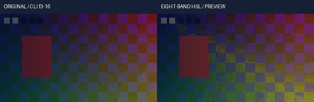

# 连续浮点八色HSL与显式色域策略实测

实际源码关联回归 **328项 /755.653893秒 /0跳过**，其中44项新增；离线安装和完整回归分别执行，不累计为剪映功能完成度。

既有selective_hsl/hsl_bands/eight_band_hsl在8位geq或随包frei0r中执行。本轮在明确float32-native-v1工程中实现连续Float32路径，不加载8位插件处理浮点表面，不生成整数LUT，不新增在线请求或闭源服务。HSL分析和重建使用binary64临时量，持久表面为Float32。标准YUV hue效果没有被悄悄替换为RGB HSL。

24个分色通道逐项与真实geq比较，混合八色与真实随包frei0r插件比较；输入明确为RGBA8，比较最终8位码，执行前门槛1码。另用标准库colorsys和原始色相左右邻点插值作独立连续参考，覆盖不等宽扇区、红色环绕、灰阶、极暗色度、输入/输出传递和线性强度。整数后端对照不代表整数后端支持高位深或任意自然画质。

首轮native-r1实际44项/83.0629272秒，0失败/1错误/0跳过。测试把compile_native放在patch.dict中，却在退出环境作用域后启动FFmpeg，导致FREI0R_PATH先被还原、插件无法定位。首次追加复现误把目录标为odd-size，该目录原样保留；实际stderr与corrected-native-test-environment收据明确证明原因是环境作用域，原43×17尺寸在修正子进程环境后成功，最大1码。仅修改测试文件，未改运行时算法和误差门槛；native-r2重跑全部328项关联范围。验证器补存CalledProcessError的原始I/O以便未来失败定位，不改写旧收据。

首轮media-r1的原创正式render成功，edited render在验证时拒绝：演示残差场景曝光终点3.5超出既有上限3。r2仅把该演示/独立参考的曝光改为2.7..3，不改任何产品输入、曝光保护或容差；实际仍产生超白并到达最终交付clip边缘。两个失败及其执行源、日志和命令均保留。

五段公开CLI覆盖暖色、冷色、全部八色、曝光后输入clip和曝光后残差保留。独立参考自行解四控制Bezier时间根、按原始色相左右邻点给权重、用colorsys重建HSL、解析源alpha并按线性背景合成；未导入产品数学模块。最终整数视频、PNG16与当前Float32预览参考明确使用交付range_policy=clip，不把裁切后参考称为无界HDR母版。静态联系表查看与连续播放/声音听审分别登记。

<!-- V105-CONTINUOUS-FLOAT-EIGHT-BAND-HSL -->
### V105 候选：连续浮点八色HSL与显式色域策略（未发布）

显式`float32-native-v1`工程的正式render和预览共用连续浮点八色HSL、24通道及强度关键帧、原始色相分带和明确输入/输出信号。既有8位HSL后端保持原接口；默认后端迁移、其余浮点算子、自然素材/离线AI质量与完整剪映目标继续开发。

| 编号 | 功能性核验 | 实际内容与边界 | 证据 |
|---|---|---|---|
| FH105-01 | 共用内核 | 父色轮316→318产品输入，5条路径改变；44新增方法；正式render、区间预览和PNG16使用既有有序效果链 | [接口契约](../../docs/specs/连续浮点八色HSL与显式色域策略契约_v0.1_2026-10-22.md) |
| FH105-02 | 八色24通道 | red/orange/yellow/green/cyan/blue/purple/magenta×hue/saturation/lightness；原始色相同时决定全部权重，保留橙/紫不等宽扇区与红色环绕 | [源码及328项相关回归](../../docs/validation/evidence/float-hsl-20261022-lab/native-r2/verification.json) |
| FH105-03 | 连续精度 | 不经过整数表面或LUT；131073个连续值检查，近黑色不用epsilon地板抹除色度；HSL使用binary64临时量，持久表面Float32；alpha逐位保留 | [实际断言](../../docs/validation/evidence/float-hsl-20261022-lab/native-r2/unittest.log) |
| FH105-04 | 真实后端对照 | 24通道分别对照真实8位FFmpeg geq；混合八色对照随包frei0r插件；预先门槛1码，直接RGBA8输入/输出，未宣称旧后端支持连续浮点 | [真实命令/原始I/O](../../docs/validation/evidence/float-hsl-20261022-lab/native-r2/verification.json) |
| FH105-05 | 显式色域 | 默认reject越界；clip明确裁切算子输入；preserve_residual把原始RGB减去bounded RGB的残差加回HSL结果。输出clip另设，均报告实际分量计数 | [契约与边界](../../docs/specs/连续浮点八色HSL与显式色域策略契约_v0.1_2026-10-22.md) |
| FH105-06 | 信号与强度 | 明确input/output primaries和transfer，不猜测视频标签；强度在线性工作RGB中混合；灰阶和未选色像素在相同信号下保留原RGB | [独立colorsys参考](../../docs/validation/evidence/float-hsl-20261022-lab/native-r2/unittest.log) |
| FH105-07 | 作者关键帧 | 25个数值通道可动；6种插值、4控制Bezier时间根、大整数/有理tick、保持左极限、作者窗口和嵌套倒放 | [实际断言](../../docs/validation/evidence/float-hsl-20261022-lab/native-r2/unittest.log) |
| FH105-08 | 顺序与事务 | 曝光/LUT/曲线/色阶/色轮/HSL按作者顺序；只读输入、跨分块一致、晚块非法值、预算/取消/转换溢出保留输入 | [冻结与执行日志](../../docs/validation/evidence/float-hsl-20261022-lab/native-r2/verification.json) |
| FH105-09 | 真实公开CLI | 20调用/31检查；2次正式render、3次preview；原创320×180、10fps、2秒各20帧；暖色/冷色/八色混合/输入clip/残差五场景 | [真实命令与媒体](../../docs/validation/evidence/float-hsl-20261022-lab/media-r2/verification.json) |
| FH105-10 | 全像素独立参考 | 作者帧3..16共2,419,200线性RGB，最终交付clip后最大绝对误差1.19209289551e-07，执行前门槛2e-6；裁切前峰值1.43499649，越界分量14056；96000/选区67200双声道PCM采样帧一致，PNG16≤1码 | [独立邻点权重/colorsys](../../docs/validation/evidence/float-hsl-20261022-lab/media-r2/executed-oracle.py.txt) |
| FH105-11 | 原片/GIF | CC0原创图形、移动帧标记、透明度和正弦音频；GIF左原片右实际CLI预览，14×100ms；静看3/10/16共6幅，未做连续播放/听审 | [原片](../../docs/assets/float-hsl-20261022-r2/original-range.mp4) · [实际输出](../../docs/assets/float-hsl-20261022-r2/range.mp4) · [Float32](../../docs/assets/float-hsl-20261022-r2/range.master.nut) · [查看记录](../../docs/validation/evidence/float-hsl-20261022-lab/static-review-r1.json) |
| FH105-12 | 离线安装 | **528项 /1436.82秒 /0跳过**；190份source/wheel/site资源、8个固定离线wheel、NumPy931文件及许可一致；安装版CLI音画、Float32和PNG16与源码版一致。 | [安装收据](../../docs/validation/evidence/float-hsl-20261022-lab/installed-r1/verification.json) · [工程](../../docs/assets/float-hsl-20261022-r2/author-project.json) · [权利账](../../docs/assets/float-hsl-20261022-r2/rights-ledger.json) · [CC0](../../docs/assets/float-hsl-20261022-r2/LICENSE.txt) |
| FH105-13 | 完整回归 | **尚未通过，不计通过**；目标2623项，仅在V104实际完整2579项通过并普通发布后执行。 源码328、安装528与完整套件分别记录，不相加作为功能完成率 | [本轮报告](../../docs/validation/连续浮点八色HSL与显式色域策略实测_2026-10-22.md) |
| FH105-14 | 保留失败与边界 | 首轮44项有1个测试环境错误；首次演示曝光终点3.5超出既有上限，CLI拒绝。仅修正测试子进程环境和演示参数；未改产品算法/保护或放宽容差。residual是明确创意延伸，不代表HDR感知模型、自然素材质量、长片RSS或完整剪映等价 | [原失败与修正](../../docs/validation/evidence/float-hsl-20261022-lab/failure-analysis-r1.json) |

<!-- /V105-CONTINUOUS-FLOAT-EIGHT-BAND-HSL -->
