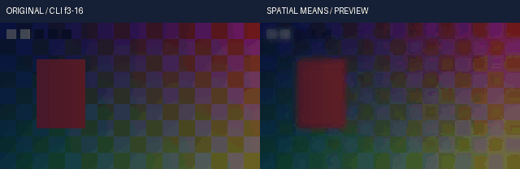

# 连续浮点均值／方框模糊与4K分块实测

实际源码关联回归 **479项 /1019.795101秒 /0跳过**，其中59项新增。每阶段结果分别列示，未执行／仍运行不计通过，完整剪映目标继续开发。

本轮新增有限窗口均值和重复方框模糊，同时修复高斯4K的转换分块准入。原空间工作区与768MiB估算上限保持，适配可用余量确定检查／信号转换块。不是把整图卷积切成没有重叠的独立小块；全空间依赖仍整体准入，逐行求和临时空间另行预留。该估算不是整个进程的峰值RSS保证。

均值使用复制边缘、有效半径限制至轴长度整除2。方框使用半采样点对称边界、多次水平后多次垂直。两者对整数半径实现理想归一化有限窗；原FFmpeg均值输出有整数floor，方框有固定倒数及逐轴逐遍量化，因此不保证位相同。32组实际整数格式对照保留原始输入／输出；均值1.02码门槛、方框按位深／半径／power预先计算解析量化界限，未按观察结果调整。

分数半径是明确的连续扩展：内层tap为1、外层tap权重为小数部分，除以2r+1。局部求和不做大前缀相减，避免远处不透明／高亮样本吞掉局部低密度或正常颜色。覆盖率1e-30、高亮1e30的实际测试与普通随机数据／矩阵参考分开保留。产品数学使用独立的逐行分层窗口求和，没有复制FFmpeg C循环。

真实4K由竖直恒定的原创条纹／矩形和透明度梯度组成，每种模糊1帧。高斯参考以有限几何卷积和边界项求解，不运行产品递推；均值参考显式逐tap和边界索引，不调用产品求和。逐项检查每个4K RGBA值，正式render输入、Float32预览、PNG16、静音样本及缓存另验。4K GIF只切换三种单帧输出；较小五场景视频另提供20帧原片与成片。二者均不能证明长视频性能、自然素材画质、连续播放或听感。

首个4K脚本误将正式render输出指向工程外的docs/assets，现有路径约束拒绝；原错误与执行代码保留。修复只把测试输出改为工程内，再复制已完成结果；没有修改数值算法、误差门槛或产品路径保护。私有continuation-r1还因保留上一轮Gaussian媒体状态常量而拒绝新空间滤镜的有效媒体状态，发生在安装或finisher启动前；保留该失败，以新私有continuation-r2修正结果名称并重绑18脚本，产品326输入不变。R107之前独立记录的NOTICE打包故障保持历史，本轮继承修复后的父输入，并继续核对193旧资源加2个新Python模块。

研究对照为官方[FFmpeg n8.1 vf_avgblur.c](https://raw.githubusercontent.com/FFmpeg/FFmpeg/n8.1/libavfilter/vf_avgblur.c)和[vf_boxblur.c](https://raw.githubusercontent.com/FFmpeg/FFmpeg/n8.1/libavfilter/vf_boxblur.c)。前者带MIT、后者GPL2+声明；本轮观察其边界与量化行为，不把GPL C源码纳入Python模块。FFmpeg程序本身及原高斯BSD参考保留既有许可归属。研究文本读取与运行网络策略分开；产品运行及测试无线上请求，无Docker／WSL／虚拟环境或浏览器tab。

<!-- V108-CONTINUOUS-FLOAT-SPATIAL-MEANS-4K -->
### V108 候选：连续浮点均值／方框模糊与4K分块（未发布）

显式`float32-native-v1`的正式render和preview新增均值／方框模糊，支持连续半径、作者关键帧和透明边缘。高斯及均值内核按剩余预算自动缩小转换分块，保留完整空间工作区准入和768MiB估算上限。

| 编号 | 功能性核验 | 实际内容与边界 | 证据 |
|---|---|---|---|
| FS108-01 | 共用内核 | 高斯父323→326产品输入、10路径改变、59新增方法；3个未支持操作样例从avgblur换成unsharp，拒绝码／清理／禁回退断言保留 | [契约](../../docs/specs/连续浮点均值方框模糊与空间预算契约_v0.1_2026-10-22.md) |
| FS108-02 | 均值模糊 | avgblur/average_blur；半径0..1024、默认2；复制边缘、有效XY半径分别限制至轴长度整除2；单次归一化有限窗 | [源码479项](../../docs/validation/evidence/float-spatial-20261022-lab/native-r2/verification.json) |
| FS108-03 | 方框模糊 | boxblur/box_blur；半径0..128、默认4；半采样点对称边界，power为0..4静态整数；先全部水平遍数再全部垂直遍数 | [实测日志](../../docs/validation/evidence/float-spatial-20261022-lab/native-r2/unittest.log) |
| FS108-04 | 连续半径／时钟 | 整数内层tap为1，两个外层tap权重为半径小数，除以2r+1；6种插值、Bezier时间根、Fraction、原作者窗口和嵌套倒放；不是四舍五入到整数窗口 | [契约](../../docs/specs/连续浮点均值方框模糊与空间预算契约_v0.1_2026-10-22.md) |
| FS108-05 | 实际原生对照 | 32组整数平面FFmpeg；均值8/10/12/16位与16种GBRA掩码，方框8/16位与4种power、默认CPU／纯C；均值最大误差0.989572138码，门槛1.02；方框最大8.62693566码，分别受执行前固定倒数／逐遍量化解析界限约束 | [命令与原始I/O](../../docs/validation/evidence/float-spatial-20261022-lab/native-r2/verification.json) |
| FS108-06 | 独立数学 | 显式tap／边界索引矩阵与矩阵幂，不调用产品求和；不同边界、单像素／行列、最大半径、分数半径、方向与多遍均执行 | [日志](../../docs/validation/evidence/float-spatial-20261022-lab/native-r2/unittest.log) |
| FS108-07 | 透明与动态范围 | straight／premultiplied；GBRA位保持G1/B2/R4/A8；RGB-only保留alpha位，alpha-only同信号绕过RGB转换；零密度清RGB，正1e-30密度无epsilon阈值 | [契约](../../docs/specs/连续浮点均值方框模糊与空间预算契约_v0.1_2026-10-22.md) |
| FS108-08 | 防止低覆盖率丢失 | 有界逐行分层求和，不做大前缀相减；真实检查不相邻不透明像素之后的1e-30覆盖率，以及1e30高亮之后的局部正常RGB；不是加epsilon掩盖误差 | [实际断言](../../docs/validation/evidence/float-spatial-20261022-lab/native-r2/unittest.log) |
| FS108-09 | 信号／强度／安全 | 明确输入输出信号；返回线性工作RGB后混合intensity，coverage独立线性混合；只读输入、取消／回调异常、完整表面非法值和保留表预算检查 | [日志](../../docs/validation/evidence/float-spatial-20261022-lab/native-r2/unittest.log) |
| FS108-10 | 预算修复 | 原高斯4K默认tile估算830865416>805306368，曾明确拒绝；现保留6×完整表面等固定估算，按余量缩tile，4K默认3903像素。71×65／2MiB新旧预算输出逐位一致 | [旧拒绝](../../docs/validation/evidence/float-spatial-20261022-lab/admission-probe-r1.json) · [新实际4K](../../docs/validation/evidence/float-spatial-20261022-lab/4k-r2/verification.json) |
| FS108-11 | 真正4K公开入口 | 3种模糊各1帧3840×2160；8次公开CLI，含正式render、原尺寸range、Gaussian PNG16及独立进程缓存复用；无提高768MiB算子预算 | [4K记录](../../docs/validation/evidence/float-spatial-20261022-lab/4k-r2/verification.json) |
| FS108-12 | 4K全部像素 | 每种33,177,600个RGBA分量逐项检查，总99,532,800；独立几何卷积边界项／显式tap行数学，图像竖直恒定；最大误差5.96046447754e-08，门槛2e-6；正式16位输入与实预览一致，4800帧双声道静音一致 | [4K复现代码](../../docs/validation/evidence/float-spatial-20261022-lab/4k-r2/executed-script.py.txt) |
| FS108-13 | 五场景公开视频 | 20调用/31检查、2正式render／3preview；320×180、10fps、2秒20帧；均值、方框、水平、RGB-only、预乘超白各4帧 | [视频实测](../../docs/validation/evidence/float-spatial-20261022-lab/media-r1/verification.json) |
| FS108-14 | 全选区／声音 | 2,419,200线性RGB最大误差2.23517417908e-08，门槛2e-6；96000／选区67200双声道PCM帧一致，PNG16≤1码；clip前线性峰值1.39998436、越界10536分量 | [独立参考](../../docs/validation/evidence/float-spatial-20261022-lab/media-r1/executed-oracle.py.txt) |
| FS108-15 | 可查看媒体 | CC0原创输入／实际输出／工程／权利账；视频GIF14×100ms，静看作者3/10/16共6幅；4K GIF仅切换3张实际单帧，不作为连续运动证明 | [原片](../../docs/assets/float-spatial-20261022-r1/original-range.mp4) · [输出](../../docs/assets/float-spatial-20261022-r1/range.mp4) · [工程](../../docs/assets/float-spatial-20261022-r1/author-project.json) · [4K](../../docs/assets/float-spatial-4k-20261022-r2/contact.png) · [目检](../../docs/validation/evidence/float-spatial-20261022-lab/static-review-r1.json) |
| FS108-16 | 离线安装 | **679项 /1520.074秒 /0跳过**，195份source/wheel/site资源一致；8固定离线wheel、NumPy931文件和许可一致；安装版真实编码音画、Float32和PNG16与源码版一致。 | [安装收据](../../docs/validation/evidence/float-spatial-20261022-lab/installed-r1/verification.json) |
| FS108-17 | 完整回归 | **尚未通过，不计通过**；目标2774项，仅在V107实际完整2715项通过并普通发布后执行。 源码479、安装679和完整套件分别登记，不相加作为完成率 | [本轮报告](../../docs/validation/连续浮点均值方框模糊与4K分块实测_2026-10-22.md) |
| FS108-18 | 失败／许可／边界 | 首次4K测试输出目录位于工程外而被拒绝；修复测试路径后重跑。私有编排首跑沿用上一轮媒体结果常量，在安装启动前拒绝；仅修正编排器并重新绑定18脚本。产品数值／门槛不变。均值数学独立实现，原高斯NOTICE继续核对；长片RSS／自然素材／HDR／完整剪映目标继续开发 | [4K原失败](../../docs/validation/evidence/float-spatial-20261022-lab/4k-r1/verification.json) · [编排修复](../../docs/validation/evidence/float-spatial-20261022-lab/continuation-recovery-r2.json) · [契约](../../docs/specs/连续浮点均值方框模糊与空间预算契约_v0.1_2026-10-22.md) |

<!-- /V108-CONTINUOUS-FLOAT-SPATIAL-MEANS-4K -->
