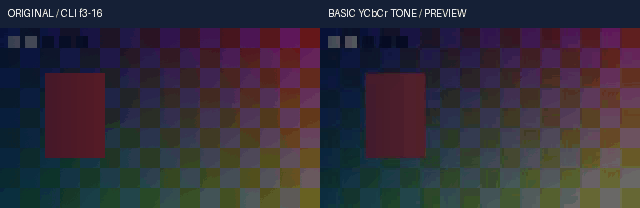

# 连续浮点基础调色与YCbCr语义实测

源码关联回归实际 **372项 /741.017157秒 /0跳过**，44项新增。源码、隔离安装、公开CLI媒体与完整回归分别记录，不将通过数解释为剪映等价。

本轮将8类旧基础调色连接到显式float32-native-v1时间线，保留Y码值亮度/对比度/Gamma、CbCr饱和度以及全局HSL的色度旋转语义。未用RGB HSL替换全局hsl。八色selective_hsl仍使用独立RGB HSL模型。matrix/range与输入输出RGB信号必须声明；工作表面保持线性RGBA Float32，算子在声明信号的分数YCbCr码值中处理，强度在线性RGB混合。

真实原生测试直接输入/输出YUVA444平面，不通过RGB转码来掩盖误差。eq比较原生8位亮度、对比度、饱和度、组合color和Gamma；hue比较8位色相、8/10位灰度与10位HSL。默认CPU和禁用CPU特性的亮度调用均执行。预先门槛为1.01分数码，允许原生像素取整与Float32投影误差，不承诺逐位相同。continuous模式还用独立矩阵求逆/标量参考核验；native_coefficients模式只舍入系数，持续像素不量化。

原生eq的快速对比度/亮度与Gamma LUT使用不同数值路径。continuous明确使用连续归一化公式；native_coefficients在Gamma为1时保留标量固定点系数，在Gamma不为1时保留连续幂函数并对参数使用原生单精度。eq饱和度实际限制3，作者4在元数据报告有效3；hue饱和度仍按其接口处理。eq零饱和度围绕最大码的一半，灰度围绕中性色度码，两者不假装相同。

首轮44项中1项测试构造遗漏Bezier控制点，保护按要求拒绝。仅补测试夹具，运行时未变；完整保留native-r1失败、执行源和原始I/O，随后native-r2运行372项相关回归。没有调整算法、功能约束或误差门槛。

实片五场景的独立参考只使用NumPy、标准数学和单独的矩阵求逆，不导入产品颜色/矩阵/关键帧/效果函数。检查整个选区的全部RGB和PCM、实际PNG16、分进程缓存复用与作者数据不变。最终交付策略明确为clip；裁切前超白单独统计，不把交付裁切参考称作无界HDR母版。CC0媒体保留原片、实际输出、GIF、工程、权利账、SHA和执行脚本。静态目检与连续播放/声音听审分别登记。

来源研究参考：[FFmpeg n8.1 eq实现](https://raw.githubusercontent.com/FFmpeg/FFmpeg/n8.1/libavfilter/vf_eq.c)。本机原生执行二进制为已配置FFmpeg 8.1。研究目录的旧FFmpeg源码标记8.0.git，不能冒称n8.1；本轮网络抓取n8.1的eq.h/hue失败，失败保留在私有研究收据，不作为已取得版本源码的证明。产品运行和媒体验证没有在线请求；没有复制旧源码充作新版本证据。

<!-- V106-CONTINUOUS-FLOAT-BASIC-YCBCR-TONE -->
### V106 候选：连续浮点基础调色与YCbCr语义（未发布）

显式`float32-native-v1`工程的正式render和预览共用亮度、对比度、饱和度、组合color、Gamma、色相、全局HSL和灰度。矩阵/量程/信号明确，像素连续；全局HSL保留YCbCr旋转模型，与八色RGB HSL分开。默认后端迁移、其余浮点算子、自然素材/离线AI质量与完整剪映目标继续开发。

| 编号 | 功能性核验 | 实际内容与边界 | 证据 |
|---|---|---|---|
| FT106-01 | 共用内核 | 父HSL318→320产品输入，5条路径改变；44新增方法；原生Windows，无容器/网络运行时 | [接口契约](../../docs/specs/连续浮点基础调色与YCbCr语义契约_v0.1_2026-10-22.md) |
| FT106-02 | 基础调色 | 8类语义及14个类型名；亮度/对比度/Gamma作用于Y码值，eq饱和度作用于Cb/Cr，全局HSL使用色度旋转和旧hue亮度幅度 | [372项相关回归](../../docs/validation/evidence/float-tone-20261022-lab/native-r2/verification.json) |
| FT106-03 | 显式信号 | 明确input/output primaries与transfer、四种受支持矩阵、full/limited量程及8/10位分数码值轴；矩阵独立于transfer，不猜测标签 | [独立矩阵求逆参考](../../docs/validation/evidence/float-tone-20261022-lab/native-r2/unittest.log) |
| FT106-04 | 实际原生对照 | 24次真实FFmpeg YUVA444 eq/hue对照，包括8位与10位hue、默认CPU与纯C亮度路径；最大分数码误差0.999512643，执行前门槛1.01码；alpha不变。整数后端对照不代表任意浮点输入等价 | [原始命令/I/O](../../docs/validation/evidence/float-tone-20261022-lab/native-r2/verification.json) |
| FT106-05 | 两种算术 | continuous使用连续公式；native_coefficients只量化旧内核标量系数，不量化像素。原生输出还会取整，未承诺逐位相同 | [实际差异断言](../../docs/validation/evidence/float-tone-20261022-lab/native-r2/unittest.log) |
| FT106-06 | 旧语义边界 | eq饱和度作者范围0..4但有效上限3，显式报告；eq零饱和度中心为半最大码，与中性色度灰度不同；HSL亮度±1是8位±25.5码，10位±102.4码 | [契约](../../docs/specs/连续浮点基础调色与YCbCr语义契约_v0.1_2026-10-22.md) |
| FT106-07 | 连续精度 | 131072个不同浮点输入保持超过130000个不同输出；无整数表面/LUT；持久RGBA Float32、临时数学binary64、alpha逐位保留 | [实际断言](../../docs/validation/evidence/float-tone-20261022-lab/native-r2/unittest.log) |
| FT106-08 | 码值裁切 | 仅发生改变的YCbCr平面裁切至参考码值轴，报告分量数；未改变平面保留headroom；RGB output_gamut=clip单独声明，最终交付clip另设 | [契约](../../docs/specs/连续浮点基础调色与YCbCr语义契约_v0.1_2026-10-22.md) |
| FT106-09 | 作者与顺序 | 6种插值、4控制Bezier时间根、大整数/有理tick、原作者预览窗口与嵌套倒放；效果顺序保留；只读、预算、取消/异常与溢出保护调用者输入 | [执行日志](../../docs/validation/evidence/float-tone-20261022-lab/native-r2/unittest.log) |
| FT106-10 | 真实公开CLI | 20调用/31检查；2次正式render、3次preview；原创320×180、10fps、2秒各20帧；color/Gamma/HSL/灰度/曝光后原生系数五场景 | [实测记录](../../docs/validation/evidence/float-tone-20261022-lab/media-r1/verification.json) |
| FT106-11 | 全像素参考 | 作者帧3..16共2,419,200线性RGB，交付clip后最大绝对误差5.96046447754e-08，执行前门槛2e-6；裁切前峰值1.64730573、越界RGB分量16432；96000/选区67200双声道PCM采样帧一致、PNG16≤1码 | [独立矩阵求逆/标量参考](../../docs/validation/evidence/float-tone-20261022-lab/media-r1/executed-oracle.py.txt) |
| FT106-12 | 原片/GIF | CC0原创图形、移动帧标记、透明度和正弦音频；左原片右实际预览，GIF14×100ms；静看3/10/16共6幅，未做连续播放/听审 | [原片](../../docs/assets/float-tone-20261022-r1/original-range.mp4) · [输出](../../docs/assets/float-tone-20261022-r1/range.mp4) · [Float32](../../docs/assets/float-tone-20261022-r1/range.master.nut) · [目检](../../docs/validation/evidence/float-tone-20261022-lab/static-review-r1.json) |
| FT106-13 | 离线安装 | **572项 /1250.367秒 /0跳过**；191份source/wheel/site资源、8个固定离线wheel、NumPy931文件及许可一致；安装版公开CLI的编码音画、Float32和PNG16与源码版一致。 | [安装收据](../../docs/validation/evidence/float-tone-20261022-lab/installed-r1/verification.json) · [可编辑工程](../../docs/assets/float-tone-20261022-r1/author-project.json) · [权利账](../../docs/assets/float-tone-20261022-r1/rights-ledger.json) · [CC0](../../docs/assets/float-tone-20261022-r1/LICENSE.txt) |
| FT106-14 | 完整回归 | **尚未通过，不计通过**；目标2667项，仅在V105实际完整2623项通过并普通发布后执行。 源码372、安装572与完整套件独立登记，不相加当作功能完成率 | [本轮报告](../../docs/validation/连续浮点基础调色与YCbCr语义实测_2026-10-22.md) |
| FT106-15 | 原失败 | native-r1实际44项/81.670621秒，0失败/1错误/0跳过；测试遗漏必需Bezier控制点，仅补测试夹具；保留执行源/日志，未改算法/保护或放宽门槛 | [失败分析](../../docs/validation/evidence/float-tone-20261022-lab/failure-analysis-r1.json) |
| FT106-16 | 未验收边界 | 10位eq为显式连续扩展，没有原生eq10兼容承诺；无HDR感知模型、自然素材质量、长片RSS、持续播放/听审或完整剪映等价验收 | [契约与边界](../../docs/specs/连续浮点基础调色与YCbCr语义契约_v0.1_2026-10-22.md) |

<!-- /V106-CONTINUOUS-FLOAT-BASIC-YCBCR-TONE -->
