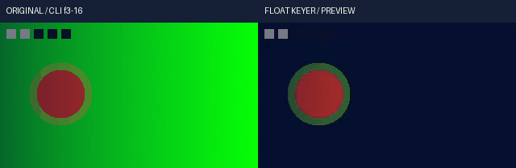

# 连续浮点色度抠像与去溢色实测

R110 为共同 Float32 渲染链增加 RGB／色度距离抠像、连续软边、分数羽化、去溢色和八个作者动画通道。正式 `render` 与浮点 `preview range/frame` 使用同一算子；需显式选择 `float32-native-v1`。本页记录候选的实际源码与媒体验证，尚不表示已发布或完成剪映全功能等价。

## 编号核验

| 编号 | 功能与方法 | 实际结果 | 证据 |
|---|---|---|---|
| K110-01 | RGB 距离、四种 YCbCr 矩阵、full/limited、软边、邻域与分数羽化 | 新增 55 项方法；关联回归第二轮实际 177 项，676.215 秒，0 失败/错误/跳过；330 输入前后逐 SHA 相同 | [第二轮收据](evidence/float-keyer-20261023-lab/native-r2/verification.json) · [原始日志](evidence/float-keyer-20261023-lab/native-r2/unittest.log) |
| K110-02 | 独立数学及作者时间 | 独立标量公式、稠密边界矩阵、>65,536 个不同 Float32 遮罩值、六种插值、超过 2^53 的有理时钟、区间与嵌套倒放；非整数遮罩中间图 | [测试源码](../../product/tests/test_float_keyer.py) · [契约](../specs/连续浮点色度抠像与去溢色契约_v0.1_2026-10-23.md) |
| K110-03 | 实际 FFmpeg RGB8/16、YUV8/16 对照 | 使用本机原生 8.1，保存实际命令、原始输入/输出和码值差；RGB alpha 预声明界限 1.08 码、YUV 1.1 码。YUV 原生比较只取内部区域，所有边界另有独立数学验证 | [原生调用与记录](evidence/float-keyer-20261023-lab/native-r2/verification.json) |
| K110-04 | 两秒原创合成素材，五种场景、八个抠像动画通道 | 20 次实际调用/31 核验；2 次正式 CLI render、3 次 CLI preview；2,419,200 个 RGB 值最大绝对误差 **1.4901161193847656e-8** | [实片收据](evidence/float-keyer-20261023-lab/media-r1/verification.json) |
| K110-05 | alpha、去溢色与显式交付裁剪 | 输入覆盖相乘；没有去溢色/显式裁剪时隐藏 RGB 逐位保留。过曝光场景线性峰值 6.498019，58,564 个越界 RGB 分量在交付阶段按显式政策裁剪 | [独立 oracle](../../scripts/keyer_media_oracle.py) · [实片](evidence/float-keyer-20261023-lab/media-r1/verification.json) |
| K110-06 | 音频、区间、PNG16 与跨进程缓存 | 整片各 96,000 个立体声采样帧、区间 67,200 个采样帧逐字节一致；PNG16 不超过 1 码；正式传输与浮点预览有 SHA 对照，独立 CLI 缓存复用 | [31 项核验](evidence/float-keyer-20261023-lab/media-r1/verification.json) |
| K110-07 | 默认 768 MiB 算子预算下的实际 4K | RGB/色度/去溢色各 1 帧 3840×2160；8 个公开 CLI 进程、19 次调用、33 核验；比较 99,532,800 个 RGBA 分量，三组最大误差均为 **0** | [4K 收据](evidence/float-keyer-20261023-lab/4k-r1/verification.json) |
| K110-08 | 静态视觉查看 | 已查看五种场景/10 幅原片与输出面板，主体及时间标记可见，软边、部分强度残留背景与过曝裁剪变化可见；仍有环形残色 | [查看记录](evidence/float-keyer-20261023-lab/static-review-r2.json) · [静态图](../assets/float-keyer-review-20261023-r1/five-scenes-contact.png) |
| K110-09 | 失败与恢复 | 首轮 177 项中 2 失败/1 错误，分别是未触发缩块的预算夹具、错误曝光参数名、嵌套合成中零透明度隐藏 RGB 的错误预期；仅修测试夹具，没有修改算法或放宽容差 | [首轮失败](evidence/float-keyer-20261023-lab/native-r1/verification.json) · [原始日志](evidence/float-keyer-20261023-lab/native-r1/unittest.log) |
| K110-10 | 安装、完整回归与发布 | 本候选尚未执行独立安装/完整回归。前序 V103 的 2,537 项全量实际有 1 失败/1 错误，后续门禁已停止；不能把推导的 796/2,891 记为已通过 | [基础与未通过状态](evidence/float-keyer-20261023-lab/foundation-r1.json) |

## 原片与结果

原创程序生成的素材包含绿/蓝背景、移动红色主体、带绿色的边环、透明度梯度、时间标记和原创立体声正弦音频；资产使用 CC0-1.0，不含外部素材或真人。GIF 展示选定作者帧 3–16，连续播放和听音尚未人工验收。

[原始高精度素材](../assets/float-keyer-20261023-r1/original.native.mkv) · [输入 MP4](../assets/float-keyer-20261023-r1/original.mp4) · [输出 MP4](../assets/float-keyer-20261023-r1/edited.mp4) · [实际工程](../assets/float-keyer-20261023-r1/author-project.json) · [版权账](../assets/float-keyer-20261023-r1/rights-ledger.json)

[4K RGB 单帧输出](../assets/float-keyer-4k-20261023-r1/rgb.mp4) · [4K 色度单帧输出](../assets/float-keyer-4k-20261023-r1/chroma.mp4) · [4K 去溢色单帧输出](../assets/float-keyer-4k-20261023-r1/despill.mp4)。4K GIF 切换三个单帧，不能用来证明 4K 动画、持续吞吐或峰值 RSS。

## 原生语义与许可

官方 FFmpeg n8.1 `vf_colorkey.c`、`vf_chromakey.c` 已通过官方 GitHub Contents API 固定，原始 API JSON、Git blob SHA 与解码源码均保留；代码为 LGPL-2.1-or-later，仅供参考与对照，本轮运行算子为原创 Python/NumPy，没有复制 C 到产品。原始 raw HTTPS 连接重置失败单独保留。[成功固定与本机过滤器信息](evidence/float-keyer-20261023-lab/source-reference-r2/verification.json) · [首次连接失败](evidence/float-keyer-20261023-lab/source-reference-r1/verification.json)。

所有效果别名默认采用已有 RGB 距离含义，必须显式 `metric="chroma"` 才使用色度算法。色度邻域与羽化使用可复现的端点复制，不复制原生色度过滤器边界暂存数组的扫描历史；`native_coefficients` 仅指标量和软边阈值解释，不承诺像素逐位等价。

全部验证为原生 Windows、本地文件、离线运行；没有 Docker、WSL、虚拟环境、云模型或交互浏览器 tab。768 MiB 是算子工作区估算上限，不是进程 RSS 实测。自然人物/头发抠像、HDR、长片、实时性能、完整剪映功能与观感等价仍未验收。
