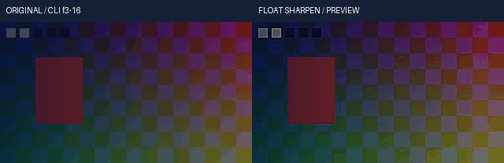

# 连续浮点锐化与原生差异实测

实际关联源码回归 **121项 /331.871580秒 /0跳过**，其中62项新增。真实媒体与4K原始收据不改写：唯一测试行更新后的328输入通过guard-only-input-binding-r1.json明确绑定到原收据；327路径（含全部产品运行资源、schema）、媒体脚本和oracle逐项未变，不把旧媒体伪装为重跑。源码、真实视频、4K、安装及完整回归分别登记；未执行或运行中不计通过，完整剪映目标仍在开发。

本轮在共同Float32 render/preview效果链新增sharpen/unsharp。先按明确input_signal编码，再变换到明确矩阵／量程的YCbCr码值轴，以独立二项核求blur，按src+amount×(src-blur)处理亮度、色度或coverage。再明确解释output_signal、回到线性工作RGB，最后混合强度。默认只锐化亮度，alpha原位保留；默认continuous路径不建立整数图像，不经过8/16位栅格，也不隐式裁RGB。

原生FFmpeg对照揭示两个不能忽略的区别：uint16实现的amount乘积右移24位，uint8右移16位；非零alpha_amount在本机8.1产生三次3221225477访问异常。固定n8.1源码config_input仅为luma/chroma分配工作区，未为alpha分配。产品不调用该原生alpha路径，也不复制崩溃行为；自己的coverage算法由独立稠密矩阵与实际CLI验证。native_coefficients是明确可选的标量兼容模式，绝不表示整数像素、uint32累加溢出、有符号32位乘积溢出或原生alpha兼容。默认continuous在高位深仍保持同等物理强度。

原生8/9/10/12/16位比较使用码值40%..60%的受限对照，避免把原生整数溢出当作数学参考。执行前误差界限固定为1.05+0.5×有效最大amount，分别包含最终floor、blur半码量化及Float32颜色运输余量。14位不在该原生格式列表中，按自有连续参考轴测试，未伪装为真实原生14位通过。极大核／分数核及amount>5也明确列作扩展。RGB矩阵在完整4:4:4解释内处理；不宣称复现420色度采样的逐位结果。

五场景媒体从原创16位图形和合成双声道声音生成，原片和成片均走公开CLI与正式编码器。Float32选区由独立Bernoulli多项式／端点索引稠密矩阵、显式YCbCr公式及独立关键帧方程验证；不调用产品卷积、颜色或采样器。4K图案竖直恒定，以独立逐tap行公式检查每个实际RGBA分量，三种场景各一帧，静音、正式交付输入、PNG16和独立进程缓存另验。这不是长片性能、整个进程峰值RSS、连续播放、听感或自然素材画质验收。

首次61项有4失败2错误：三次原生alpha崩溃、末尾关键帧缺插值字段、两项真实预览未显式选择交付clip。第二轮62项仅新增拒绝测试的错误码断言不符，输出实际上已被拒绝。第三轮541项仅一项失败：空间滤镜旧测试仍把unsharp当作未支持类型。等原回归与等待流程终结后，仅将这一行的拒绝样例改为hqdn3d，原拒绝码断言不变，再执行第四轮受影响121项（锐化62、空间滤镜59）；安装741项和完整2836项继续覆盖全套相关模块。前三轮源文件、命令与日志保留。未改变数学门槛；原生alpha不再冒充有效参考，已有独立alpha正确性断言保留，原生对照明确限制alpha_amount=0。

第一次安装在build前，因重复检查仍比较包含旧测试行的全部4K输入表而拒绝；仅将它改为已存在的显式bound_media校验，产品328输入、121项源码与原媒体不变。保留installed-r1和失败编排记录，以installed-r2重新执行完整离线构建及741项；未跳过实际4K或产品资源核验。媒体首跑数值检查已通过，但描述中沿用旧方案的RGB-only半径文字。仅删除该无关描述后，以media-r2重新执行20调用／31检查；实际编码像素、PCM、Float32、PNG16、GIF与抽帧逐项相同，原成功记录也保留。该修正不涉及效果参数、oracle或数值门槛，单独记录于media-description-replay-r1.json。

固定参考为官方[FFmpeg n8.1 vf_unsharp.c](https://github.com/FFmpeg/FFmpeg/blob/n8.1/libavfilter/vf_unsharp.c)，SHA256见source-reference-r4。n8.1 C文件首次已成功读取；其后的404来自不存在的unsharp.h，不是n8.1标签不存在。n8.0 C文件也成功且哈希相同；后来许可请求DNS失败，最终从本地已有原GPLv2文本补齐许可，未再引入运行库。GPL C只用于行为研究并附许可，Python核数学独立实现，未复制C实现。产品运行、测试和媒体生成没有网络请求，无Docker／WSL／虚拟环境；文本参考读取未打开浏览器tab。

发布顺序固定为V108实际完整2774项及安装679项通过并普通发布，然后OpenFilm R17研究文档普通发布，最后才以R17提交和V108未变的326产品输入启动本轮完整2836项。避免研究提交和产品候选争用同一个main基线，自动发布始终使用普通推送。完整目标未被缩减为当前浮点滤镜子集。

<!-- V109-CONTINUOUS-FLOAT-YCBCR-UNSHARP -->
### V109 候选：连续浮点YCbCr锐化（未发布）

显式`float32-native-v1`正式render与preview共用新增`sharpen/unsharp`。在明确RGB信号和YCbCr矩阵／量程内锐化，保留浮点范围、分数半径、独立覆盖率及原作者关键帧。

| 编号 | 功能性核验 | 实际内容与边界 | 证据 |
|---|---|---|---|
| US109-01 | 共用内核 | 空间滤镜父326→328输入，9路径改变、62新增方法；四个旧未支持样例改用hqdn3d，保留拒绝／清理／禁回退断言。旧默认引擎不自动迁移 | [契约](../../docs/specs/连续浮点YCbCr锐化契约_v0.1_2026-10-23.md) |
| US109-02 | 独立锐化数学 | 归一化Pascal二项核，复制端点；半径0..11、默认2，分数半径混合相邻整数核；Y、Cb/Cr、alpha三组独立XY与amount，默认只处理亮度 | [源码121项](../../docs/validation/evidence/float-sharpen-20261022-lab/native-r4/verification.json) |
| US109-03 | 明确参数与信号 | amount -2..10、intensity 0..1；4矩阵、full/limited、8/9/10/12/14/16码值轴；明确input/output RGB信号；原生尺寸别名只接受3..23奇数，拒绝重复别名及未知项 | [日志](../../docs/validation/evidence/float-sharpen-20261022-lab/native-r4/unittest.log) |
| US109-04 | 连续浮点与原生区别 | continuous为默认；native_coefficients只复制原生浮点参数转16.16系数及uint16路径额外8位移，非整数像素舍入或溢出。14位、半径0/分数、amount>5和较大组合核为明确扩展 | [固定源码与版本](../../docs/validation/evidence/float-sharpen-20261022-lab/source-reference-r4/verification.json) |
| US109-05 | 实际原生对照 | 17组FFmpeg YUVA444、8/9/10/12/16位、正负amount／各向异性／full-limited／默认CPU与纯C，alpha_amount=0。最大2.48047993码；每组执行前界限1.05+0.5×有效最大amount，未按结果放宽 | [原始I/O](../../docs/validation/evidence/float-sharpen-20261022-lab/native-r4/verification.json) |
| US109-06 | 原生alpha失败保留 | 本机8.1三次非零alpha调用返回3221225477访问异常；源码config_input只初始化luma/chroma工作区。未宣称原生alpha可用；产品alpha用自有数学，独立稠密矩阵及真实CLI另验 | [首次失败](../../docs/validation/evidence/float-sharpen-20261022-lab/native-r1/verification.json) · [原始日志](../../docs/validation/evidence/float-sharpen-20261022-lab/native-r1/unittest.log) |
| US109-07 | 独立oracle／精度 | Bernoulli多项式乘法和显式端点索引矩阵，不调用产品核／卷积；覆盖各组方向、分数／最大核、单像素轴、DC、超过65536级Float32灰阶和所有矩阵量程 | [实跑断言](../../docs/validation/evidence/float-sharpen-20261022-lab/native-r4/unittest.log) |
| US109-08 | alpha／动态范围 | 默认保留alpha原位，含-0和1e-30；显式alpha锐化裁至0..1并计数，coverage独立混合。alpha-only同信号preserve绕过RGB转换保留隐藏RGB位；RGB负值／超白默认保留，最终交付另选clip | [契约](../../docs/specs/连续浮点YCbCr锐化契约_v0.1_2026-10-23.md) |
| US109-09 | 动画／编辑时钟 | 11可动画数值通道、6插值、Bezier时间根、大整数Fraction、原呈现窗口和嵌套倒放的独立作者时钟；静态尺寸别名不作为整数动画通道 | [日志](../../docs/validation/evidence/float-sharpen-20261022-lab/native-r4/unittest.log) |
| US109-10 | 安全与空间预算 | 6完整表面估算、768MiB上限、自适应转换tile，逐行核scratch单独预留。完整Float64 scratch作用域结束后才做输出信号转换；只读／晚块非法值／取消／溢出不改调用者；估算不等同峰值RSS | [4K实测](../../docs/validation/evidence/float-sharpen-20261022-lab/4k-r1/verification.json) |
| US109-11 | 五场景真实CLI | 20调用/31检查，2正式render／3preview；320×180、10fps、2秒20帧，亮度、色度、水平、coverage、超白各4帧；实际工程及权利账公开 | [原片](../../docs/assets/float-sharpen-20261022-r2/original-range.mp4) · [输出](../../docs/assets/float-sharpen-20261022-r2/range.mp4) · [工程](../../docs/assets/float-sharpen-20261022-r2/author-project.json) |
| US109-12 | 全选区／声音／PNG | 2,419,200线性RGB最大误差2.98023223877e-08，门槛2e-6；原片／成片96000与选区67200双声道PCM帧一致，PNG16≤1码；clip前峰值1.55653965、越界11003分量 | [视频收据](../../docs/validation/evidence/float-sharpen-20261022-lab/media-r2/verification.json) · [独立参考](../../docs/validation/evidence/float-sharpen-20261022-lab/media-r2/executed-oracle.py.txt) |
| US109-13 | 真正4K | 亮度、独立色度XY、alpha-only各1帧3840×2160，8次公开CLI；共99,532,800个RGBA分量与独立逐tap行公式比，最大0，门槛2e-6；正式16位输入／预览、静音／PNG16／缓存另验 | [4K记录](../../docs/validation/evidence/float-sharpen-20261022-lab/4k-r1/verification.json) · [4K抽帧](../../docs/assets/float-sharpen-4k-20261022-r1/contact.png) |
| US109-14 | 目检与GIF | 作者帧3/10/16共6幅静看；GIF14×100ms来自真实预览。4K GIF仅切换3张实际单帧；无连续播放、听感、自然素材或HDR验收 | [目检](../../docs/validation/evidence/float-sharpen-20261022-lab/static-review-r1.json) · [视频GIF](../../docs/assets/float-sharpen-20261022-r2/comparison.gif) |
| US109-15 | 离线安装 | **741项 /2397.332秒 /0跳过**，196份source/wheel/site资源一致；8固定离线wheel、NumPy931文件与原许可一致；安装版真实音画、Float32及PNG16与源码版一致。 | [安装收据](../../docs/validation/evidence/float-sharpen-20261022-lab/installed-r2/verification.json) |
| US109-16 | 完整回归／发布 | **尚未通过，不计通过**；目标2836项，等待V108实际2774项发布及其后的OpenFilm R17文档普通发布，再以R17提交和未变的V108产品326输入为基线执行。 源码121、安装741、完整套件分别登记，不相加作为完成率；普通推送，保留OpenFilm研究文档 | [报告](../../docs/validation/连续浮点锐化与原生差异实测_2026-10-23.md) |
| US109-17 | 失败／许可／剩余 | 首轮61项4失败2错误、第二轮62项1断言失败、第三轮541项1旧拒绝样例失败，均保留；当前源码复验为受影响121项，安装741与完整2836门槛保留。修正测试的交付策略、末键插值和错误码，原生非零alpha失败独立披露；未放宽数值门槛。FFmpeg GPL参考附原许可，自有Python数学未复制C；完整剪映功能、时间降噪、自然视频／长片／HDR继续开发 | [原失败1](../../docs/validation/evidence/float-sharpen-20261022-lab/native-r1/unittest.log) · [原失败2](../../docs/validation/evidence/float-sharpen-20261022-lab/native-r2/unittest.log) · [参考许可](../../docs/validation/evidence/float-sharpen-20261022-lab/source-reference-r4/COPYING.GPLv2.txt) |

<!-- /V109-CONTINUOUS-FLOAT-YCBCR-UNSHARP -->
