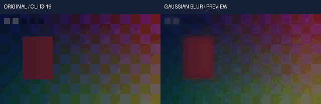

# 连续浮点高斯模糊与透明边缘实测

源码关联回归实际 **420项 /978.665781秒 /0跳过**，其中48项新增。源码、原生数值对照、公开CLI媒体、离线安装及完整套件分别登记；全剪映目标继续开发。

首次相关源码420项通过，但离线安装资源一致性检查拒绝：source193、wheel192、site192，唯一缺少float_gaussian_NOTICE.txt。package-data采用显式清单，本轮遗漏新增NOTICE。修复仅将该文件加入product/pyproject.toml；数值代码、关键帧、预算和误差门槛不变。原source-r2、media-r1、安装／finisher／continuation-r1与旧ROOT脚本完整保留；新source-r3、media-r2和installed-r2重新绑定最终323输入，不能用旧源码通过结果替代新输入验收。

本轮为显式float32-native-v1接入blur/gaussian_blur/gblur。旧8位工程继续走既有后端；新内核与旧gblur采用相同递归近似和端点边界模型，默认半径4、默认处理RGBA。增加独立XY半径、steps、平面选择和明确预乘模式。原测试中3个“未支持操作拒绝”样例改用仍未接入的avgblur，保留拒绝码、资源清理及不回退旧后端的断言。

数值实现使用归一化凸组合前后扫，临时binary64、输出Float32，避免大半径及多次迭代未归一中间值的放大。它在理想实数运算下与原递归近似同一边界算子；归一化、操作顺序和临时精度不同，不能宣称原生Float32逐位等价，也不能宣称精确无限支撑高斯卷积。37组实际原生测试直接输入／输出gbrapf32le，保留命令、原始字节与SHA；独立参考使用边界线性系统与矩阵幂，覆盖脉冲、端点、近零半径、单像素及最大半径常量DC。8e-5原生门槛在执行前声明，没有调整。

straight对选中平面独立模糊，因此透明区域隐藏RGB可渗入可见边缘。premultiplied显式将RGB乘coverage、同算子模糊RGB密度和coverage，再除正密度；没有任意epsilon下限，精确零密度RGB置0。后者仅允许全部RGBA平面。1e-30正coverage、全透明、隐藏红色渗边及原生预乘密度均执行。GBRA位掩码保持G1/B2/R4/A8，没有错套RGBA位顺序。默认行为没有静默换成预乘。

公开CLI实片含链接、水平、垂直、仅RGB和预乘超白五场景。独立参考单独求解边界系统，不导入产品数学／信号／作者函数，包含变更后的coverage及背景合成，验证整个选区RGB、实际PNG16、PCM、独立进程缓存复用和作者数据不变。最终交付使用明确clip，超白计数在交付前另报。保留21项CC0媒体／工程／权利文件；静态六幅对照与GIF时钟检查不能替代连续播放和声音听审。

研究参考为官方[FFmpeg n8.1 vf_gblur.c](https://raw.githubusercontent.com/FFmpeg/FFmpeg/n8.1/libavfilter/vf_gblur.c)与[vf_gblur_init.h](https://raw.githubusercontent.com/FFmpeg/FFmpeg/n8.1/libavfilter/vf_gblur_init.h)。本机实际执行FFmpeg8.1；研究目录旧源码标记8.0.git，未冒称n8.1下载件。独立Python实现附原数值参考作者及BSD二条款许可，安装资源验收包含NOTICE。运行／验证均原生Windows、无虚拟化环境、无产品在线请求。

<!-- V107-CONTINUOUS-FLOAT-GAUSSIAN-COVERAGE -->
### V107 候选：连续浮点高斯模糊与透明边缘（未发布）

显式`float32-native-v1`工程的正式render和preview共用连续高斯模糊，支持链接／独立XY半径、作者关键帧、GBRA平面选择及straight／premultiplied透明度。沿用旧gblur递归近似与端点边界模型，使用归一化binary64临时递推维持稳定，持久RGBA Float32；未承诺原生Float32逐位相同。

| 编号 | 功能性核验 | 实际内容与边界 | 证据 |
|---|---|---|---|
| FG107-01 | 共用内核 | 基础调色父320→323产品输入、10路径改变、48新增方法；3个旧拒绝样例从blur换成仍未支持的avgblur，原拒绝／清理／禁回退断言保留 | [接口契约](../../docs/specs/连续浮点高斯模糊与透明边缘契约_v0.1_2026-10-22.md) |
| FG107-02 | XY半径 | blur/gaussian_blur/gblur；链接radius默认4、范围0..128；radius_x/y可静态或动画独立覆盖；steps为1..6 | [420项关联回归](../../docs/validation/evidence/float-gaussian-20261022-lab/native-r3/verification.json) |
| FG107-03 | 实际原生对照 | 37组真实FFmpeg gbrapf32le；单双方向、奇偶尺寸、6种steps、16种GBRA位掩码、默认CPU／纯C及预乘密度；最大绝对误差4.17232513428e-07，执行前门槛8e-5 | [原始命令与Float32 I/O](../../docs/validation/evidence/float-gaussian-20261022-lab/native-r3/verification.json) |
| FG107-04 | 独立数学 | 两个边界线性系统求解及矩阵幂参考，无产品递推调用；脉冲、端点、单像素／单行列、近零半径与最大128／6步常量DC | [实际断言](../../docs/validation/evidence/float-gaussian-20261022-lab/native-r3/unittest.log) |
| FG107-05 | 透明边缘 | 默认straight逐选中平面模糊；premultiplied同时处理RGBA，先乘coverage、模糊再除正coverage，精确零密度RGB置0；隐藏红色渗边和1e-30正coverage实际核验 | [透明度契约](../../docs/specs/连续浮点高斯模糊与透明边缘契约_v0.1_2026-10-22.md) |
| FG107-06 | 平面语义 | 位掩码保持FFmpeg的G=1/B=2/R=4/A=8；planes=7保留alpha位，planes=8同信号／preserve下保留RGB位并绕过往返信号转换 | [全部16种实际对照](../../docs/validation/evidence/float-gaussian-20261022-lab/native-r3/unittest.log) |
| FG107-07 | 信号与强度 | 明确输入／输出RGB信号；在声明信号中模糊，返回线性工作RGB后按intensity混合，coverage独立线性混合；算子RGB clip与交付clip分开 | [契约](../../docs/specs/连续浮点高斯模糊与透明边缘契约_v0.1_2026-10-22.md) |
| FG107-08 | 连续精度 | 140000个浮点坡度保持超过130000种输出，无整数表面／LUT／每帧子进程；高半径归一化避免未归一递推的中间放大 | [执行日志](../../docs/validation/evidence/float-gaussian-20261022-lab/native-r3/unittest.log) |
| FG107-09 | 作者与安全 | 6种插值、Bezier时间根、大整数／有理tick、原作者预览窗口和嵌套倒放、有序调色／曝光／模糊；只读、完整预算、晚块非法值、取消及回调异常保护输入 | [执行日志](../../docs/validation/evidence/float-gaussian-20261022-lab/native-r3/unittest.log) |
| FG107-10 | 真实公开CLI | 20调用/31检查、2次正式render和3次preview；原创320×180、10fps、2秒20帧，5场景各4帧 | [实测记录](../../docs/validation/evidence/float-gaussian-20261022-lab/media-r2/verification.json) |
| FG107-11 | 全像素与PCM | 作者帧3..16共2,419,200线性RGB，包含模糊后的coverage合成；最大绝对误差1.49011611938e-08，执行前门槛2e-6；96000／选区67200双声道PCM采样帧一致，PNG16≤1码 | [独立矩阵参考](../../docs/validation/evidence/float-gaussian-20261022-lab/media-r2/executed-oracle.py.txt) |
| FG107-12 | 显式超白交付 | 最终clip前线性峰值1.37792289、越界RGB分量10521；实际正式／预览交付均报告裁切；并非无界HDR母版验收 | [实测记录](../../docs/validation/evidence/float-gaussian-20261022-lab/media-r2/verification.json) |
| FG107-13 | 原片与GIF | CC0原创图形／帧码／透明度／正弦音频；GIF14×100ms；已静看作者3/10/16共6幅，未做连续播放／听审 | [原片](../../docs/assets/float-gaussian-20261022-r2/original-range.mp4) · [输出](../../docs/assets/float-gaussian-20261022-r2/range.mp4) · [Float32](../../docs/assets/float-gaussian-20261022-r2/range.master.nut) · [目检](../../docs/validation/evidence/float-gaussian-20261022-lab/static-review-r2.json) |
| FG107-14 | 离线安装 | **620项 /1377.76秒 /0跳过**；193份source/wheel/site资源、8个固定离线wheel、NumPy931文件及许可一致；安装版公开CLI编码音画、Float32和PNG16与源码版一致。 | [安装收据](../../docs/validation/evidence/float-gaussian-20261022-lab/installed-r2/verification.json) · [可编辑工程](../../docs/assets/float-gaussian-20261022-r2/author-project.json) · [权利账](../../docs/assets/float-gaussian-20261022-r2/rights-ledger.json) · [CC0](../../docs/assets/float-gaussian-20261022-r2/LICENSE.txt) |
| FG107-15 | 完整回归 | **尚未通过，不计通过**；目标2715项，仅在V106实际完整2667项通过并普通发布后执行。 源码420、安装620与完整套件独立登记，不相加作为功能完成率 | [本轮报告](../../docs/validation/连续浮点高斯模糊与透明边缘实测_2026-10-22.md) |
| FG107-16 | 许可与边界 | 原数值参考的BSD许可及作者声明随源代码／wheel／安装站点保留；平均／方框模糊、锐化、时间降噪继续接入；默认后端迁移、自然素材／HDR／实时质量与完整剪映目标未完成 | [接口与边界](../../docs/specs/连续浮点高斯模糊与透明边缘契约_v0.1_2026-10-22.md) |
| FG107-17 | 打包故障与修复 | 首次source193／wheel192／site192，唯一缺失NOTICE；显式补入package-data，保留首次420项和安装失败，随后以新source／media／install证据重跑；数值算法与门槛未改变 | [诊断与修复](../../docs/validation/evidence/float-gaussian-20261022-lab/failure-analysis-r1.json) |

<!-- /V107-CONTINUOUS-FLOAT-GAUSSIAN-COVERAGE -->
