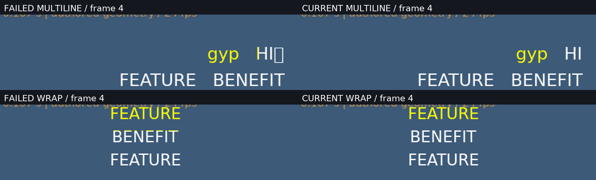

# 逐字高亮原生排版与真实成片实测

| 项目 | 内容 |
|---|---|
| 文档编号 | VALIDATION-WORD-LAYOUT-2026-10-16 |
| 状态 | 有效 |
| 日期 | 2026-10-16；执行记录使用 UTC 时间戳 |
| 固定旧版 | `7beb9ce0f2715f1c83067cc98f58e0a40c36d64b`，真实本地运行原始 Git 字节 |
| 当前版本绑定 | [完整机器证据](evidence/word-layout-20261016.json)的 95 文件原始 SHA-256；不以可变 HEAD 代替 |
| 执行方式 | 原生 Windows、本地 Python/FFmpeg 8.1；无 GUI、模型推理或虚拟化 |
| 总体结论 | 下面九个受控场景通过，完整剪映功能/效果未达成 |

完整 **491/491，887.673 秒**；94 份 Python 产品源码/测试及 1 份 Schema（共 95 份）执行前后字节摘要一致；21 项新增专项为完整套件子集，固定旧版同测 21 方法失败。九组真实旧版/新版/普通字幕对照，632 个新版主帧与 632 个普通对照帧；R/G 轮廓最大差由 51–255 降至 2（阈值 3），逐词激活/串色、源帧与音频脉冲检查均无不匹配。90 次生成 CLI 含 27 次渲染、9 次质量检查，另有 9 次本地策略审计；0 新模型实测推理。受控字体/字幕排版子项通过；自动换行仍由 Pillow 选行，CJK 仅四个确认字形。动态尺寸内嵌高亮显式降级，任意颜色透明度、复杂文字动画、RTL、定格/VFR、群组、自然质量和整体剪映等价未验收。

## 1. 原输入与三秒真实对照


[原视频](../assets/word-layout-20261016/source.mp4) · [原脉冲音频](../assets/word-layout-20261016/pulses.wav) · [旧输出](../assets/word-layout-20261016/before-inline.mp4) · [新输出](../assets/word-layout-20261016/after-inline.mp4) · [普通字幕对照](../assets/word-layout-20261016/reference-inline.mp4) · [对照 MP4](../assets/word-layout-20261016/word-layout-comparison.mp4) · [0/36/71 帧接触表](../assets/word-layout-20261016/contact-sheet.png)。

源视频与展示均为 72 帧/24 fps/3 秒，源面板使用全部 72 帧。GIF 为 1152×249，72 帧按 40/50 ms 量化，总时长 3000 ms；MP4 对照为 1536×332、72 帧/3 秒，两种对照均无声。九组各三份正式成片是 H.264 CRF 0、yuv444p，包含实际 AAC 脉冲音轨；它们用于减少压缩/色度采样对小字测量的影响，不代表普通发布编码或 4K 性能验收。

本批 29 份 MP4 = 27 份正式变体 + 原片 + 对照；失败目录另有 4 份 MP4（2 失败成片与 2 普通字幕对照）。两批共 33 份视频，不把普通对照、旧版或失败计为新版输出次数。

## 2. 九组实际成片

R/G 测量比较白色普通字幕与黄色激活字幕：黄色只改变蓝通道，R/G 轮廓差应≤3。它需要配合逐词蓝通道核对，单独不能发现串色。

| 编号 | 场景 | 新版帧数 | 旧→新 R/G 最大差 | 新版错误词区域数 | 实际成片 |
|---|---|---:|---:|---:|---|
| WL01 | 媒体内嵌 FEATURE / BENEFIT | 72 | 193 → 2 | 0 | [旧](../assets/word-layout-20261016/before-inline.mp4) / [新](../assets/word-layout-20261016/after-inline.mp4) / [普通对照](../assets/word-layout-20261016/reference-inline.mp4) |
| WL02 | 默认居中与重复 AV / VA / AV | 72 | 193 → 2 | 0 | [旧](../assets/word-layout-20261016/before-center-repeat.mp4) / [新](../assets/word-layout-20261016/after-center-repeat.mp4) / [普通对照](../assets/word-layout-20261016/reference-center-repeat.mp4) |
| WL03 | 多行、下伸字母与右下对齐 | 72 | 194 → 2 | 0 | [旧](../assets/word-layout-20261016/before-multiline.mp4) / [新](../assets/word-layout-20261016/after-multiline.mp4) / [普通对照](../assets/word-layout-20261016/reference-multiline.mp4) |
| WL04 | 自动换行与重复原文范围 | 72 | 199 → 2 | 0 | [旧](../assets/word-layout-20261016/before-wrap.mp4) / [新](../assets/word-layout-20261016/after-wrap.mp4) / [普通对照](../assets/word-layout-20261016/reference-wrap.mp4) |
| WL05 | 描边、阴影和背景框 | 72 | 255 → 2 | 0 | [旧](../assets/word-layout-20261016/before-styled.mp4) / [新](../assets/word-layout-20261016/after-styled.mp4) / [普通对照](../assets/word-layout-20261016/reference-styled.mp4) |
| WL06 | 原 t 时钟移动位置 | 72 | 193 → 2 | 0 | [旧](../assets/word-layout-20261016/before-moving.mp4) / [新](../assets/word-layout-20261016/after-moving.mp4) / [普通对照](../assets/word-layout-20261016/reference-moving.mp4) |
| WL07 | 组合重音与字面百分号 | 72 | 193 → 2 | 0 | [旧](../assets/word-layout-20261016/before-combining.mp4) / [新](../assets/word-layout-20261016/after-combining.mp4) / [普通对照](../assets/word-layout-20261016/reference-combining.mp4) |
| WL08 | 广 / 告 / 素 / 材四字 | 72 | 51 → 2 | 0 | [旧](../assets/word-layout-20261016/before-cjk.mp4) / [新](../assets/word-layout-20261016/after-cjk.mp4) / [普通对照](../assets/word-layout-20261016/reference-cjk.mp4) |
| WL09 | 嵌套 Bezier 变速与倒放 | 56 | 193 → 2 | 0 | [旧](../assets/word-layout-20261016/before-nested-reverse.mp4) / [新](../assets/word-layout-20261016/after-nested-reverse.mp4) / [普通对照](../assets/word-layout-20261016/reference-nested-reverse.mp4) |

独立复核重新解码 27 份变体；632 个新主帧、632 个当前普通字幕对照帧，旧版 632 帧另计。每个激活词的前景选中色占比实际最小值 1.0（门槛≥0.98），未激活词最大值 0.0（门槛≤0.01），错误词区域为 0。源画面可读帧号最大误差 0；避开源脉冲边界 0.10 秒后的包络检查不匹配为 0，不等于相位、口型或听感通过。

嵌套倒放原时钟使用独立的 Bezier 参数域 Gauss 积分（4096 区间，每区间 8 点）复核；与生成器时钟最大差 **5.5426×10⁻⁸ 秒**，检查门槛 2×10⁻⁶ 秒。该值是本样例独立数值对照结果，不是一般浮点证明或所有长曲线保证。

[多行抽帧](../assets/word-layout-20261016/selected-multiline.png) · [换行抽帧](../assets/word-layout-20261016/selected-wrap.png) · [描边/阴影抽帧](../assets/word-layout-20261016/selected-styled.png) · [组合重音抽帧](../assets/word-layout-20261016/selected-combining.png) · [四字 CJK 抽帧](../assets/word-layout-20261016/selected-cjk.png)。已静态目检接触表 0/36/71 帧、多行和 CJK 第 40 帧、失败对照第 4 帧；**没有连续播放或听审**。其余抽帧是可供复核的实际输出，未计入人工目检声明。

## 3. 实际实现与版本绑定

旧版使用 Pillow 前缀宽度定位独立单词；示例 `FEATURE BENEFIT` 的 Pillow BASIC 宽 253.96875 px，当前本地 FFmpeg 原生取整宽 252 px，差值引起残字。新路径用本地 FFmpeg 和显式字体测量真实布局，分别画两份完全相同的整段文字，再以二值蒙版选择普通/激活色，避免再次叠画抗锯齿。每行整行绘制，共享段落原点、行高和基线；LF 不参与字形渲染，背景框只画一次。相邻行的选择边界由实际字形上下界之间的中点决定。

逐词激活依原作者时钟每帧求值一次，再供像素蒙版读取，避免复杂 Bezier 表达式逐像素重复计算。指标缓存绑定 FFmpeg、字体字节 SHA-256、字号和布局选项；未解析到原生指标时结构化拒绝，逐词选择不会退回平均字宽。源码见 [text_highlight.py](../../product/src/ai_ad_editor/text_highlight.py)、[render.py](../../product/src/ai_ad_editor/render.py)，完整约束见[原生排版契约](../specs/逐字高亮原生排版与颜色选择契约_v0.1_2026-10-16.md)。

27 次渲染前后作者 assets/settings/sequences 与原始 Rights Ledger 均未改变；渲染内部时钟和布局记录只写 manifest。完整回归、专项、公开烟测冻结相同 95 文件原始字节；旧版产品源码另以 Git 对象逐文件核对，不进行换行归一化冒充原始摘要。

## 4. 测试、真实调用与失败保留

| 编号 | 实际执行 | 结果与范围 |
|---|---|---|
| WT01 | 当前完整产品套件 | 491/491，887.673 秒；[原始日志](evidence/word-layout-full-20261016.log)，95 文件前后不变 |
| WT02 | 当前新增专项 | 21/21，47.843 秒；[原始日志](evidence/word-layout-targeted-20261016.log)，是 WT01 子集 |
| WT03 | 固定旧版运行相同 21 方法 | 21 方法失败，142.134 秒；[原始日志](evidence/word-layout-before-20261016.log)，明确区分预期失败与当前通过 |
| WT04 | 正式公开生成 CLI | 90 次，含 27 次渲染和 9 次 `quality check`；其余为初始化/导入/时间线等，见[逐次结果](../assets/word-layout-20261016/evidence.json) |
| WT05 | 额外本地策略检查 | 9 次 `policy audit`，九项目均通过；与上项分计，见[完整证据](evidence/word-layout-20261016.json) |
| WT06 | 独立交付审计 | 27 份变体重解码、全部 29 份 MP4 probe、GIF 计时、字体 cmap、旧版 Git 字节与源文件冻结；脚本及结果嵌入证据 |
| WT07 | Skills 与文档 | [14 个 Skills](evidence/skills-audit-word-layout-20261016.json)及[全量文档本地链接/摘要审计](evidence/docs-audit-word-layout-20261016.json)，外链/锚点和外部许可法律结论不在此审计范围 |

21 项专项包含同色不增厚、内嵌/独立标题、整段居中、多行无额外字形、右下对齐、自动换行跨行不串色、组合重音、描边/阴影/背景、时间位置与 fix_bounds、原生透明度对照、跨 LF 范围、重复词显式 start_char、无 Pillow 指标依赖、RTL/拆分 grapheme/内部连字拒绝、动态内嵌降级及文字动画警告。透明度测试比较原生普通文字结果，**没有据此接受任意颜色/透明度的绝对正确性**。

两段实际开发失败均有原始成片、普通对照、manifest 和 SHA-256：[失败多行](../assets/word-layout-failures-20261016/failed-multiline.mp4) / [多行对照](../assets/word-layout-failures-20261016/control-multiline.mp4)、[失败换行](../assets/word-layout-failures-20261016/failed-wrap.mp4) / [换行对照](../assets/word-layout-failures-20261016/control-wrap.mp4)。



失败多行产生额外方框且染错 HI，15 帧词状态不匹配；失败换行把下一行字形顶部染色，40 帧不匹配。两者 R/G 最大差同为 2，证明单轮廓门槛不足。该两次未完成烟测没有独立发布当时完整源码冻结，故只作为失败成片/测量记录，**不作冻结版本验收证据**；原 manifest 路径搬迁后按实际文件摘要识别。详情见[失败证据](../assets/word-layout-failures-20261016/failure-evidence.json)。

早期开发还出现原生指标日志解析错误、复杂逐像素表达式资源/耗时失败、drawbox 逗号引用错误，以及测试 fixture/manifest/阈值修订。18 项、20 项阶段通过不覆盖最终源码；为修复上述跨行串色而中断的完整套件/旧版对照均未得到 `Ran ... OK`，不计成功。全部原始开发日志、阶段记录与明确中断状态保留在[汇总证据](evidence/word-layout-20261016.json)，最终只接受 WT01/WT02 绑定的 95 文件。

## 5. 来源、许可与复现

原视频和脉冲 WAV 逐字节复用上一轮自制 CC0 输入，不含第三方人物；源生成器 [smoke_subtitle_clock.py](../../scripts/smoke_subtitle_clock.py) 摘要固定。拉丁字体是本机已有 DejaVu Sans；CJK 使用本地 Concat 快照已有 Kosugi Maru，仅 cmap 确认的“广、告、素、材”四字进入验收，不能推广为全部简体中文。媒体 CC0 与字体许可证分开登记，未在此演示目录分发字体二进制。见[来源记录](../assets/word-layout-20261016/fixture-provenance.json)、[DejaVu 许可](../assets/word-layout-20261016/font-license.txt)、[Kosugi 许可](../assets/word-layout-20261016/cjk-font-license.txt)。

生成器 [smoke_word_layout.py](../../scripts/smoke_word_layout.py) 需现有原生 NumPy/Pillow/fontTools、FFmpeg、本地字体及许可证；不下载它们，也不启动 ComfyUI 服务。输出与 work 路径必须使用新的目录，执行示例：

```powershell
$nativePython = 'D:\dev\comfyui\ComfyUI_windows_portable_nvidia_0_30_0\ComfyUI_windows_portable\python_embeded\python.exe'
$latinFontRoot = 'D:\dev\comfyui\ComfyUI_windows_portable_nvidia_0_30_0\ComfyUI_windows_portable\python_embeded\Lib\site-packages\matplotlib\mpl-data\fonts\ttf'
& $nativePython -I -B -X utf8 scripts/smoke_word_layout.py `
  --output docs/assets/word-layout-reproduction `
  --work product/.runtime/word-layout-reproduction `
  --font "$latinFontRoot/DejaVuSans.ttf" --font-license "$latinFontRoot/LICENSE_DEJAVU" `
  --cjk-font sources/upstream/concat/src/crates/concat-text/fonts/KosugiMaru-Regular.ttf `
  --cjk-font-license sources/upstream/concat/src/crates/concat-text/fonts/LICENSE-KosugiMaru.txt
```

完整验证包装器和独立审计器、策略审计器、失败发布器、文档更新/审计器的原始源码与摘要嵌入[机器证据](evidence/word-layout-20261016.json)，可按记录的相同入口复核。耗时为本机本次执行记录，不是性能基准；跨 FFmpeg/字体构建不保证 MP4 二进制相同。

## 6. 仍未验收

受控字体/字幕排版子项通过；自动换行仍由 Pillow 选行，CJK 仅四个确认字形。动态尺寸内嵌高亮显式降级，任意颜色透明度、复杂文字动画、RTL、定格/VFR、群组、自然质量和整体剪映等价未验收。 内部西文字词连字拆分、拆分组合字形、状态式位置表达式明确拒绝；选中完整词不等于通用卡拉 OK 字簇引擎。普通及激活色依原生 drawtext 语义，任意 fontcolor alpha、线性光/HDR、跨设备、4K/长片性能和通用中文排版仍需另验。九个项目本地策略审计通过的事实不替代 OS 网络抓包或外部许可证核验。此前 V21 的排版失败保持历史，只在本轮新版本/样例范围推进受控子项。
