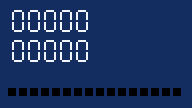
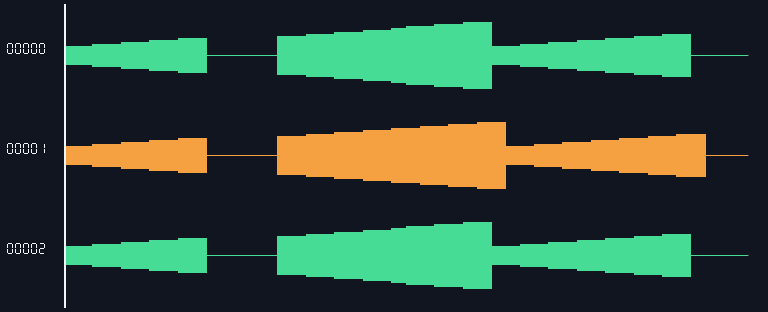
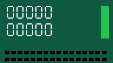

# AI广告剪辑 Agent：产品需求与开发路线基线

<!-- V91-NATIVE-AUDIO-INTERVAL-CLOCK -->
### V91 源音频内部缺口、重叠与派生缓存

V91 完整原生回归 **2148方法 /4714.461秒 /0跳过**；267产品输入、8外部夹具、16验证脚本和9依赖文件保持相同。源内部缺口/重叠按原生采样时钟处理，原始工程引用保留；合入、17份Skill注册和普通推送以发布审计为准。

| 编号 | 核验内容 | 实际执行结果与边界 | 证据 |
|---|---|---|---|
| V91-01 | 原生源时钟 | 解码帧PTS/样本数建整数索引；正缺口补零，后解码帧覆盖重叠；精确采样格保留真实单采样缺口 | [规格](../docs/specs/源音频内部时钟与硬缺口缓存_v0.1_2026-10-21.md) |
| V91-02 | 原实现失败 | 同6原片13项实际11失败/2连续对照通过/0错误/0跳过；原日志和旧实现保留 | [before](../docs/validation/evidence/audio-discontinuity-20261021-lab/before-r1.json) |
| V91-03 | AAC粗时基修复 | 另9原片先5通过/4失败，修复后9份实际解码PCM逐采样相同；粗PTS已丢失的亚tick跳变不能恢复 | [补充前后](../docs/validation/evidence/audio-discontinuity-20261021-lab/extra-native-after-r1/verification.json) |
| V91-04 | 缓存与生命周期 | 源/工具/实现/派生字节SHA绑定，流式管道、损坏拒绝、原子写入、明确list/prune及登记源保护；队列合法空派生仍绑定SHA，原素材非空门禁保留；31专项通过 | [队列修复](../docs/validation/evidence/audio-discontinuity-20261021-lab/queue-cache-fix-r1.json) |
| V91-05 | 全部音频入口 | scalar/reverse/曲线/嵌套、真实R3输入及多机位只读分析通过；R3仅在实际视频覆盖内允许音频EOF静音，超界源句柄拒绝 | [路径12项](../docs/validation/evidence/audio-discontinuity-20261021-lab/paths-r2.json) |
| V91-06 | 原生CLI与所有帧/样本 | 32次CLI＋22条其他原生命令、37检查；forward/reverse各120帧及230400样本/声道，R3为96帧及184320样本/声道 | [实际收据](../docs/validation/evidence/audio-discontinuity-20261021-lab/native-r1/verification.json) |
| V91-07 | 全新八轮离线安装 | 163资源源/wheel/安装字节相同；官方NumPy2.4.2及原生数学前向；27隔离CLI、92方法/338.389s/0跳过，含31队列方法；三组媒体重新运行 | [安装收据](../docs/validation/evidence/audio-discontinuity-20261021-lab/installed-r3/verification.json) |
| V91-08 | 历史专项和失败完整 | 2145全量4个队列失败保留；队列修复只变2输入，旧native/152表面其余265输入相同；更早r2三组另差能力发现及测试，明确分开 | [纪元及完整绑定](../docs/validation/evidence/audio-discontinuity-20261021-lab/audit-r2.json) |
| V91-09 | 原片/失败片/MP4/GIF | 66实际文件、11GIF、37次原生ffprobe，包含新安装重新生成结果；MP4每帧PTS/二进制ID另验，AAC不声明波形无损 | [逐文件SHA](../docs/validation/evidence/audio-discontinuity-20261021-lab/media-manifest-r2.json) |
| V91-10 | 完整回归 | 2148方法 /4714.461秒 /0跳过；专项与隔离各自保留，不累计 | [当前完整](../docs/validation/evidence/audio-discontinuity-20261021-lab/full-r2.json)、[原失败](../docs/validation/evidence/audio-discontinuity-20261021-lab/full-r1.json) |
| V91-11 | 文档/Skill/发布 | 4份Skill由固定17父版衍生；发布时重验全部17注册、链接与索引字节，普通推送；OpenFilm R14/R15结论保留 | [完整实测](../docs/validation/源音频硬缺口与重叠缓存实测_2026-10-21.md) |
| V91-12 | 未验收范围 | 仅目检1张PCM诊断PNG；未试听、未连续播放；自然设备异常、任意编解码变化、长片/HDR/RSS、完整AI及剪映等价继续待验 | [目检记录](../docs/validation/evidence/audio-discontinuity-20261021-lab/static-review-r1.json) |

[原创含音轨NUT](../docs/assets/audio-discontinuity-20261021-lab/native-r1/original.nut) · [原视频MP4（无音轨）](../docs/assets/audio-discontinuity-20261021-lab/native-r1/original-video-only.mp4) · [原始GIF](../docs/assets/audio-discontinuity-20261021-lab/native-r1/original.gif) · [forward MP4](../docs/assets/audio-discontinuity-20261021-lab/native-r1/forward.mp4) · [reverse MP4](../docs/assets/audio-discontinuity-20261021-lab/native-r1/reverse.mp4) · [R3 MP4](../docs/assets/audio-discontinuity-20261021-lab/native-r1/R3.mp4) · [V90真实失败无损](../docs/assets/audio-discontinuity-20261021-lab/native-r1/before-forward-lossless.nut)

这些是限定原创样例的真实输出；诊断GIF不代替自然录音试听或特效质量验收。
<!-- /V91-NATIVE-AUDIO-INTERVAL-CLOCK -->

<!-- V90-MULTICAM-AFFINE-CLOCK -->
### V90 多机位仿射时钟与浮点PCM

V90 完整原生回归 **2084 方法/3875.245秒/0跳过**；263产品输入、8外部夹具、14验证脚本和9依赖文件前后相同。新增显式仿射设备时钟和scalar音频float上采样；默认offset保持不变。合入与注册以发布审计收据为准。

| 编号 | 核验 | 实际结果 / 边界 | 证据 |
|---|---|---|---|
| V90-01 | 时钟模型 | `source=b+a*reference`；显式 `--clock-model affine`，默认 offset 不变。最多600秒前缀，3–31锚点、4–60秒窗口和20000ppm参数上限，默认5000ppm | [契约](../docs/specs/多机位仿射时钟与漂移校准_实验_v0.1_2026-10-21.md) |
| V90-02 | 拟合、绑定和规划方法 | 当前33方法通过，含±漂移、100ppm/600秒、坏锚点、歧义、SHA / ID / digest / inverse / ppm / duration 篡改与覆盖策略 | [记录](../docs/validation/evidence/multicam-affine-clock-20261021-lab/after-validation-r2.json) |
| V90-03 | 音频重采样修复前后 | 同8个真实PCM方法：修复前6失败/2对照通过；修复后8通过，5.426秒，0跳过。初轮夹具缺视频导致8ERROR，另存为失败，未当作量化缺陷 | [修复后](../docs/validation/evidence/multicam-affine-clock-20261021-lab/audio-precision-after-r2.json) |
| V90-04 | 当前相关回归 | 157个不同方法/283.522秒/0跳过，263输入前后相同；历史141与149是旧源码时点，不与157累计 | [记录](../docs/validation/evidence/multicam-affine-clock-20261021-lab/related-r3.json) |
| V90-05 | 真实CLI与远距离选段 | 参考事件覆盖590秒；取0、295、586秒起各4秒。原生39CLI+21其他命令/52检查；两相机真值+1500ppm/-100ppm | [原生](../docs/validation/evidence/multicam-affine-clock-20261021-lab/native-r3/verification.json) |
| V90-06 | 独立源帧覆盖 | 固定offset对照最大错21/1源帧，affine两例均0；每个无损输出300帧，24,883,200 RGBA字节，与独立的所选原始帧完全相同 | [实测](../docs/validation/多机位仿射时钟与浮点音频独立实验_2026-10-21.md) |
| V90-07 | 参考主音轨 | 每输出每声道576000样本/共4,608,000字节，与先整源float重采样后取样的独立期望逐字节一致；修复8k单声道先s16上采样导致的二次量化 | [诊断](../docs/validation/evidence/multicam-affine-clock-20261021-lab/native-r2-mono-format-controls.json) |
| V90-08 | 隔离交付 | 8轮离线包，162资源源码/轮/安装同字节；安装20检查及隔离媒体52检查已通过。wrapper末段字段误读保留failed，由补验闭合 | [原失败wrapper](../docs/validation/evidence/multicam-affine-clock-20261021-lab/installed-r1/verification.json) |
| V90-09 | 隔离补验 | -I -S实跑41方法/7.075秒/0跳过；累计43次隔离CLI。补验不重复媒体或安装，不借用父版的成片 | [补验](../docs/validation/evidence/multicam-affine-clock-20261021-lab/installed-postflight-r3/verification.json) |
| V90-10 | 媒体资产 | 33资产/9个实际GIF，含短原片、原生/安装输出、原始590秒区间素材和失败夹具；SHA/大小/帧率/时长见清单 | [清单](../docs/validation/evidence/multicam-affine-clock-20261021-lab/media-manifest-r1.json) |
| V90-11 | 静态目检 | 实际GIF帧0/100/200，未连续播放或听审。相机采样相位不同，下行事件计数偶尔比参考少1，符合覆盖源帧契约 | [联系表](../docs/assets/multicam-affine-clock-20261021-lab/review-r1/actual-frame-contact-sheet.png) |
| V90-12 | 未验收 | 非线性/不连续漂移、真实录制/房间回声/自然质量、完整长片/HDR/RSS与播放听审、全剪映功能等价均未验收。MP4只验PTS和身份码；AAC不宣称全PCM相同 | [报告](../docs/validation/多机位仿射时钟与浮点音频独立实验_2026-10-21.md) |
| V90-13 | 完整回归 | 2084方法/3875.245秒/0跳过；专项157为其子集，不累计 | [完整记录](../docs/validation/evidence/multicam-affine-clock-20261021-lab/full-r1.json) |
| V90-14 | 生产发布与Skill | 4份变更与原父版逐项校验；发布时再审全部17份注册、链接和源码SHA，保留历史失败。 | [规格](../docs/specs/多机位仿射时钟与漂移校准_v0.1_2026-10-21.md) |

[参考短MP4](../docs/assets/multicam-affine-clock-20261021-lab/review-r1/source-selected-reference.mp4) · [参考完整MKV](../docs/assets/multicam-affine-clock-20261021-lab/native-r2/source-reference.mkv) · [正漂移输入](../docs/assets/multicam-affine-clock-20261021-lab/native-r2/source-positive.mkv) · [小负漂移输入](../docs/assets/multicam-affine-clock-20261021-lab/native-r2/source-small-negative.mkv)

固定偏移对照与仿射结果（实际MP4解码制作）：

<!-- /V90-MULTICAM-AFFINE-CLOCK -->

<!-- V89-OFFLINE-MEDIA-PROFILE -->
### V89 八轮离线媒体运行时

V89 八轮离线媒体运行时完成2043方法/3988.673秒/0跳过的完整源码回归；260产品输入、8既有外部夹具、15验证脚本和9依赖文件（8上游artifact＋lock）前后相同。默认构建包含NumPy2.4.2，安装会实际执行原生矩阵/FFT核验；没有复制宿主NumPy。

| 编号 | 核验 | 实际结果与边界 | 证据 |
|---|---|---|---|
| V89-01 | 完整源码回归 | 2043方法/3988.673秒/0跳过；260输入、8夹具、15脚本。全量为源码原生环境；新安装另有独立CLI证据。 | [记录](validation/evidence/offline-media-profile-20261021-lab/full-r1.json) |
| V89-02 | 固定依赖冻结 | 8上游artifact＋lock共9文件；包含7个运行时依赖及1个不发行的历史非运行时wheel。运行时加产品共8wheels。完整回归前后字节不变。 | [记录](validation/evidence/offline-media-profile-20261021-lab/full-dependencies-r1.json) |
| V89-03 | 相关回归 | 260不同方法/708.130秒/0跳过＝父226＋旧安装22＋新安装12。旧34及12属于此子集，不重复累计。 | [记录](validation/evidence/offline-media-profile-20261021-lab/related-r1.json) |
| V89-04 | 相同断言修复前后 | 同12方法修复前6FAIL/1ERROR/5控制通过，修复后12/1.004秒通过；原测试和错误日志保留。 | [记录](validation/evidence/offline-media-profile-20261021-lab/after-r1.json) |
| V89-05 | 正式离线NumPy交付 | 官方NumPy2.4.2/cp313 Windows x64；932RECORD文件核对。新安装中931原文件除pip重写RECORD外完全相同，原通知在包和安装中保留。 | [记录](validation/evidence/offline-media-profile-20261021-lab/wheelhouse-r1.json) |
| V89-06 | 新隔离安装及原生运算 | 8个依赖模块来源审计、两个NumPy.pyd均来自安装site；实际dot=285、2×2求解及FFT通过。20安装检查，无宿主site复制。 | [记录](validation/evidence/offline-media-profile-20261021-lab/installed-r1/verification.json) |
| V89-07 | 默认入口实际执行 | 不传--wheelhouse的新构建＋全新安装＋1次-I/-S隔离CLI，8检查通过；另一次独立运行，未重复执行媒体或并入完整方法数。 | [记录](validation/evidence/offline-media-profile-20261021-lab/default-profile-r1/verification.json) |
| V89-08 | 新原生及安装媒体 | 开发23CLI＋32其他命令/39检查；安装26CLI＋1来源进程/14模块、20安装＋39媒体检查。161产品资源源码/wheel/site同字节。 | [记录](validation/evidence/offline-media-profile-20261021-lab/installed-r1/verification.json) |
| V89-09 | 完整无损帧与PCM | 原点0/5秒、首音频PTS1/6秒；每输出75帧/17,280,000RGBA字节、1,152,000float32PCM字节/每声道144000样本独立一致。视频切换显式选择参考主音轨。 | [记录](validation/evidence/offline-media-profile-20261021-lab/native-r2/verification.json) |
| V89-10 | 原片/MP4/GIF及静态审查 | 42资产/14GIF两次新生成。MP4各75帧、PTS=n/25、身份色块最大误差1。AAC每声道144384含填充；不作编码整帧/PCM一致或播放听审声明。 | [记录](validation/evidence/offline-media-profile-20261021-lab/media-manifest-r1.json) |
| V89-11 | 保留验证器失败 | native-r1在0CLI时因旧audit路径停止，native-r2只重绑路径/260输入后通过；相关生成器相对路径失误在写runner前失败。产品源码没有因这些修复改变。 | [记录](validation/evidence/offline-media-profile-20261021-lab/audit-r1.json) |
| V89-12 | Skills与范围 | 四Skill只合并新块与精确条款，并更新两份通用安装指引；17份总审。固定平台/版本限定；通用依赖求解、完整模型发行、自然/HDR/长片/RSS/播放听审及全部剪映功能效果仍待验收。 | [记录](specs/离线媒体运行时与NumPy交付_v0.1_2026-10-21.md) |

[完整实测](validation/八轮离线媒体运行时实测_2026-10-21.md)。源码全量、子集、独立安装和默认入口命令分别报告，不累计为额外完整方法。
<!-- /V89-OFFLINE-MEDIA-PROFILE -->

<!-- V88-NATIVE-AUDIO-SOURCE-ORIGIN -->
### V88 原生音频起点与同步

V88 原生音频起点与同步已完成 2031 方法、4718.468 秒、0 跳过的完整回归；259 产品输入、8 已提交外部夹具和18份验证脚本前后相同。源音频首先按 demux 相对 PTS 保留前置静音，再选择、反向、变速或分析同步；不启用 async 漂移校正。

| 编号 | 核验 | 实际结果与边界 | 证据 |
|---|---|---|---|
| V88-01 | 完整回归 | 2031 方法/4718.468秒/0跳过；259输入、8夹具、18脚本。 | [记录](validation/evidence/audio-source-origin-20261021-lab/full-r1.json) |
| V88-02 | 当前相关检查 | 226个不同方法：12本轮＋104父相关＋110既有音频方法。是完整套件子集，各次12方法不重复累计。 | [记录](validation/evidence/audio-source-origin-20261021-lab/related-r1.json) |
| V88-03 | 修复前后相同控制 | 同12方法：修复前7FAIL/1ERROR/4通过；修复后12通过。中间两次各1个置信度断言失败，均保留。 | [记录](validation/evidence/audio-source-origin-20261021-lab/after-controls-r3.json) |
| V88-04 | 真实源时钟 | 容器原点0/5秒，音频首PTS1/6秒，两例均有1秒相对缺口；零原点及等原点不得增加错误静音。 | [记录](validation/evidence/audio-source-origin-20261021-lab/native-r1/verification.json) |
| V88-05 | 完整无损样本与帧 | 每个输出75帧、17,280,000 RGBA字节；立体声float32 PCM 1,152,000字节/每声道144000样本，与独立期望完全相同。 | [记录](validation/evidence/audio-source-origin-20261021-lab/native-r1/verification.json) |
| V88-06 | 同步与显式主音轨 | 实际CLI偏移1秒，原速source[1,3)放置reference[0,2)，末25帧保留背景；显式作者参考主音轨。score=1仅为此确定性样例。 | [记录](validation/evidence/audio-source-origin-20261021-lab/installed-r1/media/verification.json) |
| V88-07 | 原生与新隔离安装 | 原生23CLI＋32其他命令/39检查；隔离26CLI＋1来源进程/14模块、15安装＋39媒体检查；161资源同字节。 | [记录](validation/evidence/audio-source-origin-20261021-lab/installed-r1/verification.json) |
| V88-08 | 离线依赖范围 | 7基础wheel不含NumPy；隔离实测只读复制现有NumPy2.4.2的933个RECORD/许可文件，不能视为安装器已内置。 | [记录](validation/evidence/audio-source-origin-20261021-lab/installed-r1/verification.json) |
| V88-09 | 观看副本与静态目检 | 42资产/14GIF来自两次新生成；实际MP4各75帧、PTS=n/25、身份色块最大误差1。AAC解码每声道144384样本，编码填充单列。 | [记录](validation/evidence/audio-source-origin-20261021-lab/media-manifest-r1.json) |
| V88-10 | 反向/曲线/嵌套/R3 | 实际R3输入/输出帧和全静音选区检查；不代表R3输出全PCM相同或听感/音高/立体声相位质量已验收。 | [记录](validation/evidence/audio-source-origin-20261021-lab/after-controls-r3.json) |
| V88-11 | 保留失败与研究边界 | 最早观察夹具字段错误的渲染结果无效，另有更正后的before-r2；未执行smoke缺import及检查点编码拼写错误均保留，不归为产品故障。 | [记录](validation/evidence/audio-source-origin-20261021-lab/audit-r1.json) |
| V88-12 | Skill及尚缺验收 | 四Skill仅增量＋精确父版条款更新，17份再审。压缩priming/edit-list、负/不连续时间戳、漂移、自然/HDR/长片/RSS/播放听审与完整剪映等价未验收。 | [记录](specs/原生音频起点与作者采样时钟_v0.1_2026-10-21.md) |

[完整实测](validation/原生音频起点与同步实测_2026-10-21.md)。完整套件、方法子集、CLI命令和安装检查分开报告。
<!-- /V88-NATIVE-AUDIO-SOURCE-ORIGIN -->

<!-- V87-MULTICAM-NATIVE-STREAM-COVERAGE -->
### V87 多机位原生视频覆盖

V87 多机位原生视频覆盖已完成 2019 方法、3210.232 秒、0 跳过的完整回归；258 个冻结输入、8 个已提交外部夹具及 15 份验证脚本前后相同。视频覆盖取原生首/末帧区间，独立于较长音轨和容器时长；原速剪辑保留真实缺口。

| 编号 | 核验 | 实际结果与边界 | 证据 |
|---|---|---|---|
| V87-01 | 完整回归 | 2019 方法 /3210.232 秒 /0 跳过；258 输入、8 夹具、15 验证脚本。 | [记录](validation/evidence/multicam-stream-coverage-20261021-lab/full-r1.json) |
| V87-02 | 相关回归 | 104 个不同方法：24 本轮＋22 父多机位＋16 空选区＋32 嵌套时钟＋10 CLI；属于完整套件子集，旧 102 不累计。 | [记录](validation/evidence/multicam-stream-coverage-20261021-lab/related-r2.json) |
| V87-03 | 真实视频边界 | 两组视频实际范围 [0,.32) 与 [1,1.32)，音轨/容器均 2 秒；33 原生 CLI＋25 其他命令、54 检查。 | [记录](validation/evidence/multicam-stream-coverage-20261021-lab/native-r1/verification.json) |
| V87-04 | 完整无损 RGBA/PCM | 每组 50 帧、11,520,000 RGBA 字节与 768,000 float32 PCM 字节 /每声道 96,000 样本独立一致。主音轨须显式创作。 | [记录](validation/evidence/multicam-stream-coverage-20261021-lab/native-r1/verification.json) |
| V87-05 | MP4/GIF 与静态目检 | trim/stretch 均 50 帧、PTS=n/25；trim 身份色块最大误差 1，非编码整帧一致。源 GIF 8 帧/320 ms，输出 GIF 2000 ms，黑帧会合并。 | [记录](validation/evidence/multicam-stream-coverage-20261021-lab/static-review-r1.json) |
| V87-06 | 只读索引与损坏拒绝 | 命中经 SHA 核验的既有原生索引时 0 次源帧探针，仍读 SHA。损坏索引拒绝保留，工程/报告/快照/缓存不被自动修复。 | [记录](validation/evidence/multicam-stream-coverage-20261021-lab/installed-r1/media/verification.json) |
| V87-07 | 当前源码的新隔离安装 | 161 资源源码/包/安装相同；36 CLI＋1 次 14 模块来源探针、14 安装检查＋54 媒体检查。7 wheels 不含 NumPy，实验只读复制既有 2.4.2 的 933 个 RECORD 文件及许可。 | [记录](validation/evidence/multicam-stream-coverage-20261021-lab/installed-r1/verification.json) |
| V87-08 | 仅音频及未知 EOF | 有效音频分析可返回偏移与 unknown 视频诊断，生成该机位切换时拒绝；未知视频状态采用模拟，音频真实生成。完整性错误仍拒绝。 | [记录](validation/evidence/multicam-stream-coverage-20261021-lab/audio-only-after-r1.json) |
| V87-09 | 保留失败与生成器修复 | 真实修复前 8 方法有 7 方法/9 断言失败；另保留子测试错误、仅音频过度拒绝、汇总清单名及生成器数字替换失误。修复未冒称旧结果重跑。 | [记录](validation/evidence/multicam-stream-coverage-20261021-lab/audit-r1.json) |
| V87-10 | 契约与范围 | 4 Skill 只合并本轮增量，17 份再审。自然/HDR/长片/RSS/漂移/非零音频流起点/连续播放听审及完整剪映功能效果仍待验收。 | [记录](specs/多机位原生帧覆盖与只读索引契约_v0.1_2026-10-21.md) |

[完整实测](validation/多机位原生视频覆盖实测_2026-10-21.md)。方法子集、原生命令、安装检查分开报告，不累计为额外完整方法或剪映等价。
<!-- /V87-MULTICAM-NATIVE-STREAM-COVERAGE -->

<!-- V86-MULTICAM-SOURCE-COVERAGE -->
### V86 多机位源覆盖与原速事件同步

V86 多机位源覆盖策略已完成 1995 方法、3072.832 秒、0 跳过的完整回归；257 个冻结输入、8 个已提交外部夹具及 10 份验证脚本前后相同。默认拒绝源覆盖不足，显式 trim 保持原速并保留参考事件位置和缺口；stretch 明示事件时钟改变。

| 编号 | 核验 | 实际结果及边界 | 证据 |
|---|---|---|---|
| V86-01 | 完整回归 | 当轮 1995 方法 /3072.832 秒 /0 跳过，冻结 257 输入、8 夹具及 10 验证脚本。 | [记录](validation/evidence/multicam-source-range-20261021-lab/full-r1.json) |
| V86-02 | 关联回归 | 当轮候选 80 个不同方法：22 多机位＋16 空选区＋32 嵌套时钟＋10 既有 CLI；为完整回归子集。 | [记录](validation/evidence/multicam-source-range-20261021-lab/related-r1.json) |
| V86-03 | 真实原生 CLI | 15 次 CLI＋11 条其他原生命令，23 检查；2 秒 /25 fps /50 帧原创参考，短机位 .4..1.84 秒。 | [记录](validation/evidence/multicam-source-range-20261021-lab/native-r1/verification.json) |
| V86-04 | 完整无损帧和显式主音轨 | 50 帧、11,520,000 RGBA 字节及 768,000 PCM 字节 /每声道 96,000 采样与独立生成参考完全相同；两端缺口均核验。 | [记录](validation/evidence/multicam-source-range-20261021-lab/native-r1/verification.json) |
| V86-05 | 编码输出与静态目检 | trim/stretch 各 50 帧、全部 PTS=n/25；trim 帧身份色块实测最大误差 1。联系表已静态查看；未连续播放或听审。 | [记录](validation/evidence/multicam-source-range-20261021-lab/frame-review-r1.json) |
| V86-06 | 隔离发行与 NumPy 边界 | 161 资源、7 基础 wheels；另将现有 NumPy 2.4.2 的 933 个 RECORD 文件复制至隔离 E 盘 site。18 次隔离 CLI＋1 次来源探针 /14 模块、12 安装检查。基础包未新增 NumPy。 | [记录](validation/evidence/multicam-source-range-20261021-lab/installed-r1/verification.json) |
| V86-07 | 失败、变基与未重跑声明 | 初次 22 方法 4 FAIL /3 ERROR、数组加载修复及单数 test 解析失误保留。后续仅继承未打包的父 test_cli.py；原媒体/隔离结果保留原冻结图，161 运行时资源相同，未冒称重跑。 | [记录](validation/evidence/multicam-source-range-20261021-lab/audit-r2.json) |
| V86-08 | 契约、Skills 与局限 | 4 份 Skill 只追加本轮指导，全部 17 份再审。单偏移、容器时长边界；设备漂移、每流真实 EOF、自然/HDR/长片/RSS/听审及完整剪映等价未验收。 | [记录](specs/多机位源覆盖与显式缺口策略_v0.1_2026-10-21.md) |

[完整实测](validation/多机位源覆盖与原速同步实测_2026-10-21.md)。80 项与原生/隔离检查分别报告，不累计成额外完整方法或剪映等价。
<!-- /V86-MULTICAM-SOURCE-COVERAGE -->

<!-- V85-NATIVE-EMPTY-WINDOW -->
2026-10-21 V85：完整原生回归 **1973 项、3623.367 秒、0 跳过**；256 产品输入与 8 外部夹具不变（本轮限定验收）。293 项专项、媒体与隔离安装保留运行时完全相同的原执行；仅继承父版测试断言后新跑 4 项旧 CLI 控制，未将历史记录标为重跑。293 个不同专项方法、真实 CLI、完整无损画面/PCM 与离线隔离分别记录；补齐 V84 已知的完全空视频选区拒绝缺口。完整剪映目标仍未验收。

[实测与原视频/GIF](validation/原生空视频选区与显式音频保留实测_2026-10-21.md) · [空区间契约](specs/原生视频空区间契约_v0.1_2026-10-21.md)
<!-- /V85-NATIVE-EMPTY-WINDOW -->

<!-- V84-NESTED-NATIVE-CLOCK -->
2026-10-21 V84：完整原生回归 **1957 项、4856.958 秒、0 跳过**；255 产品输入与 8 外部夹具不变（本轮限定验收）。277 个不同专项方法、两段真实原生/隔离输出分别记录；原生视频叶片保留源时钟，中间表面遵守子级 CFR。完整剪映功能与效果目标保持不变。

[实测与原视频/GIF](validation/嵌套原生VFR时钟与多层速度曲线实测_2026-10-21.md) · [时钟契约](specs/嵌套原生VFR时钟契约_v0.1_2026-10-21.md)
<!-- /V84-NESTED-NATIVE-CLOCK -->

<!-- V83-NATIVE-INDEX -->
2026-10-21 V83：完整原生回归 **1925 项、3063.161 秒、0 跳过**；254 产品输入与 8 外部夹具不变（本轮限定验收）。新增持久原生帧索引和显式三文件清理，重复倒放避免全源帧扫描。172 个不同专项方法、实际 4K/安装结果分别记录；完整剪映功能与效果目标保持不变。

[实测与原视频/GIF](validation/原生帧索引缓存与倒放复用实测_2026-10-21.md) · [索引契约](specs/原生帧索引缓存契约_v0.1_2026-10-21.md)
<!-- /V83-NATIVE-INDEX -->

<!-- V81-CURVE-CLOCK -->
2026-10-21 **V81**：完整原生回归1838项、4452.737秒、0跳过（本轮限定验收）。242冻结输入、8外部夹具；14时钟／5哈希／110自动化专项，5组真实时钟媒体、157资源离线隔离及合并曲线复测已通过。修正1个旧测试断言后162运行时输入字节不变，原媒体通过明确桥接保留。原V80全量失败、未发布，保留历史；[当前限定结果、原视频/GIF及失败](validation/%E6%9C%89%E7%90%86%E6%95%B0%E8%A7%86%E9%A2%91%E6%97%B6%E9%92%9F%E4%B8%8E%E6%9B%B2%E7%BA%BF%E5%80%99%E9%80%89%E5%90%88%E5%B9%B6%E5%AE%9E%E6%B5%8B_2026-10-21.md)、[时间与读取边界](specs/%E7%89%87%E6%AE%B5%E6%9C%89%E7%90%86%E6%95%B0%E6%97%B6%E9%97%B4%E5%9F%BA%E4%B8%8ECFR%E8%BE%B9%E7%95%8C%E5%A5%91%E7%BA%A6_v0.1_2026-10-21.md)。自然质量、VFR倒放、HDR和完整剪映等价未验收。
<!-- /V81-CURVE-CLOCK -->

<!-- V80-CURRENT -->
2026-10-21 **V80（RGB 曲线控制点动画限定验收）**：补齐差异 #60 的固定拓扑曲线控制点时间动画。`curves/rgb_curves` 支持 `all/red/green/blue.<点号>.x/y`，六种时间插值、完整作者时钟、剪入剪出、倒放嵌套和区间调节层。逐通道整曲线命令保留独立 RGB，拒绝六位小数后交叉／重合的 8-bit x 采样格；共享递归预算与内容寻址缓存。效果目录 **0.9.0／46 项**；原数值引擎仍为 10 家族／34 通道，分色 HSL 25 通道另计。原V80的1819项完整回归因MemoryError失败，未独立发布；本段239输入为历史，当前状态以V81为准；相关专项 **110/110、191.855 秒、0 跳过**，属于全量子集。开发 **32 CLI／44 检查**，5 组×24 帧独立静态参考、原始透明度、PCM 与 PTS、包／片段重建；离线 **156 资源／7 wheels／35 隔离 CLI＋1 来源探针**，开发和安装解码一致；4 份相关 Skill 已更新；17 份发现联接待 main 核对。附加非线性变速／祖先倒放探针 2 组通过；分数帧率与非整帧起点探针暴露 **CFR-01：静态路径也缺末帧覆盖**，该场景未验收。未验收动态增删控制点、HDR／线性光、自然广告质量、连续播放审片、实时性能或完整剪映效果等价。

[曲线动画契约](specs/RGB曲线控制点动画契约_v0.1_2026-10-21.md) · [实测、原素材与失败记录](validation/RGB曲线控制点动画离线实测_2026-10-21.md)
<!-- /V80-CURRENT -->

<!-- V79-CURRENT -->
2026-10-21 **V79（HTML 组件字段与逐片段取值限定验收）**：落实 OpenFilm 接入契约 CP-01..06。新命令 `motion html-fields` 无浏览器返回稳定 ID、独立定义／取值、JSON Schema、类型／范围／单位／默认来源及图片选项；`html-render/controls/quality` 共用有类型的组件补丁、单项 null 与全量 reset。本地图片限定原源码登记闭包并检查实际 SHA 与 strict commercial_ad 权利；boolean 在每帧作者动画后执行，并恢复原页面属性。`--replace-clip-id` 仅更换指定片段资产引用，保留作者时间、变换、特效和其他片段。完整原生回归 **1796/1796、5798.792 秒、0 跳过，237 冻结输入＋8 外部夹具前后相同**；专项 **28/28、222.167 秒、0 跳过**，属于全量子集。开发 **28 成功 CLI＋3 明确拒绝／41 检查**；7 组×20 帧无损 RGBA、稳定 ID 改名保值、局部／全量复位、图片与逐帧显隐独立像素、包／片段重建、2 个实际队列输出均核验。离线 **155 资源／7 wheels／34 次隔离 CLI＋1 来源探针**；源码／平台 wheel／安装资源逐字节一致，开发与安装 7 组解码相同；17 Skills／326 本地引用及发现联接已核对。未验收自动字段发现、任意网页／完整 OpenFilm 时间线、自然广告质量、实时连续播放、HDR或完整剪映效果等价。

[组件契约](specs/HTML组件字段与逐片段取值契约_v0.1_2026-10-21.md) · [实测与失败边界](validation/HTML组件字段与逐片段参数离线实测_2026-10-21.md)
<!-- /V79-CURRENT -->

<!-- R13-CURRENT -->
2026-10-21 R13 后续：固定 OpenFilm `53156ac5` /package 0.2.4；781文件中756不变、25修改。7份原始纯函数测试65/65、0跳过，235产品输入未变；研究不增加产品能力验收。新版撤掉服务端按速度音频缓存，改为浏览器播放；纯CLI继续现有本地音频处理。优先候选为组件字段（CP-01..06仍待实现）、限定基础NLE适配及本地Agent图片上下文裁剪；帧/区间内容缓存已在V78限定实现，完整剪映功能与效果目标保持不变。[本轮模块、成本、实际执行与历史采用边界](OpenFilm_0.2.4复用复核与成本更新_2026-10-21.md)。
<!-- /R13-CURRENT -->

<!-- V78-CURRENT -->
2026-10-20 **V78（时间线帧/区间预览与内容缓存限定验收）**：新增 `preview frame/range/cache-list/cache-prune`，完整作者图合成后按输出帧截取；RGBA PNG、FFV1 BGRA＋float32 PCM NUT、H.264/AAC MP4；有理数显示帧率、末帧音频端点与全部 PTS 核验。持久缓存以实际源/派生/运行时 SHA 验证，不能沿用上游路径＋大小＋mtime 命中；新目录导出、取消、损坏拒绝、配额及工程引用保护。完整原生回归 **1768/1768、2772.065 秒、0 跳过、235 冻结输入＋8 外部夹具前后相同**；22 新方法为全量子集，专项 **22/22、48.755 秒、0 跳过**。开发 **32 次 CLI／24 项检查**，四组共37帧；移动 HSL、缩小、实际透明作者输出及 NTSC 不完整末帧，全部 RGBA／每个 PCM 样本与独立完整图参考逐字节一致，包重放一致。离线 **154 资源／7 wheels／35 次隔离 CLI＋1 来源探针／11 项检查**，源码／平台 wheel／安装资源逐字节相同，安装解码结果与开发一致；17 Skills／318 本地引用与发现联接已核对。另作跨转场及本地R3伸缩两组上下文探针：开发/同一隔离安装各22次CLI／15检查，24帧与完整PCM及包重放一致，独立于主四组计数。LUT三种字段再以开发/隔离入口各12次CLI验证同大小/mtime替换失效与新像素；不与上述次数混合。保留早期探测字段、像素转换和演示夹具失败。软件预览从作者起点累计解码，命中仍需内容校验；未验收实时播放、连续审片／听审、自然质量、HDR或完整剪映等价。

[CLI与缓存契约](specs/时间线帧区间预览与内容缓存契约_v0.1_2026-10-20.md) · [实测、失败与时延边界](validation/时间线帧区间预览与离线发行实测_2026-10-20.md) · [完整回归](validation/evidence/timeline-preview-20261020-v78/full-r2.json)
<!-- /V78-CURRENT -->

<!-- V77-CURRENT -->
2026-10-20 **V77（八色 HSL 原生提速与离线发行限定验收）**：catalog **0.8.1／46 项**；本地 C11 frei0r 像素内核＋有界作者表达式 DAG，保留原八色 HSL、25 表达式通道和作者模型；既有 **10 类／34 命令通道**不增计。默认校验摘要后选原生模块，可显式 native／expression；完整性错误拒绝。完整原生回归 **1746/1746、2940.352 秒、0 跳过、233 冻结输入＋8 外部夹具前后相同**；本轮新增 19 内核＋2 安装方法，原 HSL 29 和安装 22 专项均为全量子集。最终专项 **19/19（4.806s）、29/29（42.425s）、22/22（2.993s）**，均无跳过。原生 **24 CLI／50 检查**，四组各 24 帧，独立 colorsys＋source-over RGB 最大差均 **1/255**；Alpha、每组完整 **96,000 帧立体声 PCM**、全部 PTS 和包重建分别核验。离线 **153 资源／7 wheels／27 隔离 CLI＋1 来源探针／13 检查**，源／平台 wheel／安装逐字节一致，安装成片与开发解码和内核元数据一致；17 Skills／310 本地引用与发现联接均核对。**1080p 最终滤镜探针 52.97–67.43fps（60 帧×3，null 输出，最多 3 后台线程＋调用线程）；完整 CLI 静态八色 11.35–13.18fps、强度动画 11.54–12.20fps，未达 30fps。**完整 CLI 包含校验、解码、合成、H.264/AAC 编码和清单，且并发回归；不能把滤镜吞吐当实时预览。保留构建／夹具失败、安装器标签缺口、漏打包 HTML 脚本及两次停止全量。未连续审片／听审；自然质量、HDR、交互预览和完整剪映等价未验收。

[原生契约](specs/八色HSL原生像素内核与表达式DAG契约_v0.1_2026-10-20.md) · [实测与失败](validation/八色HSL原生提速与离线发行实测_2026-10-20.md) · [最终回归](validation/evidence/native-hsl-20261020-v77/full-r3.json)
<!-- /V77-CURRENT -->

<!-- V76-CURRENT -->
2026-10-20 **V76（八色分区 HSL 限定功能验收）**：catalog **0.8.0／46 项**；新增八色各 H/S/L＋最终 RGB 强度 **25 个表达式通道**，原生命令仍为 **10 类／34 通道**。按原始色相相邻权重同时分区，灰阶与输入 Alpha 保留；作者时钟、六插值、拆分／反转、区间、工程包／片段重建均核验。修复片段／区间效果超大整数校验，静态中性／零强度旁路不消耗执行配额。完整原生回归 **1725/1725、2092.459 秒、0 跳过、225 冻结输入＋8 外部夹具前后相同**；29 新方法为全量子集。专项 **29/29、17.722 秒、0 跳过**。开发 **24 CLI／50 检查**，四组各 24 帧，独立 colorsys＋source-over 参照的 RGB 最大差均 **1/255**，输出 Alpha、每组完整 **96,000 帧立体声 PCM** 和每帧 PTS 分别检查。离线 **147 资源／7 wheels／27 隔离 CLI＋1 模块来源探针／12 安装检查**，开发／安装全部解码摘要、参数／内核元数据和 PTS 一致；17 Skills／302 本地引用，发行联接与正文均核对。**1080p 单滤镜线程、各 3 帧探针：单色区／八色约 21.040／26.856 秒/帧，未达 30fps；性能仍是明确缺口。**保留首轮 1 failure／2 errors 和参照修正；仅静看最终两张 PNG，未连续审片／听审。本轮为 8 位编码 RGB 算法验收；自然质量、实时预览、线性光／HDR及完整剪映等价未验收。

[契约](specs/八色分区HSL与关键帧契约_v0.1_2026-10-20.md) · [实测与失败](validation/八色分区HSL与离线发行实测_2026-10-20.md) · [当前回归](validation/evidence/selective-hsl-20261020-v76/full-r1.json)
<!-- /V76-CURRENT -->

<!-- V75-CURRENT -->
2026-10-20 **V75（空间／抠像效果关键帧限定验收）**：catalog **0.7.0**，45 项效果不增计；新增高斯模糊、颜色对比、镜头畸变、RGB 抠像 **4 类／14 数值通道**，累计 **10 类／34 原生命令通道**。支持作者时钟、六插值、窗口／拆分、完整输出反转、工程包／片段跨项目重建和递归预算。修复超大整数校验异常、静态及动态抠像覆盖原有 Alpha、颜色对比目录默认值；模糊零半径为精确中性。完整原生回归 **1696/1696、2120.997 秒、0 跳过、223 冻结输入＋8 外部夹具前后相同**；29 新方法为全量子集。专项 **29/29、16.696 秒、0 跳过**。开发 **24 CLI／36 检查**，四组各 24 帧，独立静态原生选项＋source-over 参照的全 RGB 最大差均 **0**，输出 Alpha 与每组完整 **96,000 帧立体声 PCM** 精确。离线 **146 资源／7 wheels／27 隔离 CLI＋1 模块来源探针／12 安装检查**，开发／安装全部解码摘要、作者参数、抠像覆盖元数据及每帧 PTS 一致；17 Skills／294 本地引用，发行联接与正文均核对。保留全部失败和已停止的 full-r1；只静看最终开发／安装两张联系图，未连续审片或听审。gblur 会处理 Alpha，colorkey 的 RGB 距离覆盖乘以该阶段输入 Alpha，镜头采用原生采样；自然绿幕／去溢色、线性光／HDR、长片性能和完整剪映等价未验收。

[契约](specs/空间滤镜与抠像参数关键帧契约_v0.1_2026-10-20.md) · [实测与失败](validation/空间滤镜与抠像关键帧实测_2026-10-20.md) · [当前回归](validation/evidence/spatial-automation-20261020-v75/full-r2.json)
<!-- /V75-CURRENT -->

<!-- V74-CURRENT -->
2026-10-20 **V74（外部混合动画变速限定验收）**：完整输出相对变速现在保留可编辑 `blend.opacity_animation`，支持恒速、既有有界速度曲线、倒放、定格、重复操作和输出窗口；混合仍在原背景上执行，alpha 只乘一次。修复默认 u8 静音进入 tempo 后的 −256 PCM 偏移。完整原生回归 **1667/1667、2517.215 秒、0 跳过、222 冻结输入＋8 外部夹具前后相同**；23 个新增方法是其子集。专项 **23/23、9.975 秒、0 跳过**；原生 **24 CLI/30 检查**，三组各 30 帧独立 RGB 对照最大误差 **0/1/1 个 8 位码值**，输出 alpha 和每组完整 144,000 帧立体声 PCM 精确。离线 **146 资源/7 wheels/27 隔离 CLI＋1 模块来源探针/11 安装检查**；开发/安装解码摘要、作者模型和每帧 PTS 一致。17 Skills / 286 本地引用，发现联接与正文已核对。保留测试输入、旧栅格参考、音频成片失败及中止的 full-r1；静看两张对照 PNG，未连续审片或听审。连续参数与隔离祖先已栅格化帧序有明确边界；HDR、线性光、自然素材、长片性能、全部剪映混合效果与完整等价均未验收。

[契约](specs/外部混合动画与完整输出变速契约_v0.1_2026-10-20.md) · [实测与失败](validation/外部混合动画变速与静音修复实测_2026-10-20.md) · [当前完整回归](validation/evidence/retime-blend-20261020-v74/full-r2.json)
<!-- /V74-CURRENT -->

<!-- V73-CURRENT -->
2026-10-20 **V73（LUT 强度关键帧限定验收）**：catalog **0.6.0** 新增 `lut3d.intensity`，共 6 类/20 个数值通道；四别名、六种插值、作者时钟及共享预算。修复中性 CUBE 静态半强度红蓝索引、常速祖先效果时钟、区间调节层输入分流及项目包 LUT 依赖。完整原生回归 **1644/1644、4143.088 秒、0 跳过、220 冻结输入＋8 外部夹具前后相同**；30 个新方法为其子集。专项 **30/30、16.595 秒、0 跳过**；原生 **8 CLI/9 检查**，24 帧逐帧独立 RGB 对照最大误差 1/255、alpha 全字节一致。**145 资源/7 wheels/11 隔离 CLI＋1 模块来源/12 安装检查**，开发/安装完整解码摘要与每帧 PTS 相同。**17 Skills/278 本地引用**。另各 **7 CLI/2 组解析时钟核验**，线性速度曲线 22 帧、外套 2x 倒放 11 帧，与独立积分逆函数的 RGB 误差≤1；不并入方法数。保留所有旧专项与演示失败；静看对照 PNG，未连续审片或听审。8-bit 编码 RGB 混合；HDR、线性光、全部厂商 LUT 方言、自然调色质量和完整剪映等价未验收。 [契约、实际输入输出与失败记录](validation/LUT强度关键帧与中性调色修复实测_2026-10-20.md)。
<!-- /V73-CURRENT -->

<!-- V72-CURRENT -->
2026-10-20 **V72（HTML 子帧快门限定验收）**：采用 OpenFilm 子帧重绘思路，新增可选 `motion html-render --shutter-samples/--shutter-fraction`、源切点与配方重放。中心中点采样＋预乘编码域 sRGB 8-bit；默认/零快门保留原帧路径。隔离分支完整 **1614/1614、9086.433 秒、0 跳过、219 源码输入＋8 外部夹具前后相同**；发布路径字节逐项匹配，21 个快门和 4 个原生 Job 新方法为其子集。专项 **21/21、116.579 秒、0 跳过**；公开原生 **19 CLI/36 检查**，整片 RGBA 对照独立 Python 参考；strict 检查每个实际子帧，打包和片段跨项目重建像素相同。**145 资源/7 wheels/22 隔离 CLI＋1 模块来源/34 安装检查**，开发/安装全部公开输入输出字节一致。**4 次旧安装 CLI**另验默认 PNG、整片 RGBA 与 PTS；不与新安装操作合并。**17 Skills/270 本地引用**。**当前 26 公开文件/14 视频探测**，另保留历史 29 文件/14 复探（总计 55/28）。保留旧 Schema 摘要、Canvas 严格布局测试设置和演示验证命令失败；只静看图片，未连续审片或听审。本轮无模型/GPU 前向、GUI、网络媒体、Docker/WSL/虚拟环境；自然运动、HDR、4K 长片性能和完整剪映等价未验收。 [契约、原输入、实际输出及失败](validation/HTML子帧快门与透明混合实测_2026-10-20.md)。
<!-- /V72-CURRENT -->

<!-- V71-CURRENT -->
2026-10-20 **V71（透明联系表限定验收）**：参考 OpenFilm `lookMedia`，新增原生 `media contact-sheet`；透明视频按实际 PTS 输出棋盘格、浅底、深底、Alpha 四视图。显式锚点选择请求时刻或之后的首个可解码帧，0.17 秒样例实际为 0.25 秒，不伪造精确播放定位。隔离分支完整 **1593/1593、9056.192 秒、0 跳过、217 源码输入＋8 外部夹具前后相同**，发布工作区相同相对路径字节逐项匹配；25 个联系表和 4 个原生 Job 新方法为其子集。联系表专项 **25/25、107.100 秒、0 跳过**。开发原生 **7 CLI/35 检查**；四锚点均与完整 24 帧解码对应帧逐字节一致，16 面板通过独立 Alpha 像素对照。**144 资源/7 wheels/10 隔离 CLI＋1 模块来源/38 安装检查**，安装联系表 PNG、来源帧、Alpha、PTS 和字体摘要与开发版一致。原生 Job **4/4**与受控提前退出对照通过；修复挂起创建→加入 Job→恢复主线程，8 份外部夹具显式绑定。**17 Skills/264 本地引用**。**当前 33 公开文件、6 次实际视频探测**（另留 33 历史文件）；静看开发/安装两张图，未连续播放或听审。本版无 GUI、浏览器、模型前向或网络媒体请求；8-bit 抽样预览不验收自然人像、HDR、长片性能或完整剪映等价。 [契约、原视频、实际图片及失败](validation/透明视频多帧联系表与Alpha核验实测_2026-10-20.md)。
<!-- /V71-CURRENT -->

<!-- V70-CURRENT -->
2026-10-20 **V70（同批次结果复用限定验收）**：参考 OpenFilm 的批次规则，新增显式 `queue run --reuse-identical`，仅本次调用、同项目、单 worker。实际源字节、有效设置、权利和运行实现绑定摘要；复制另建 operation/manifest，编码证据保留来源身份。完整 **1564/1564、4147.745 秒、0 跳过、214 输入冻结**；28 新契约方法为其子集。针对性 **28/28、62.954 秒、0 跳过**。开发版 **10 次 CLI、22 项检查**；6 个作业中 5 成功/1 参数拒绝，真实 **3 次编码、2 次复制**；普通 MP4、透明 WebM 的副本逐字节、全部 24 帧、PTS、PCM 相同。**143 资源/7 wheels/13 次隔离 CLI＋1 次模块来源检查/38 项安装检查**；安装版独立重复样例，全部帧/PTS/PCM 与开发版相同。真实 ffconcat 伪装登记另 5 CLI＋1 FFprobe，在编码前拒绝；**17 Skills/260 本地引用**。本次为程序生成的 320×180/12 fps/2 秒技术素材；静看两张首帧联系图，未连续播放或听审。**未验收自然素材效果、吞吐提升、跨调用缓存或完整剪映等价**。 [契约、原片/GIF、收据与保留的失败](validation/OpenFilm同批次结果复用实测_2026-10-20.md)。
<!-- /V70-CURRENT -->

<!-- V69-CURRENT -->
2026-10-20 **V69（CPU 人脸契约限定验收）**：本地 OpenSeeFace 66 点逐帧锚点，显式磨皮/曝光/瘦脸/眼部放大；默认零强度，缺失/切点清空几何关联，保存完整地标配方并显式重放。完整 **1536/1536、3748.515 秒、0 跳过、212 输入冻结**；16 新契约方法为子集。开发 **16 次基础 CLI/39 条原检查/24 帧，24 次真实检测＋20 次地标**；四项独立控制另 20 检查、0 新模型前向。**142 包内资源/7 wheels/19 次基础隔离 CLI＋1 模块来源检查**；开发/安装另各 1 次 worker 启动后取消核验。安装版另 24 检测/20 地标，全部 RGBA/PCM 与开发相同。**17 Skills/256 引用**。原 Alpha、范围外 RGB、中性输出、逐帧 PTS/PCM、取消/超时回滚通过；PNG 中文路径和 FFV1 色彩标签失败保留。素材为 NASA 静照生成的平移/空脸段，静看 3 帧和控制联系图，未连续播放/听审；**自然动态美颜、透明人脸边缘、美妆/身体及完整剪映等价未验收**。暂存 CRLF 检查曾中止；已保留日志并修正规则，源码与实测文件原字节保留。 [原片/GIF/失败与发行](validation/离线人脸锚点与局部修饰实测_2026-10-20.md)。
<!-- /V69-CURRENT -->

<!-- V68-CURRENT -->
2026-10-20 **V68（CLI/协议/发行限定核验）**：显式 `media inpaint|outpaint --temporal-context previous`，把同场景、同一全局帧已经正式输出的生成选区交给后窗，保留已输出前缀；默认/`none` 保持旧路径。完整 **1520/1520、3573.275 秒、0 跳过、204 输入冻结**；65 项 VACE 定向是子集，新增 24 方法。**135 包内资源/7 wheels/28 隔离 CLI**，另 1 次安装模块契约调用；开发/安装各 8 帧真实 LaMa 控制，全部 RGBA/PCM 相同；**17 Skills/250 引用**。真实 VACE previous 在文本权重准入阶段拒绝：物理可用 5146 MiB，要求 7936 MiB；CLI 退出码 6，**0 有效 VACE 前向/无成片**，原错误和诊断保留。 当前 none/previous 的真实成片对照及自然质量仍未验收。 **完整剪映等价未验收**。 [编号核验、原片/GIF、失败及发行](validation/VACE前窗生成上下文实测_2026-10-20.md)。
<!-- /V68-CURRENT -->

<!-- V67-CURRENT -->
2026-10-20 **V67（产品限定验收）**：共享 RVM/SAM2/LaMa/VACE 管道新增三角色退出观测、有界脱敏日志、回收前留证和 `diagnostics list/show/export`；保留原错误、operation ID 和事务回滚。完整 **1496/1496、4676.172 秒、0 跳过、202 输入冻结**，34 新专项为子集。开发 **33 CLI**：真实无效 ONNX 解析失败 1 次（0 有效模型前向），LaMa harmonic 真实 **8 次前向/8 帧**；原生离线 **134 包内文件/35 隔离 CLI**，另一次真实解析失败与 8 帧 LaMa 输出，全部解码 RGBA/PCM 与开发版相同；**17 Skills/244 引用**。受控生成区 35.578 dB，≥30 dB 单项通过，沿用原质量门槛；静看 4 帧，未连续播放/听审。**本轮没有新 VACE 模型推理或新 Torch 崩溃，原访问冲突根因/长期稳定性、自然质量及完整剪映等价仍未验收**。 [编号核验/原片/GIF/失败/发行](validation/本地模型管道诊断与回收前留证实测_2026-10-20.md)。
<!-- /V67-CURRENT -->

<!-- V66-CURRENT -->
2026-10-20 **V66（产品，10-19 开始的跨日验收）**：新增 `media outpaint`，本地 LaMa/VACE 向更大画布生成背景；显式放置、同源蒙版、归一化原区域 RGBA/PTS/PCM 保护、可编辑配方、工程包与片段组跨项目重绑定。完整 **1462/1462、4928.763 秒、0 跳过、200 输入冻结**；24 扩图专项、41 VACE 专项均为子集，后者含 8 个新增读取方法。开发 **67 CLI/3 次模型交付/24 帧**；原生离线 **133 包内文件/25 隔离 CLI**，LaMa harmonic 的全部 RGBA/PCM 与开发版相同；**17 Skills/238 引用**。生成区预先声明 ≥30 dB，实测 lama/direct 34.485 dB（通过）；lama/harmonic 35.578 dB（通过）；vace/harmonic 19.228 dB（未通过）。原画面保护通过不替代生成质量；**自然扩图、安装版 VACE 推理与完整剪映等价仍未验收**。 VACE 两次原生文本加载访问冲突保留；组件内 `pread` 后本例实际交付通过，**底层根因与长期稳定性仍未确认**。 [原片/GIF/编号核验/失败和发行](validation/本地视频扩图与原画面保护实测_2026-10-19.md)。
<!-- /V66-CURRENT -->

<!-- V65-CURRENT -->
2026-10-19 **V65（产品）**：接入 OpenFilm 固定 `f6a65ae5` 的硬件参数/H.273 策略，保留 Python/FFmpeg 主链；独立 `off/prefer/require` 编码/解码、四帧实测、强制硬件帧与 CPU 对照、NV12/P010 输入、帧级/码流色彩标签、有限回退、队列/续跑及持久诊断。完整 **1430/1430、2566.147 秒、0 跳过、198 输入冻结**；20 新专项为子集。开发 **20 CLI/49 断言/8 成片/384 帧/768,000 立体声采样帧**；离线 **132 包内文件/22 隔离 CLI**，8 成片解码视频/PCM 均与开发版相同；**17 Skills/235 引用**。本机 RTX 3060 的 H.264 NVENC＋D3D11VA/CUDA、HEVC 10-bit NVENC＋CUDA 通过；AMF 不可用和 H.264 10-bit 设备拒绝均保留。GIF 为实际成片 8-fps 采样、16 帧/2.01 秒/无声；已查看 6 个静帧，未听审/连续播放。这是位流格式/传输与受控合成样例核验，**不验收内部全精度 10-bit 合成、所有设备、自然画质、提速或完整剪映等价**。 [原片/GIF/编号核验/失败与发行](validation/硬件编解码与显式回退实测_2026-10-19.md)。
<!-- /V65-CURRENT -->

<!-- V64-CURRENT -->
2026-10-19 **V64（产品）**：显式 R3 `source_context_ms` 0..1000、默认 0；真实源前后句柄、有理边缘时间图、原作者采样裁切后反向。完整 **1410/1410、2079.167 秒、0 跳过、196 输入冻结**；9 新专项为子集。开发版 **144 CLI/408 最终帧/816,000 立体声采样帧**；8 次独立原生 R3 裁切 PCM 最大差 0，零上下文与固定 V62 基线解码相同。**131 包内文件/146 隔离 CLI/408 安装帧**；工程往返另 5 隔离 CLI/36 帧/72,000 采样帧；**17 Skills/232 引用**。选定 4 ms 双音 apart 从 375/819.946 改善为 400.085/799.988 Hz，**together 右声道 789.368 Hz 仍失败，apart 反相残差 0.00246022013 仍失败**。28 研究探针/旧代码基线分别计数。GIF 是实际采样统计图、3 页/6 秒、无声；静帧已看，未听审/连续播放。自然质量及完整剪映等价未验收。 [原输入/GIF/失败/发行](validation/离线音频真实源上下文与短窗音高实测_2026-10-19.md)；[契约](specs/离线音频真实源上下文与精确选区契约_v0.1_2026-10-19.md)。
<!-- /V64-CURRENT -->

<!-- V63-REJECTION -->
2026-10-19 **V63（真实资源拒绝）**：不变 V62 产品/原 VACE 模型流程在 `text-weights` 前因物理可用 3,718 MiB、要求 7,936 MiB 拒绝；0 新模型前向/修复视频。失败、空项目状态与事后自有进程快照保留；未终止其它任务，显存观测不预约资源。 [真实日志与限制](validation/VACE共享显存真实重试与准入拒绝_2026-10-19.md)。
<!-- /V63-REJECTION -->

<!-- V62-CURRENT -->
历史产品 2026-10-19 **V62（产品）**：新增本地 PP-OCRv4 CPU `ocr adapter/scan/anchors`，源帧/PTS、原文字/多边形、唯一精确查询生成可编辑位置/缩放和回全景。完整 **1401/1401、2428.911 秒、0 跳过、195 文件冻结**；27 OCR 专项为全量子集。开发版 **42 CLI /192 最终帧 /1,152,000 立体声采样帧**；32 聚焦帧边缘最大差 1.484375 px，160 全景帧 RGB 最大差 2，PCM 0。英文四个选定目标/中文四个目标通过，原生前向分别 6 det+60 rec /1 det+4 rec；**英文首帧全十行仅 5/10 完全一致，7/255 字符编辑**，保留空格错误，非盲测。**131 包内文件 /44 隔离 CLI /192 安装帧**，同源预测/解码音画一致；**17 Skills /228 引用**。冒号文本误判、静音夹具/字体缺字、标点阈值参考与旧回归中断保留。静帧已看，未连续播放/听审；文字框不代表点击区域，全隐私、自然 OCR/语义、VACE 修订版完整交付与完整剪映等价仍未验收。 [原片/GIF/识别错误/安装与范围](validation/离线OCR与文字锚点真实成片实测_2026-10-19.md)。
<!-- /V62-CURRENT -->

<!-- V61-CURRENT -->
历史工作流 2026-10-19 **V61（Agent 工作流适配）**：将固定 OpenFilm 的参考片重建、长转短、录屏演示创作要求适配为 **3 个本地 `video-cut-` Skill，累计 17 个**；沿用现有编辑内核。当前 **62 次真实 CLI、158 个最终编码帧/PTS、948,000 个立体声采样帧**；长转短另有 94 个中间基础帧，不叠加为最终产量。参考运镜中心最大差 0.878 像素；字幕前源帧最大差 2，三类 PCM 最大差 0；录屏控件边缘最大差 2.600 像素，5 次回全景 RGB 最大差 2，94 帧字幕安全边缘通过。**188 产品输入与 V60 相同，沿用已完成的 1374/1374，未重跑完整回归**。首轮音频/时长失败、第二版出框/裁切及后续底边拒绝保留。公开原片、无音预览/GIF；生成语音仅内部使用、商业权利拒绝。未连续播放/听审；自动语义/点击识别、自然质量及完整剪映等价未验收。 [原片/GIF/实测/失败/Skill](validation/OpenFilm三套本地创作Skill与实片核验_2026-10-19.md)。
<!-- /V61-CURRENT -->

<!-- V60-CURRENT -->
历史产品 2026-10-19 **V60（产品增量，GPU 完整交付待验）**：VACE 用完整 GPU UUID 对齐物理/Torch free，在文本加载、视频上卡和每个非空窗口准入；补充文本卸载钩子清理及当前 worker 空闲缓存的前后记录。**1374/1374、2480.857 秒、0 跳过、188 文件冻结**；16 新资源专项和 33 VACE 专项属于全量子集。本机原生离线安装 **125 包内文件/2 隔离 CLI/安装版 CUDA 准入** 通过，当前源码原生 **128 MiB** 有效分配/自身空闲缓存释放通过。首轮模型在窗口 1 前因 Torch free 522.441 MiB 拒绝；修订版小额探测在分配前因物理 free 440.000 MiB 拒绝，该次未执行分配，资源回升后的复测通过。**本轮无新修复成片**；保留原片/选区/真值及失败。不预约显存、不保证无 OOM，当前真模型整链、自然质量和完整剪映等价待验。 [原片/拒绝/范围/安装证据](validation/VACE物理显卡准入与真实交付实测_2026-10-19.md)。
<!-- /V60-CURRENT -->

<!-- V59-RESEARCH -->
历史研究 2026-10-19 **V59（研究）**：固定 ROSE 作者 Transformer、Wan T5/VAE 在现有 Windows 原生 CUDA Python 真实运行两条既有样例，各 32 帧@8 fps、50 步；补末帧至 33 后裁回，不改原时钟。受控整体 **28.116434 dB /运动残差 3.442043**，沿用 ≥30 dB、MAE≤5 且不差于 FGT 的门槛，结果 **未通过**。原始全画面和限于选区的合成分别保存；区外 RGB/原 Alpha/每帧 PTS 与自然 768,000 字节 PCM 核对。ROSE 仍为独立研究 runner，未注册生产引擎；#56 自然背景/纹理/阴影反射、全局显存准入与完整剪映等价未验收。186 产品输入未改，未重跑产品全量；该轮最近完整产品回归为 V58 1357/1357。 [原片/GIF/失败与范围](validation/ROSE本地对象移除与原始全画面输出实测_2026-10-19.md)、[先行契约](specs/ROSE离线对象移除与副作用核验契约_v0.1_2026-10-19.md)。
<!-- /V59-RESEARCH -->

<!-- V58-CURRENT -->
历史产品 2026-10-19 **V58（产品）**：色温、基础色彩平衡、三向色轮、曝光、色阶共 **19 数值通道**逐帧执行，保留作者时钟和可编辑字段；独立实例、递归配额、运行时能力及缓存摘要门禁。**1357/1357、2022.398 秒、0 跳过、186 文件冻结**；28 新增专项为全量子集。**64 CLI /14 组 /262 帧 /1,158,528 立体声采样帧**；13 组独立参数参考 RGB 最大差 1，文字另验实际颜色变化、Alpha 0 与同编码音频一致；全部 PCM 0。**124 包内文件 /65 隔离 CLI /282 安装帧 /1,254,528 采样帧；14 Skills /206 引用**。另验复合容器自身效果：6 隔离 CLI/20 帧/96,000 采样帧，RGB/Alpha/PCM 0，重复实例时钟重置。原曝光参考失配与文字夹具修正保留，未放宽误差门槛。原生静态参考共用 FFmpeg 算法及相同交付边界；Kelvin/基础平衡仍为阴影映射，物理白平衡、HDR、自然质量、连续播放/听审、另一台机器及完整剪映等价未验收。[契约](specs/逐帧调色参数自动化契约_v0.1_2026-10-19.md)、[原输入/MP4/GIF/失败/安装](validation/逐帧调色参数自动化实测_2026-10-19.md)。
<!-- /V58-CURRENT -->

<!-- V57-CURRENT -->
历史 **V57（产品，2026-10-19）**：完整作者输出的相对变速、曲线、反向、定格与主轨自动随动，保留可编辑作者子序列；局部关联音画共用宿主时钟，连续 BGM 可选保持速度波纹或显式变速。**1329/1329、2092.274 秒、0 跳过、184 文件冻结**；40 新增专项、66 旧磁吸集成为完整子集，不叠加。**62 CLI /344 主帧 /1,651,200 立体声采样帧**，RGB 最大差 1、PCM 0；**123 包内文件 /51 隔离 CLI /454 安装帧 /2,179,200 采样帧**；**14 Skills /202 引用**。原曲线 PCM 失败已修复；文件头部与总线尾部选样参考分开，开发失败全数保留。未连续播放/听审、自然质量、动态外部 blend、全手势、长片/HDR、另一台机器及完整剪映等价未验收。[契约](specs/完整作者输出变速与磁吸联动契约_v0.1_2026-10-18.md)、[原输入/MP4/GIF/失败/发行](validation/完整作者输出变速与磁吸联动实测_2026-10-19.md)。
<!-- /V57-CURRENT -->

2026-10-18 **V56（产品）**：持久主轨磁吸、剪口吸附及 append/remove/shift/trim 联动，跨不同位移剪口的连续音频/字幕/嵌套输出自动分段。完整 **1289/1289，1986.638 秒**、0 跳过、**181 文件**冻结；66 磁吸专项含 26 新增与 40 旧重排，为完整子集。**44 CLI /236 主帧 /1,132,800 立体声采样帧**，RGB 最大差 1、PCM 0；**121 包内文件 /39 隔离 CLI /316 安装帧 /1,516,800 采样帧**，开发版与安装版解码一致；**14 Skills /198 引用**通过。局部片段组真实失败与旧回归中断保留；复杂音频/字形参考使用同版完整作者图，独立原源参考另计。未连续播放/听审；速度/曲线/定格长度自动随动、全手势、自然质量、长片/HDR、另一台机器及完整剪映等价未验收。[契约](specs/主轨磁吸模式与跨剪口同步拆分契约_v0.1_2026-10-18.md)、[原输入/MP4/GIF/失败/发行](validation/主轨磁吸模式与跨剪口同步拆分实测_2026-10-18.md)。

2026-10-18 **V53（产品）**：新增明确的主轨整片段 `reorder`，自动紧邻排列，被挤动镜头的关联配音/字幕随动，复杂作者与有效转场保留；断开的转场默认拒绝。完整 **1223/1223，1762.901 秒**、0 跳过、**175 文件**冻结；40 新增专项为全量子集。**69 CLI /380 主帧**；独立原 PCM **115.2 万采样帧差 0**，复杂块参考另计；**118 包内文件 /19 隔离 CLI /190 安装帧**，**14 Skills /190 引用**通过。四轮开发夹具失败保留；9 时刻静帧，未连续播放/听审。持久磁吸模式/全手势、自然 AI/声音、长片/HDR、另一台机器及完整剪映等价仍未验收。 [原输入/GIF/成片/失败/发行包](validation/主轨磁吸重排与关联附着实测_2026-10-18.md)。

历史产品 2026-10-18 **V52（产品）**：受控 VP9 无损交付及重新入轨的 Alpha 最大差 **0**；4.01 秒工程按作者时钟核对端点，保留原始 90 ms 差及 **80 ms** 门槛，真实偏移仍拒绝。完整 **1183/1183，2258.638 秒**、0 跳过、**173 文件**冻结；22 新增专项是全量子集。**36 当前 CLI /251 主帧**，另有 4 次 V51 对照；**117 包内文件 /13 隔离 CLI /98 安装帧**，**14 Skills /186 引用**通过。有损 VP9 /VP8 的 Alpha 差 **12 /4**，仍不接受精确交付；YUV 4:2:0 不代表 RGB 无损。8 时刻静帧、未连续播放/听审；自然 AI/声音、另一台机器、长片/HDR与完整剪映等价仍未验收。 [原输入/GIF/原视频/安装包与失败](validation/透明视频交付与音画端点实测_2026-10-18.md)。

历史产品 2026-10-18 **V51（产品）**：复合片段先完成完整子画面/字幕/动画/转场与子音频总线，再统一定格；父动画继续。完整 **1161/1161，2083.168 秒**，0 跳过，**172 文件**冻结；26 新增专项为全量子集，相同测试在固定 V50 上 22 失败/4 控制通过。九组 **30 CLI /327 主帧 /1,567,101 立体声采样帧**；曲线音频只验长度/有限性。**117 包内文件 /9 隔离 CLI /80 新安装帧**与开发版 RGB/PCM 一致；**14 Skills /182 引用**通过。**正式 VP9 精确 alpha 失败：326,400 像素最大差 1（128→129）**；另 3 CLI/41 帧门禁诊断中，10 fps /4.01 秒 MP4 被现有 80 ms AV 门禁拒绝。无损图精确不能替代交付通过。四时刻静帧、未连续播放/听审，0 新模型前向；自然声音/AI、长片/HDR与完整剪映等价仍未验收。 [原片/GIF/安装包与失败](validation/复合片段定格与完整音画时钟实测_2026-10-18.md)。

历史研究 2026-10-18 **V50（研究）**：完成字词边界三方案对照，**3 个实际模型 worker /6 次新前向**；Qwen 两组最大误差 **220 /161 ms**，仍未过既定 **66.6667 ms** 门槛，中文一字零时长/六处相邻重叠；Whisper-DTW 与新留出 CTC 也失败。两组最终研究图 **458 帧**核对 PTS、**243,835 个原 PCM 样本**精确保留，两个中间静帧可读性检查，未连续播放/听审。**170 产品/测试/发行文件与 V49 相同，本轮没有重跑历史 1135/1135**；Qwen 尚未成为正式 engine，完整剪映等价仍未达成。 [原输入/GIF/逐词失败/来源](validation/开源字词边界模型对照实测_2026-10-18.md)。

历史产品 2026-10-18 **V49（产品）**：新增本地 Wav2Vec2 CTC `subtitle align`、原文码点/样本时钟、长音频重叠窗和 SRT 窗口，**英文定位门槛未通过：最大 258.1875 ms，高于预声明 66.6667 ms**。完整 **1135/1135，1592.399 秒**，0 跳过，**170 文件**冻结；28 新增方法为完整子集。英文开发 15 CLI/3 worker/5 前向，中文 12 CLI/2 worker/3 前向（含一次预期繁体 OOV 拒绝）；逐帧高亮 236 帧、48 kHz 单声道 377,550 样本核对通过。最终原生安装 **116 包内文件 /11 隔离 CLI /七轮依赖包**，另一次真实 worker/一次前向，RGB/PCM 与开发版一致；缺 Pillow 的旧安装、双音轨和错误 16 kHz 预期均保留。**14 Skills /172 引用**通过。三时刻静帧、未连续播放/听审；自然对齐/歌词、完整声音、长片/HDR、另一台干净机器及完整剪映等价仍未验收。 [契约](specs/离线CTC字词强制对齐契约_v0.1_2026-10-18.md)、[原片/GIF/安装包与失败](validation/离线CTC字词强制对齐实测_2026-10-18.md)。

历史产品 2026-10-18 **V48（产品）**：拆取 OpenFilm 示例两个原描线函数，新增 `motion stroke-source`，显式字符时间/折线转为可编辑离线源并沿用透明编码和工程包；完整 **1107/1107，1677.105 秒**，0 跳过，**165 文件**冻结，23 新增专项为全量子集。开发版 **17 CLI /108 HTML 帧**，另 216 次乱序重绘、36 时间线主帧；独立几何 36 帧覆盖 100%，颜色切换 alpha 与工程包重建 RGBA 一致。**112 包内文件 /12 独立 CLI**；实际原生离线安装另 **6 CLI /36 帧**，五个固定依赖，均与开发版 RGBA 一致。**14 Skills /164 引用**通过；浏览器页面/子进程全回收。三时刻静帧，未连续播放/听审，0 新模型推理。只处理明确输入的笔画，不提供自动汉字笔顺、字体生成或语音对齐；自然 AI/声音、复杂 HTML、长片/HDR、干净机器、FGT 自然画质、内容库和完整剪映等价仍未验收。 [契约](specs/离线逐笔描线动效契约_v0.1_2026-10-18.md)、[原输入/原视频/GIF/发行包与失败](validation/离线逐笔描线动效实测_2026-10-18.md)。

历史产品 2026-10-18 **V47（产品）**：固定 Schema 随 wheel 分发，声明本地校验依赖及显式日期检查，缺资源/执行器或摘要不符拒绝成功降级；新增 `schema show/export` 和原生 Windows CPython 3.13 x64 离线安装入口。完整 **1084/1084，1524.818 秒**，0 跳过，**160 文件（含测试/发行代码）**冻结；33 新增专项为全量子集。实际安装 **108 包内文件 / 22 隔离 CLI**，关联音画源滑移与工程包往返共 90 新帧、432,000 立体声采样帧；独立源帧身份一致、RGB 最大差 1、PCM 差 0，重建 RGB/PCM 一致。**14 Skills /162 引用**通过，日期夹具层级失败和周期音频弱观察保留。三时刻静帧，未连续播放/听审，0 新模型推理；本机独立安装及 Schema 随包已验，其他机器/平台、自然 AI/声音、复杂 HTML、长片/HDR、内容库及完整剪映功能/效果仍未验收。 [契约](specs/离线发行与随包Schema契约_v0.1_2026-10-18.md)、[发行包/原片/GIF/实测](validation/离线发行与随包Schema实测_2026-10-18.md)。

历史产品 2026-10-18 **V46（产品）**：采用 OpenFilm MIT `cutText` 原函数作同帧诊断对照，新增 `motion html-quality` 和 `html-render --layout-check strict`；逐帧检查部分/完全出框、容器独立轴裁切、实际平台字体及本地 Unicode→glyph 映射。严格门禁随配方继承并重新执行，失败报告/PNG 保留，工程/台账/新编码资产不变。完整 **1051/1051，1697.011 秒**，0 跳过；**152 文件（含测试）**冻结，26 新增专项为全量子集。原创样例 **26 CLI / 60 编码帧**，120 次额外渲染重绘；9 次质量检查共 108 帧及 108 次独立反序重绘，FontTools 独立核对 120 个字符，33 页面全关闭/Job 回收，继承及工程包重建 RGBA 一致。**104 包内文件 / 14 独立进程 CLI** 的离线 wheel、**14 Skills / 156 引用**通过。V45 缺 O 字体负例及两轮开发实测失败保留；公开出框/裁切/修复使用新原创完整字体，不发布系统 fallback 像素。三时刻静帧，未连续播放；无音频、0 新模型推理。复杂字形/变换、WOFF2、自然质量、长片/HDR、Schema 随包/干净机器、FGT 自然画质与来源链及完整剪映等价仍未验收。 [契约](specs/HTML文字布局与字体覆盖核验契约_v0.1_2026-10-18.md)、[原片/GIF/实测](validation/HTML文字布局与字体覆盖实测_2026-10-18.md)。

历史产品 2026-10-18 **V45（产品）**：复用 OpenFilm MIT 模板字段与原字节覆盖/恢复函数，新增 `motion html-controls` 和 `html-render --overrides`；CSS 单位、原文/换行、已登记图片、逐帧恢复、配方继承/单项 null 撤销及跨工程重建可用。完整 **1025/1025，1436.703 秒**，0 跳过；**146 文件（含测试）**冻结，20 新增专项为全量子集。原创样例 **26 CLI / 72 编码帧**，144 次额外乱序重绘、2 次单帧检查；17,280 品牌像素及 84,924 不透明图片像素与独立参考一致，继承/撤销/工程包/片段组重建 RGBA 一致，浏览器 Job 全部回收。**100 包内文件 / 11 独立进程 CLI** 的离线 wheel、**14 Skills / 150 引用**通过。三时刻静帧目检，未连续播放；原创样例无音频、0 新模型推理。缺字/越界、自然广告美学、长片/HDR、Schema 随包/干净机器及完整剪映等价仍未验收；FGT 继续为 V44 研究候选，自然画质和来源链未关闭。 [契约](specs/离线HTML模板控件与覆盖恢复契约_v0.1_2026-10-18.md)、[原片/GIF/完整实测](validation/离线HTML模板控件与覆盖恢复实测_2026-10-18.md)。

历史研究 2026-10-18 **V44（研究）**：FGT 原生离线多帧修复在一个原创双表面样本通过预声明门槛：选区 PSNR **26.143899→33.137925 dB**，已知运动残差 MAE **5.213643→0.908588**；同一自然 32 帧仍有残留/纹理补丁，**自然质量与完整剪映等价未验收**。两个 worker 合计 RAFT 124 / LAFC 124 / FGT 14 次前向，受控 LaMa 32 次；ROSE 仅断网导入、0 次推理。全部编码帧/PTS/alpha/选区外 RGB 核对通过，自然 768,000 字节 PCM 一致；四时刻静态目检，未连续播放/听审。生产 **141 文件**与 V43 相同，本轮未重跑最近 **1005/1005**、0 跳过的完整产品回归，不增加产品 CLI/测试计数。FGT 尚未注册产品适配器，来源链/商业权利仍开放。 [原片/失败/下一步](validation/开源FGT时序修复候选实测_2026-10-18.md)。

历史产品 2026-10-18 **V43（产品）**：新增标准库/FFmpeg `media mask-edit`，支持笔刷、框、椭圆、多边形、有序布尔覆盖、关键帧和切镜重置，编辑计划随工程包保留并可重建。完整 **1005/1005，1432.864 秒**，0 跳过，134 Python+4 MJS+Schema+pyproject+MIT 共 141 文件冻结；30 新增专项为完整子集。原创 16 帧/12 CLI、1,228,800 RGBA 字节与独立真值完全一致，24 检查点通过；同一自然场景末帧显式修正 261 个 alpha 像素，五个旧检查点由 4/5 到 5/5，前 31 帧 alpha 不变。真实 LaMa 一次 worker/32 次帧调用消费新蒙版，扩张外 RGB 改变 0、源 alpha 与 768,000 字节 PCM 精确保留；**自然背景仍涂抹，完整对象/画质未验收**。96 文件离线 wheel/11 新进程 CLI、14 Skills/140 引用通过；锁码测试误期望、策略元数据真实失败与主动停止的旧回归保留。仅两张静帧目检，未连续播放/听审；完整剪映等价、长片资源与干净机器发行未验收。 [实测/原片/GIF](validation/本地蒙版笔刷与关键帧修正实测_2026-10-18.md)、[机器证据](validation/evidence/mask-edits-20261018/verification.json)。

历史研究 2026-10-18 **V42（研究）**：空间/时序一致供体选择完成 7 组、124 候选帧及独立复核，**41/41 研究检查，质量门槛未通过（12 区域中 4 失败）**；三组新增输入无严格 MSE 改善。原输入/失败/GIF 和研究 CLI 已保留，未进入产品；137 产品文件与 V41 一致，本轮未重跑其 975 项完整回归，研究与产品计数分开。 [实测与原片](./validation/空间与时序一致参考选择实测_2026-10-18.md)、[机器证据](./validation/evidence/coherent-reference-20261018/verification.json)。

2026-10-18 来源评估增量：[OpenFilm 0.2.0 整树核查与接入建议](./OpenFilm_v0.2增量复用与接入建议_2026-10-18.md)将可复用片段组列为优先候选，参考片/录屏/长转短 Skill 采用固定本地入口适配；HTML 动效、乱序检查与 xmeml 保持独立可选里程碑。此为设计路径参考，新模块未产品化，不降低既有离线、版权、时钟/事务或完整剪映验收要求。

| 项目 | 内容 |
|---|---|
| 文档编号 | PRD-BASELINE-001 |
| 版本日期 | 2026-10-12 |
| 状态 | 有效 |
| 最近体系审计 | 2026-10-13；见 [文档体系审计与补全记录](./文档体系审计与补全记录_2026-10-13.md) |
| 适用范围 | `AI广告剪辑` 项目的产品、架构、工程、Skill、素材库和兼容性工作 |
| 维护位置 | `docs/` |
| 维护原则 | 需求、实现、证据和验收条件必须可追溯 |

历史产品 V41（以下为当轮记录）：提取 OpenFilm 原帧时钟，新增完全本地 `motion html-register/html-source/html-inspect/html-render`；保留 HTML/CSS/SVG/Canvas 源码、固定资源/工具链、强类型参数、新版本重建和普通时间线透明叠加。完整 **975/975，1302.879 秒**，0 跳过；137 文件冻结，37 新增专项为完整子集。五组成功内容/三项页面拒绝共 30 CLI 入口调用，96 HTML 编码输入帧、192 全帧乱序重绘、24 原生时间线主帧分计；独立 RGB 合成最大差 3、均值 0.476496，工程包/片段组重建 RGBA 一致，所有实际浏览器 Job 回收。94 文件离线 wheel/11 独立进程 CLI、14 Skills/133 本地引用通过；六张静帧目检，未连续播放/听审。初始 MKV 帧时钟错位、源长和回收/工具链诊断失败原证据保留；正式采用逐帧精确 PTS 的 FFV1/BGRA NUT。完整 OpenFilm HTML 时间线/媒体/WebGL、自动模板控件/缺字越界诊断、HDR/自然广告美学、长片资源、Schema 随包/干净机器及完整剪映等价仍未验收。 见[原片/GIF/实测](./validation/离线HTML动效源码与透明合成实测_2026-10-18.md)和[机器证据](./validation/evidence/html-motion-20261018.json)。

历史 V40：统一关联 `slip`、真实有限源 `extend_source` 与 roll/slide 显式 `handle_policy:source`；默认仍使用保留作者句柄，源界/关联锁/跟踪观察/转场额外句柄和原子事务统一检查，旧 compose slip 也走相同规划器。完整 **938/938，2478.552 秒**，0 跳过；127 Python+2 MJS+Schema+pyproject+MIT 共 132 文件冻结，41 新增方法为完整子集。九组/79 CLI 入口（66 成功、4 当前预期拒绝、9 固定 V39 缺项拒绝），505 新主帧/2,424,000 立体声采样帧与手工固定 V39 工程完全相同；两组另核对 100 个直接源帧身份，0 错配。同产品参照不独立验收渲染或音质。90 文件离线 wheel/26 独立进程 CLI、14 Skills/128 引用通过；四时刻静态目检，未连续播放/听审；开发失败与主动中断原记录保留。真实外扩重新求值效果/淡入淡出/retiming；嵌套曲线明确告警其时长再归一化，原主体采样不变未验收。完整磁吸、跟踪重规划、自然画质/音质、长片资源、Schema 随包/干净机器、内容库规模及完整剪映等价仍未验收。 见[本轮原片/GIF/实测](./validation/真实源外扩与关联Slip实测_2026-10-18.md)和[机器证据](./validation/evidence/source-edits-20261018.json)。

历史 V39：新增本地 `insert/overwrite/lift/extract/roll/slide` 六种专业范围编辑，复用完整作者输出窗口，保留曲线/倒放/动画/音频；关联音轨、同步锁、骑乘片段、文件字幕偏移、全差异计划和批量事务共用现有入口。完整 **897/897，1510.144 秒**，0 跳过；125 Python+2 MJS+Schema+pyproject+MIT 共 130 文件冻结，53 新增专项为完整子集。八组/73 CLI（59 成功、6 当前预期拒绝、8 固定 V38 缺项拒绝），340 新主帧、1,632,000 立体声采样帧与固定同产品 V38 完整作者选区/拼接完全相同；参照不是独立渲染或变速算法。89 文件离线 wheel/30 产品隔离 CLI、14 Skills/124 引用通过；四个时刻静态对照和 CTA 移位抽查，未连续播放/听审。开发报错优先级/非法 action、生成器错误码和复制幂等历史失败保留。roll/slide 只用保留作者句柄；源范围外扩、复杂关联 slip、完整磁吸、自然质量/长片资源、Schema 随包/干净机器与完整剪映等价仍未验收。 见[本轮原片/GIF/实测](./validation/专业范围编辑与滚滑剪口实测_2026-10-18.md)和[机器证据](./validation/evidence/range-edits-20261018.json)。

历史 V38：原生输出窗口保留完整作者源时钟、倒放、曲线、定格、动画与片段音频，再执行拆分、内部波纹插入/删除和 `trim_clip`；嵌套音频总线、黑边策略及跨工程片段组继续保留。完整 **844/844，1515.979 秒**，0 跳过；123 Python+2 MJS+Schema+pyproject+MIT 共 128 文件冻结，30 新增专项为完整子集。九组/54 CLI（53 成功、1 预期锁拒绝），300 新主帧、1,440,000 立体声采样帧与固定 V37 原片选区逐帧/逐采样完全相同；此参照不是独立图像/时钟算法。88 文件 wheel/10 次产品隔离 CLI、14 Skills/120 引用通过。原变量/端口/字幕黑底/黑边/非法夹具/无效动画夹具及三次中断完整日志保留。仅短合成素材、三帧静态目检，无连续播放或听审；源范围外扩、完整磁吸/insert/overwrite/roll、自然质量、长片资源、Schema 随包/干净机器及完整剪映等价仍未验收。 见[本轮原片/GIF/实测](./validation/输出窗口裁切与作者时钟实测_2026-10-18.md)和[机器证据](./validation/evidence/windows-20261018.json)。

历史 V37：参考 OpenFilm O13 Saved，新增离线 `fragment save/list/inspect/apply`，跨工程保存并插入可编辑片段组；递归保留嵌套/作者时钟、关联/转场/跟踪闭包、原生画布、字体/LUT/文件字幕和权利修订/处置历史，新实例隔离同名 ID。完整 **814/814，1644.572 秒**，0 跳过；121 Python+2 MJS+Schema+pyproject+MIT 共 126 文件前后冻结，29 新增专项为完整子集。六组/84 CLI（79 成功、5 预期拒绝），340 新主帧、1,632,000 立体声采样帧与固定 V36 手工作者参照逐帧/逐采样完全一致；参照使用同一既有渲染器，不是独立图像算法。87 文件离线 wheel/11 次产品隔离 CLI、14 Skills/116 引用通过。原脚本依赖隔离/子进程路径/漏传原生工具、夹具路径/name、restricted 误期望、顶层错误码、暂存查询/目录联接边界失败及失去冻结资格的开发回归公开。只在相同时基/FPS/色彩/音频上下文插入嵌套组；全局调节/外部音频程序和部分闪避总线拒绝。自由文本限制不自动解析、后续来源撤回不自动传播，崩溃可能留未引用资源；自然素材/听审、长片资源、干净机器发行及完整剪映等价仍未验收。 见[本轮原片/GIF/实测](./validation/可复用片段组库与跨项目插入实测_2026-10-18.md)和[机器证据](./validation/evidence/fragments-20261018.json)。

历史 V36：含真实源句柄转场的子序列先在原生透明画布合成，再接受父级裁切、倒放、恒速/曲线与多级投影；原始音频与总线保留，不生成中间视频。完整 **785/785，1123.814 秒**，0 跳过；119 Python+2 MJS+Schema+pyproject+MIT 共 124 文件前后冻结，52 转场专项为完整子集（21 新增）。22 组/236 CLI（234 成功、2 预期拒绝），920 新帧、441.6 万立体声采样帧；22 组固定子级/解析父时钟最大 RGB 差 1.7，其中 12 组/520 帧另有独立源混合参考，最大差 1.946；六组/144 万采样帧独立 PCM 最大差 3.72e-9，其余变速音频仅验长度/有限性。86 文件离线 wheel/11 次隔离 CLI、14 Skills/112 引用通过；112 公开文件/16,982,469 字节，55 视频/50 音频流复解码。原二倍速提前一帧、倒放采样时钟/原动画相位失败及中断回归保留，修复后从头重跑；三帧静态目检，未连续播放/听审，0 新模型推理。转场端点容器/曲线/定格/跟踪/blend、祖先定格仍拒绝；方向窗内独立画质、自然音画、HDR/VFR、长片 RSS、干净机器发行及完整剪映等价仍未验收。 见[本轮原片/GIF、22 组及失败](./validation/嵌套转场与父级重映射实测_2026-10-18.md)和[机器证据](./validation/evidence/nested-transitions-20261018.json)。

历史 V35：参考 OpenFilm O03 操作工作流，原生新增真实源句柄转场的添加/调长/移除、关联音频与多剪口链；作者剪口/片段/总长不改，渲染副本取真实源余量。完整 **764/764，1233.183 秒**，0 跳过；117 Python+2 MJS+Schema+打包配置+MIT 共 122 文件前后字节冻结，31 新增专项为子集。十五组/113 CLI（108 成功、4 产品预期拒绝、1 固定旧版缺命令拒绝），900 新帧、432 万个新立体声采样帧；四组独立 RGB 最大差 1.8、十五组独立 PCM 最大差 0，其余类型未独立验收窗内方向画质。85 文件离线 wheel/8 次隔离 CLI、14 Skills/108 引用通过；三张静帧目检，无连续播放/听审或新模型推理。四项开发记录含剪口白场失败与指标截断，修复后保留原证据。嵌套/曲线/定格等显式拒绝，自然广告、HDR/VFR、长片/干净机器发行与完整剪映等价未验收。证据轮次从 10-17 开始，完整回归于台北时间 10-18 00:02:48 结束。 见[本轮原片/GIF/实测](./validation/真实源句柄转场与可逆编辑实测_2026-10-17.md)和[机器证据](./validation/evidence/source-transitions-20261017.json)。

历史 V34：固定复用 OpenFilm O01 原算法，新增本地 `subtitle segment`：中文/英文/数字单位分段、明确提供的双语、绑定输入摘要的局部回写，生成 JSON/SRT 并可入轨。完整 **733/733，1604.604 秒**，0 跳过；115 Python+2 MJS+Schema+打包配置+MIT 原文共 120 文件前后字节冻结；38 新增专项为完整子集。四组/108 CLI（100 成功、8 预期拒绝），192 新帧与手工文字/时钟参考一致；参考使用同一渲染器，编辑前后 PCM 一致。另一次真实 Whisper CPU 推理将 5 条原句分成 9 条字幕，CER 2%，同一既有语料、无逐字对齐，音视频因权利未核验留本地。上游 13 测试/48 数据另计；离线 wheel 的 84 文件和 7 次隔离 CLI、14 Skills/104 引用通过。仅三帧静态目检，未连续播放/听审；分段估时、启发式译文对齐、样式迁移、广泛语言/自然质量、干净机器发行与完整剪映等价仍未验收。 见[本轮原片/实测/失败](./validation/本地字幕分段与双语回写实测_2026-10-17.md)和[机器证据](./validation/evidence/subtitle-segments-20261017.json)。

历史 V33：OpenFilm O02 整片段规划子集已适配为本地 Python，提供关联/解关联、同步锁、主轨骑乘跟随、共同闭隙与平移；不引入上游 GUI/Node/网络。完整 **695/695，1329.624 秒**，0 跳过；113 Python+1 Schema+1 打包配置+1 MIT 原文共 116 文件冻结，31 新增/132 关联均为完整子集。九组/187 CLI（177 成功、10 预期拒绝），360 新帧与编辑前/手工参考分计，216 万个新立体声采样帧的独立混音最大差 0。固定上游 80/80 数据对照另计；固定 V32 同测 31 方法均失败、含子测试 53 条记录。视频手工参考使用同一渲染器；59 视频/69 音频复核、GIF/原片和九条开发记录公开，未连续播放/听审。源边缘裁切、插入/覆盖、完整磁吸重排、长片/自然质量与完整剪映等价仍未完成。 见[整片段规划契约](./specs/关联片段与主轨联动规划契约_v0.1_2026-10-17.md)和[真实音画/失败](./validation/关联剪辑与主轨联动真实音画实测_2026-10-17.md)。

历史 V32：显式 area/投影工作配额通过 664/664，原字节及九组输入/默认/新核/独立参考保留；见[实测](./validation/序列面积采样与工作配额实测_2026-10-17.md)。

历史 V31：序列可声明独立像素画布，子级先在本地画布合成，父级按原生子坐标一次预乘双线性投影；选中子序列的 render/quality/queue 默认使用其画布。完整 **643/643，1128.545 秒**，0 跳过，109 Python+1 Schema 共 110 文件原字节冻结；25 新增/114 关联方法均为完整子集。固定 V30 同测 25 方法：20 失败、5 控制通过，含子测试 30 条失败记录。九组/65 次正式 CLI 全成功，216 新主帧、216 旧帧、216 参考帧与 24 个单独子级帧分计；C01–C08 最大 RGB 误差 2（门槛 5），C09 与旧版字节一致。168 帧为空间独立参考，24 帧只验字形投影，24 帧只验继承兼容。开发配置失败和错误参考保留，0 新模型推理；未连续播放或听审。独立子 FPS/色域/SAR、高频抗锯齿、长片资源、自然质量和完整剪映等价仍未验收。 见[九组实测与失败](./validation/独立序列画布与原生坐标投影实测_2026-10-17.md)和[机器证据](./validation/evidence/sequence-canvas-20261017.json)。

历史 V30：默认分段 atempo 使用作者选区内的 float32 上下文，末段从实际伸缩结果取尾；超过 64 MiB 估算末端 PCM 时在规划阶段拒绝。完整 **618/618，1529.147 秒**，0 跳过，107 Python+1 Schema 共 108 文件原字节冻结；12 新增及 94 关联方法均为完整子集。固定 V29 同测 12 项为 6 失败/6 控制。11 组、88 次正式 CLI 全成功；396 新视频帧与旧版像素一致。1,584,000 新立体声采样帧检查长度/有限性及各自声明的内容条件；六组 DC 完整有效区间均通过，T01 检查区零采样帧 82→0。S01 资源拒绝另计 6 次 CLI；开发尾部缺样和错误参考预览保留。未连续播放或听审，通用音高/相位/瞬态、极短输入、自然声音及完整剪映等价仍未验收。 见[11 组实际成片及开发失败](./validation/分段音频上下文与完整尾部实测_2026-10-17.md)和[机器证据](./validation/evidence/tempo-context-20261017.json)。

历史 V29：片段→轨道→子序列→父容器分层混音，轨道/容器效果在各自求和之后执行；音频 mute/solo 按序列作用，音量包络逐采样计算。完整 **606/606，2333.520 秒**，0 跳过，105 Python+1 Schema 共 106 份原字节冻结；24 新增与 83 关联方法均为完整子集。固定 V28 同测 24 方法：23 失败、1 控制通过；31 条失败记录包含参数子测试。12 组/102 次正式 CLI 全成功，含 24 渲染、12 质量、12 策略；1,152,000 个新立体声采样帧（2,304,000 个通道数值）全部检查，最大绝对差 0，阈值 2e-6。旧版采样、独立参考分别同量另计；288 新主视频帧与旧版逐像素一致。旧版 11 组内容失败、1 控制通过。另保留非线性 atempo DC 诊断：幅度偏差 0.30517578125、检查区内 82 个零采样帧，包络对照通过不能关闭该内容失败。多轨由自动归一化改为浮点求和，旧工程音量可能改变；无自动限幅。命名 send/return、空间音频、通用效果自动化、嵌套 freeze/VFR、长片性能和完整剪映等价未完成；既有极短音高/相位失败保留，未连续播放或听审。 见[12 组实际成片及 DC 失败](./validation/分层音频总线与真实采样实测_2026-10-17.md)和[机器证据](./validation/evidence/audio-buses-20261017.json)。

历史 V28：嵌套序列先在透明画布隔离合成，再执行父级 crop/TRS/opacity/effects/mask/fade，父级枢轴与轨道槽位独立生效。完整 **582/582，1358.132 秒**，0 跳过；104 份 Python 源码/测试加 1 份 Schema（共 105 份）原字节冻结。17 项新增与 96 项关联回归均为完整套件子集；固定 V27 同测 17 项，14 失败、3 控制通过。14 组正式实测、112 次 CLI 全部成功，含 28 渲染、14 质量、14 策略；360 新主帧、360 固定 V27 帧与 360 独立参考帧分计。新版全部像素最大 RGB 误差 3（阈值 5），14 组受控通过；旧版 12 组失败、2 组控制通过。另保留 57 帧开发缩放回归对照：缺失行 2→0、最大可测宽度误差 78.8494→0.9864 px，单独计数。原视频、旧/新/参考视频、GIF/MP4、开发失败与摘要已公开。未连续播放或听审；组级音频、独立子画布、嵌套定格/VFR、HDR/线性光、长片性能、自然 AI 画质及完整剪映等价继续未验收；既有音高/相位失败保留。 见[14 组实际成片](./validation/嵌套序列隔离合成与逐帧像素实测_2026-10-17.md)和[机器证据](./validation/evidence/sequence-groups-20261017.json)。

本文档是当前项目的开发基线。它把此前对开源剪辑内核、Concat、FFmpeg、Agent Skill、素材模板库和剪映项目互操作性的研究，收敛成可执行的产品边界与开发路径。后续实现可以调整方案，但必须通过文档变更流程留下理由、影响和新的验收条件。

## 1. 产品定位与成功标准

### 1.1 产品定位

产品暂定名为 **AI广告剪辑 Agent**。它是一套面向 Agent 的、无 GUI 依赖的本地视频广告生产内核，使用 CLI、结构化项目文件和可编排工具完成素材理解、脚本到时间线、混剪、字幕、音频、特效、模板化、渲染、质检和格式转换。

最终产品目标是不依赖剪映私有运行时或闭源线上服务，以面向 Agent 的 CLI 实现剪映完整功能内核及效果对标。广告生产主链路是分期交付重点；P0/P1 可用不等于完整目标达成。所有细化能力仍需按功能、视觉/声音效果、质量和性能逐项提供验收证据，尤其覆盖：

- 多轨时间线、裁剪、拼接、变速、转场、叠加、裁切、缩放、旋转和关键帧；
- 字幕、文本动画、贴纸、滤镜、简单调色、音频混音、降噪和节拍锚点；
- Agent 能够通过稳定的 CLI/API/Skill 直接创建和修改项目，而不是依赖鼠标操作；
- 有版权记录的开源素材库、模板库和可审计的广告生产流水线；
- 对外部项目格式提供有损可解释的导入/导出适配，而不是承诺对任何私有格式完全无损。

### 1.2 成功标准

当以下条件同时满足时，才可以称为“可交付的 Agent 广告剪辑内核”：

1. 在原生 Windows 环境中可以从素材清单创建项目、生成时间线、渲染并完成质检，不依赖 Docker、WSL、容器或其他虚拟化环境。
2. Agent 只使用结构化输入和 CLI/API/Skill，就能复现同一个项目的编辑结果；每次运行都有项目文件、渲染清单和验证报告。
3. 关键时间线能力拥有自动化回归样例，输出的视频在时长、帧数、音画同步、字幕、音量、画幅和黑帧方面通过门禁。
4. 所有素材和模板都能追溯到许可证、来源、版本、允许用途和归属要求；没有版权记录的素材不能进入发布流程。
5. 任何跨格式转换都输出能力映射报告，明确标记精确保留、已映射、近似、烘焙、未支持和失败项。

## 2. 不可变约束

下列条款为 MUST。若实现与它们冲突，必须先修改本基线或新增 ADR，不能通过隐式例外绕过。

| 编号 | 强制约束 | 验证方式 |
|---|---|---|
| ENG-MUST-001 | 严禁调度本地 Docker、WSL、容器或其他虚拟化环境；开发、测试和发布使用原生 Windows 工具链。 | 环境检查、CI/脚本审计 |
| ENG-MUST-002 | 产品运行时不得依赖剪映/Jianying 私有运行时、登录态、破解接口、DRM 绕过或未授权私有协议。 | 依赖清单、网络与代码审查 |
| ENG-MUST-003 | 主要产品形态是 Agent-first CLI/API；GUI 不属于当前交付门槛。 | CLI 端到端验收 |
| ENG-MUST-004 | 项目文档统一放在 `docs/`；根目录只保留工作区约束、脚本、安装清单和运行配置。 | 文档目录检查 |
| ENG-MUST-005 | 本项目下载、注册或修改的本地 Skill 使用 `video-cut-` 前缀，并以 `$video-cut-技能名` 调用。 | Skill 清单检查 |
| ENG-MUST-006 | 素材和模板必须有许可证与来源记录；许可证不明的内容不得进入“可发布”集合。 | Rights Ledger 门禁 |
| ENG-MUST-007 | 任何外部研究结论必须带检索日期、来源、版本和证据边界。 | 研究文档审查 |
| ENG-MUST-008 | 兼容性报告必须披露丢失能力，禁止把近似转换描述为无损导入/导出。 | 转换报告审查 |
| ENG-MUST-009 | 默认拒绝网络访问；路径、插件、模型和媒体输入必须经过权限与哈希校验，日志不得泄露秘密或原始敏感素材。 | 安全/隐私测试、操作审计 |
| ENG-MUST-010 | 渲染和转换使用临时目录与原子产物；失败或取消不得留下可误发布的最终文件。 | P0 样例、故障恢复测试 |
| ENG-MUST-011 | CLI、项目 schema、转换报告和插件 manifest 必须版本化，输出必须包含 provenance 和可重放信息。 | 契约测试、发布门禁 |

以下条款为 SHOULD，可在 ADR 中说明后调整：

- 原生 Windows 优先，同时为后续 Linux/macOS 适配保留清晰的进程和文件接口。
- 以 FFmpeg 作为媒体编解码与基础滤镜层，但把时间线、关键帧、模板、版权、Agent 契约和质检做成上层领域能力。
- 以 Concat 作为可评估的开源内核候选；先锁定上游提交、许可证和架构，再决定 fork、抽取核心或重写。
- 以自有 Agent Project JSON 作为规范项目格式；用 OpenTimelineIO 作为交换适配，MLT 作为可选的编辑描述适配。
- 远程 AI 服务作为可替换适配器，不得让核心项目文件绑定单一供应商。

## 3. 当前范围与非范围

### 3.1 当前范围

| 范围 | 说明 | 优先级 |
|---|---|---|
| 媒体摄取 | 探测、校验、代理文件、缩略图、波形、场景和镜头元数据 | P0 |
| 时间线 | 多轨、片段、轨道、转场、叠加、速度、裁剪和时间映射 | P0 |
| 关键帧与运镜 | 位置、缩放、旋转、不透明度、裁切和常用运镜预设 | P0 |
| 字幕与文本 | SRT/VTT/ASS、自动转写、时间轴对齐、样式和简单入出场动画 | P0 |
| 音频 | 多轨、淡入淡出、音量包络、混音、峰值/响度检查和基础降噪 | P0 |
| 画面处理 | 画幅适配、裁切、缩放、旋转、速度、调色和常见滤镜 | P0 |
| AI 分析 | 转写、说话人/镜头/场景标签、节拍锚点、可用片段建议 | P1 |
| 广告编排 | 钩子、卖点、证明、行动号召、版本化时长和画幅输出 | P1 |
| 开源素材库 | 素材、音效、音乐、字体、模板的确定性索引、字幕侧车/媒体属性检索、重复组和权利台账；模型级语义检索单独立项 | P1 |
| 项目互操作 | Agent Project JSON、OTIO/MLT 适配，以及剪映项目的能力映射转换 | P1 |
| 批量生产 | 多版本、批处理、变量替换、渲染队列和失败重试 | P1 |
| 高级 AI 特效 | 抠像、跟踪、生成式填充、风格化和复杂合成 | P2 |

### 3.2 当前非范围

- 不把消费级 GUI、移动端交互、账号体系、云端协作和商业素材交易平台作为首版内核交付。
- 不承诺读取任意版本、任意地区、任意设备产生的私有剪映项目并完全无损还原。
- 不把“接入某个 AI API”本身视为产品能力；每个 AI 适配器必须能产出可验证的中间结果和失败原因。
- 不接受没有许可记录的网络抓取素材作为默认资产。

## 4. 面向 Agent 的核心工作流

产品必须围绕以下可组合动作设计 CLI/API/Skill。命令名可调整，但语义和输入输出必须保持稳定。

| 动作 | 输入 | 输出 | 关键验收 |
|---|---|---|---|
| `project init` | 项目规格、画幅、帧率、时长策略 | Agent Project JSON、目录和锁文件 | 重复执行不会破坏已有资产 |
| `media ingest` | 本地文件、授权来源、可选代理规格 | 素材索引、探测结果、缩略图和权利记录 | 文件哈希、时长、编码和许可证可追溯 |
| `media understand` | 素材索引 | 转写、镜头、场景、节拍和候选片段；ASR 可选择 Transformers 或 FFmpeg Whisper 本地适配器 | 失败项有状态和可重试原因；模型不会自动下载 |
| `subtitle transcribe` | 已登记本地音视频、离线 ASR 模型和字幕轨道 | 时间戳 SRT、派生字幕资产、独立字幕轨道片段和可回滚应用 | 无源 Rights Ledger 时拒绝应用；应用前快照、校验和操作记录 |
| `subtitle segment` | 本地字幕/ASR 报告、规则、明确提供的译文与摘要绑定纠正 | 原文可追溯 JSON/SRT、可选独立字幕片段 | 不作强制对齐/模型翻译；新文本默认未核验，事务/幂等/父权利依赖保留 |
| `media beat-cut` | 本地节拍分析、已登记视频资产和目标视频轨道 | 源范围合法的卡点混剪片段、计划报告和可回滚应用 | 无语义节拍时显式降级；应用前快照、轨道重叠门禁和项目校验 |
| `timeline compose` | 项目 JSON、脚本节拍、素材候选 | 可解释的轨道、片段、关键帧和字幕 | 时间线无重叠错误，时间基准明确 |
| `template apply` | 模板、变量、素材映射 | 版本化项目 JSON 和变更清单 | 模板变量缺失会在渲染前失败 |
| `convert import/export` | 外部项目或交换格式 | 本地项目、转换报告和丢失能力清单 | 每个不支持特性都有分类 |
| `render` | 锁定项目和输出规格 | 视频、音频、封面、渲染清单 | 可复现、可取消、可重试 |
| `queue enqueue/run/cancel` | 多版本输出规格和项目内作业 ID | 队列状态、顺序渲染结果、失败/取消记录 | 作业可恢复、取消可追踪、失败需显式重试 |
| `validate` | 项目或渲染产物 | 机器可读和人类可读报告 | 失败有错误码、位置和修复建议 |
| `rights check` | 项目资产和目标渠道 | 发布资格报告 | 许可证、归属和地域限制逐项通过 |

## 5. 目标架构

### 5.1 分层

1. **Agent 契约层**：CLI、JSON 输入输出、错误码、幂等键、进度事件和 Skill 入口。
2. **项目领域层**：项目、序列、轨道、片段、效果、关键帧、字幕、音频、模板变量和版本迁移。
3. **编排层**：将自然语言或结构化广告脚本转换为可解释的镜头计划、时间线变更和渲染任务。
4. **媒体执行层**：FFmpeg、原生编解码工具、音频工具和可替换的 AI 推理适配器。
5. **互操作层**：Agent Project JSON、OpenTimelineIO、MLT，以及经过许可和能力验证的外部项目适配器。
6. **资产与权利层**：素材库、模板库、字体/音乐/音效索引、哈希、许可证、归属和使用限制。
7. **验证层**：结构校验、媒体质量、音画同步、响度、黑帧、字幕、版权和转换完整性检查。

### 5.2 Concat 的定位

Concat 是当前的候选基础，不是已经作出的最终依赖决定。进入实现前必须完成：

- 锁定上游仓库、提交、许可证和依赖版本；
- 将 GUI、服务器、CLI、渲染和项目模型边界画清楚；
- 验证现有 CLI 是否覆盖所需的无头调用、JSON-RPC/gRPC 或其他接口；
- 评估 AGPL 义务、再分发方式、商标命名和网络服务源码提供要求；
- 建立最小可行时间线样例，确认 fork、抽取核心和从头重写三种路径的真实成本。

若 Concat 的项目模型或渲染层无法承载关键帧、字幕、模板、权利台账和 Agent 契约，应保留其可复用部分并更换上层，不得为了“基于 Concat”牺牲项目格式和可审计性。

### 5.3 规范项目格式

Agent Project JSON 至少包含：

- 项目 ID、schema 版本、创建工具、时间基准、画幅、帧率和色彩信息；
- 资产 ID、路径或内容哈希、探测元数据、代理关系和权利记录 ID；
- 序列、轨道、片段、源入出点、时间线入出点、速度、变换和关键帧；
- 转场、滤镜、字幕、文本样式、音频处理、自动化参数和模板变量；
- 生成来源、人工确认点、外部模型版本、随机种子（如适用）和变更日志；
- 导出规格、渲染清单、质量门禁结果和转换报告引用。

所有时间值必须携带时间基准或以整数 tick 表达，禁止在不同模块之间隐式混用浮点秒数、帧号和时间码。

## 6. 能力优先级与验收门禁

### 6.1 P0：可用的无头剪辑核心

P0 必须实现媒体摄取、项目初始化、单/多轨时间线、裁剪拼接、基础转场、变换与关键帧、字幕、音频混音、基础滤镜、渲染和质检。P0 退出条件：

- 至少一套 9:16 广告样例可以完全通过 CLI 从素材到成片；
- 运行两次产生等价的项目和渲染清单，差异仅限明确声明的临时文件；
- 变更任意一个片段后，系统能指出受影响的轨道、渲染任务和质量检查；
- 项目损坏、素材缺失、时间线越界和编码失败均返回稳定错误码。

### 6.2 P1：Agent 广告生产层

P1 增加转写、节拍锚点、镜头候选、广告结构、模板变量、批量版本、开源素材/模板库和转换报告。项目内顺序渲染队列与显式有界本地 FFmpeg 并发已经作为执行底座落地；优先级/分布式调度、模板市场和多机生产仍待建设。P1 退出条件：

- 一个广告 brief 可以生成至少三种时长或画幅版本，并保留同一素材与权利引用；
- 自动字幕、节拍锚点和模板应用都可以人工审阅和局部重跑；
- 每个外部项目导入都有 Exact、Mapped、Approximate、Baked、Unsupported、Failed 等状态；
- 权利台账不完整时，发布命令在渲染或导出门禁处失败。

### 6.3 P2：接近消费级剪辑工具的扩展层

P2 才考虑复杂跟踪、抠像、生成式特效、智能补帧、复杂调色、更多交换格式、并发渲染和跨平台打包。P2 的目标是扩大覆盖面，不修改 P0/P1 的项目契约。

## 7. 开发路线与里程碑

下面是用于拆任务的初始路线。工期是工程量估计，不是承诺；每个阶段开始前必须用真实样例重新估算。

| 阶段 | 主要工作 | 退出条件 | 初步工程量 |
|---|---|---|---|
| M0 基线 | 文档、许可证、上游提交、样例集、项目格式草案和错误码 | 本基线有效，风险和样例可追踪 | 1–2 周 |
| M1 无头骨架 | Concat fork/抽取/替代决策，CLI、项目目录、配置、日志和任务状态 | 原生 Windows 可创建空项目并执行探测 | 2–4 周 |
| M2 时间线核心 | 多轨、剪切、拼接、变换、关键帧、基础转场、字幕和音频 | P0 样例渲染与结构校验通过 | 6–10 周 |
| M3 Agent 契约 | 稳定 JSON schema、幂等、错误码、进度事件、Skill 封装和回归夹具 | Agent 可独立创建、修改、验证和重跑项目 | 4–8 周 |
| M4 广告智能层 | 转写、镜头/节拍锚点、广告结构、模板变量、批量版本 | 三种广告版本通过质量和权利门禁 | 6–10 周 |
| M5 资产与模板 | 开源素材库、模板库、权利台账、检索、缓存和发布检查 | 资产来源、许可和归属全链路可审计 | 4–8 周 |
| M6 互操作 | Agent JSON、OTIO/MLT 和外部项目适配、转换报告 | 典型项目的能力损失可解释、可回归 | 6–12 周 |
| M7 加固发布 | 性能、并发、崩溃恢复、升级迁移、文档和发布包 | 发布候选版通过全量门禁 | 6–10 周 |

以单人全职开发计，M0–M3 的 P0 核心通常需要约 6–12 人月；覆盖 M4–M7 的 Agent 广告生产与互操作能力，初步按 18–36 人月以上规划。实际数值取决于复用 Concat 的程度、AI 模型选择、测试素材规模和兼容目标，不能把它当作固定报价。

## 8. 质量、兼容性与权利门禁

### 8.1 媒体质量门禁

- 总时长、帧数、帧率、分辨率、像素宽高比和色彩元数据符合输出规格；
- 无意外黑帧、冻结帧、重复帧、丢帧、花屏、未处理的占位素材或空音轨；
- 音画同步误差在项目定义阈值内；音量峰值、响度和静音段符合目标渠道要求；
- 字幕不越界、不重叠、不漏字，时间轴与语音或脚本引用可追踪；
- 转场、关键帧和变速在边界时间点有专门样例，不只测试普通片段。

### 8.2 可复现门禁

- 项目文件必须声明 schema 版本和迁移路径；
- 媒体使用内容哈希或稳定路径，渲染前锁定输入清单；
- 任务日志包含工具版本、参数、模型版本和失败原因；
- 重跑同一锁文件时，输出差异必须可解释；涉及非确定性模型时记录随机种子或明确标记非确定性。

### 8.3 互操作门禁

转换器必须生成机器可读报告，并按以下状态记录每个能力：

| 状态 | 含义 |
|---|---|
| Exact | 时间、参数和媒体引用可直接保留 |
| Mapped | 映射到本系统等价能力，存在可验证的参数变化 |
| Approximate | 视觉或行为近似，必须说明差异 |
| Baked | 将效果预渲染为媒体，后续不可继续编辑 |
| Unsupported | 当前系统不支持，必须保留原始信息或提出替代方案 |
| Failed | 转换无法完成，必须返回错误位置和原因 |

项目互转不会改变素材版权、模板授权或第三方服务条款。转换器不能以解密、绕过登录或抓取受限制数据作为功能前提。

### 8.4 权利门禁

Rights Ledger 至少记录：资产 ID、来源 URL、下载日期、内容哈希、作者或提供者、许可证、归属文本、允许用途、地域/平台限制、衍生和再分发限制、验证状态和证据链接。

模板也必须逐个记录内部字体、音乐、图片、视频、图标、插件和 AI 生成结果的许可，不能因为模板本身公开就推断所有组成资产可商用。

## 9. 风险登记

| 风险 | 影响 | 处理策略 |
|---|---|---|
| Concat 上游架构或许可证不适合长期维护 | 高 | M0 锁定提交并完成法律/依赖审计；保留抽取核心和替代路线 |
| 消费级剪辑工具的功能面持续扩大 | 高 | 用 P0/P1/P2 能力矩阵管理范围，按广告主链路排序 |
| 外部项目格式私有、版本碎片化 | 高 | 自有规范格式为主，边缘适配，报告丢失能力，不承诺全量无损 |
| FFmpeg 能做渲染但不提供完整编辑领域模型 | 高 | 将时间线、关键帧、模板、权利和 Agent 契约放在上层 |
| 开源素材许可证不完整或发生变更 | 高 | 下载时固定证据、哈希和版本；发布前强制 Rights Ledger 检查 |
| AI 服务不可用或输出不稳定 | 中 | 适配器隔离、缓存中间结果、支持人工确认和本地替代 |
| 原生 Windows 依赖差异 | 中 | 统一路径/进程/编码接口，建立原生 Windows 回归机 |
| 只测试单一素材导致边界缺陷 | 中 | 建立包含 VFR、HDR、透明、长 GOP、多语言和坏文件的固定样例集 |
| 人物抠像首帧与手持商品缺失 | 高 | RVM 必须保留质量复核警告；已记录受控首帧/头盔缺失，补充自然动作、携带商品和独立 alpha 真值集，不能以模型接入代替效果对标 |
| 透明视频解码器丢弃 alpha | 中 | 中间素材使用 RGBA 字节往返校验的 QTRLE；WebM 验收显式选择支持 alpha 的解码器，跨播放器仍待验证 |

## 10. 近期执行清单

以下事项是当前基线落地后的下一批工作，按顺序执行：

1. 将本基线提交为当前有效版本，并在后续变更中维护版本号和状态。**已完成文档审计；工程实现仍需按本表推进。**
2. 新建 `docs/adr/ADR-001_Concat基础路线.md`，记录 fork、抽取核心和重写三条路线的决策门槛。**已完成。**
3. 固定 Concat 上游仓库、提交、许可证和本地快照，建立可重复的原生 Windows 构建说明。**已完成仓库快照清单；Concat Windows 构建仍待 Cargo 工具链验证。**
4. 起草 Agent Project JSON schema、时间基准、错误码、任务状态和转换报告 schema。**规范、机器 Schema 执行、语义 validator 与已知旧项目迁移已实现；更广历史版本和长期兼容性仍待验收。**
5. 建立 P0 固定素材集与 golden render，覆盖普通片段、VFR、透明、字幕、音频和关键帧边界。**本地合成媒体 P0 样例和 golden 哈希捕获/验证命令已跑通；固定版权素材集及扩展边界样例待建立。**
6. 先实现 `project init`、`media ingest`、`validate` 和最小 `render`，再扩展智能能力。**P0 CLI 已落地于 `product/`，时间线 compose 与 rights check 同步可用。**
7. 建立 Rights Ledger 最小表结构，并将现有开源素材和模板研究映射进去。**P0 JSON Ledger 与发布阻断已实现；素材目录、渠道策略和证据归档待扩展。**
8. 把本地 Skill 清单与 `$video-cut-` 前缀校验接入文档和发布检查。
9. 为每种外部格式写一个最小转换样例，先测 Exact/Mapped，再补 Approximate/Baked/Unsupported。
10. 每个里程碑结束时更新本文件的状态、实际工期、未关闭风险和下一阶段验收条件。**由每次里程碑审计执行。**

## 11. 需求追踪矩阵

| 需求编号 | 用户目标 | 当前承载文档 | 未来验收产物 |
|---|---|---|---|
| PRD-001 | Agent 优先、无 GUI 依赖 | 本基线第 1、4、5 节；Concat 无 GUI 评估 | CLI 端到端 golden project |
| PRD-002 | 只使用开源方案，不使用剪映 | 本基线第 2 节；纯开源能力评估 | 依赖与许可证清单 |
| PRD-003 | 达到主流剪辑工具广告主链路水平 | 本基线第 3、6 节；功能差异矩阵 | P0/P1 能力回归矩阵 |
| PRD-004 | 关键帧与运镜预设 | 本基线第 3、5、6 节 | 关键帧边界测试集 |
| PRD-005 | 开源素材库和模板库 | 本基线第 8 节；素材模板互转评估 | Rights Ledger 与发布门禁 |
| PRD-006 | 剪映项目可转换 | 本基线第 8 节；互转可行性评估 | 转换报告与样例项目 |
| PRD-007 | 本地 Skill 统一前缀 | 本基线第 2 节；本地 Skill 指南 | Skill 前缀自动检查 |
| PRD-008 | 后续文档统一放在 docs | [文档中心 README](./README.md) | 文档目录检查 |

## 12. 变更规则

- 修改 MUST 约束、规范项目格式、兼容性承诺、许可证策略或里程碑出口时，必须新增或更新 ADR，并在本文档中保留链接。
- 研究结论与实现事实冲突时，以可复现的本地测试、锁定版本和许可证原文为准；不能用 Star 数或宣传页面替代功能验证。
- 若用户新增目标超出 P0/P1/P2 范围，先增加需求编号、优先级、验收条件和资源估计，再进入路线图。
- 文档与代码发生偏差时，先标记文档为 `评审中`，在修复或重新批准后恢复 `有效`。

## 13. 配套规范入口

实现阶段必须同时评审并遵守以下规范；它们定义了本基线中原先只描述名称的机器契约。当前为 `评审中` 的规范可以指导实现，但在发布前必须完成评审并改为 `有效`：

- [Agent Project JSON 规范](./specs/AgentProjectJSON规范_v0.1_2026-10-13.md)
- [Agent CLI 契约](./specs/AgentCLI契约_v0.1_2026-10-13.md)
- [Rights Ledger 与素材模板登记规范](./specs/RightsLedger与素材模板登记规范_v0.1_2026-10-13.md)
- [项目转换报告规范](./specs/项目转换报告规范_v0.1_2026-10-13.md)
- [系统边界与模块契约](./architecture/系统边界与模块契约_v0.1_2026-10-13.md)
- [P0 黄金样例与验收计划](./validation/P0黄金样例与验收计划_v0.1_2026-10-13.md)
- [能力覆盖与验收矩阵](./validation/能力覆盖与验收矩阵_v0.1_2026-10-13.md)
- [性能预算与设备基线](./validation/性能预算与设备基线_v0.1_2026-10-13.md)
- [版本、依赖与发布门禁](./ops/版本依赖与发布门禁_v0.1_2026-10-13.md)
- [安全与隐私边界](./ops/安全与隐私边界_v0.1_2026-10-13.md)
- [仓库与运行依赖锁定](./仓库与运行依赖锁定_v0.1_2026-10-13.md)
- [产品实现入口与 P0 使用说明](./产品实现入口与P0使用说明_v0.1_2026-10-13.md)

## 14. Definition of Done

一个需求、模块或里程碑只有同时满足以下条件才算完成：

1. 需求编号、输入输出、失败策略、许可证影响和验收样例已经写入 `docs/`；
2. 实现通过对应的 schema/CLI/模块契约测试，日志和错误码可追踪；
3. P0 相关功能有固定输入哈希、golden render 或明确的 Unsupported/Failed 报告；
4. 性能、资源、网络、隐私和权利门禁已按适用范围执行；
5. 依赖、模型、插件、字体和素材的版本/哈希/许可证已锁定；
6. 失败任务不会留下可误发布的最终文件，并且可以恢复或回滚；
7. 文档索引、需求追踪、风险登记和变更记录已更新，评审状态从 `草案/评审中` 变为 `有效`。
8. 根目录 README 的编号功能核验表同步记录当轮实际执行、结果、证据和未通过项；可视能力优先提供可公开原输入与实际 MP4/GIF，素材来源、摘要、播放时钟和复现方法完整。历史回归、当轮实测和研究检查分别统计，抽帧/机器检查不能代替连续播放或听审。执行规则与首轮公开样例见 [README 功能核验与实测演示](./validation/README功能核验与实测演示_2026-10-16.md)。

当前本地中文配音实现及边界见[本地 SoulX 契约](./specs/本地SoulX中文配音与声线登记契约_v0.1_2026-10-15.md)和[真实模型实测](./validation/SoulX中文离线配音实测_2026-10-15.md)；该增量不缩小完整功能/效果对标的最终范围。

2026-10-16 人物视频抠像增量：差异 #55/#94/#115 已有原生 RVM、软 alpha MOV、音视频入轨、背景合成和透明 WebM 证据，见[契约](./specs/本地RVM人物视频抠像与透明素材契约_v0.1_2026-10-16.md)及[实测](./validation/RVM本地人物抠像与透明成片实测_2026-10-16.md)。这是功能接入与受控验证；首帧、手持物、自然运动与广泛广告质量仍未关闭，完整功能和效果对标范围保持本基线要求。

## 2026-10-16 SAM2 对象分割增量

差异 #55/#94 已增加原生 SAM2 点/框、多对象选择、后续修正、镜头重置和二值/概率 RGBA 输出，见[契约](./specs/本地SAM2对象分割与提示修正契约_v0.1_2026-10-16.md)及[CPU/CUDA/自然运动实测](./validation/SAM2本地对象分割与提示修正实测_2026-10-16.md)。完整产品 278 项回归、21 项新增专项及 14 个 Skill 审计通过。人物框改善了样例重置后的对象范围，但模型接入不关闭完整画质要求。

仍须验收：提示/重置选区敏感、发丝/领口/手部漏抠、概率残影、自然遮挡身份、长输入资源、模型与素材商业许可。SAM2 提供 #56 的选区基础，修复执行能力见后续 LaMa 增量；生成填充、姿态、美颜和生成式图像/视频、开放内容库、复杂时间线与互操作、性能及发行继续保留全部原始要求。

## 2026-10-16 LaMa 区域修复与对象移除增量

差异 #56 已有本地 `media inpaint`、CPU/CUDA TorchScript、静态/动态 alpha 或亮度蒙版、显式时钟与几何、ROI、蒙版外 RGB/源 alpha 保留、音频/入轨、取消恢复及源/蒙版/模型权利依赖。新增 25 项，完整回归 303/303。受控已知背景与两种 SAM2→LaMa→成片链路见[契约](./specs/本地LaMa区域修复与对象移除契约_v0.1_2026-10-16.md)及[真模型实测](./validation/LaMa本地区域修复与物体移除实测_2026-10-16.md)。

自然运动仍有腿部残影与纹理涂抹，逐帧算法未证明联合时序一致性；CPU/CUDA 有小幅字节差异，不承诺跨设备完全一致。模型/素材商业许可、长输入/大画幅和广泛广告质量尚未验收，提示词生成填充仍未实现。因此不能将 #56 或完整剪映功能/效果对标标记为关闭。

## 2026-10-16 VACE 联合视频窗口增量

差异 #56 增加本地 VACE 提示词/负向词、seed、显式预算、联合窗口/重叠/切点和生成填充，沿用源/蒙版/模型权利、alpha/蒙版外 RGB 保留、音频/入轨和成片门禁。Windows 进度快照与原子发布冲突修复，冻结源码后完整回归 338/338；32 帧、30 步、3 窗口 SAM2→VACE→MP4 正式链路成功。见[契约](./specs/本地VACE联合视频编辑契约_v0.1_2026-10-16.md)及[实测](./validation/VACE本地多帧编辑与生成填充实测_2026-10-16.md)。

自然镜头有彩色块、形体残影及纹理不连续，部分帧明显差于匹配输入的 LaMa 对照，画质未通过；受控 30 步仍有暗矩形补丁。下一步分离验证分辨率/上下文、窗口、采样与连续播放，不把局部窗口模型当作完整生成式视频编辑。#56 仍为 degraded，模型许可、长输入、跨设备、开放内容库、姿态/美颜、其他全部细化功能与完整剪映效果要求保持不变。

## 2026-10-16 VACE 显式采样与输入尺度增量

CLI 已接入显式 flow_shift 和 1/2/4 倍模型输入，纳入 canonical 请求/幂等、真实 scheduler、倍率平方数组预算及 worker 输入形状核对；输出画布与源 alpha/蒙版外保留契约不变，默认仍为 shift 3、倍率 1。41/41 专项、344/344 完整回归及同源 4 倍/shift 16 正式受控链路通过；87 份源码前后不变。实际输入 5×512×704，输出仍为 8 帧 192×128，原始 RGBA 与校准 C4 一致；自有数组上界 85,131,264 bytes，不含模型/Torch。结果见[实测](./validation/VACE本地多帧编辑与生成填充实测_2026-10-16.md)和[本轮证据](./validation/evidence/vace-profiles-20261016.json)。

五组同源参数对照全部完成，受控暗补丁均未消除，不能从步数或分辨率变化推导画质已达标。色差融合的 NumPy 原型已通过独立测试和 29 帧算法交叉核验，当时未接入产品；自然形体残影、纹理和时序缺口没有关闭。见[候选契约](./specs/本地修复区域色差融合契约_v0.1_2026-10-16.md)。这些工作不缩减完整剪映功能/效果、开放内容库、许可、性能与发行的全部原始要求。

## 2026-10-16 共享区域色差融合增量

差异 #56 增加显式 `direct|harmonic`、有界迭代/容差、浮点 ROI/窗口后修正、实际选区资源检查、收敛/样本报告及父进程验证。默认直接合成不变；LaMa 在有效选区通过预算后才加载权重。共享实现仅在数值计算内部导入 NumPy，宿主 CLI 的规划、预算和报告校验保持标准库路径；新增隔离进程明确禁止 NumPy 导入的测试。

本轮完整 363/363、73 项融合子集通过；89 份最终源码前后不变。LaMa 受控/自然/全空与 VACE 受控完成最终原生验证、RGBA/PCM 和交付门禁。参数和效果边界见[契约](./specs/本地修复区域色差融合契约_v0.1_2026-10-16.md)、[实测](./validation/本地区域色差融合实测_2026-10-16.md)与[正式证据](./validation/evidence/repair-blend-smoke-20261016.json)。自然腿状残留、床单纹理和遮挡没有因空间颜色修正关闭，#56 仍为 degraded；全部剪映功能/效果、内容库、许可、性能、发行要求继续有效。

## 2026-10-16 光流背景传播研究

差异 #56 新增研究内核与可复现诊断 CLI，10 项独立检查通过，真实画面的人工遮挡真值有墙纸/床单改善证据；自然人物移除仍有残留与接缝，未接入正式产品。生产/测试/烟测 89 份 Python 与上一轮 363 项回归版本相同，本轮未重跑完整产品回归，也不把研究检查相加为产品通过数量。见[实测](./validation/本地光流背景传播与遮挡真值实测_2026-10-16.md)和[机器证据](./validation/evidence/temporal-background-flow-20261016.json)。下一步运动补全/形变、遮挡和选区完整性、时序一致参考及正式 CLI/权利/成片接入仍须验收；完整剪映功能/效果与全部原始范围保持有效。

## 2026-10-16 多运动参考选择研究增量

差异 #56 新增背景相似变换、相机/DIS 可见上下文评分及不同供体帧计数，新增 12 项研究检查，合并实际执行 22/22；7 份研究源码冻结，89 份生产相关源码与最近 363 项回归一致，本轮未重跑产品完整回归。真实画面人工遮挡墙面/床单较前序改善，但新增双表面合计略退化，自然人物残影/纹理/接缝仍未通过，未接入正式产品或替换默认。见[实测](./validation/本地多运动参考选择与双表面真值实测_2026-10-16.md)和[机器证据](./validation/evidence/temporal-reference-selection-20261016.json)。选区完整、遮挡、时序与跨场景、长窗口/权利/成片仍待验收；#56 degraded 和所有原始剪映功能/效果、内容库、许可、性能及发行要求继续有效。

## 2026-10-16 编码蒙版范围与明确检查点增量

`quality mask` 增加已登记 alpha/luma 的逐帧面积、半开包围框、未运动补偿 IoU、切点和显式 selected/clear 检查；宿主标准库执行，有解码灰度存储预算、哈希前后核对和失败报告。16 项新增检查纳入本轮完整 **379/379**，83 份产品源码/测试前后摘要一致；不与前序研究 22 项或专项重跑相加。公开原始合成蒙版、实际 CLI 报告、4 秒/32 帧 GIF/MP4 已同步到 README V14。见[契约](./specs/本地蒙版逐帧核验与检查点契约_v0.1_2026-10-16.md)、[实测](./validation/本地蒙版范围与正负检查点实测_2026-10-16.md)和[证据](./validation/evidence/mask-review-20261016.json)。

## 2026-10-16 编码蒙版到剪辑应用增量

`media track/track-bind/reframe --mask-asset-id` 将已登记视频蒙版转为源时钟包围框轨迹，并接入现有持久画布绑定/裁切与 source+mask/model 权利闭包。检查点、稠密空帧和显式切点有门禁，正常失败事务保留明确诊断。透明 PNG/alpha 视频适配画幅的黑色补边已由真实失败像素回归定位并修复。

完整 **405/405，693.735 秒**，新增 26 项为子集，85 份产品源码/测试前后与 Git 原始字节一致；详见[汇总证据](./validation/evidence/mask-tracking-20261016.json)。公开自制原视频/蒙版及横屏/变换/竖屏实际渲染和 GIF；逐帧标签最大误差 1.64/2.14/2.15 px。自然 SAM2 仍有手腕漏选，补边后标签最大 4.10 px 超过 3 px，0 新模型推理，不将几何功能通过写成自然质量或完整剪映验收。见[契约](./specs/本地分割蒙版轨迹与锚定契约_v0.1_2026-10-16.md)和[实测/失败](./validation/本地蒙版驱动锚定与重构图实测_2026-10-16.md)。README V15/V16 和模块 13/25 随增量维护；既有质量、许可、性能与发行缺口继续有效。

同一自然场景只新增一次 SAM2 CUDA 提示修正：目标为男孩 2，女孩 1 应保留；女孩前臂从误选变为排除，男孩手腕仍漏选，5 点从 3 通过到 4 通过，两份报告均失败。选择范围之外还有未检查部位，不能视作完整分割改善或修复画质通过；也不能把保留人物的腿直接归为残影。自然素材未核验发布权利，不公开原片/衍生画面。#55/#56 质量缺口、原始全部剪映功能/效果、开放库、许可、性能和发行要求保持有效。

## 2026-10-16 透明素材缩放核验增量

普通透明媒体 fit/fill/stretch 和静态/动态标量缩放、独立文字标量缩放改用浮点预乘 alpha。六项专项通过，完整 411/411、86 份源码/测试冻结；公开同 alpha/可见 RGB 的黑/绿隐藏色对照原片与实际输出，最大 RGB 差由 64 降为 0。自然 32 帧标签误差从 4.0954 降到 2.0650 px，原 3 px 门槛通过；手腕漏选仍失败。不能将本增量推广为仿射/dynamic crop、线性光、性能或完整剪映质量验收。见[真实实测](./validation/透明素材缩放边缘与标签精度实测_2026-10-16.md)。

## 2026-10-16 透明仿射/crop 与文字验收增量

普通 scale、仿射和 alpha 动态尺寸 crop 使用预乘插值，动态 fit 透明补边与静态接口一致，不透明素材黑条保留；独立文字源先恢复 straight alpha，消除重复覆盖率。17 项专项为完整 422 项子集，86 份源码/测试冻结。公开真实旧/新组合及白底成片/GIF；既有 RVM 照片平移素材补边通过、SAM2 标签继续通过，模型漏抠仍失败。一般畸变、线性光/HDR、4K 内存/吞吐、自然视听、内容库与发行继续未验收。见[本轮实测](./validation/仿射动态裁切与文字透明合成实测_2026-10-16.md)。

## 2026-10-16 嵌套源时钟增量

完整 **435/435，776.365 秒**，88 份产品源码/测试前后摘要一致；13 项新增专项为子集，旧版同测 13 项语义失败。正式 23 次生成 CLI、5 次额外质量检查和 172 个新输出帧另计。主样例源帧误差 13→0，动画宽度 42.8821→0.9831 px，五组全帧最大仍≤1；公开原视频/音频、十份旧/新成片及 GIF/MP4，保留夹具修正与被明确停止的无效完整运行记录。见[实测、复现和未验收边界](./validation/嵌套变速倒放与关键帧时钟实测_2026-10-16.md)；自然模型质量、群组语义及完整剪映对标继续未验收。

## 2026-10-16 真实速度 easing/Bezier 增量

完整 **452/452，738.867 秒**，90 份产品源码/测试及 Schema 前后摘要一致；17 项新增专项为子集，旧版 16 方法语义失败/1 个既有对照通过。七组新成片 336 帧为 0 源帧误差，原动画 8.1369→0.9911 px；31 次生成与 7 次质量调用分别记录。实际源时钟、编码帧和听感/自然质量分别验收，完整剪映对标仍未完成。见[实测、复现与边界](./validation/速度Easing与Bezier原时钟实测_2026-10-16.md)。

## 2026-10-16 字幕原时钟

完整 **470/470，1150.472 秒**；92 份产品源码/测试及 Schema 前后摘要一致；18 项新增专项为子集，固定旧版同测 18 方法失败（19 个失败记录，含 subTest）。八组主场景 448 新帧的源帧误差为 0，四份校准另计 288 帧、最大差 1；105 次正式 CLI 含 20 次渲染、12 次质量，0 新模型实测推理。逐字状态、打字机和透明度对应通过；旋转只接受 6 个选定姿态。高亮字形定位仍偏移，动态尺寸内嵌透明度、定格、VFR、群组、自然画质及整体剪映等价未验收。见[实测、原片与复现](./validation/嵌套字幕与文字动画原时钟实测_2026-10-16.md)。

## 2026-10-16 V22 原生逐词排版增量

完整 **491/491，887.673 秒**；94 份 Python 产品源码/测试及 1 份 Schema（共 95 份）执行前后字节摘要一致；21 项新增专项为完整套件子集，固定旧版同测 21 方法失败。九组真实旧版/新版/普通字幕对照，632 个新版主帧与 632 个普通对照帧；R/G 轮廓最大差由 51–255 降至 2（阈值 3），逐词激活/串色、源帧与音频脉冲检查均无不匹配。90 次生成 CLI 含 27 次渲染、9 次质量检查，另有 9 次本地策略审计；0 新模型实测推理。受控字体/字幕排版子项通过；自动换行仍由 Pillow 选行，CJK 仅四个确认字形。动态尺寸内嵌高亮显式降级，任意颜色透明度、复杂文字动画、RTL、定格/VFR、群组、自然质量和整体剪映等价未验收。 见[实测与复现](./validation/逐字高亮原生排版与真实成片实测_2026-10-16.md)和[机器证据](./validation/evidence/word-layout-20261016.json)。

该增量只推进差异域 E 的受控排版与逐词颜色选择；不关闭通用中文/RTL、字体回退、文字模板生态或整体剪映差异。后续按[契约](./specs/逐字高亮原生排版与颜色选择契约_v0.1_2026-10-16.md)补独立颜色/透明度真值、复杂字簇与动画联合验收；仍以离线原生 CLI、显式本地素材/字体和 Rights Ledger 为强制边界。

## 2026-10-16 V23 文字颜色透明度增量

完整 **506/506，947.834 秒**；96 份 Python 产品源码/测试和 1 份 Schema（共 97 份）执行前后原始字节摘要一致；15 项新增专项为完整套件子集，固定旧版同测 15 方法失败（含 subTest 共 18 条失败记录）。九组实际成片，123 次正式 CLI（其中 39 次渲染、9 次质量、9 次本地策略）；独立复核 632 个新版主帧、1480 个空白/覆盖率对照帧，旧版 632 帧另计。最大 RGB 误差由旧版 9.93–54.91 降至 2.22–3.61（阈值 6）；源帧误差为 0，同组各变体解码 PCM 摘要一致。0 新模型推理。新增约束为不透明独立组件覆盖率、作者颜色实际 FFmpeg 解析、straight RGBA 和有序 source-over；动画/图层 opacity 各乘一次。没有新增 GUI/服务/模型/在线素材，CLI 入口不变。受控 8-bit 编码 RGB 下的字面/框/阴影/描边颜色、透明度及已测淡入/图层 opacity 子项通过；动态尺寸内嵌颜色显式近似，ASS、逐词+动画、随机/有状态位置组合、通用 CJK/RTL、超低 alpha 高精度、HDR/线性光、定格/VFR/群组、4K 性能和完整剪映等价未验收。 [契约](./specs/文字颜色透明度与独立覆盖率契约_v0.1_2026-10-16.md)、[实测与失败](./validation/文字颜色透明度与实际合成实测_2026-10-16.md)；当前目标和完整剪映验收门槛继续有效。

## 2026-10-17 V24 文字组合与原生前缀打字机

完整 **524/524，1027.580 秒**；98 份 Python 源码/测试加 1 份 Schema（共 99 份）原始字节前后不变；18 项新增专项为完整套件子集，固定旧版同测 18 方法失败、含 subTest 共 28 条失败记录。12 组正式 CLI 实测，160 次调用包含 50 次渲染、12 次质量和 12 次本地策略审计；846 新主帧（其中 52 帧属于未通过交付）与 1818 控制帧分计，794 帧来自 11 组通过交付。文字组合最大 R/G 差为 2，独立前缀/词状态均无不匹配；各组变体解码 PCM 一致。裁切+倒放+Bezier 样例末尾第 50/51 帧背景消失，源帧最大差 5，保留失败成片，整组交付未验收。29.97 fps 仅验明确 90 帧/3.003 秒时间线；任意非整帧时长、动态内嵌、通用塑形/RTL、VFR/定格/HDR、长片性能和完整剪映等价仍未验收。 [契约](./specs/文字动画高亮组合与原生打字机契约_v0.1_2026-10-17.md)、[实测](./validation/文字动画高亮组合与原生打字机实测_2026-10-17.md)。

保持完整段落锚点/基线，原生完整前缀、源空格步骤与逐组件命令一并验收；manifest 的 `text_layout.typing` 保存帧/作者时钟、组件目标、命令摘要。没有新增顶层 CLI 参数/GUI/线上服务。相关错误、资源预算和动态降级按新契约执行，既有测试和媒体的历史边界不回写。

## 2026-10-17 V25 嵌套视频帧覆盖与交付边界

完整 **537/537，1282.599 秒**；99 份 Python 源码/测试加 1 份 Schema（共 100 份）原字节冻结。新增 13 项与 79 项关联回归均为完整套件子集；固定旧版同测 13 项，8 失败、5 控制通过。10 组正式实测，85 次 CLI 含 22 渲染、10 质量、10 策略；83 次成功、2 次质量失败。496 新主帧与 116 控制帧分计，视频可见性 0 不匹配、源帧最大差 1；V24 第 50/51 帧背景缺失已在同源重验中恢复，误差 0。8 组整体交付通过，2 组极短音频变速后全静音，交付失败。4 毫秒音频拉伸到 250 毫秒仍未验收；非整帧项目时长、VFR/嵌套定格、完整群组、HDR、自然 AI 画质、内容库、性能及完整剪映等价继续未完成。 [契约](./specs/嵌套视频帧区间与结束时钟契约_v0.1_2026-10-17.md)、[十组实测](./validation/嵌套视频帧区间与结束时钟实测_2026-10-17.md)。

没有新增 GUI、线上调用或顶层 CLI 命令；inputs[].nested_time_mapping.frame_sampling 增加可审计的源/输出帧区间和 EOF 计划。短音频错误未修复，不能因已通过视频检查或 render --publish 而关闭整体交付失败。

## V26：本地音频整段伸缩

完整 **555/555，1598.173 秒**，0 跳过；102 份 Python 源码/测试加 1 份 Schema（共 103 份）原字节冻结。18 项新增与 61 项关联回归均为完整套件子集；固定旧版的 1 项恒速控制也通过，不记作旧版失败。8 组正式实测、72 次 CLI 含 24 渲染/8 质量/8 策略全部成功；210 新主帧、210 精度控制与 210 旧帧分计，三路视频像素相等，源帧身份无误。4 组受控通过；4 组 4 ms→250 ms 已有声，但音高失败：原 400 Hz 脉冲约 386.72 Hz，双声道 400/800 Hz 两路主峰均约 797.24 Hz。瞬态/相位/听感、默认 atempo 极短窗、长片性能和完整剪映等价继续未验收。 [契约](./specs/离线音频伸缩与PCM输出契约_v0.1_2026-10-17.md)、[实测](./validation/离线音频伸缩与真实采样实测_2026-10-17.md)。

## V27：显式 R3 声道策略与实际相位边界

完整 **565/565，2302.693 秒**，0 跳过；103 份 Python 源码/测试加 1 份 Schema（共 104 份）原字节冻结。10 项新增与 71 项关联回归均为完整套件子集；固定 V26 对照中，新增 apart 配置 1 项按预期拒绝、恒速控制 1 项通过，分开计数。20 组正式实测、180 次 CLI 含 60 渲染/20 质量/20 策略全部成功；516 新主帧、516 精度控制与 516 旧帧分别核对，三路视频像素相等、源帧身份无误。默认 together 的 10 组控制通过：9 组 float 缓存与 V26 字节一致、1 组恒速 AAC 解码一致。11 组受控交付通过，9 组内容检查未通过：8 组极短音高失败、1 组 apart 反相单声道混合失败。声道策略是明确取舍；瞬态/相位/听感、默认 atempo 极短窗、3..8 声道、长片性能和完整剪映等价继续未验收。 [契约](./specs/R3声道策略契约_v0.1_2026-10-17.md)、[20 组实测](./validation/R3声道策略与立体声权衡实测_2026-10-17.md)。

## 2026-10-17 OpenFilm 选择性复用研究

[固定源码拆解与成本评估](./OpenFilm源码拆解与复用成本评估_2026-10-17.md)确认字幕分句和联动/同步锁规划值得优先提取；网页动效/乱序检查可作为可选后端。原 58 项与移除唯一 React Hook 后的 65 项分别通过，原依赖失败及两个真实数据结果已公开。此为研究证据，未修改本产品运行时，也不关闭完整剪映差异。

实施保留 Python/FFmpeg 主链、Agent Project ticks、Rights Ledger 和事务/发布门禁。先做本地 JSON 纯算法桥，验证毫秒/亚帧时间、锁定/源边界/冲突；HTML 后端另验固定浏览器、强制离线、资源闭包、回收、Alpha/颜色、性能和实际视频。禁止照搬 npx latest、Studio 启动和在线生成功能作为默认依赖；新技能继续 video-cut- 前缀。第一批两块估算 7–13 人日，仅为同范围初步适配排期；不以此削减 AI 自然质量、声音/相位、HDR、内容库和整体对标的验收负担。

## 2026-10-17 V31：独立像素序列与父级原生投影

本轮接受显式序列 canvas、继承清除/事务、局部排版/裁切/锚点、一次父投影和选中子级导出；[契约](./specs/独立序列画布与父级投影契约_v0.1_2026-10-17.md)及[实测](./validation/独立序列画布与原生坐标投影实测_2026-10-17.md)约束受控范围。缺省/null 继承有效工程画布，显式子画布不随其他根输出变体改变；独立 FPS/色域/SAR 仍未接受。互操作仅 Agent JSON/package 保留多级；OTIO/Kdenlive/明文草稿仅已测首序列尺寸，不接受外部整工程效果等价。

下一阶段先补高频缩小抗锯齿及大源工作栅格资源预算，再扩深层 freeze/VFR、子级时基/色彩语义与真实广告 golden。声音极短窗/相位和自然 AI 移除质量、模板版权库、开放互操作及发行继续按独立门禁推进；不能凭 643 项绿色回归宣布完整剪映等价。OpenFilm 两块纯算法桥仍为独立研究排期，没有作为此轮渲染依赖引入。
