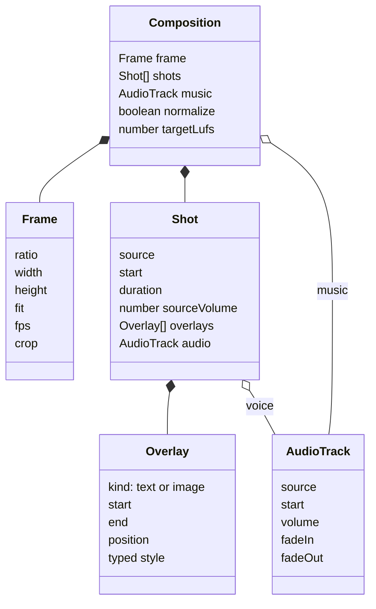

# Architecture

The server is intentionally a small synchronous pipeline. It exposes no network transport and persists no catalog or job database.

```mermaid
flowchart LR
  C[MCP client over stdio] --> Z[Strict Zod schemas]
  Z --> L[Duration, size and shot limits]
  L --> W[Workspace path and link guard]
  W --> S[Private per-call snapshots]
  S --> A[Server-built argument arrays]
  A --> E[execFile: ffmpeg or ffprobe]
  E --> V[Size and media verification]
  V --> P[Atomic no-overwrite publication]
  P --> D[(Workspace volume)]
```

## Trust boundary

Client JSON and every file already present in the workspace are untrusted. A request is serialized: one operation runs at a time. The server resolves each path component, rejects symbolic links, opens input files with `O_NOFOLLOW`, checks regular-file/link-count and size properties, then copies bytes into a private directory. ffmpeg only sees generated basenames in that directory and is given an explicit demuxer. Publication creates a hard link and never overwrites a destination.

| Layer | Control | Remaining consideration |
|---|---|---|
| MCP | stdio only; strict schemas; unknown fields rejected | The parent process controls who may invoke it |
| Paths | Relative restricted names; component checks; no symlinks; canonical root | Filesystem semantics vary; use a dedicated local volume |
| Input snapshot | `O_NOFOLLOW`, regular single-link file, bounded copy | A malicious media decoder may still exploit ffmpeg |
| Arguments | `execFile`; fixed executable; argument arrays; no raw flags | Filter graphs are generated by server code and need review when extended |
| Text | Private `textfile`; `expansion=none`; fixed basename | Font rendering depends on installed fonts |
| Resources | Duration, file, timeout, shot, thread and single-request limits | ffmpeg may use memory before a limit trips; container limits help |
| Output | `-fs`, polling kill, ffprobe duration check, no overwrite | Failed temporary jobs consume space only until cleanup |
| Errors | Generic MCP error; detailed diagnostics on server stderr | stderr can reveal media metadata to the operator |
| Container | No network, read-only root, dropped capabilities, PID/CPU/memory limits | Docker/host and ffmpeg must be patched |

## Composition

Shots are ordered and concatenated without transitions. A shot has one video source, a trim, zero or more timed overlays, and either source audio or a replacement audio track. Composition music is mixed below the concatenated shot audio. Geometry and frame rate are normalized before concatenation.

## Execution lifecycle

1. Parse strict JSON and apply configured ceilings.
2. Validate the requested output before expensive work.
3. Snapshot bounded inputs into a private job directory.
4. Build filter graphs exclusively from typed values and generated labels.
5. Run a fixed binary with `execFile`, no stdin and a hard timeout.
6. Monitor output size and kill on the configured ceiling.
7. Probe the artifact, check duration, then publish without overwriting.
8. Remove the private job directory on success or failure.
